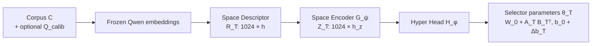
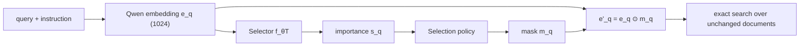

# Architecture

Source of truth for the system design. Rationale and full module specifications are in the
[implementation plan](plan/Qwen3_HyperDIME_Implementation_Plan.en.md); protocols and leakage rules
are in [protocols.md](protocols.md).

## Overview

Qwen3-Embedding-0.6B defines a fixed 1024-dimensional coordinate system. The system adapts *which*
coordinates a query uses to the retrieval environment it searches:

`T = (corpus C, query distribution Q, instruction I, frozen Qwen3-Embedding-0.6B)`

### Offline, once per environment

`θ_T` is persisted and reused for every query of the environment.

### Online, per query

`score(q, d) = (e'_q)ᵀ e_d`. Document embeddings are never modified.

## Components

| Component | Plan | Package | Implemented |
|---|---|---|---|
| Contracts, manifests, seeds | M0 | `hyperdime.contracts` | **implemented (F1)**: seven records in `schemas` (**F4**: + `SelectorProperties`, `TransferCell`, `GateDecision`, protocol `transfer`), `manifests.RunManifest`, `manifests.ArtifactWriter`, `seeding.seed_everything`, `config.load_config`, `hashing.config_hash` / `file_sha256` / `tree_sha256`; `hyperdime diagnose` |
| Loaders, splits, negatives | M1 | `hyperdime.data` | **F2**: `environments.ENVIRONMENTS` (pinned sources), `sources.HuggingFaceSource` / `IrDatasetsQuerySet`, `prepare.prepare_environment` / `load_environment` (test judgments only on request), `negatives.build_negative_pools` (ADR-0002); spike: `loaders.download_beir`, `loaders.read_beir`, `splits.split_ids`, `negatives.sample_hard_negatives` |
| Frozen Qwen embeddings | M2 | `hyperdime.embeddings` | `qwen.QwenEncoder` (local), `remote.VllmEncoder` (vLLM, shared with the `beir` project), **F2**: `encoders.encoder_settings` / `build_encoder`, `cache.embed_sharded` (resumable shards), `cache.publish_embeddings` / `load_embeddings`; spike: `cache.embed_cached` |
| Oracle targets `softmax(e_q ⊙ (p − n) / τ)` | M3 | `hyperdime.oracle` | `importance.oracle_scores`, `importance.oracle_importance`, `targets.aggregate_targets`, `targets.aggregate_pairs` |
| Learning-to-Select and other baselines | M3 | `hyperdime.baselines` | `learning_to_select.LinearSelector`, **F3**: `methods` (prefix, random, global importance, selector, oracle), **F4**: `methods.fixed_subset`, `methods.rank_importance` |
| Selector and meta-training | M3, M9 | `hyperdime.training` | `losses.selector_kl_loss`, `selector_trainer.train_selector` (device, anchor, patience), **F3**: `selection` (ADR-0002 grid and ADR-0003 candidates, validation-only choice), `inputs.load_inputs`; **F4**: `train-selector --recipe seeded` (F3's `wide-grid` cell, one run per seed); **F5**: `losses.masked_retrieval_loss`, `examples.retrieval_examples`, `retrieval_trainer.train_retrieval_selector` (relaxed top-k from `selection.relaxed.soft_top_k`, fixed or multi-budget), `retrieval_selection` (32-cell grid, validation mean over the 10%–90% budgets, soft-mass guard); `train-selector --recipe retrieval-grid \| retrieval-seeded` |
| Selector-shift analysis | M4 | `hyperdime.evaluation` | `selector_shift.overlap_at_k`, `selector_shift.js_divergence`, `selector_shift.spearman` (tied values share their average rank), `selector_shift.mean_importance`, `selector_shift.selection_frequency`, `selector_shift.half_split_profiles`, `selector_shift.split_half_spearman`, `selector_shift.profile_permutation_test`, **F4**: `selector_shift.kl_divergence`, `selector_shift.pair_measures`, `selector_shift.group_permutation_test` (G2 criterion 2), `transfer` (seed averaging, `degradation_tests`, `criterion_1`, `fit_gain`, `sample_battery`); `hyperdime transfer-matrix`, `hyperdime report E1`, `hyperdime decide G2`; **F5**: `hyperdime compare-selectors`, `hyperdime report S1`, `hyperdime decide S1` (experiment S1, ADR-0008) |
| Space Descriptor and Space Encoder | M5, M6 | `hyperdime.space` | `marginal.marginal_stats` (descriptor group A, P0), **F6**: `geometry.corpus_geometry` (streamed moments, covariance spectrum, participation ratio); `hyperdime probe-geometry`, `hyperdime report P1` |
| Low-rank selector and Hyper Head | M7, M8 | `hyperdime.hypernet` | — |
| Inference protocols P0–P2 | M10 | `hyperdime.cli`, `hyperdime.contracts` | — |
| Selection policies | M11 | `hyperdime.selection` | `topk.resolve_k`, `topk.top_k_mask`, `topk.apply_mask` |
| Retrieval | M12 | `hyperdime.retrieval` | `exact.exact_search`, `exact.exact_search_streamed` (memory-mapped corpora, F2), `scoring.rank_documents` (BEIR identical-ID exclusion) |
| Metrics and statistics | M12 | `hyperdime.evaluation` | `metrics.query_metrics`, `metrics.evaluate_run`, `statistics.paired_randomization_test`, `statistics.paired_bootstrap_ci`, `statistics.holm`, **F3**: `metrics.query_metrics` (AP, TREC relevance threshold), `runs.evaluate_methods` (all methods and budgets in one corpus pass) |
| F0 selector-shift spike (exploratory) | research R0 | `hyperdime.spike` | `python -m hyperdime.spike prepare\|train\|train-global\|analyze\|diagnose\|report\|all`; `diagnose` (research R20, not part of `all`) in `spike.diagnostics` |

File names inside each package follow plan §4.

## Contracts (F1)

Every module exchanges data through the records in `hyperdime.contracts` and writes artifacts
through one writer ([001 data model](../specs/001-m0-foundation/data-model.md)).

| Record | Version | Describes |
|---|---|---|
| `QueryRecord`, `DocumentRecord`, `QrelsRecord` | 1 | one query, document, or relevance judgment, with its environment and split |
| `EmbeddingArtifact` | 1 | a stored embedding matrix: row ids, width 1024, dtype, model revision, payload |
| `SpaceDescriptor` | 0, provisional until M5.5 | per-dimension statistics of an environment under a protocol |
| `SelectorCheckpoint` | 0, provisional until M7 | a trained or generated selector and its training manifest |
| `EvaluationResult` | 1 | exact-scoring metrics with per-query values |
| `RunManifest` | 1 | provenance: commit and dirty flag, config hash, dataset hash, model revision, seed, device, dtype, versions, UTC start and end, published files with SHA-256 |

- Records are frozen, reject unknown fields, and fail to load with a `ContractError` naming the
  record type and field; large arrays are `PayloadRef`s (relative path, SHA-256, `npy` or
  `safetensors`).
- An artifact is `artifacts/<kind>/<run_id>/`. `ArtifactWriter` refuses to run without a
  `RunManifest`, stages files in a hidden directory, writes `manifest.json` last, and publishes
  with one rename, so no visible artifact ever lacks its manifest and none is overwritten.
- Runs are described by Hydra config groups under `configs/`, validated into `RunConfig`, which
  enforces the frozen model, width 1024, and a pinned revision; `hyperdime diagnose` exercises the
  whole chain without loading the model.
- The F0 spike writes `RunManifest`s into its in-place directories without `ArtifactWriter`
  ([ADR-0005](decisions/ADR-0005-spike-manifests-without-artifact-writer.md)).

## Invariants

- Embeddings have shape `(N, 1024)`, use last-token pooling, and are L2-normalized in the main
  protocol. Queries carry the instruction prefix `Instruct: {instruction}\nQuery:{query}`;
  documents are encoded without one.
- The same text, config, and model revision produce the same vector within numerical tolerance.
- Selection is query-only: `apply_mask` zeroes coordinates and does not re-normalize.
- `k = 1024` is equivalent to full-dimensional scoring; ratios resolve to `floor(ρ · 1024)`.
- With zero modulation, the generated selector equals the base selector `θ_0`.
- Descriptors are invariant to the order of sampled documents and queries, and are **not**
  invariant to dimension identity: permuting dimensions permutes descriptor rows.
- Importance prediction is separate from the policy that decides how many dimensions to keep.

## Design choices

- **Environment-conditioned, not query-conditioned.** Unlike Hypencoder, which builds a network per
  query from query tokens, the Hyper Head reads an environment descriptor and produces one selector
  per environment. The query-conditioned design was tried and did not beat the linear selector
  (ADR-0001).
- **Residual low-rank generation.** Generating a full `1024 × 1024` matrix per environment is
  intractable. The Hyper Head produces `A_T`, `B_T` (rank 4–32), and `Δb_T`, with a near-zero
  initialization so that training starts from the global selector.
- **Low capacity first.** The Space Encoder starts as a per-dimension MLP plus a dimension-ID
  embedding. Inter-dimension Transformer blocks, contrast and redundancy features, and adaptive k
  are added only when an ablation shows the simpler version is limiting.
- **Gates before complexity.** No hypernetwork code is written before Gate G2 (selector shift)
  passes. A failed gate is recorded as evidence in an ADR.

## Gates

| Gate | Claim | Decided by |
|---|---|---|
| G1 | The Learning-to-Select baseline converges, masking is correct, exact retrieval ranks as expected | E0 |
| G2 | Selector shift is functional across environments (H1) | M4 transfer matrix and behavior analysis |
| G3 | The environment descriptor predicts selector properties above baseline (H2) | M5 probes |
| G4 | The hypernetwork narrows the global vs per-domain gap on unseen environments (H3) | E3 |
| G5 | Offline adaptation is amortizable and online overhead keeps the dimension-reduction benefit | E6 |
