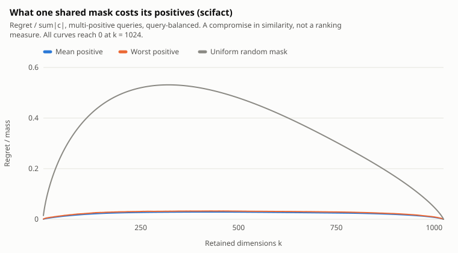
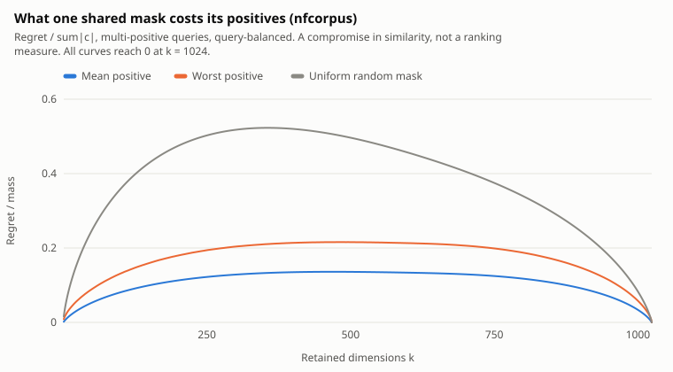
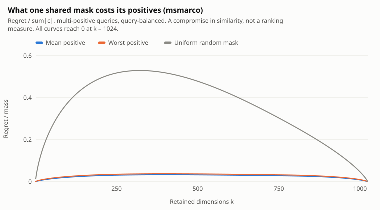
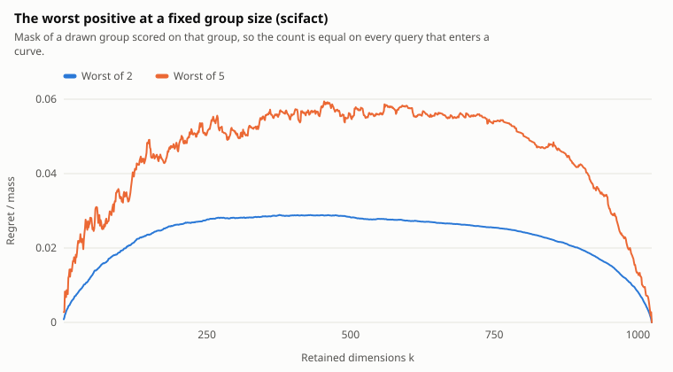
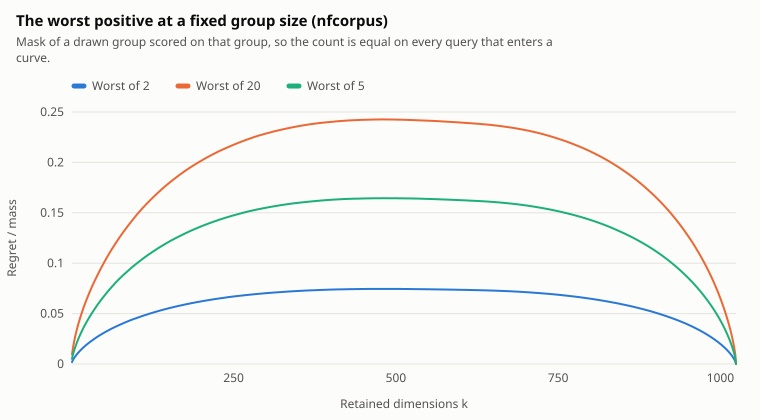
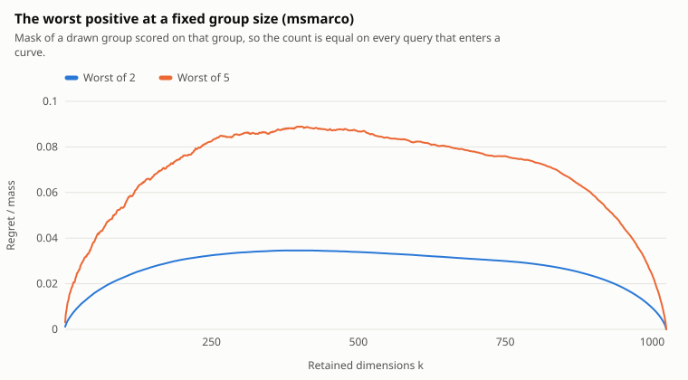
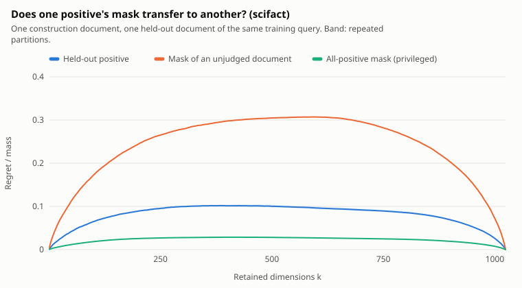
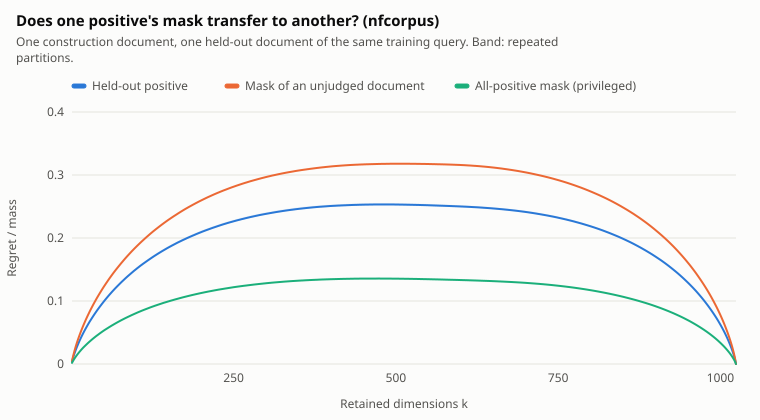
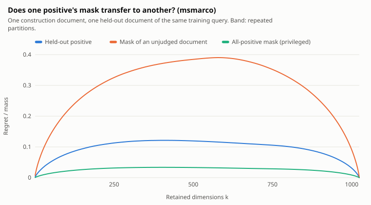

# P3 follow-up: what one shared mask costs a query's relevant documents

Exploratory and descriptive, on published F2 training queries and training judgments,
with frozen vectors at D = 1024. Stored documents are unchanged and masked queries are
not re-normalized. This is not selector training or a ranking evaluation. Regret
describes a compromise in similarity: high regret does not show retrieval damage or
rule out a better ranking mask, and low overlap with low regret is a valid outcome.
Held-out documents are documents of a training query, not validation or test queries,
so nothing here is evidence about unseen queries.

- Run `20261107T025534Z-d8bad5ff` (commit `a36dacd1dc70`, dirty `False`, device `cuda:0`)
- Pilot bound on queries: None; seed 0

## What the curves show

- **scifact, one shared mask.** Mean regret / mass peaks at 0.0286 at k = 418. On the decile grid: 102: 0.0187, 204: 0.0257, 307: 0.0279, 409: 0.0286, 512: 0.0281, 614: 0.0268, 716: 0.0253, 819: 0.0232, 921: 0.0176, 1024: 0.0000. A uniform random mask: 102: 0.3840, 204: 0.4980, 307: 0.5309, 409: 0.5173, 512: 0.4731, 614: 0.4092, 716: 0.3321, 819: 0.2457, 921: 0.1473, 1024: 0.0000. Mean overlap: 102: 0.707, 204: 0.741, 307: 0.766, 409: 0.788, 512: 0.802, 614: 0.817, 716: 0.828, 819: 0.861, 921: 0.923, 1024: 1.000.
- **scifact, worst of 2 positives (69 queries).** Worst regret / mass: 102: 0.0193, 204: 0.0264, 307: 0.0281, 409: 0.0288, 512: 0.0279, 614: 0.0273, 716: 0.0259, 819: 0.0236, 921: 0.0181, 1024: 0.0000. Its share of the group's regret, where an even split would be 1/m: 102: 0.562, 204: 0.553, 307: 0.546, 409: 0.549, 512: 0.536, 614: 0.540, 716: 0.543, 819: 0.548, 921: 0.558, 1024: n/a. This measures the single worst positive, and it does not describe the rest of the regret distribution.
- **scifact, worst of 5 positives (1 queries).** Worst regret / mass: 102: 0.0325, 204: 0.0491, 307: 0.0498, 409: 0.0546, 512: 0.0572, 614: 0.0552, 716: 0.0555, 819: 0.0483, 921: 0.0373, 1024: 0.0000. Its share of the group's regret, where an even split would be 1/m: 102: 0.230, 204: 0.234, 307: 0.215, 409: 0.220, 512: 0.229, 614: 0.233, 716: 0.255, 819: 0.244, 921: 0.243, 1024: n/a. This measures the single worst positive, and it does not describe the rest of the regret distribution.
- **scifact, transfer.** One positive's mask on another: 102: 0.0655, 204: 0.0897, 307: 0.0999, 409: 0.1015, 512: 0.0999, 614: 0.0956, 716: 0.0911, 819: 0.0837, 921: 0.0632, 1024: 0.0000. On the same queries, the privileged all-positive mask: 102: 0.0187, 204: 0.0257, 307: 0.0279, 409: 0.0287, 512: 0.0281, 614: 0.0269, 716: 0.0254, 819: 0.0232, 921: 0.0176, 1024: 0.0000. A mask of one unjudged document: 102: 0.1747, 204: 0.2465, 307: 0.2805, 409: 0.2984, 512: 0.3051, 614: 0.3066, 716: 0.2920, 819: 0.2543, 921: 0.1847, 1024: 0.0000.
- **scifact, small cohorts.** Read with care: 2-2 (6 queries), fixed 5 (1 queries).
- **nfcorpus, one shared mask.** Mean regret / mass peaks at 0.1360 at k = 468. On the decile grid: 102: 0.0819, 204: 0.1138, 307: 0.1292, 409: 0.1353, 512: 0.1357, 614: 0.1333, 716: 0.1280, 819: 0.1140, 921: 0.0837, 1024: 0.0000. A uniform random mask: 102: 0.3626, 204: 0.4774, 307: 0.5191, 409: 0.5189, 512: 0.4924, 614: 0.4499, 716: 0.3961, 819: 0.3245, 921: 0.2200, 1024: 0.0000. Mean overlap: 102: 0.471, 204: 0.521, 307: 0.560, 409: 0.592, 512: 0.621, 614: 0.647, 716: 0.707, 819: 0.794, 921: 0.886, 1024: 1.000.
- **nfcorpus, worst of 2 positives (2162 queries).** Worst regret / mass: 102: 0.0460, 204: 0.0626, 307: 0.0706, 409: 0.0740, 512: 0.0744, 614: 0.0734, 716: 0.0706, 819: 0.0628, 921: 0.0465, 1024: 0.0000. Its share of the group's regret, where an even split would be 1/m: 102: 0.554, 204: 0.542, 307: 0.537, 409: 0.536, 512: 0.536, 614: 0.537, 716: 0.538, 819: 0.540, 921: 0.547, 1024: n/a. This measures the single worst positive, and it does not describe the rest of the regret distribution.
- **nfcorpus, worst of 20 positives (1105 queries).** Worst regret / mass: 102: 0.1490, 204: 0.2031, 307: 0.2298, 409: 0.2407, 512: 0.2423, 614: 0.2389, 716: 0.2297, 819: 0.2045, 921: 0.1515, 1024: 0.0000. Its share of the group's regret, where an even split would be 1/m: 102: 0.077, 204: 0.076, 307: 0.076, 409: 0.076, 512: 0.076, 614: 0.076, 716: 0.076, 819: 0.076, 921: 0.077, 1024: n/a. This measures the single worst positive, and it does not describe the rest of the regret distribution.
- **nfcorpus, worst of 5 positives (1833 queries).** Worst regret / mass: 102: 0.1004, 204: 0.1375, 307: 0.1559, 409: 0.1633, 512: 0.1643, 614: 0.1621, 716: 0.1558, 819: 0.1386, 921: 0.1022, 1024: 0.0000. Its share of the group's regret, where an even split would be 1/m: 102: 0.277, 204: 0.274, 307: 0.273, 409: 0.273, 512: 0.274, 614: 0.275, 716: 0.275, 819: 0.275, 921: 0.277, 1024: n/a. This measures the single worst positive, and it does not describe the rest of the regret distribution.
- **nfcorpus, transfer.** One positive's mask on another: 102: 0.1524, 204: 0.2109, 307: 0.2397, 409: 0.2514, 512: 0.2530, 614: 0.2493, 716: 0.2388, 819: 0.2119, 921: 0.1551, 1024: 0.0000. On the same queries, the privileged all-positive mask: 102: 0.0818, 204: 0.1135, 307: 0.1289, 409: 0.1348, 512: 0.1353, 614: 0.1328, 716: 0.1276, 819: 0.1136, 921: 0.0834, 1024: 0.0000. A mask of one unjudged document: 102: 0.1882, 204: 0.2617, 307: 0.2985, 409: 0.3144, 512: 0.3179, 614: 0.3151, 716: 0.3007, 819: 0.2652, 921: 0.1933, 1024: 0.0000.
- **msmarco, one shared mask.** Mean regret / mass peaks at 0.0336 at k = 402. On the decile grid: 102: 0.0216, 204: 0.0295, 307: 0.0328, 409: 0.0336, 512: 0.0328, 614: 0.0312, 716: 0.0294, 819: 0.0270, 921: 0.0206, 1024: 0.0000. A uniform random mask: 102: 0.3807, 204: 0.4955, 307: 0.5292, 409: 0.5161, 512: 0.4723, 614: 0.4085, 716: 0.3313, 819: 0.2448, 921: 0.1465, 1024: 0.0000. Mean overlap: 102: 0.691, 204: 0.726, 307: 0.752, 409: 0.772, 512: 0.790, 614: 0.806, 716: 0.819, 819: 0.853, 921: 0.916, 1024: 1.000.
- **msmarco, worst of 2 positives (2321 queries).** Worst regret / mass: 102: 0.0230, 204: 0.0307, 307: 0.0338, 409: 0.0346, 512: 0.0338, 614: 0.0322, 716: 0.0305, 819: 0.0280, 921: 0.0215, 1024: 0.0000. Its share of the group's regret, where an even split would be 1/m: 102: 0.565, 204: 0.552, 307: 0.544, 409: 0.543, 512: 0.542, 614: 0.543, 716: 0.545, 819: 0.546, 921: 0.551, 1024: n/a. This measures the single worst positive, and it does not describe the rest of the regret distribution.
- **msmarco, worst of 5 positives (18 queries).** Worst regret / mass: 102: 0.0541, 204: 0.0763, 307: 0.0862, 409: 0.0886, 512: 0.0866, 614: 0.0818, 716: 0.0765, 819: 0.0719, 921: 0.0534, 1024: 0.0000. Its share of the group's regret, where an even split would be 1/m: 102: 0.269, 204: 0.274, 307: 0.273, 409: 0.277, 512: 0.276, 614: 0.274, 716: 0.270, 819: 0.277, 921: 0.267, 1024: n/a. This measures the single worst positive, and it does not describe the rest of the regret distribution.
- **msmarco, transfer.** One positive's mask on another: 102: 0.0779, 204: 0.1060, 307: 0.1183, 409: 0.1214, 512: 0.1190, 614: 0.1139, 716: 0.1078, 819: 0.0986, 921: 0.0747, 1024: 0.0000. On the same queries, the privileged all-positive mask: 102: 0.0217, 204: 0.0295, 307: 0.0328, 409: 0.0336, 512: 0.0329, 614: 0.0313, 716: 0.0294, 819: 0.0270, 921: 0.0206, 1024: 0.0000. A mask of one unjudged document: 102: 0.2157, 204: 0.3011, 307: 0.3478, 409: 0.3727, 512: 0.3859, 614: 0.3886, 716: 0.3653, 819: 0.3154, 921: 0.2261, 1024: 0.0000.
- **msmarco, small cohorts.** Read with care: fixed 5 (18 queries).

A nonzero mean regret under the mean-optimal mask shows that no single mask reaches every
positive's optimum at that `k`. It does not show that the observed worst-positive regret
is irreducible, since a minimax mask could trade mean score for a better worst case.

These compare similarity at equal `k` and describe training pairs. They do not show a
mask harms retrieval, that no better ranking mask exists, or that an unseen query would
behave the same. Positives also lie closer to one another than unjudged documents, so a
smaller regret than the unjudged-document mask is not attributed to relevance itself.

## Definitions

`c_ij = q_j * d_ij`. A positive's optimum at `k` is the sum of its own `k` largest
`c_ij`. The shared mask is the top `k` of the weighted mean of a group's
contributions, with the repository's relevance weights (`2^grade - 1`, normalized;
every grade here is 1). It exactly maximizes the weighted mean score at that `k`, and
no single positive's score. Regret is a positive's optimum minus its score under the
mask at the same `k`; dividing by `sum|c_ij|` gives regret / mass, undefined for a
document with no mass. Masks can differ and tie in score, so regret is compared, and
overlap reported apart.

A query counts once in query-balanced summaries. Pair-weighted curves are labeled and
separate. Intervals are 95% over queries, pointwise and exploratory: neighboring `k`
are strongly dependent, so they are not independent confirmations. Repeat ranges and
between-partition spread show variation from partitions, a different thing from
sampling queries. No threshold for a small loss is applied.

## Coverage

- **scifact.** 69 multi-positive queries, 163 relevant pairs; 69 queries at 2 documents, 0 queries at 20 documents, 1 queries at 5 documents.
- **nfcorpus.** 2162 multi-positive queries, 100664 relevant pairs; 2162 queries at 2 documents, 1105 queries at 20 documents, 1833 queries at 5 documents.
- **msmarco.** 2321 multi-positive queries, 5054 relevant pairs; 2321 queries at 2 documents, 0 queries at 20 documents, 18 queries at 5 documents.

| environment | F2 cap on train and validation queries | training queries | with a positive | eligible multi-positive | selected | pairs | largest group | 2-5 | 6-20 | 21+ | grades | capped |
|---|---|---|---|---|---|---|---|---|---|---|---|---|
| scifact | none | 728 | 728 | 69 | 69 | 163 | 5 | 69 | 0 | 0 | 1 | no |
| nfcorpus | none | 2331 | 2331 | 2162 | 2162 | 100664 | 1363 | 399 | 688 | 1075 | 1 | no |
| msmarco | 50000 | 45000 | 45000 | 2321 | 2321 | 5054 | 7 | 2317 | 4 | 0 | 1 | no |

## The cost of one shared mask

Every `k` is in `tables/curves-<environment>.csv`; checkpoint rows sample those
curves. The uniform random mask's regret is an exact expectation, a reference with no
structure.

| environment | positives | k | queries | mean regret / mass (95% over queries) | worst positive / mass | p90 positive / mass | spread within query | mean raw regret | uniform random mask / mass | overlap with own mask | worst positive's share of regret | worst fifth's share |
|---|---|---|---|---|---|---|---|---|---|---|---|---|
| scifact | multi | 102 | 69 | 0.0187 (0.0166 to 0.0209) | 0.0220 (p10 0.0104, p50 0.0194, p90 0.0362) | 0.0213 | 0.0029 | 0.0145 | 0.3840 | 0.707 | 0.518 | 0.518 |
| scifact | multi | 204 | 69 | 0.0257 (0.0229 to 0.0285) | 0.0296 (p10 0.0150, p50 0.0248, p90 0.0485) | 0.0288 | 0.0036 | 0.0200 | 0.4980 | 0.741 | 0.508 | 0.508 |
| scifact | multi | 307 | 69 | 0.0279 (0.0248 to 0.0309) | 0.0315 (p10 0.0156, p50 0.0276, p90 0.0523) | 0.0308 | 0.0033 | 0.0217 | 0.5309 | 0.766 | 0.501 | 0.501 |
| scifact | multi | 409 | 69 | 0.0286 (0.0254 to 0.0318) | 0.0325 (p10 0.0159, p50 0.0279, p90 0.0550) | 0.0317 | 0.0035 | 0.0222 | 0.5173 | 0.788 | 0.502 | 0.502 |
| scifact | multi | 512 | 69 | 0.0281 (0.0250 to 0.0312) | 0.0318 (p10 0.0154, p50 0.0276, p90 0.0541) | 0.0310 | 0.0033 | 0.0218 | 0.4731 | 0.802 | 0.493 | 0.493 |
| scifact | multi | 614 | 69 | 0.0268 (0.0239 to 0.0298) | 0.0308 (p10 0.0146, p50 0.0281, p90 0.0552) | 0.0299 | 0.0035 | 0.0208 | 0.4092 | 0.817 | 0.497 | 0.497 |
| scifact | multi | 716 | 69 | 0.0253 (0.0225 to 0.0282) | 0.0294 (p10 0.0140, p50 0.0257, p90 0.0525) | 0.0285 | 0.0035 | 0.0196 | 0.3321 | 0.828 | 0.500 | 0.500 |
| scifact | multi | 819 | 69 | 0.0232 (0.0206 to 0.0258) | 0.0266 (p10 0.0143, p50 0.0227, p90 0.0450) | 0.0259 | 0.0031 | 0.0180 | 0.2457 | 0.861 | 0.503 | 0.503 |
| scifact | multi | 921 | 69 | 0.0176 (0.0157 to 0.0195) | 0.0203 (p10 0.0105, p50 0.0166, p90 0.0329) | 0.0197 | 0.0025 | 0.0137 | 0.1473 | 0.923 | 0.511 | 0.511 |
| scifact | multi | 1024 | 69 | 0.0000 (0.0000 to 0.0000) | 0.0000 (p10 0.0000, p50 0.0000, p90 0.0000) | 0.0000 | 0.0000 | 0.0000 | 0.0000 | 1.000 | n/a | n/a |
| scifact | 2-5 | 102 | 69 | 0.0187 (0.0166 to 0.0209) | 0.0220 (p10 0.0104, p50 0.0194, p90 0.0362) | 0.0213 | 0.0029 | 0.0145 | 0.3840 | 0.707 | 0.518 | 0.518 |
| scifact | 2-5 | 204 | 69 | 0.0257 (0.0229 to 0.0285) | 0.0296 (p10 0.0150, p50 0.0248, p90 0.0485) | 0.0288 | 0.0036 | 0.0200 | 0.4980 | 0.741 | 0.508 | 0.508 |
| scifact | 2-5 | 307 | 69 | 0.0279 (0.0248 to 0.0309) | 0.0315 (p10 0.0156, p50 0.0276, p90 0.0523) | 0.0308 | 0.0033 | 0.0217 | 0.5309 | 0.766 | 0.501 | 0.501 |
| scifact | 2-5 | 409 | 69 | 0.0286 (0.0254 to 0.0318) | 0.0325 (p10 0.0159, p50 0.0279, p90 0.0550) | 0.0317 | 0.0035 | 0.0222 | 0.5173 | 0.788 | 0.502 | 0.502 |
| scifact | 2-5 | 512 | 69 | 0.0281 (0.0250 to 0.0312) | 0.0318 (p10 0.0154, p50 0.0276, p90 0.0541) | 0.0310 | 0.0033 | 0.0218 | 0.4731 | 0.802 | 0.493 | 0.493 |
| scifact | 2-5 | 614 | 69 | 0.0268 (0.0239 to 0.0298) | 0.0308 (p10 0.0146, p50 0.0281, p90 0.0552) | 0.0299 | 0.0035 | 0.0208 | 0.4092 | 0.817 | 0.497 | 0.497 |
| scifact | 2-5 | 716 | 69 | 0.0253 (0.0225 to 0.0282) | 0.0294 (p10 0.0140, p50 0.0257, p90 0.0525) | 0.0285 | 0.0035 | 0.0196 | 0.3321 | 0.828 | 0.500 | 0.500 |
| scifact | 2-5 | 819 | 69 | 0.0232 (0.0206 to 0.0258) | 0.0266 (p10 0.0143, p50 0.0227, p90 0.0450) | 0.0259 | 0.0031 | 0.0180 | 0.2457 | 0.861 | 0.503 | 0.503 |
| scifact | 2-5 | 921 | 69 | 0.0176 (0.0157 to 0.0195) | 0.0203 (p10 0.0105, p50 0.0166, p90 0.0329) | 0.0197 | 0.0025 | 0.0137 | 0.1473 | 0.923 | 0.511 | 0.511 |
| scifact | 2-5 | 1024 | 69 | 0.0000 (0.0000 to 0.0000) | 0.0000 (p10 0.0000, p50 0.0000, p90 0.0000) | 0.0000 | 0.0000 | 0.0000 | 0.0000 | 1.000 | n/a | n/a |
| nfcorpus | multi | 102 | 2162 | 0.0819 (0.0809 to 0.0829) | 0.1329 (p10 0.0613, p50 0.1415, p90 0.1863) | 0.1098 | 0.0220 | 0.0555 | 0.3626 | 0.471 | 0.146 | 0.331 |
| nfcorpus | multi | 204 | 2162 | 0.1138 (0.1124 to 0.1152) | 0.1811 (p10 0.0863, p50 0.1947, p90 0.2503) | 0.1513 | 0.0294 | 0.0772 | 0.4774 | 0.521 | 0.144 | 0.328 |
| nfcorpus | multi | 307 | 2162 | 0.1292 (0.1276 to 0.1308) | 0.2049 (p10 0.0967, p50 0.2208, p90 0.2817) | 0.1717 | 0.0332 | 0.0876 | 0.5191 | 0.560 | 0.144 | 0.327 |
| nfcorpus | multi | 409 | 2162 | 0.1353 (0.1336 to 0.1370) | 0.2143 (p10 0.1007, p50 0.2313, p90 0.2959) | 0.1799 | 0.0348 | 0.0917 | 0.5189 | 0.592 | 0.144 | 0.327 |
| nfcorpus | multi | 512 | 2162 | 0.1357 (0.1340 to 0.1374) | 0.2156 (p10 0.1010, p50 0.2318, p90 0.2967) | 0.1809 | 0.0352 | 0.0920 | 0.4924 | 0.621 | 0.144 | 0.328 |
| nfcorpus | multi | 614 | 2162 | 0.1333 (0.1316 to 0.1350) | 0.2126 (p10 0.0987, p50 0.2283, p90 0.2924) | 0.1783 | 0.0350 | 0.0903 | 0.4499 | 0.647 | 0.144 | 0.329 |
| nfcorpus | multi | 716 | 2162 | 0.1280 (0.1264 to 0.1296) | 0.2043 (p10 0.0962, p50 0.2201, p90 0.2817) | 0.1713 | 0.0338 | 0.0867 | 0.3961 | 0.707 | 0.145 | 0.330 |
| nfcorpus | multi | 819 | 2162 | 0.1140 (0.1126 to 0.1155) | 0.1819 (p10 0.0874, p50 0.1954, p90 0.2505) | 0.1524 | 0.0300 | 0.0773 | 0.3245 | 0.794 | 0.145 | 0.330 |
| nfcorpus | multi | 921 | 2162 | 0.0837 (0.0827 to 0.0848) | 0.1348 (p10 0.0636, p50 0.1447, p90 0.1865) | 0.1124 | 0.0225 | 0.0568 | 0.2200 | 0.886 | 0.146 | 0.332 |
| nfcorpus | multi | 1024 | 2162 | 0.0000 (0.0000 to 0.0000) | 0.0000 (p10 0.0000, p50 0.0000, p90 0.0000) | 0.0000 | 0.0000 | 0.0000 | 0.0000 | 1.000 | n/a | n/a |
| nfcorpus | 2-5 | 102 | 399 | 0.0472 (0.0454 to 0.0490) | 0.0620 (p10 0.0273, p50 0.0582, p90 0.1009) | 0.0581 | 0.0106 | 0.0322 | 0.3636 | 0.569 | 0.426 | 0.426 |
| nfcorpus | 2-5 | 204 | 399 | 0.0658 (0.0633 to 0.0682) | 0.0859 (p10 0.0372, p50 0.0829, p90 0.1383) | 0.0805 | 0.0143 | 0.0449 | 0.4785 | 0.615 | 0.423 | 0.423 |
| nfcorpus | 2-5 | 307 | 399 | 0.0746 (0.0718 to 0.0774) | 0.0967 (p10 0.0427, p50 0.0923, p90 0.1562) | 0.0910 | 0.0158 | 0.0509 | 0.5197 | 0.649 | 0.421 | 0.421 |
| nfcorpus | 2-5 | 409 | 399 | 0.0782 (0.0753 to 0.0812) | 0.1019 (p10 0.0426, p50 0.0962, p90 0.1702) | 0.0956 | 0.0167 | 0.0533 | 0.5187 | 0.677 | 0.421 | 0.421 |
| nfcorpus | 2-5 | 512 | 399 | 0.0785 (0.0755 to 0.0815) | 0.1021 (p10 0.0435, p50 0.0973, p90 0.1680) | 0.0959 | 0.0167 | 0.0535 | 0.4911 | 0.702 | 0.421 | 0.421 |
| nfcorpus | 2-5 | 614 | 399 | 0.0773 (0.0743 to 0.0802) | 0.1006 (p10 0.0436, p50 0.0962, p90 0.1641) | 0.0944 | 0.0165 | 0.0526 | 0.4474 | 0.726 | 0.421 | 0.421 |
| nfcorpus | 2-5 | 716 | 399 | 0.0741 (0.0713 to 0.0770) | 0.0967 (p10 0.0402, p50 0.0933, p90 0.1563) | 0.0907 | 0.0160 | 0.0505 | 0.3922 | 0.777 | 0.422 | 0.422 |
| nfcorpus | 2-5 | 819 | 399 | 0.0659 (0.0634 to 0.0684) | 0.0865 (p10 0.0358, p50 0.0828, p90 0.1400) | 0.0810 | 0.0146 | 0.0449 | 0.3196 | 0.842 | 0.425 | 0.425 |
| nfcorpus | 2-5 | 921 | 399 | 0.0482 (0.0463 to 0.0500) | 0.0638 (p10 0.0264, p50 0.0614, p90 0.1045) | 0.0596 | 0.0111 | 0.0328 | 0.2156 | 0.913 | 0.429 | 0.429 |
| nfcorpus | 2-5 | 1024 | 399 | 0.0000 (0.0000 to 0.0000) | 0.0000 (p10 0.0000, p50 0.0000, p90 0.0000) | 0.0000 | 0.0000 | 0.0000 | 0.0000 | 1.000 | n/a | n/a |
| nfcorpus | 21+ | 102 | 1075 | 0.0990 (0.0983 to 0.0997) | 0.1661 (p10 0.1380, p50 0.1638, p90 0.1969) | 0.1330 | 0.0256 | 0.0670 | 0.3624 | 0.428 | 0.038 | 0.287 |
| nfcorpus | 21+ | 204 | 1075 | 0.1375 (0.1365 to 0.1385) | 0.2250 (p10 0.1895, p50 0.2229, p90 0.2638) | 0.1830 | 0.0341 | 0.0931 | 0.4772 | 0.479 | 0.038 | 0.283 |
| nfcorpus | 21+ | 307 | 1075 | 0.1560 (0.1548 to 0.1572) | 0.2540 (p10 0.2154, p50 0.2527, p90 0.2970) | 0.2075 | 0.0385 | 0.1056 | 0.5190 | 0.520 | 0.038 | 0.283 |
| nfcorpus | 21+ | 409 | 1075 | 0.1633 (0.1620 to 0.1645) | 0.2656 (p10 0.2260, p50 0.2641, p90 0.3090) | 0.2176 | 0.0404 | 0.1105 | 0.5191 | 0.554 | 0.038 | 0.284 |
| nfcorpus | 21+ | 512 | 1075 | 0.1638 (0.1625 to 0.1651) | 0.2672 (p10 0.2264, p50 0.2657, p90 0.3123) | 0.2189 | 0.0410 | 0.1108 | 0.4928 | 0.584 | 0.038 | 0.285 |
| nfcorpus | 21+ | 614 | 1075 | 0.1607 (0.1594 to 0.1620) | 0.2634 (p10 0.2234, p50 0.2619, p90 0.3078) | 0.2159 | 0.0408 | 0.1087 | 0.4506 | 0.611 | 0.038 | 0.286 |
| nfcorpus | 21+ | 716 | 1075 | 0.1544 (0.1532 to 0.1557) | 0.2533 (p10 0.2153, p50 0.2516, p90 0.2963) | 0.2075 | 0.0394 | 0.1044 | 0.3972 | 0.675 | 0.038 | 0.286 |
| nfcorpus | 21+ | 819 | 1075 | 0.1377 (0.1366 to 0.1388) | 0.2257 (p10 0.1911, p50 0.2242, p90 0.2624) | 0.1844 | 0.0348 | 0.0931 | 0.3258 | 0.770 | 0.038 | 0.285 |
| nfcorpus | 21+ | 921 | 1075 | 0.1012 (0.1004 to 0.1020) | 0.1674 (p10 0.1401, p50 0.1661, p90 0.1964) | 0.1361 | 0.0260 | 0.0685 | 0.2212 | 0.874 | 0.038 | 0.287 |
| nfcorpus | 21+ | 1024 | 1075 | 0.0000 (0.0000 to 0.0000) | 0.0000 (p10 0.0000, p50 0.0000, p90 0.0000) | 0.0000 | 0.0000 | 0.0000 | 0.0000 | 1.000 | n/a | n/a |
| nfcorpus | 6-20 | 102 | 688 | 0.0753 (0.0742 to 0.0764) | 0.1220 (p10 0.0868, p50 0.1222, p90 0.1573) | 0.1036 | 0.0229 | 0.0511 | 0.3624 | 0.483 | 0.151 | 0.345 |
| nfcorpus | 6-20 | 204 | 688 | 0.1046 (0.1031 to 0.1062) | 0.1677 (p10 0.1183, p50 0.1690, p90 0.2143) | 0.1429 | 0.0309 | 0.0710 | 0.4770 | 0.532 | 0.149 | 0.342 |
| nfcorpus | 6-20 | 307 | 688 | 0.1190 (0.1172 to 0.1207) | 0.1909 (p10 0.1354, p50 0.1926, p90 0.2408) | 0.1625 | 0.0351 | 0.0808 | 0.5188 | 0.570 | 0.149 | 0.342 |
| nfcorpus | 6-20 | 409 | 688 | 0.1246 (0.1228 to 0.1265) | 0.1993 (p10 0.1444, p50 0.2003, p90 0.2507) | 0.1698 | 0.0366 | 0.0846 | 0.5188 | 0.602 | 0.149 | 0.342 |
| nfcorpus | 6-20 | 512 | 688 | 0.1251 (0.1232 to 0.1269) | 0.2008 (p10 0.1419, p50 0.2020, p90 0.2534) | 0.1708 | 0.0371 | 0.0849 | 0.4925 | 0.631 | 0.150 | 0.343 |
| nfcorpus | 6-20 | 614 | 688 | 0.1229 (0.1211 to 0.1248) | 0.1980 (p10 0.1416, p50 0.1997, p90 0.2494) | 0.1683 | 0.0368 | 0.0834 | 0.4503 | 0.658 | 0.150 | 0.344 |
| nfcorpus | 6-20 | 716 | 688 | 0.1180 (0.1162 to 0.1198) | 0.1901 (p10 0.1353, p50 0.1923, p90 0.2398) | 0.1615 | 0.0353 | 0.0800 | 0.3968 | 0.719 | 0.150 | 0.344 |
| nfcorpus | 6-20 | 819 | 688 | 0.1050 (0.1034 to 0.1066) | 0.1688 (p10 0.1218, p50 0.1701, p90 0.2152) | 0.1438 | 0.0315 | 0.0713 | 0.3253 | 0.802 | 0.150 | 0.344 |
| nfcorpus | 6-20 | 921 | 688 | 0.0770 (0.0759 to 0.0782) | 0.1249 (p10 0.0897, p50 0.1258, p90 0.1586) | 0.1060 | 0.0236 | 0.0523 | 0.2208 | 0.891 | 0.152 | 0.347 |
| nfcorpus | 6-20 | 1024 | 688 | 0.0000 (0.0000 to 0.0000) | 0.0000 (p10 0.0000, p50 0.0000, p90 0.0000) | 0.0000 | 0.0000 | 0.0000 | 0.0000 | 1.000 | n/a | n/a |
| msmarco | multi | 102 | 2321 | 0.0216 (0.0212 to 0.0221) | 0.0252 (p10 0.0105, p50 0.0229, p90 0.0427) | 0.0245 | 0.0033 | 0.0168 | 0.3807 | 0.691 | 0.544 | 0.545 |
| msmarco | multi | 204 | 2321 | 0.0295 (0.0289 to 0.0301) | 0.0338 (p10 0.0141, p50 0.0307, p90 0.0573) | 0.0329 | 0.0038 | 0.0229 | 0.4955 | 0.726 | 0.532 | 0.532 |
| msmarco | multi | 307 | 2321 | 0.0328 (0.0321 to 0.0335) | 0.0372 (p10 0.0157, p50 0.0335, p90 0.0628) | 0.0362 | 0.0039 | 0.0254 | 0.5292 | 0.752 | 0.525 | 0.525 |
| msmarco | multi | 409 | 2321 | 0.0336 (0.0329 to 0.0343) | 0.0381 (p10 0.0161, p50 0.0346, p90 0.0650) | 0.0371 | 0.0040 | 0.0260 | 0.5161 | 0.772 | 0.524 | 0.524 |
| msmarco | multi | 512 | 2321 | 0.0328 (0.0322 to 0.0335) | 0.0373 (p10 0.0155, p50 0.0335, p90 0.0634) | 0.0363 | 0.0039 | 0.0254 | 0.4723 | 0.790 | 0.523 | 0.523 |
| msmarco | multi | 614 | 2321 | 0.0312 (0.0306 to 0.0319) | 0.0356 (p10 0.0146, p50 0.0319, p90 0.0616) | 0.0346 | 0.0038 | 0.0242 | 0.4085 | 0.806 | 0.524 | 0.524 |
| msmarco | multi | 716 | 2321 | 0.0294 (0.0287 to 0.0300) | 0.0337 (p10 0.0130, p50 0.0299, p90 0.0598) | 0.0327 | 0.0038 | 0.0227 | 0.3313 | 0.819 | 0.526 | 0.526 |
| msmarco | multi | 819 | 2321 | 0.0270 (0.0264 to 0.0275) | 0.0309 (p10 0.0116, p50 0.0277, p90 0.0543) | 0.0300 | 0.0035 | 0.0208 | 0.2448 | 0.853 | 0.527 | 0.527 |
| msmarco | multi | 921 | 2321 | 0.0206 (0.0202 to 0.0210) | 0.0237 (p10 0.0094, p50 0.0212, p90 0.0412) | 0.0230 | 0.0028 | 0.0159 | 0.1465 | 0.916 | 0.531 | 0.531 |
| msmarco | multi | 1024 | 2321 | 0.0000 (0.0000 to 0.0000) | 0.0000 (p10 0.0000, p50 0.0000, p90 0.0000) | 0.0000 | 0.0000 | 0.0000 | 0.0000 | 1.000 | n/a | n/a |
| msmarco | 2-5 | 102 | 2317 | 0.0216 (0.0212 to 0.0220) | 0.0251 (p10 0.0105, p50 0.0229, p90 0.0426) | 0.0244 | 0.0032 | 0.0167 | 0.3807 | 0.691 | 0.545 | 0.545 |
| msmarco | 2-5 | 204 | 2317 | 0.0295 (0.0289 to 0.0301) | 0.0337 (p10 0.0141, p50 0.0307, p90 0.0568) | 0.0328 | 0.0038 | 0.0229 | 0.4955 | 0.727 | 0.533 | 0.533 |
| msmarco | 2-5 | 307 | 2317 | 0.0327 (0.0321 to 0.0334) | 0.0371 (p10 0.0157, p50 0.0335, p90 0.0626) | 0.0361 | 0.0039 | 0.0254 | 0.5292 | 0.752 | 0.525 | 0.525 |
| msmarco | 2-5 | 409 | 2317 | 0.0335 (0.0328 to 0.0342) | 0.0380 (p10 0.0161, p50 0.0345, p90 0.0644) | 0.0370 | 0.0040 | 0.0260 | 0.5161 | 0.773 | 0.525 | 0.525 |
| msmarco | 2-5 | 512 | 2317 | 0.0328 (0.0321 to 0.0334) | 0.0372 (p10 0.0155, p50 0.0334, p90 0.0633) | 0.0362 | 0.0039 | 0.0254 | 0.4723 | 0.790 | 0.523 | 0.523 |
| msmarco | 2-5 | 614 | 2317 | 0.0312 (0.0305 to 0.0318) | 0.0355 (p10 0.0146, p50 0.0318, p90 0.0614) | 0.0345 | 0.0038 | 0.0241 | 0.4084 | 0.806 | 0.525 | 0.525 |
| msmarco | 2-5 | 716 | 2317 | 0.0293 (0.0287 to 0.0300) | 0.0336 (p10 0.0130, p50 0.0299, p90 0.0594) | 0.0327 | 0.0038 | 0.0226 | 0.3313 | 0.819 | 0.527 | 0.527 |
| msmarco | 2-5 | 819 | 2317 | 0.0269 (0.0263 to 0.0275) | 0.0308 (p10 0.0116, p50 0.0277, p90 0.0541) | 0.0299 | 0.0035 | 0.0208 | 0.2447 | 0.853 | 0.527 | 0.527 |
| msmarco | 2-5 | 921 | 2317 | 0.0205 (0.0201 to 0.0210) | 0.0236 (p10 0.0094, p50 0.0212, p90 0.0411) | 0.0229 | 0.0027 | 0.0159 | 0.1465 | 0.916 | 0.532 | 0.532 |
| msmarco | 2-5 | 1024 | 2317 | 0.0000 (0.0000 to 0.0000) | 0.0000 (p10 0.0000, p50 0.0000, p90 0.0000) | 0.0000 | 0.0000 | 0.0000 | 0.0000 | 1.000 | n/a | n/a |
| msmarco | 6-20 | 102 | 4 | 0.0501 (0.0423 to 0.0579) | 0.0690 (p10 0.0508, p50 0.0735, p90 0.0836) | 0.0614 | 0.0107 | 0.0377 | 0.3894 | 0.549 | 0.223 | 0.394 |
| msmarco | 6-20 | 204 | 4 | 0.0677 (0.0595 to 0.0758) | 0.0892 (p10 0.0765, p50 0.0914, p90 0.1000) | 0.0807 | 0.0121 | 0.0508 | 0.5024 | 0.600 | 0.213 | 0.382 |
| msmarco | 6-20 | 307 | 4 | 0.0764 (0.0661 to 0.0867) | 0.0969 (p10 0.0797, p50 0.1045, p90 0.1080) | 0.0938 | 0.0149 | 0.0573 | 0.5372 | 0.641 | 0.204 | 0.392 |
| msmarco | 6-20 | 409 | 4 | 0.0776 (0.0675 to 0.0876) | 0.1002 (p10 0.0839, p50 0.1081, p90 0.1101) | 0.0957 | 0.0153 | 0.0582 | 0.5243 | 0.669 | 0.208 | 0.394 |
| msmarco | 6-20 | 512 | 4 | 0.0769 (0.0676 to 0.0862) | 0.0953 (p10 0.0787, p50 0.0997, p90 0.1083) | 0.0925 | 0.0138 | 0.0576 | 0.4813 | 0.686 | 0.199 | 0.384 |
| msmarco | 6-20 | 614 | 4 | 0.0738 (0.0639 to 0.0836) | 0.0928 (p10 0.0765, p50 0.0991, p90 0.1040) | 0.0899 | 0.0148 | 0.0553 | 0.4188 | 0.702 | 0.202 | 0.388 |
| msmarco | 6-20 | 716 | 4 | 0.0699 (0.0598 to 0.0799) | 0.0886 (p10 0.0738, p50 0.0960, p90 0.0975) | 0.0852 | 0.0140 | 0.0523 | 0.3445 | 0.716 | 0.204 | 0.389 |
| msmarco | 6-20 | 819 | 4 | 0.0644 (0.0555 to 0.0733) | 0.0817 (p10 0.0667, p50 0.0870, p90 0.0925) | 0.0779 | 0.0128 | 0.0482 | 0.2610 | 0.785 | 0.205 | 0.386 |
| msmarco | 6-20 | 921 | 4 | 0.0491 (0.0425 to 0.0557) | 0.0634 (p10 0.0518, p50 0.0690, p90 0.0705) | 0.0595 | 0.0092 | 0.0368 | 0.1615 | 0.878 | 0.208 | 0.387 |
| msmarco | 6-20 | 1024 | 4 | 0.0000 (0.0000 to 0.0000) | 0.0000 (p10 0.0000, p50 0.0000, p90 0.0000) | 0.0000 | 0.0000 | 0.0000 | 0.0000 | 1.000 | n/a | n/a |

## The worst positive at a matched count

A group's worst depends on the group's size, so natural-group worst values cannot be
compared across strata. Here a mask is built on a drawn group of fixed size and scored
on it. Check the query counts: a small cohort describes itself, and queries with more
positives enter only the larger sizes. The mask is mean-optimal and not minimax. Another
mask could give up mean score for a better worst positive, so these values are not the
least worst-case regret one mask can reach. That was not computed here.

| environment | documents in the group | queries | k | mean regret / mass | worst of the group / mass | worst's share of regret (even would be 1/m) |
|---|---|---|---|---|---|---|
| scifact | 2 | 69 | 102 | 0.0171 (0.0151 to 0.0191) | 0.0193 (0.0171 to 0.0215) | 0.562 |
| scifact | 2 | 69 | 204 | 0.0237 (0.0210 to 0.0263) | 0.0264 (0.0233 to 0.0295) | 0.553 |
| scifact | 2 | 69 | 307 | 0.0257 (0.0228 to 0.0286) | 0.0281 (0.0249 to 0.0313) | 0.546 |
| scifact | 2 | 69 | 409 | 0.0263 (0.0232 to 0.0293) | 0.0288 (0.0255 to 0.0320) | 0.549 |
| scifact | 2 | 69 | 512 | 0.0258 (0.0229 to 0.0288) | 0.0279 (0.0248 to 0.0311) | 0.536 |
| scifact | 2 | 69 | 614 | 0.0247 (0.0219 to 0.0275) | 0.0273 (0.0240 to 0.0306) | 0.540 |
| scifact | 2 | 69 | 716 | 0.0234 (0.0206 to 0.0261) | 0.0259 (0.0227 to 0.0291) | 0.543 |
| scifact | 2 | 69 | 819 | 0.0214 (0.0189 to 0.0238) | 0.0236 (0.0209 to 0.0263) | 0.548 |
| scifact | 2 | 69 | 921 | 0.0162 (0.0144 to 0.0180) | 0.0181 (0.0161 to 0.0201) | 0.558 |
| scifact | 2 | 69 | 1024 | 0.0000 (0.0000 to 0.0000) | 0.0000 (0.0000 to 0.0000) | n/a |
| scifact | 20 | 0 | 102 | n/a | n/a | n/a |
| scifact | 20 | 0 | 204 | n/a | n/a | n/a |
| scifact | 20 | 0 | 307 | n/a | n/a | n/a |
| scifact | 20 | 0 | 409 | n/a | n/a | n/a |
| scifact | 20 | 0 | 512 | n/a | n/a | n/a |
| scifact | 20 | 0 | 614 | n/a | n/a | n/a |
| scifact | 20 | 0 | 716 | n/a | n/a | n/a |
| scifact | 20 | 0 | 819 | n/a | n/a | n/a |
| scifact | 20 | 0 | 921 | n/a | n/a | n/a |
| scifact | 20 | 0 | 1024 | n/a | n/a | n/a |
| scifact | 5 | 1 | 102 | 0.0273 (n=1) | 0.0325 (n=1) | 0.230 |
| scifact | 5 | 1 | 204 | 0.0419 (n=1) | 0.0491 (n=1) | 0.234 |
| scifact | 5 | 1 | 307 | 0.0457 (n=1) | 0.0498 (n=1) | 0.215 |
| scifact | 5 | 1 | 409 | 0.0484 (n=1) | 0.0546 (n=1) | 0.220 |
| scifact | 5 | 1 | 512 | 0.0487 (n=1) | 0.0572 (n=1) | 0.229 |
| scifact | 5 | 1 | 614 | 0.0462 (n=1) | 0.0552 (n=1) | 0.233 |
| scifact | 5 | 1 | 716 | 0.0425 (n=1) | 0.0555 (n=1) | 0.255 |
| scifact | 5 | 1 | 819 | 0.0387 (n=1) | 0.0483 (n=1) | 0.244 |
| scifact | 5 | 1 | 921 | 0.0298 (n=1) | 0.0373 (n=1) | 0.243 |
| scifact | 5 | 1 | 1024 | 0.0000 (n=1) | 0.0000 (n=1) | n/a |
| nfcorpus | 2 | 2162 | 102 | 0.0414 (0.0410 to 0.0418) | 0.0460 (0.0455 to 0.0464) | 0.554 |
| nfcorpus | 2 | 2162 | 204 | 0.0574 (0.0569 to 0.0580) | 0.0626 (0.0620 to 0.0632) | 0.542 |
| nfcorpus | 2 | 2162 | 307 | 0.0653 (0.0647 to 0.0659) | 0.0706 (0.0700 to 0.0712) | 0.537 |
| nfcorpus | 2 | 2162 | 409 | 0.0684 (0.0678 to 0.0690) | 0.0740 (0.0733 to 0.0746) | 0.536 |
| nfcorpus | 2 | 2162 | 512 | 0.0688 (0.0682 to 0.0694) | 0.0744 (0.0737 to 0.0751) | 0.536 |
| nfcorpus | 2 | 2162 | 614 | 0.0678 (0.0671 to 0.0684) | 0.0734 (0.0728 to 0.0741) | 0.537 |
| nfcorpus | 2 | 2162 | 716 | 0.0650 (0.0644 to 0.0656) | 0.0706 (0.0699 to 0.0712) | 0.538 |
| nfcorpus | 2 | 2162 | 819 | 0.0577 (0.0572 to 0.0583) | 0.0628 (0.0622 to 0.0634) | 0.540 |
| nfcorpus | 2 | 2162 | 921 | 0.0423 (0.0419 to 0.0426) | 0.0465 (0.0461 to 0.0469) | 0.547 |
| nfcorpus | 2 | 2162 | 1024 | 0.0000 (0.0000 to 0.0000) | 0.0000 (0.0000 to 0.0000) | n/a |
| nfcorpus | 20 | 1105 | 102 | 0.0952 (0.0945 to 0.0959) | 0.1490 (0.1482 to 0.1499) | 0.077 |
| nfcorpus | 20 | 1105 | 204 | 0.1322 (0.1312 to 0.1331) | 0.2031 (0.2020 to 0.2042) | 0.076 |
| nfcorpus | 20 | 1105 | 307 | 0.1500 (0.1489 to 0.1510) | 0.2298 (0.2286 to 0.2311) | 0.076 |
| nfcorpus | 20 | 1105 | 409 | 0.1569 (0.1558 to 0.1581) | 0.2407 (0.2395 to 0.2420) | 0.076 |
| nfcorpus | 20 | 1105 | 512 | 0.1574 (0.1563 to 0.1586) | 0.2423 (0.2410 to 0.2436) | 0.076 |
| nfcorpus | 20 | 1105 | 614 | 0.1545 (0.1534 to 0.1557) | 0.2389 (0.2376 to 0.2402) | 0.076 |
| nfcorpus | 20 | 1105 | 716 | 0.1485 (0.1474 to 0.1496) | 0.2297 (0.2285 to 0.2310) | 0.076 |
| nfcorpus | 20 | 1105 | 819 | 0.1323 (0.1314 to 0.1333) | 0.2045 (0.2034 to 0.2056) | 0.076 |
| nfcorpus | 20 | 1105 | 921 | 0.0973 (0.0966 to 0.0980) | 0.1515 (0.1506 to 0.1523) | 0.077 |
| nfcorpus | 20 | 1105 | 1024 | 0.0000 (0.0000 to 0.0000) | 0.0000 (0.0000 to 0.0000) | n/a |
| nfcorpus | 5 | 1833 | 102 | 0.0724 (0.0718 to 0.0729) | 0.1004 (0.0997 to 0.1010) | 0.277 |
| nfcorpus | 5 | 1833 | 204 | 0.1004 (0.0997 to 0.1012) | 0.1375 (0.1367 to 0.1384) | 0.274 |
| nfcorpus | 5 | 1833 | 307 | 0.1141 (0.1132 to 0.1150) | 0.1559 (0.1549 to 0.1569) | 0.273 |
| nfcorpus | 5 | 1833 | 409 | 0.1195 (0.1186 to 0.1204) | 0.1633 (0.1622 to 0.1643) | 0.273 |
| nfcorpus | 5 | 1833 | 512 | 0.1200 (0.1191 to 0.1210) | 0.1643 (0.1633 to 0.1654) | 0.274 |
| nfcorpus | 5 | 1833 | 614 | 0.1180 (0.1171 to 0.1190) | 0.1621 (0.1610 to 0.1632) | 0.275 |
| nfcorpus | 5 | 1833 | 716 | 0.1133 (0.1124 to 0.1142) | 0.1558 (0.1548 to 0.1568) | 0.275 |
| nfcorpus | 5 | 1833 | 819 | 0.1008 (0.1000 to 0.1016) | 0.1386 (0.1377 to 0.1395) | 0.275 |
| nfcorpus | 5 | 1833 | 921 | 0.0739 (0.0733 to 0.0745) | 0.1022 (0.1016 to 0.1029) | 0.277 |
| nfcorpus | 5 | 1833 | 1024 | 0.0000 (0.0000 to 0.0000) | 0.0000 (0.0000 to 0.0000) | n/a |
| msmarco | 2 | 2321 | 102 | 0.0204 (0.0200 to 0.0208) | 0.0230 (0.0225 to 0.0234) | 0.565 |
| msmarco | 2 | 2321 | 204 | 0.0279 (0.0273 to 0.0284) | 0.0307 (0.0302 to 0.0313) | 0.552 |
| msmarco | 2 | 2321 | 307 | 0.0309 (0.0303 to 0.0315) | 0.0338 (0.0331 to 0.0344) | 0.544 |
| msmarco | 2 | 2321 | 409 | 0.0317 (0.0311 to 0.0323) | 0.0346 (0.0339 to 0.0352) | 0.543 |
| msmarco | 2 | 2321 | 512 | 0.0310 (0.0304 to 0.0316) | 0.0338 (0.0331 to 0.0344) | 0.542 |
| msmarco | 2 | 2321 | 614 | 0.0295 (0.0289 to 0.0301) | 0.0322 (0.0316 to 0.0329) | 0.543 |
| msmarco | 2 | 2321 | 716 | 0.0277 (0.0272 to 0.0283) | 0.0305 (0.0299 to 0.0312) | 0.545 |
| msmarco | 2 | 2321 | 819 | 0.0254 (0.0249 to 0.0259) | 0.0280 (0.0274 to 0.0286) | 0.546 |
| msmarco | 2 | 2321 | 921 | 0.0194 (0.0190 to 0.0198) | 0.0215 (0.0211 to 0.0219) | 0.551 |
| msmarco | 2 | 2321 | 1024 | 0.0000 (0.0000 to 0.0000) | 0.0000 (0.0000 to 0.0000) | n/a |
| msmarco | 20 | 0 | 102 | n/a | n/a | n/a |
| msmarco | 20 | 0 | 204 | n/a | n/a | n/a |
| msmarco | 20 | 0 | 307 | n/a | n/a | n/a |
| msmarco | 20 | 0 | 409 | n/a | n/a | n/a |
| msmarco | 20 | 0 | 512 | n/a | n/a | n/a |
| msmarco | 20 | 0 | 614 | n/a | n/a | n/a |
| msmarco | 20 | 0 | 716 | n/a | n/a | n/a |
| msmarco | 20 | 0 | 819 | n/a | n/a | n/a |
| msmarco | 20 | 0 | 921 | n/a | n/a | n/a |
| msmarco | 20 | 0 | 1024 | n/a | n/a | n/a |
| msmarco | 5 | 18 | 102 | 0.0397 (0.0349 to 0.0446) | 0.0541 (0.0469 to 0.0613) | 0.269 |
| msmarco | 5 | 18 | 204 | 0.0552 (0.0491 to 0.0612) | 0.0763 (0.0667 to 0.0859) | 0.274 |
| msmarco | 5 | 18 | 307 | 0.0624 (0.0556 to 0.0692) | 0.0862 (0.0759 to 0.0964) | 0.273 |
| msmarco | 5 | 18 | 409 | 0.0636 (0.0563 to 0.0709) | 0.0886 (0.0778 to 0.0994) | 0.277 |
| msmarco | 5 | 18 | 512 | 0.0623 (0.0549 to 0.0697) | 0.0866 (0.0761 to 0.0971) | 0.276 |
| msmarco | 5 | 18 | 614 | 0.0592 (0.0521 to 0.0664) | 0.0818 (0.0717 to 0.0919) | 0.274 |
| msmarco | 5 | 18 | 716 | 0.0558 (0.0489 to 0.0627) | 0.0765 (0.0666 to 0.0864) | 0.270 |
| msmarco | 5 | 18 | 819 | 0.0514 (0.0450 to 0.0578) | 0.0719 (0.0624 to 0.0813) | 0.277 |
| msmarco | 5 | 18 | 921 | 0.0392 (0.0343 to 0.0440) | 0.0534 (0.0457 to 0.0611) | 0.267 |
| msmarco | 5 | 18 | 1024 | 0.0000 (0.0000 to 0.0000) | 0.0000 (0.0000 to 0.0000) | n/a |

## Transfer among positives

A mask is built only from construction documents, and their grades alone set its
weights. Held-out documents are scored against their own optima. Cells `a-a` use `a`
documents on each side, for queries with at least `2a` positives; `half` splits each
query's positives. Two positives give both directed transfers, and a split is
exhaustive when at most `partitions` exist; otherwise seeded draws. The all-positive
mask saw the held-out documents, and is a privileged reference only. A mask of
unjudged corpus documents, paired with the same query, shows what sharing the query
alone transfers; those documents are not negatives. Construction-side regret and
held-out regret use one mask, so their difference is what leaving a document out
costs. Any cell's scope is only the queries that enter it.

| environment | construct-evaluate documents | queries | partitions | k | held-out, construction mask | construction side, same mask | held-out minus construction | held-out, all-positive mask (privileged) | held-out, mask of unjudged documents | held-out minus unjudged | worst held-out | overlap with held-out | repeat range | between-partition SD within a query |
|---|---|---|---|---|---|---|---|---|---|---|---|---|---|---|
| scifact | 1-1 | 69 | 222 | 102 | 0.0655 (0.0585 to 0.0725) | 0.0000 (0.0000 to 0.0000) | 0.0655 (0.0585 to 0.0725) | 0.0187 (0.0166 to 0.0208) | 0.1747 (0.1690 to 0.1805) | -0.1092 (-0.1172 to -0.1013) | 0.0655 (0.0585 to 0.0725) | 0.511 | 0.0642 to 0.0666 | 0.0061 |
| scifact | 1-1 | 69 | 222 | 204 | 0.0897 (0.0803 to 0.0991) | 0.0000 (0.0000 to 0.0000) | 0.0897 (0.0803 to 0.0991) | 0.0257 (0.0230 to 0.0285) | 0.2465 (0.2392 to 0.2538) | -0.1567 (-0.1673 to -0.1461) | 0.0897 (0.0803 to 0.0991) | 0.558 | 0.0881 to 0.0916 | 0.0071 |
| scifact | 1-1 | 69 | 222 | 307 | 0.0999 (0.0893 to 0.1105) | 0.0000 (0.0000 to 0.0000) | 0.0999 (0.0893 to 0.1105) | 0.0279 (0.0248 to 0.0309) | 0.2805 (0.2727 to 0.2884) | -0.1807 (-0.1926 to -0.1688) | 0.0999 (0.0893 to 0.1105) | 0.597 | 0.0982 to 0.1020 | 0.0062 |
| scifact | 1-1 | 69 | 222 | 409 | 0.1015 (0.0904 to 0.1126) | 0.0000 (0.0000 to 0.0000) | 0.1015 (0.0904 to 0.1126) | 0.0287 (0.0255 to 0.0318) | 0.2984 (0.2898 to 0.3070) | -0.1969 (-0.2095 to -0.1844) | 0.1015 (0.0904 to 0.1126) | 0.632 | 0.0996 to 0.1046 | 0.0067 |
| scifact | 1-1 | 69 | 222 | 512 | 0.0999 (0.0888 to 0.1110) | 0.0000 (0.0000 to 0.0000) | 0.0999 (0.0888 to 0.1110) | 0.0281 (0.0251 to 0.0312) | 0.3051 (0.2964 to 0.3139) | -0.2052 (-0.2180 to -0.1924) | 0.0999 (0.0888 to 0.1110) | 0.656 | 0.0973 to 0.1031 | 0.0062 |
| scifact | 1-1 | 69 | 222 | 614 | 0.0956 (0.0848 to 0.1065) | 0.0000 (0.0000 to 0.0000) | 0.0956 (0.0848 to 0.1065) | 0.0269 (0.0239 to 0.0298) | 0.3066 (0.2976 to 0.3156) | -0.2110 (-0.2239 to -0.1980) | 0.0956 (0.0848 to 0.1065) | 0.679 | 0.0931 to 0.0988 | 0.0060 |
| scifact | 1-1 | 69 | 222 | 716 | 0.0911 (0.0806 to 0.1016) | 0.0000 (0.0000 to 0.0000) | 0.0911 (0.0806 to 0.1016) | 0.0254 (0.0225 to 0.0282) | 0.2920 (0.2836 to 0.3003) | -0.2009 (-0.2132 to -0.1886) | 0.0911 (0.0806 to 0.1016) | 0.701 | 0.0884 to 0.0941 | 0.0059 |
| scifact | 1-1 | 69 | 222 | 819 | 0.0837 (0.0743 to 0.0931) | 0.0000 (0.0000 to 0.0000) | 0.0837 (0.0743 to 0.0931) | 0.0232 (0.0207 to 0.0258) | 0.2543 (0.2469 to 0.2618) | -0.1706 (-0.1813 to -0.1600) | 0.0837 (0.0743 to 0.0931) | 0.765 | 0.0813 to 0.0866 | 0.0056 |
| scifact | 1-1 | 69 | 222 | 921 | 0.0632 (0.0563 to 0.0700) | 0.0000 (0.0000 to 0.0000) | 0.0632 (0.0563 to 0.0700) | 0.0176 (0.0157 to 0.0195) | 0.1847 (0.1790 to 0.1903) | -0.1215 (-0.1293 to -0.1136) | 0.0632 (0.0563 to 0.0700) | 0.868 | 0.0620 to 0.0648 | 0.0045 |
| scifact | 1-1 | 69 | 222 | 1024 | 0.0000 (0.0000 to 0.0000) | 0.0000 (0.0000 to 0.0000) | 0.0000 (0.0000 to 0.0000) | 0.0000 (0.0000 to 0.0000) | 0.0000 (0.0000 to 0.0000) | 0.0000 (0.0000 to 0.0000) | 0.0000 (0.0000 to 0.0000) | 1.000 | 0.0000 to 0.0000 | 0.0000 |
| scifact | 2-2 | 6 | 38 | 102 | 0.0455 (0.0241 to 0.0669) | 0.0147 (0.0076 to 0.0217) | 0.0309 (0.0165 to 0.0452) | 0.0228 (0.0116 to 0.0340) | 0.1652 (0.1452 to 0.1852) | -0.1197 (-0.1367 to -0.1027) | 0.0503 (0.0278 to 0.0729) | 0.587 | 0.0428 to 0.0490 | 0.0053 |
| scifact | 2-2 | 6 | 38 | 204 | 0.0625 (0.0350 to 0.0900) | 0.0207 (0.0121 to 0.0294) | 0.0417 (0.0229 to 0.0606) | 0.0314 (0.0180 to 0.0447) | 0.2264 (0.2058 to 0.2469) | -0.1639 (-0.1843 to -0.1435) | 0.0682 (0.0393 to 0.0971) | 0.623 | 0.0579 to 0.0652 | 0.0065 |
| scifact | 2-2 | 6 | 38 | 307 | 0.0669 (0.0366 to 0.0971) | 0.0222 (0.0123 to 0.0320) | 0.0447 (0.0243 to 0.0651) | 0.0342 (0.0187 to 0.0497) | 0.2579 (0.2308 to 0.2849) | -0.1910 (-0.2146 to -0.1674) | 0.0731 (0.0422 to 0.1039) | 0.661 | 0.0639 to 0.0702 | 0.0061 |
| scifact | 2-2 | 6 | 38 | 409 | 0.0696 (0.0383 to 0.1008) | 0.0227 (0.0125 to 0.0328) | 0.0469 (0.0257 to 0.0681) | 0.0353 (0.0195 to 0.0511) | 0.2727 (0.2461 to 0.2993) | -0.2031 (-0.2266 to -0.1796) | 0.0754 (0.0437 to 0.1070) | 0.681 | 0.0663 to 0.0731 | 0.0065 |
| scifact | 2-2 | 6 | 38 | 512 | 0.0683 (0.0373 to 0.0993) | 0.0220 (0.0121 to 0.0319) | 0.0463 (0.0252 to 0.0674) | 0.0344 (0.0188 to 0.0500) | 0.2787 (0.2539 to 0.3035) | -0.2104 (-0.2345 to -0.1863) | 0.0735 (0.0419 to 0.1050) | 0.698 | 0.0630 to 0.0716 | 0.0068 |
| scifact | 2-2 | 6 | 38 | 614 | 0.0636 (0.0332 to 0.0940) | 0.0205 (0.0108 to 0.0302) | 0.0431 (0.0224 to 0.0638) | 0.0318 (0.0167 to 0.0470) | 0.2805 (0.2579 to 0.3030) | -0.2168 (-0.2413 to -0.1924) | 0.0683 (0.0370 to 0.0996) | 0.722 | 0.0576 to 0.0668 | 0.0062 |
| scifact | 2-2 | 6 | 38 | 716 | 0.0593 (0.0304 to 0.0881) | 0.0191 (0.0097 to 0.0285) | 0.0401 (0.0207 to 0.0596) | 0.0297 (0.0152 to 0.0442) | 0.2699 (0.2489 to 0.2910) | -0.2107 (-0.2343 to -0.1871) | 0.0639 (0.0342 to 0.0937) | 0.741 | 0.0544 to 0.0619 | 0.0051 |
| scifact | 2-2 | 6 | 38 | 819 | 0.0539 (0.0274 to 0.0804) | 0.0175 (0.0089 to 0.0262) | 0.0364 (0.0185 to 0.0543) | 0.0272 (0.0138 to 0.0406) | 0.2341 (0.2146 to 0.2537) | -0.1802 (-0.2006 to -0.1599) | 0.0582 (0.0310 to 0.0855) | 0.788 | 0.0489 to 0.0561 | 0.0048 |
| scifact | 2-2 | 6 | 38 | 921 | 0.0412 (0.0206 to 0.0618) | 0.0135 (0.0071 to 0.0199) | 0.0277 (0.0135 to 0.0419) | 0.0208 (0.0108 to 0.0308) | 0.1685 (0.1539 to 0.1830) | -0.1273 (-0.1436 to -0.1109) | 0.0442 (0.0233 to 0.0650) | 0.880 | 0.0371 to 0.0427 | 0.0044 |
| scifact | 2-2 | 6 | 38 | 1024 | 0.0000 (0.0000 to 0.0000) | 0.0000 (0.0000 to 0.0000) | 0.0000 (0.0000 to 0.0000) | 0.0000 (0.0000 to 0.0000) | 0.0000 (0.0000 to 0.0000) | 0.0000 (0.0000 to 0.0000) | 0.0000 (0.0000 to 0.0000) | 1.000 | 0.0000 to 0.0000 | 0.0000 |
| scifact | half | 69 | 176 | 102 | 0.0644 (0.0573 to 0.0716) | 0.0013 (0.0001 to 0.0024) | 0.0632 (0.0559 to 0.0705) | 0.0187 (0.0166 to 0.0209) | 0.1675 (0.1622 to 0.1728) | -0.1031 (-0.1111 to -0.0950) | 0.0665 (0.0594 to 0.0736) | 0.515 | 0.0638 to 0.0652 | 0.0047 |
| scifact | half | 69 | 176 | 204 | 0.0883 (0.0787 to 0.0979) | 0.0018 (0.0002 to 0.0033) | 0.0865 (0.0767 to 0.0963) | 0.0257 (0.0229 to 0.0285) | 0.2354 (0.2284 to 0.2424) | -0.1471 (-0.1580 to -0.1362) | 0.0911 (0.0815 to 0.1007) | 0.562 | 0.0875 to 0.0887 | 0.0052 |
| scifact | half | 69 | 176 | 307 | 0.0983 (0.0876 to 0.1089) | 0.0019 (0.0002 to 0.0036) | 0.0963 (0.0854 to 0.1073) | 0.0279 (0.0248 to 0.0309) | 0.2721 (0.2642 to 0.2801) | -0.1739 (-0.1860 to -0.1618) | 0.1010 (0.0904 to 0.1117) | 0.600 | 0.0974 to 0.0991 | 0.0043 |
| scifact | half | 69 | 176 | 409 | 0.1001 (0.0889 to 0.1113) | 0.0020 (0.0003 to 0.0037) | 0.0981 (0.0867 to 0.1095) | 0.0286 (0.0254 to 0.0318) | 0.2888 (0.2802 to 0.2974) | -0.1887 (-0.2016 to -0.1759) | 0.1029 (0.0917 to 0.1141) | 0.635 | 0.0987 to 0.1014 | 0.0047 |
| scifact | half | 69 | 176 | 512 | 0.0986 (0.0874 to 0.1098) | 0.0019 (0.0002 to 0.0036) | 0.0967 (0.0853 to 0.1081) | 0.0281 (0.0250 to 0.0312) | 0.2969 (0.2879 to 0.3059) | -0.1983 (-0.2113 to -0.1853) | 0.1013 (0.0901 to 0.1125) | 0.658 | 0.0966 to 0.1000 | 0.0044 |
| scifact | half | 69 | 176 | 614 | 0.0942 (0.0833 to 0.1051) | 0.0018 (0.0002 to 0.0034) | 0.0924 (0.0813 to 0.1036) | 0.0268 (0.0239 to 0.0298) | 0.2983 (0.2893 to 0.3072) | -0.2041 (-0.2169 to -0.1912) | 0.0967 (0.0857 to 0.1077) | 0.681 | 0.0926 to 0.0955 | 0.0043 |
| scifact | half | 69 | 176 | 716 | 0.0897 (0.0791 to 0.1003) | 0.0017 (0.0002 to 0.0032) | 0.0880 (0.0772 to 0.0988) | 0.0253 (0.0225 to 0.0282) | 0.2850 (0.2767 to 0.2933) | -0.1953 (-0.2075 to -0.1831) | 0.0921 (0.0814 to 0.1028) | 0.703 | 0.0878 to 0.0911 | 0.0042 |
| scifact | half | 69 | 176 | 819 | 0.0824 (0.0729 to 0.0919) | 0.0015 (0.0002 to 0.0029) | 0.0809 (0.0712 to 0.0906) | 0.0232 (0.0206 to 0.0258) | 0.2468 (0.2395 to 0.2541) | -0.1644 (-0.1754 to -0.1534) | 0.0846 (0.0751 to 0.0942) | 0.766 | 0.0805 to 0.0838 | 0.0040 |
| scifact | half | 69 | 176 | 921 | 0.0622 (0.0553 to 0.0692) | 0.0012 (0.0001 to 0.0022) | 0.0610 (0.0539 to 0.0681) | 0.0176 (0.0157 to 0.0195) | 0.1777 (0.1723 to 0.1832) | -0.1155 (-0.1238 to -0.1073) | 0.0639 (0.0569 to 0.0709) | 0.869 | 0.0615 to 0.0626 | 0.0033 |
| scifact | half | 69 | 176 | 1024 | 0.0000 (0.0000 to 0.0000) | 0.0000 (0.0000 to 0.0000) | 0.0000 (0.0000 to 0.0000) | 0.0000 (0.0000 to 0.0000) | 0.0000 (0.0000 to 0.0000) | 0.0000 (0.0000 to 0.0000) | 0.0000 (0.0000 to 0.0000) | 1.000 | 0.0000 to 0.0000 | 0.0000 |
| nfcorpus | 1-1 | 2162 | 16296 | 102 | 0.1524 (0.1511 to 0.1537) | 0.0000 (0.0000 to 0.0000) | 0.1524 (0.1511 to 0.1537) | 0.0818 (0.0807 to 0.0828) | 0.1882 (0.1876 to 0.1888) | -0.0358 (-0.0371 to -0.0345) | 0.1524 (0.1511 to 0.1537) | 0.328 | 0.1512 to 0.1542 | 0.0329 |
| nfcorpus | 1-1 | 2162 | 16296 | 204 | 0.2109 (0.2092 to 0.2127) | 0.0000 (0.0000 to 0.0000) | 0.2109 (0.2092 to 0.2127) | 0.1135 (0.1120 to 0.1150) | 0.2617 (0.2609 to 0.2624) | -0.0507 (-0.0524 to -0.0490) | 0.2109 (0.2092 to 0.2127) | 0.383 | 0.2094 to 0.2133 | 0.0437 |
| nfcorpus | 1-1 | 2162 | 16296 | 307 | 0.2397 (0.2377 to 0.2417) | 0.0000 (0.0000 to 0.0000) | 0.2397 (0.2377 to 0.2417) | 0.1289 (0.1272 to 0.1306) | 0.2985 (0.2977 to 0.2994) | -0.0588 (-0.0608 to -0.0569) | 0.2397 (0.2377 to 0.2417) | 0.427 | 0.2382 to 0.2420 | 0.0489 |
| nfcorpus | 1-1 | 2162 | 16296 | 409 | 0.2514 (0.2492 to 0.2535) | 0.0000 (0.0000 to 0.0000) | 0.2514 (0.2492 to 0.2535) | 0.1348 (0.1331 to 0.1366) | 0.3144 (0.3135 to 0.3152) | -0.0630 (-0.0651 to -0.0609) | 0.2514 (0.2492 to 0.2535) | 0.466 | 0.2499 to 0.2535 | 0.0511 |
| nfcorpus | 1-1 | 2162 | 16296 | 512 | 0.2530 (0.2508 to 0.2551) | 0.0000 (0.0000 to 0.0000) | 0.2530 (0.2508 to 0.2551) | 0.1353 (0.1335 to 0.1371) | 0.3179 (0.3170 to 0.3188) | -0.0649 (-0.0671 to -0.0628) | 0.2530 (0.2508 to 0.2551) | 0.504 | 0.2516 to 0.2551 | 0.0515 |
| nfcorpus | 1-1 | 2162 | 16296 | 614 | 0.2493 (0.2472 to 0.2515) | 0.0000 (0.0000 to 0.0000) | 0.2493 (0.2472 to 0.2515) | 0.1328 (0.1311 to 0.1346) | 0.3151 (0.3142 to 0.3159) | -0.0657 (-0.0679 to -0.0636) | 0.2493 (0.2472 to 0.2515) | 0.546 | 0.2483 to 0.2513 | 0.0511 |
| nfcorpus | 1-1 | 2162 | 16296 | 716 | 0.2388 (0.2368 to 0.2409) | 0.0000 (0.0000 to 0.0000) | 0.2388 (0.2368 to 0.2409) | 0.1276 (0.1259 to 0.1293) | 0.3007 (0.2999 to 0.3016) | -0.0619 (-0.0639 to -0.0599) | 0.2388 (0.2368 to 0.2409) | 0.632 | 0.2376 to 0.2408 | 0.0490 |
| nfcorpus | 1-1 | 2162 | 16296 | 819 | 0.2119 (0.2101 to 0.2137) | 0.0000 (0.0000 to 0.0000) | 0.2119 (0.2101 to 0.2137) | 0.1136 (0.1121 to 0.1151) | 0.2652 (0.2645 to 0.2660) | -0.0534 (-0.0552 to -0.0516) | 0.2119 (0.2101 to 0.2137) | 0.740 | 0.2111 to 0.2135 | 0.0437 |
| nfcorpus | 1-1 | 2162 | 16296 | 921 | 0.1551 (0.1538 to 0.1564) | 0.0000 (0.0000 to 0.0000) | 0.1551 (0.1538 to 0.1564) | 0.0834 (0.0823 to 0.0845) | 0.1933 (0.1927 to 0.1938) | -0.0381 (-0.0395 to -0.0368) | 0.1551 (0.1538 to 0.1564) | 0.857 | 0.1545 to 0.1567 | 0.0329 |
| nfcorpus | 1-1 | 2162 | 16296 | 1024 | 0.0000 (0.0000 to 0.0000) | 0.0000 (0.0000 to 0.0000) | 0.0000 (0.0000 to 0.0000) | 0.0000 (0.0000 to 0.0000) | 0.0000 (0.0000 to 0.0000) | 0.0000 (0.0000 to 0.0000) | 0.0000 (0.0000 to 0.0000) | 1.000 | 0.0000 to 0.0000 | 0.0000 |
| nfcorpus | 10-10 | 1105 | 8840 | 102 | 0.1133 (0.1125 to 0.1141) | 0.0889 (0.0883 to 0.0895) | 0.0244 (0.0241 to 0.0247) | 0.0987 (0.0979 to 0.0994) | 0.1329 (0.1324 to 0.1335) | -0.0196 (-0.0203 to -0.0189) | 0.1605 (0.1596 to 0.1614) | 0.398 | 0.1129 to 0.1137 | 0.0078 |
| nfcorpus | 10-10 | 1105 | 8840 | 204 | 0.1573 (0.1562 to 0.1584) | 0.1234 (0.1226 to 0.1243) | 0.0339 (0.0334 to 0.0343) | 0.1371 (0.1360 to 0.1381) | 0.1857 (0.1850 to 0.1864) | -0.0284 (-0.0294 to -0.0274) | 0.2197 (0.2186 to 0.2209) | 0.451 | 0.1567 to 0.1577 | 0.0103 |
| nfcorpus | 10-10 | 1105 | 8840 | 307 | 0.1784 (0.1771 to 0.1797) | 0.1401 (0.1391 to 0.1411) | 0.0383 (0.0378 to 0.0388) | 0.1555 (0.1543 to 0.1567) | 0.2114 (0.2106 to 0.2122) | -0.0330 (-0.0341 to -0.0319) | 0.2486 (0.2473 to 0.2499) | 0.492 | 0.1777 to 0.1789 | 0.0114 |
| nfcorpus | 10-10 | 1105 | 8840 | 409 | 0.1866 (0.1852 to 0.1880) | 0.1466 (0.1456 to 0.1477) | 0.0400 (0.0395 to 0.0406) | 0.1627 (0.1614 to 0.1640) | 0.2218 (0.2209 to 0.2227) | -0.0352 (-0.0364 to -0.0340) | 0.2600 (0.2587 to 0.2614) | 0.528 | 0.1857 to 0.1871 | 0.0119 |
| nfcorpus | 10-10 | 1105 | 8840 | 512 | 0.1871 (0.1857 to 0.1886) | 0.1471 (0.1460 to 0.1482) | 0.0400 (0.0395 to 0.0406) | 0.1632 (0.1619 to 0.1645) | 0.2229 (0.2220 to 0.2238) | -0.0358 (-0.0370 to -0.0346) | 0.2612 (0.2598 to 0.2626) | 0.560 | 0.1861 to 0.1876 | 0.0121 |
| nfcorpus | 10-10 | 1105 | 8840 | 614 | 0.1836 (0.1821 to 0.1850) | 0.1445 (0.1434 to 0.1456) | 0.0391 (0.0385 to 0.0396) | 0.1602 (0.1589 to 0.1615) | 0.2192 (0.2183 to 0.2201) | -0.0356 (-0.0368 to -0.0344) | 0.2570 (0.2556 to 0.2584) | 0.590 | 0.1825 to 0.1842 | 0.0119 |
| nfcorpus | 10-10 | 1105 | 8840 | 716 | 0.1764 (0.1750 to 0.1778) | 0.1388 (0.1378 to 0.1398) | 0.0376 (0.0371 to 0.0381) | 0.1539 (0.1527 to 0.1552) | 0.2108 (0.2099 to 0.2117) | -0.0344 (-0.0356 to -0.0332) | 0.2470 (0.2457 to 0.2484) | 0.659 | 0.1755 to 0.1770 | 0.0115 |
| nfcorpus | 10-10 | 1105 | 8840 | 819 | 0.1574 (0.1562 to 0.1586) | 0.1237 (0.1228 to 0.1246) | 0.0338 (0.0333 to 0.0342) | 0.1372 (0.1362 to 0.1383) | 0.1876 (0.1869 to 0.1884) | -0.0302 (-0.0312 to -0.0292) | 0.2204 (0.2193 to 0.2216) | 0.759 | 0.1565 to 0.1580 | 0.0102 |
| nfcorpus | 10-10 | 1105 | 8840 | 921 | 0.1158 (0.1149 to 0.1167) | 0.0908 (0.0902 to 0.0915) | 0.0250 (0.0246 to 0.0253) | 0.1009 (0.1001 to 0.1017) | 0.1376 (0.1370 to 0.1382) | -0.0218 (-0.0226 to -0.0210) | 0.1632 (0.1623 to 0.1641) | 0.867 | 0.1151 to 0.1162 | 0.0078 |
| nfcorpus | 10-10 | 1105 | 8840 | 1024 | 0.0000 (0.0000 to 0.0000) | 0.0000 (0.0000 to 0.0000) | 0.0000 (0.0000 to 0.0000) | 0.0000 (0.0000 to 0.0000) | 0.0000 (0.0000 to 0.0000) | 0.0000 (0.0000 to 0.0000) | 0.0000 (0.0000 to 0.0000) | 1.000 | 0.0000 to 0.0000 | 0.0000 |
| nfcorpus | 2-2 | 1922 | 15198 | 102 | 0.1338 (0.1327 to 0.1349) | 0.0424 (0.0420 to 0.0428) | 0.0914 (0.0906 to 0.0922) | 0.0872 (0.0863 to 0.0881) | 0.1667 (0.1662 to 0.1673) | -0.0329 (-0.0340 to -0.0319) | 0.1525 (0.1514 to 0.1537) | 0.360 | 0.1332 to 0.1345 | 0.0219 |
| nfcorpus | 2-2 | 1922 | 15198 | 204 | 0.1856 (0.1842 to 0.1871) | 0.0588 (0.0583 to 0.0592) | 0.1269 (0.1258 to 0.1280) | 0.1211 (0.1199 to 0.1224) | 0.2323 (0.2316 to 0.2330) | -0.0467 (-0.0481 to -0.0452) | 0.2106 (0.2090 to 0.2121) | 0.413 | 0.1846 to 0.1867 | 0.0289 |
| nfcorpus | 2-2 | 1922 | 15198 | 307 | 0.2108 (0.2091 to 0.2125) | 0.0668 (0.0662 to 0.0673) | 0.1441 (0.1428 to 0.1454) | 0.1376 (0.1362 to 0.1390) | 0.2650 (0.2642 to 0.2657) | -0.0542 (-0.0559 to -0.0525) | 0.2387 (0.2370 to 0.2405) | 0.456 | 0.2098 to 0.2119 | 0.0323 |
| nfcorpus | 2-2 | 1922 | 15198 | 409 | 0.2208 (0.2190 to 0.2226) | 0.0700 (0.0694 to 0.0706) | 0.1508 (0.1495 to 0.1522) | 0.1440 (0.1425 to 0.1455) | 0.2788 (0.2780 to 0.2796) | -0.0580 (-0.0597 to -0.0562) | 0.2500 (0.2481 to 0.2518) | 0.494 | 0.2197 to 0.2217 | 0.0337 |
| nfcorpus | 2-2 | 1922 | 15198 | 512 | 0.2217 (0.2199 to 0.2235) | 0.0703 (0.0698 to 0.0709) | 0.1514 (0.1500 to 0.1527) | 0.1445 (0.1430 to 0.1460) | 0.2813 (0.2804 to 0.2821) | -0.0595 (-0.0614 to -0.0577) | 0.2510 (0.2491 to 0.2529) | 0.530 | 0.2207 to 0.2227 | 0.0340 |
| nfcorpus | 2-2 | 1922 | 15198 | 614 | 0.2180 (0.2162 to 0.2198) | 0.0693 (0.0687 to 0.0699) | 0.1487 (0.1474 to 0.1501) | 0.1419 (0.1404 to 0.1434) | 0.2782 (0.2774 to 0.2790) | -0.0601 (-0.0619 to -0.0583) | 0.2470 (0.2451 to 0.2488) | 0.567 | 0.2170 to 0.2190 | 0.0336 |
| nfcorpus | 2-2 | 1922 | 15198 | 716 | 0.2093 (0.2076 to 0.2110) | 0.0665 (0.0659 to 0.0670) | 0.1428 (0.1415 to 0.1441) | 0.1363 (0.1349 to 0.1377) | 0.2665 (0.2658 to 0.2673) | -0.0572 (-0.0589 to -0.0555) | 0.2371 (0.2353 to 0.2389) | 0.647 | 0.2083 to 0.2104 | 0.0323 |
| nfcorpus | 2-2 | 1922 | 15198 | 819 | 0.1862 (0.1847 to 0.1877) | 0.0590 (0.0585 to 0.0595) | 0.1272 (0.1260 to 0.1284) | 0.1215 (0.1202 to 0.1227) | 0.2360 (0.2353 to 0.2367) | -0.0498 (-0.0513 to -0.0483) | 0.2110 (0.2095 to 0.2126) | 0.750 | 0.1853 to 0.1871 | 0.0289 |
| nfcorpus | 2-2 | 1922 | 15198 | 921 | 0.1364 (0.1353 to 0.1376) | 0.0432 (0.0428 to 0.0436) | 0.0933 (0.0924 to 0.0941) | 0.0891 (0.0882 to 0.0900) | 0.1725 (0.1720 to 0.1730) | -0.0360 (-0.0371 to -0.0349) | 0.1551 (0.1540 to 0.1563) | 0.863 | 0.1359 to 0.1371 | 0.0217 |
| nfcorpus | 2-2 | 1922 | 15198 | 1024 | 0.0000 (0.0000 to 0.0000) | 0.0000 (0.0000 to 0.0000) | 0.0000 (0.0000 to 0.0000) | 0.0000 (0.0000 to 0.0000) | 0.0000 (0.0000 to 0.0000) | 0.0000 (0.0000 to 0.0000) | 0.0000 (0.0000 to 0.0000) | 1.000 | 0.0000 to 0.0000 | 0.0000 |
| nfcorpus | 20-20 | 611 | 4888 | 102 | 0.1123 (0.1114 to 0.1131) | 0.0992 (0.0985 to 0.1000) | 0.0130 (0.0128 to 0.0133) | 0.1040 (0.1032 to 0.1048) | 0.1273 (0.1267 to 0.1280) | -0.0150 (-0.0158 to -0.0143) | 0.1675 (0.1665 to 0.1686) | 0.399 | 0.1121 to 0.1125 | 0.0050 |
| nfcorpus | 20-20 | 611 | 4888 | 204 | 0.1561 (0.1549 to 0.1573) | 0.1378 (0.1368 to 0.1389) | 0.0183 (0.0179 to 0.0186) | 0.1445 (0.1434 to 0.1457) | 0.1775 (0.1766 to 0.1783) | -0.0213 (-0.0223 to -0.0204) | 0.2285 (0.2272 to 0.2297) | 0.452 | 0.1557 to 0.1565 | 0.0065 |
| nfcorpus | 20-20 | 611 | 4888 | 307 | 0.1773 (0.1759 to 0.1787) | 0.1565 (0.1553 to 0.1577) | 0.0208 (0.0204 to 0.0212) | 0.1641 (0.1628 to 0.1654) | 0.2020 (0.2010 to 0.2029) | -0.0247 (-0.0258 to -0.0235) | 0.2586 (0.2571 to 0.2600) | 0.493 | 0.1770 to 0.1779 | 0.0073 |
| nfcorpus | 20-20 | 611 | 4888 | 409 | 0.1854 (0.1839 to 0.1869) | 0.1638 (0.1625 to 0.1650) | 0.0217 (0.0212 to 0.0221) | 0.1717 (0.1703 to 0.1731) | 0.2118 (0.2107 to 0.2128) | -0.0263 (-0.0275 to -0.0252) | 0.2703 (0.2688 to 0.2718) | 0.529 | 0.1851 to 0.1860 | 0.0076 |
| nfcorpus | 20-20 | 611 | 4888 | 512 | 0.1859 (0.1844 to 0.1875) | 0.1643 (0.1630 to 0.1656) | 0.0216 (0.0212 to 0.0221) | 0.1722 (0.1707 to 0.1737) | 0.2126 (0.2115 to 0.2137) | -0.0267 (-0.0279 to -0.0255) | 0.2718 (0.2703 to 0.2733) | 0.561 | 0.1856 to 0.1864 | 0.0076 |
| nfcorpus | 20-20 | 611 | 4888 | 614 | 0.1824 (0.1808 to 0.1840) | 0.1613 (0.1600 to 0.1626) | 0.0211 (0.0207 to 0.0215) | 0.1690 (0.1675 to 0.1705) | 0.2089 (0.2078 to 0.2100) | -0.0265 (-0.0277 to -0.0253) | 0.2678 (0.2663 to 0.2694) | 0.590 | 0.1821 to 0.1829 | 0.0076 |
| nfcorpus | 20-20 | 611 | 4888 | 716 | 0.1752 (0.1737 to 0.1767) | 0.1549 (0.1536 to 0.1562) | 0.0203 (0.0198 to 0.0207) | 0.1623 (0.1609 to 0.1637) | 0.2009 (0.1998 to 0.2019) | -0.0257 (-0.0269 to -0.0245) | 0.2572 (0.2557 to 0.2587) | 0.658 | 0.1749 to 0.1756 | 0.0073 |
| nfcorpus | 20-20 | 611 | 4888 | 819 | 0.1562 (0.1549 to 0.1575) | 0.1380 (0.1369 to 0.1391) | 0.0182 (0.0178 to 0.0186) | 0.1447 (0.1435 to 0.1459) | 0.1788 (0.1778 to 0.1797) | -0.0225 (-0.0236 to -0.0215) | 0.2292 (0.2279 to 0.2305) | 0.758 | 0.1560 to 0.1566 | 0.0066 |
| nfcorpus | 20-20 | 611 | 4888 | 921 | 0.1149 (0.1139 to 0.1158) | 0.1014 (0.1006 to 0.1022) | 0.0135 (0.0132 to 0.0137) | 0.1064 (0.1055 to 0.1072) | 0.1311 (0.1304 to 0.1318) | -0.0163 (-0.0170 to -0.0155) | 0.1699 (0.1690 to 0.1709) | 0.867 | 0.1145 to 0.1152 | 0.0050 |
| nfcorpus | 20-20 | 611 | 4888 | 1024 | 0.0000 (0.0000 to 0.0000) | 0.0000 (0.0000 to 0.0000) | 0.0000 (0.0000 to 0.0000) | 0.0000 (0.0000 to 0.0000) | 0.0000 (0.0000 to 0.0000) | 0.0000 (0.0000 to 0.0000) | 0.0000 (0.0000 to 0.0000) | 1.000 | 0.0000 to 0.0000 | 0.0000 |
| nfcorpus | 5-5 | 1517 | 12136 | 102 | 0.1179 (0.1170 to 0.1188) | 0.0744 (0.0738 to 0.0749) | 0.0435 (0.0430 to 0.0440) | 0.0932 (0.0924 to 0.0940) | 0.1443 (0.1438 to 0.1449) | -0.0264 (-0.0273 to -0.0256) | 0.1544 (0.1534 to 0.1554) | 0.389 | 0.1174 to 0.1184 | 0.0124 |
| nfcorpus | 5-5 | 1517 | 12136 | 204 | 0.1635 (0.1622 to 0.1648) | 0.1032 (0.1024 to 0.1039) | 0.0603 (0.0596 to 0.0609) | 0.1295 (0.1284 to 0.1306) | 0.2016 (0.2009 to 0.2023) | -0.0381 (-0.0394 to -0.0369) | 0.2119 (0.2106 to 0.2132) | 0.442 | 0.1632 to 0.1638 | 0.0162 |
| nfcorpus | 5-5 | 1517 | 12136 | 307 | 0.1856 (0.1841 to 0.1871) | 0.1172 (0.1164 to 0.1181) | 0.0684 (0.0676 to 0.0691) | 0.1470 (0.1457 to 0.1483) | 0.2297 (0.2290 to 0.2305) | -0.0441 (-0.0455 to -0.0427) | 0.2399 (0.2384 to 0.2414) | 0.484 | 0.1852 to 0.1861 | 0.0182 |
| nfcorpus | 5-5 | 1517 | 12136 | 409 | 0.1942 (0.1927 to 0.1958) | 0.1227 (0.1218 to 0.1237) | 0.0715 (0.0707 to 0.0723) | 0.1539 (0.1525 to 0.1552) | 0.2412 (0.2404 to 0.2420) | -0.0469 (-0.0484 to -0.0455) | 0.2510 (0.2494 to 0.2525) | 0.520 | 0.1939 to 0.1947 | 0.0189 |
| nfcorpus | 5-5 | 1517 | 12136 | 512 | 0.1946 (0.1931 to 0.1962) | 0.1232 (0.1223 to 0.1242) | 0.0714 (0.0706 to 0.0722) | 0.1543 (0.1530 to 0.1557) | 0.2427 (0.2418 to 0.2435) | -0.0480 (-0.0495 to -0.0466) | 0.2518 (0.2502 to 0.2533) | 0.554 | 0.1943 to 0.1952 | 0.0191 |
| nfcorpus | 5-5 | 1517 | 12136 | 614 | 0.1910 (0.1894 to 0.1925) | 0.1211 (0.1202 to 0.1221) | 0.0698 (0.0690 to 0.0706) | 0.1515 (0.1501 to 0.1529) | 0.2391 (0.2383 to 0.2400) | -0.0482 (-0.0496 to -0.0467) | 0.2475 (0.2459 to 0.2491) | 0.587 | 0.1906 to 0.1915 | 0.0188 |
| nfcorpus | 5-5 | 1517 | 12136 | 716 | 0.1835 (0.1820 to 0.1850) | 0.1163 (0.1154 to 0.1172) | 0.0672 (0.0664 to 0.0680) | 0.1455 (0.1442 to 0.1469) | 0.2298 (0.2290 to 0.2306) | -0.0463 (-0.0477 to -0.0449) | 0.2379 (0.2364 to 0.2394) | 0.659 | 0.1832 to 0.1840 | 0.0181 |
| nfcorpus | 5-5 | 1517 | 12136 | 819 | 0.1637 (0.1624 to 0.1650) | 0.1035 (0.1027 to 0.1043) | 0.0602 (0.0595 to 0.0609) | 0.1297 (0.1286 to 0.1309) | 0.2042 (0.2035 to 0.2049) | -0.0404 (-0.0417 to -0.0392) | 0.2123 (0.2110 to 0.2136) | 0.758 | 0.1633 to 0.1643 | 0.0161 |
| nfcorpus | 5-5 | 1517 | 12136 | 921 | 0.1205 (0.1195 to 0.1215) | 0.0760 (0.0754 to 0.0766) | 0.0445 (0.0440 to 0.0450) | 0.0954 (0.0945 to 0.0962) | 0.1497 (0.1492 to 0.1502) | -0.0292 (-0.0301 to -0.0283) | 0.1571 (0.1561 to 0.1581) | 0.867 | 0.1202 to 0.1210 | 0.0121 |
| nfcorpus | 5-5 | 1517 | 12136 | 1024 | 0.0000 (0.0000 to 0.0000) | 0.0000 (0.0000 to 0.0000) | 0.0000 (0.0000 to 0.0000) | 0.0000 (0.0000 to 0.0000) | 0.0000 (0.0000 to 0.0000) | 0.0000 (0.0000 to 0.0000) | 0.0000 (0.0000 to 0.0000) | 1.000 | 0.0000 to 0.0000 | 0.0000 |
| nfcorpus | half | 2162 | 15788 | 102 | 0.1081 (0.1071 to 0.1090) | 0.0714 (0.0700 to 0.0728) | 0.0367 (0.0350 to 0.0384) | 0.0819 (0.0809 to 0.0829) | 0.1410 (0.1400 to 0.1419) | -0.0329 (-0.0340 to -0.0318) | 0.1533 (0.1521 to 0.1545) | 0.408 | 0.1077 to 0.1083 | 0.0066 |
| nfcorpus | half | 2162 | 15788 | 204 | 0.1501 (0.1488 to 0.1514) | 0.0991 (0.0972 to 0.1011) | 0.0510 (0.0486 to 0.0533) | 0.1138 (0.1124 to 0.1152) | 0.1969 (0.1955 to 0.1982) | -0.0468 (-0.0483 to -0.0452) | 0.2101 (0.2085 to 0.2117) | 0.461 | 0.1496 to 0.1506 | 0.0086 |
| nfcorpus | half | 2162 | 15788 | 307 | 0.1705 (0.1690 to 0.1719) | 0.1126 (0.1104 to 0.1148) | 0.0579 (0.0552 to 0.0605) | 0.1292 (0.1276 to 0.1308) | 0.2244 (0.2228 to 0.2259) | -0.0539 (-0.0557 to -0.0522) | 0.2378 (0.2360 to 0.2397) | 0.502 | 0.1700 to 0.1708 | 0.0094 |
| nfcorpus | half | 2162 | 15788 | 409 | 0.1784 (0.1769 to 0.1800) | 0.1179 (0.1155 to 0.1202) | 0.0606 (0.0578 to 0.0634) | 0.1353 (0.1336 to 0.1370) | 0.2357 (0.2341 to 0.2374) | -0.0573 (-0.0591 to -0.0554) | 0.2487 (0.2468 to 0.2507) | 0.537 | 0.1780 to 0.1788 | 0.0098 |
| nfcorpus | half | 2162 | 15788 | 512 | 0.1790 (0.1775 to 0.1806) | 0.1183 (0.1160 to 0.1207) | 0.0607 (0.0579 to 0.0636) | 0.1357 (0.1340 to 0.1374) | 0.2374 (0.2357 to 0.2391) | -0.0584 (-0.0602 to -0.0565) | 0.2500 (0.2481 to 0.2520) | 0.570 | 0.1785 to 0.1795 | 0.0099 |
| nfcorpus | half | 2162 | 15788 | 614 | 0.1758 (0.1742 to 0.1774) | 0.1162 (0.1139 to 0.1185) | 0.0596 (0.0568 to 0.0624) | 0.1333 (0.1316 to 0.1350) | 0.2341 (0.2324 to 0.2358) | -0.0583 (-0.0602 to -0.0564) | 0.2462 (0.2443 to 0.2481) | 0.601 | 0.1753 to 0.1762 | 0.0098 |
| nfcorpus | half | 2162 | 15788 | 716 | 0.1688 (0.1673 to 0.1703) | 0.1116 (0.1094 to 0.1138) | 0.0572 (0.0545 to 0.0599) | 0.1280 (0.1264 to 0.1296) | 0.2247 (0.2231 to 0.2263) | -0.0559 (-0.0577 to -0.0541) | 0.2364 (0.2345 to 0.2382) | 0.669 | 0.1682 to 0.1691 | 0.0095 |
| nfcorpus | half | 2162 | 15788 | 819 | 0.1503 (0.1490 to 0.1517) | 0.0994 (0.0974 to 0.1014) | 0.0509 (0.0486 to 0.0533) | 0.1140 (0.1126 to 0.1155) | 0.1995 (0.1981 to 0.2009) | -0.0491 (-0.0507 to -0.0476) | 0.2106 (0.2090 to 0.2122) | 0.766 | 0.1499 to 0.1506 | 0.0085 |
| nfcorpus | half | 2162 | 15788 | 921 | 0.1104 (0.1094 to 0.1114) | 0.0730 (0.0715 to 0.0744) | 0.0374 (0.0357 to 0.0392) | 0.0837 (0.0827 to 0.0848) | 0.1461 (0.1451 to 0.1471) | -0.0357 (-0.0368 to -0.0345) | 0.1557 (0.1545 to 0.1570) | 0.871 | 0.1100 to 0.1107 | 0.0065 |
| nfcorpus | half | 2162 | 15788 | 1024 | 0.0000 (0.0000 to 0.0000) | 0.0000 (0.0000 to 0.0000) | 0.0000 (0.0000 to 0.0000) | 0.0000 (0.0000 to 0.0000) | 0.0000 (0.0000 to 0.0000) | 0.0000 (0.0000 to 0.0000) | 0.0000 (0.0000 to 0.0000) | 1.000 | 0.0000 to 0.0000 | 0.0000 |
| msmarco | 1-1 | 2321 | 6036 | 102 | 0.0779 (0.0765 to 0.0794) | 0.0000 (0.0000 to 0.0000) | 0.0779 (0.0765 to 0.0794) | 0.0217 (0.0212 to 0.0221) | 0.2157 (0.2149 to 0.2165) | -0.1378 (-0.1392 to -0.1363) | 0.0779 (0.0765 to 0.0794) | 0.482 | 0.0776 to 0.0782 | 0.0065 |
| msmarco | 1-1 | 2321 | 6036 | 204 | 0.1060 (0.1041 to 0.1079) | 0.0000 (0.0000 to 0.0000) | 0.1060 (0.1041 to 0.1079) | 0.0295 (0.0290 to 0.0301) | 0.3011 (0.3001 to 0.3021) | -0.1951 (-0.1970 to -0.1931) | 0.1060 (0.1041 to 0.1079) | 0.532 | 0.1055 to 0.1065 | 0.0074 |
| msmarco | 1-1 | 2321 | 6036 | 307 | 0.1183 (0.1161 to 0.1204) | 0.0000 (0.0000 to 0.0000) | 0.1183 (0.1161 to 0.1204) | 0.0328 (0.0321 to 0.0335) | 0.3478 (0.3468 to 0.3489) | -0.2296 (-0.2318 to -0.2274) | 0.1183 (0.1161 to 0.1204) | 0.570 | 0.1178 to 0.1187 | 0.0074 |
| msmarco | 1-1 | 2321 | 6036 | 409 | 0.1214 (0.1191 to 0.1236) | 0.0000 (0.0000 to 0.0000) | 0.1214 (0.1191 to 0.1236) | 0.0336 (0.0329 to 0.0343) | 0.3727 (0.3715 to 0.3738) | -0.2513 (-0.2537 to -0.2490) | 0.1214 (0.1191 to 0.1236) | 0.602 | 0.1208 to 0.1219 | 0.0071 |
| msmarco | 1-1 | 2321 | 6036 | 512 | 0.1190 (0.1168 to 0.1213) | 0.0000 (0.0000 to 0.0000) | 0.1190 (0.1168 to 0.1213) | 0.0329 (0.0322 to 0.0335) | 0.3859 (0.3847 to 0.3871) | -0.2669 (-0.2693 to -0.2645) | 0.1190 (0.1168 to 0.1213) | 0.631 | 0.1185 to 0.1196 | 0.0069 |
| msmarco | 1-1 | 2321 | 6036 | 614 | 0.1139 (0.1117 to 0.1160) | 0.0000 (0.0000 to 0.0000) | 0.1139 (0.1117 to 0.1160) | 0.0313 (0.0306 to 0.0319) | 0.3886 (0.3874 to 0.3898) | -0.2747 (-0.2772 to -0.2723) | 0.1139 (0.1117 to 0.1160) | 0.656 | 0.1131 to 0.1145 | 0.0067 |
| msmarco | 1-1 | 2321 | 6036 | 716 | 0.1078 (0.1056 to 0.1099) | 0.0000 (0.0000 to 0.0000) | 0.1078 (0.1056 to 0.1099) | 0.0294 (0.0288 to 0.0300) | 0.3653 (0.3642 to 0.3664) | -0.2575 (-0.2598 to -0.2552) | 0.1078 (0.1056 to 0.1099) | 0.683 | 0.1070 to 0.1084 | 0.0067 |
| msmarco | 1-1 | 2321 | 6036 | 819 | 0.0986 (0.0967 to 0.1005) | 0.0000 (0.0000 to 0.0000) | 0.0986 (0.0967 to 0.1005) | 0.0270 (0.0264 to 0.0275) | 0.3154 (0.3144 to 0.3164) | -0.2168 (-0.2188 to -0.2148) | 0.0986 (0.0967 to 0.1005) | 0.750 | 0.0980 to 0.0991 | 0.0062 |
| msmarco | 1-1 | 2321 | 6036 | 921 | 0.0747 (0.0733 to 0.0761) | 0.0000 (0.0000 to 0.0000) | 0.0747 (0.0733 to 0.0761) | 0.0206 (0.0202 to 0.0210) | 0.2261 (0.2253 to 0.2269) | -0.1514 (-0.1529 to -0.1499) | 0.0747 (0.0733 to 0.0761) | 0.858 | 0.0741 to 0.0752 | 0.0051 |
| msmarco | 1-1 | 2321 | 6036 | 1024 | 0.0000 (0.0000 to 0.0000) | 0.0000 (0.0000 to 0.0000) | 0.0000 (0.0000 to 0.0000) | 0.0000 (0.0000 to 0.0000) | 0.0000 (0.0000 to 0.0000) | 0.0000 (0.0000 to 0.0000) | 0.0000 (0.0000 to 0.0000) | 1.000 | 0.0000 to 0.0000 | 0.0000 |
| msmarco | 2-2 | 81 | 522 | 102 | 0.0714 (0.0663 to 0.0765) | 0.0230 (0.0214 to 0.0246) | 0.0484 (0.0449 to 0.0520) | 0.0364 (0.0337 to 0.0390) | 0.2060 (0.2031 to 0.2089) | -0.1346 (-0.1396 to -0.1295) | 0.0827 (0.0771 to 0.0884) | 0.497 | 0.0706 to 0.0725 | 0.0085 |
| msmarco | 2-2 | 81 | 522 | 204 | 0.0972 (0.0905 to 0.1039) | 0.0314 (0.0293 to 0.0336) | 0.0657 (0.0611 to 0.0703) | 0.0495 (0.0460 to 0.0529) | 0.2856 (0.2819 to 0.2893) | -0.1884 (-0.1945 to -0.1824) | 0.1125 (0.1050 to 0.1201) | 0.546 | 0.0948 to 0.0994 | 0.0112 |
| msmarco | 2-2 | 81 | 522 | 307 | 0.1082 (0.1008 to 0.1155) | 0.0351 (0.0328 to 0.0374) | 0.0731 (0.0680 to 0.0781) | 0.0554 (0.0515 to 0.0592) | 0.3292 (0.3253 to 0.3330) | -0.2210 (-0.2277 to -0.2143) | 0.1248 (0.1166 to 0.1331) | 0.583 | 0.1059 to 0.1101 | 0.0123 |
| msmarco | 2-2 | 81 | 522 | 409 | 0.1111 (0.1034 to 0.1188) | 0.0360 (0.0336 to 0.0385) | 0.0750 (0.0697 to 0.0803) | 0.0566 (0.0527 to 0.0605) | 0.3518 (0.3477 to 0.3558) | -0.2407 (-0.2480 to -0.2334) | 0.1281 (0.1195 to 0.1367) | 0.615 | 0.1087 to 0.1135 | 0.0126 |
| msmarco | 2-2 | 81 | 522 | 512 | 0.1092 (0.1016 to 0.1169) | 0.0355 (0.0331 to 0.0379) | 0.0737 (0.0685 to 0.0790) | 0.0556 (0.0517 to 0.0595) | 0.3628 (0.3587 to 0.3670) | -0.2536 (-0.2612 to -0.2460) | 0.1258 (0.1172 to 0.1344) | 0.640 | 0.1066 to 0.1121 | 0.0126 |
| msmarco | 2-2 | 81 | 522 | 614 | 0.1035 (0.0960 to 0.1110) | 0.0339 (0.0316 to 0.0363) | 0.0696 (0.0644 to 0.0747) | 0.0530 (0.0491 to 0.0568) | 0.3653 (0.3612 to 0.3694) | -0.2618 (-0.2696 to -0.2540) | 0.1194 (0.1110 to 0.1278) | 0.666 | 0.1007 to 0.1058 | 0.0122 |
| msmarco | 2-2 | 81 | 522 | 716 | 0.0976 (0.0903 to 0.1048) | 0.0321 (0.0298 to 0.0344) | 0.0654 (0.0605 to 0.0704) | 0.0498 (0.0461 to 0.0536) | 0.3448 (0.3410 to 0.3487) | -0.2473 (-0.2549 to -0.2397) | 0.1126 (0.1043 to 0.1209) | 0.689 | 0.0951 to 0.0992 | 0.0115 |
| msmarco | 2-2 | 81 | 522 | 819 | 0.0896 (0.0830 to 0.0962) | 0.0294 (0.0273 to 0.0315) | 0.0602 (0.0557 to 0.0647) | 0.0457 (0.0423 to 0.0492) | 0.2995 (0.2961 to 0.3028) | -0.2099 (-0.2163 to -0.2034) | 0.1033 (0.0958 to 0.1107) | 0.755 | 0.0871 to 0.0916 | 0.0107 |
| msmarco | 2-2 | 81 | 522 | 921 | 0.0684 (0.0635 to 0.0732) | 0.0223 (0.0207 to 0.0238) | 0.0461 (0.0428 to 0.0495) | 0.0349 (0.0324 to 0.0375) | 0.2159 (0.2131 to 0.2186) | -0.1475 (-0.1521 to -0.1429) | 0.0790 (0.0735 to 0.0844) | 0.860 | 0.0666 to 0.0702 | 0.0082 |
| msmarco | 2-2 | 81 | 522 | 1024 | 0.0000 (0.0000 to 0.0000) | 0.0000 (0.0000 to 0.0000) | 0.0000 (0.0000 to 0.0000) | 0.0000 (0.0000 to 0.0000) | 0.0000 (0.0000 to 0.0000) | 0.0000 (0.0000 to 0.0000) | 0.0000 (0.0000 to 0.0000) | 1.000 | 0.0000 to 0.0000 | 0.0000 |
| msmarco | half | 2321 | 5229 | 102 | 0.0773 (0.0759 to 0.0787) | 0.0008 (0.0006 to 0.0010) | 0.0765 (0.0751 to 0.0779) | 0.0216 (0.0212 to 0.0221) | 0.2146 (0.2138 to 0.2155) | -0.1373 (-0.1388 to -0.1359) | 0.0790 (0.0776 to 0.0805) | 0.484 | 0.0772 to 0.0775 | 0.0052 |
| msmarco | half | 2321 | 5229 | 204 | 0.1052 (0.1033 to 0.1071) | 0.0011 (0.0009 to 0.0014) | 0.1041 (0.1021 to 0.1060) | 0.0295 (0.0289 to 0.0301) | 0.2999 (0.2988 to 0.3009) | -0.1947 (-0.1966 to -0.1927) | 0.1074 (0.1055 to 0.1094) | 0.533 | 0.1050 to 0.1054 | 0.0058 |
| msmarco | half | 2321 | 5229 | 307 | 0.1173 (0.1152 to 0.1195) | 0.0013 (0.0010 to 0.0015) | 0.1161 (0.1139 to 0.1182) | 0.0328 (0.0321 to 0.0335) | 0.3466 (0.3454 to 0.3477) | -0.2292 (-0.2314 to -0.2270) | 0.1198 (0.1176 to 0.1220) | 0.571 | 0.1171 to 0.1176 | 0.0057 |
| msmarco | half | 2321 | 5229 | 409 | 0.1204 (0.1182 to 0.1226) | 0.0013 (0.0010 to 0.0016) | 0.1191 (0.1169 to 0.1213) | 0.0336 (0.0329 to 0.0343) | 0.3716 (0.3704 to 0.3728) | -0.2512 (-0.2535 to -0.2489) | 0.1229 (0.1206 to 0.1252) | 0.603 | 0.1201 to 0.1207 | 0.0054 |
| msmarco | half | 2321 | 5229 | 512 | 0.1180 (0.1158 to 0.1203) | 0.0013 (0.0010 to 0.0016) | 0.1168 (0.1145 to 0.1190) | 0.0328 (0.0322 to 0.0335) | 0.3847 (0.3834 to 0.3859) | -0.2666 (-0.2690 to -0.2642) | 0.1205 (0.1183 to 0.1228) | 0.632 | 0.1178 to 0.1184 | 0.0051 |
| msmarco | half | 2321 | 5229 | 614 | 0.1129 (0.1107 to 0.1150) | 0.0012 (0.0009 to 0.0015) | 0.1117 (0.1095 to 0.1138) | 0.0313 (0.0306 to 0.0319) | 0.3872 (0.3860 to 0.3885) | -0.2743 (-0.2767 to -0.2719) | 0.1152 (0.1130 to 0.1175) | 0.658 | 0.1125 to 0.1134 | 0.0051 |
| msmarco | half | 2321 | 5229 | 716 | 0.1068 (0.1047 to 0.1089) | 0.0011 (0.0009 to 0.0014) | 0.1056 (0.1035 to 0.1078) | 0.0294 (0.0288 to 0.0300) | 0.3638 (0.3627 to 0.3650) | -0.2571 (-0.2594 to -0.2548) | 0.1090 (0.1069 to 0.1112) | 0.684 | 0.1064 to 0.1072 | 0.0051 |
| msmarco | half | 2321 | 5229 | 819 | 0.0977 (0.0958 to 0.0996) | 0.0011 (0.0008 to 0.0013) | 0.0967 (0.0948 to 0.0986) | 0.0270 (0.0264 to 0.0275) | 0.3142 (0.3131 to 0.3152) | -0.2164 (-0.2184 to -0.2144) | 0.0998 (0.0979 to 0.1017) | 0.750 | 0.0975 to 0.0981 | 0.0048 |
| msmarco | half | 2321 | 5229 | 921 | 0.0741 (0.0727 to 0.0755) | 0.0008 (0.0006 to 0.0010) | 0.0733 (0.0719 to 0.0747) | 0.0206 (0.0202 to 0.0210) | 0.2251 (0.2243 to 0.2259) | -0.1511 (-0.1525 to -0.1496) | 0.0757 (0.0742 to 0.0771) | 0.858 | 0.0738 to 0.0744 | 0.0040 |
| msmarco | half | 2321 | 5229 | 1024 | 0.0000 (0.0000 to 0.0000) | 0.0000 (0.0000 to 0.0000) | 0.0000 (0.0000 to 0.0000) | 0.0000 (0.0000 to 0.0000) | 0.0000 (0.0000 to 0.0000) | 0.0000 (0.0000 to 0.0000) | 0.0000 (0.0000 to 0.0000) | 1.000 | 0.0000 to 0.0000 | 0.0000 |

Each cell above covers its own eligible queries, so differences between cells mix
construction size with which queries enter. The next table restricts cells to the same
queries, from the stored per-query arrays: each cohort is the queries eligible for its
largest cell. It describes these cohorts, whose queries have many positives, and
partitions are drawn separately per cell. The full curves are in
`tables/transfer-common-cohort-curves-<environment>.csv`.

| environment | cohort: positives at least | queries | construct-evaluate | k | held-out | construction side | held-out minus 1-1, same queries |
|---|---|---|---|---|---|---|---|
| scifact | 4 | 6 | 1-1 | 102 | 0.0577 (0.0361 to 0.0792) | 0.0000 (0.0000 to 0.0000) | reference |
| scifact | 4 | 6 | 1-1 | 204 | 0.0789 (0.0505 to 0.1073) | 0.0000 (0.0000 to 0.0000) | reference |
| scifact | 4 | 6 | 1-1 | 307 | 0.0859 (0.0505 to 0.1213) | 0.0000 (0.0000 to 0.0000) | reference |
| scifact | 4 | 6 | 1-1 | 409 | 0.0860 (0.0507 to 0.1213) | 0.0000 (0.0000 to 0.0000) | reference |
| scifact | 4 | 6 | 1-1 | 512 | 0.0838 (0.0476 to 0.1199) | 0.0000 (0.0000 to 0.0000) | reference |
| scifact | 4 | 6 | 1-1 | 614 | 0.0806 (0.0457 to 0.1154) | 0.0000 (0.0000 to 0.0000) | reference |
| scifact | 4 | 6 | 1-1 | 716 | 0.0756 (0.0417 to 0.1095) | 0.0000 (0.0000 to 0.0000) | reference |
| scifact | 4 | 6 | 1-1 | 819 | 0.0692 (0.0385 to 0.1000) | 0.0000 (0.0000 to 0.0000) | reference |
| scifact | 4 | 6 | 1-1 | 921 | 0.0526 (0.0303 to 0.0748) | 0.0000 (0.0000 to 0.0000) | reference |
| scifact | 4 | 6 | 1-1 | 1024 | 0.0000 (0.0000 to 0.0000) | 0.0000 (0.0000 to 0.0000) | reference |
| scifact | 4 | 6 | 2-2 | 102 | 0.0455 (0.0241 to 0.0669) | 0.0147 (0.0076 to 0.0217) | -0.0121 (-0.0164 to -0.0078) |
| scifact | 4 | 6 | 2-2 | 204 | 0.0625 (0.0350 to 0.0900) | 0.0207 (0.0121 to 0.0294) | -0.0164 (-0.0187 to -0.0141) |
| scifact | 4 | 6 | 2-2 | 307 | 0.0669 (0.0366 to 0.0971) | 0.0222 (0.0123 to 0.0320) | -0.0190 (-0.0246 to -0.0134) |
| scifact | 4 | 6 | 2-2 | 409 | 0.0696 (0.0383 to 0.1008) | 0.0227 (0.0125 to 0.0328) | -0.0164 (-0.0214 to -0.0114) |
| scifact | 4 | 6 | 2-2 | 512 | 0.0683 (0.0373 to 0.0993) | 0.0220 (0.0121 to 0.0319) | -0.0155 (-0.0210 to -0.0099) |
| scifact | 4 | 6 | 2-2 | 614 | 0.0636 (0.0332 to 0.0940) | 0.0205 (0.0108 to 0.0302) | -0.0170 (-0.0224 to -0.0115) |
| scifact | 4 | 6 | 2-2 | 716 | 0.0593 (0.0304 to 0.0881) | 0.0191 (0.0097 to 0.0285) | -0.0163 (-0.0216 to -0.0110) |
| scifact | 4 | 6 | 2-2 | 819 | 0.0539 (0.0274 to 0.0804) | 0.0175 (0.0089 to 0.0262) | -0.0153 (-0.0205 to -0.0102) |
| scifact | 4 | 6 | 2-2 | 921 | 0.0412 (0.0206 to 0.0618) | 0.0135 (0.0071 to 0.0199) | -0.0113 (-0.0142 to -0.0085) |
| scifact | 4 | 6 | 2-2 | 1024 | 0.0000 (0.0000 to 0.0000) | 0.0000 (0.0000 to 0.0000) | 0.0000 (0.0000 to 0.0000) |
| nfcorpus | 4 | 1922 | 1-1 | 102 | 0.1558 (0.1546 to 0.1570) | 0.0000 (0.0000 to 0.0000) | reference |
| nfcorpus | 4 | 1922 | 1-1 | 204 | 0.2157 (0.2140 to 0.2173) | 0.0000 (0.0000 to 0.0000) | reference |
| nfcorpus | 4 | 1922 | 1-1 | 307 | 0.2451 (0.2432 to 0.2469) | 0.0000 (0.0000 to 0.0000) | reference |
| nfcorpus | 4 | 1922 | 1-1 | 409 | 0.2570 (0.2551 to 0.2590) | 0.0000 (0.0000 to 0.0000) | reference |
| nfcorpus | 4 | 1922 | 1-1 | 512 | 0.2587 (0.2567 to 0.2607) | 0.0000 (0.0000 to 0.0000) | reference |
| nfcorpus | 4 | 1922 | 1-1 | 614 | 0.2550 (0.2530 to 0.2570) | 0.0000 (0.0000 to 0.0000) | reference |
| nfcorpus | 4 | 1922 | 1-1 | 716 | 0.2442 (0.2423 to 0.2462) | 0.0000 (0.0000 to 0.0000) | reference |
| nfcorpus | 4 | 1922 | 1-1 | 819 | 0.2167 (0.2150 to 0.2183) | 0.0000 (0.0000 to 0.0000) | reference |
| nfcorpus | 4 | 1922 | 1-1 | 921 | 0.1586 (0.1574 to 0.1598) | 0.0000 (0.0000 to 0.0000) | reference |
| nfcorpus | 4 | 1922 | 1-1 | 1024 | 0.0000 (0.0000 to 0.0000) | 0.0000 (0.0000 to 0.0000) | reference |
| nfcorpus | 4 | 1922 | 2-2 | 102 | 0.1338 (0.1327 to 0.1349) | 0.0424 (0.0420 to 0.0428) | -0.0220 (-0.0227 to -0.0213) |
| nfcorpus | 4 | 1922 | 2-2 | 204 | 0.1856 (0.1842 to 0.1871) | 0.0588 (0.0583 to 0.0592) | -0.0300 (-0.0310 to -0.0291) |
| nfcorpus | 4 | 1922 | 2-2 | 307 | 0.2108 (0.2091 to 0.2125) | 0.0668 (0.0662 to 0.0673) | -0.0342 (-0.0353 to -0.0332) |
| nfcorpus | 4 | 1922 | 2-2 | 409 | 0.2208 (0.2190 to 0.2226) | 0.0700 (0.0694 to 0.0706) | -0.0362 (-0.0374 to -0.0351) |
| nfcorpus | 4 | 1922 | 2-2 | 512 | 0.2217 (0.2199 to 0.2235) | 0.0703 (0.0698 to 0.0709) | -0.0370 (-0.0381 to -0.0359) |
| nfcorpus | 4 | 1922 | 2-2 | 614 | 0.2180 (0.2162 to 0.2198) | 0.0693 (0.0687 to 0.0699) | -0.0370 (-0.0381 to -0.0359) |
| nfcorpus | 4 | 1922 | 2-2 | 716 | 0.2093 (0.2076 to 0.2110) | 0.0665 (0.0659 to 0.0670) | -0.0349 (-0.0360 to -0.0339) |
| nfcorpus | 4 | 1922 | 2-2 | 819 | 0.1862 (0.1847 to 0.1877) | 0.0590 (0.0585 to 0.0595) | -0.0305 (-0.0314 to -0.0295) |
| nfcorpus | 4 | 1922 | 2-2 | 921 | 0.1364 (0.1353 to 0.1376) | 0.0432 (0.0428 to 0.0436) | -0.0221 (-0.0229 to -0.0214) |
| nfcorpus | 4 | 1922 | 2-2 | 1024 | 0.0000 (0.0000 to 0.0000) | 0.0000 (0.0000 to 0.0000) | 0.0000 (0.0000 to 0.0000) |
| nfcorpus | 10 | 1517 | 1-1 | 102 | 0.1610 (0.1598 to 0.1622) | 0.0000 (0.0000 to 0.0000) | reference |
| nfcorpus | 10 | 1517 | 1-1 | 204 | 0.2226 (0.2209 to 0.2242) | 0.0000 (0.0000 to 0.0000) | reference |
| nfcorpus | 10 | 1517 | 1-1 | 307 | 0.2528 (0.2509 to 0.2547) | 0.0000 (0.0000 to 0.0000) | reference |
| nfcorpus | 10 | 1517 | 1-1 | 409 | 0.2652 (0.2632 to 0.2671) | 0.0000 (0.0000 to 0.0000) | reference |
| nfcorpus | 10 | 1517 | 1-1 | 512 | 0.2668 (0.2648 to 0.2688) | 0.0000 (0.0000 to 0.0000) | reference |
| nfcorpus | 10 | 1517 | 1-1 | 614 | 0.2630 (0.2610 to 0.2650) | 0.0000 (0.0000 to 0.0000) | reference |
| nfcorpus | 10 | 1517 | 1-1 | 716 | 0.2519 (0.2499 to 0.2538) | 0.0000 (0.0000 to 0.0000) | reference |
| nfcorpus | 10 | 1517 | 1-1 | 819 | 0.2235 (0.2218 to 0.2252) | 0.0000 (0.0000 to 0.0000) | reference |
| nfcorpus | 10 | 1517 | 1-1 | 921 | 0.1637 (0.1625 to 0.1649) | 0.0000 (0.0000 to 0.0000) | reference |
| nfcorpus | 10 | 1517 | 1-1 | 1024 | 0.0000 (0.0000 to 0.0000) | 0.0000 (0.0000 to 0.0000) | reference |
| nfcorpus | 10 | 1517 | 2-2 | 102 | 0.1386 (0.1376 to 0.1397) | 0.0439 (0.0435 to 0.0443) | -0.0224 (-0.0232 to -0.0215) |
| nfcorpus | 10 | 1517 | 2-2 | 204 | 0.1922 (0.1907 to 0.1937) | 0.0608 (0.0603 to 0.0613) | -0.0303 (-0.0314 to -0.0292) |
| nfcorpus | 10 | 1517 | 2-2 | 307 | 0.2183 (0.2166 to 0.2200) | 0.0690 (0.0685 to 0.0696) | -0.0345 (-0.0358 to -0.0333) |
| nfcorpus | 10 | 1517 | 2-2 | 409 | 0.2285 (0.2267 to 0.2303) | 0.0723 (0.0717 to 0.0729) | -0.0366 (-0.0379 to -0.0353) |
| nfcorpus | 10 | 1517 | 2-2 | 512 | 0.2294 (0.2276 to 0.2312) | 0.0727 (0.0721 to 0.0733) | -0.0374 (-0.0387 to -0.0361) |
| nfcorpus | 10 | 1517 | 2-2 | 614 | 0.2256 (0.2237 to 0.2274) | 0.0716 (0.0710 to 0.0722) | -0.0374 (-0.0387 to -0.0361) |
| nfcorpus | 10 | 1517 | 2-2 | 716 | 0.2166 (0.2148 to 0.2183) | 0.0687 (0.0681 to 0.0693) | -0.0353 (-0.0365 to -0.0341) |
| nfcorpus | 10 | 1517 | 2-2 | 819 | 0.1927 (0.1912 to 0.1943) | 0.0610 (0.0605 to 0.0615) | -0.0307 (-0.0318 to -0.0296) |
| nfcorpus | 10 | 1517 | 2-2 | 921 | 0.1414 (0.1403 to 0.1425) | 0.0447 (0.0443 to 0.0450) | -0.0223 (-0.0231 to -0.0215) |
| nfcorpus | 10 | 1517 | 2-2 | 1024 | 0.0000 (0.0000 to 0.0000) | 0.0000 (0.0000 to 0.0000) | 0.0000 (0.0000 to 0.0000) |
| nfcorpus | 10 | 1517 | 5-5 | 102 | 0.1179 (0.1170 to 0.1188) | 0.0744 (0.0738 to 0.0749) | -0.0431 (-0.0439 to -0.0424) |
| nfcorpus | 10 | 1517 | 5-5 | 204 | 0.1635 (0.1622 to 0.1648) | 0.1032 (0.1024 to 0.1039) | -0.0591 (-0.0601 to -0.0581) |
| nfcorpus | 10 | 1517 | 5-5 | 307 | 0.1856 (0.1841 to 0.1871) | 0.1172 (0.1164 to 0.1181) | -0.0672 (-0.0683 to -0.0660) |
| nfcorpus | 10 | 1517 | 5-5 | 409 | 0.1942 (0.1927 to 0.1958) | 0.1227 (0.1218 to 0.1237) | -0.0709 (-0.0721 to -0.0697) |
| nfcorpus | 10 | 1517 | 5-5 | 512 | 0.1946 (0.1931 to 0.1962) | 0.1232 (0.1223 to 0.1242) | -0.0722 (-0.0734 to -0.0710) |
| nfcorpus | 10 | 1517 | 5-5 | 614 | 0.1910 (0.1894 to 0.1925) | 0.1211 (0.1202 to 0.1221) | -0.0720 (-0.0732 to -0.0708) |
| nfcorpus | 10 | 1517 | 5-5 | 716 | 0.1835 (0.1820 to 0.1850) | 0.1163 (0.1154 to 0.1172) | -0.0683 (-0.0695 to -0.0672) |
| nfcorpus | 10 | 1517 | 5-5 | 819 | 0.1637 (0.1624 to 0.1650) | 0.1035 (0.1027 to 0.1043) | -0.0598 (-0.0608 to -0.0587) |
| nfcorpus | 10 | 1517 | 5-5 | 921 | 0.1205 (0.1195 to 0.1215) | 0.0760 (0.0754 to 0.0766) | -0.0432 (-0.0440 to -0.0425) |
| nfcorpus | 10 | 1517 | 5-5 | 1024 | 0.0000 (0.0000 to 0.0000) | 0.0000 (0.0000 to 0.0000) | 0.0000 (0.0000 to 0.0000) |
| nfcorpus | 20 | 1105 | 1-1 | 102 | 0.1663 (0.1650 to 0.1675) | 0.0000 (0.0000 to 0.0000) | reference |
| nfcorpus | 20 | 1105 | 1-1 | 204 | 0.2298 (0.2281 to 0.2315) | 0.0000 (0.0000 to 0.0000) | reference |
| nfcorpus | 20 | 1105 | 1-1 | 307 | 0.2610 (0.2591 to 0.2629) | 0.0000 (0.0000 to 0.0000) | reference |
| nfcorpus | 20 | 1105 | 1-1 | 409 | 0.2739 (0.2719 to 0.2759) | 0.0000 (0.0000 to 0.0000) | reference |
| nfcorpus | 20 | 1105 | 1-1 | 512 | 0.2756 (0.2736 to 0.2777) | 0.0000 (0.0000 to 0.0000) | reference |
| nfcorpus | 20 | 1105 | 1-1 | 614 | 0.2717 (0.2696 to 0.2737) | 0.0000 (0.0000 to 0.0000) | reference |
| nfcorpus | 20 | 1105 | 1-1 | 716 | 0.2601 (0.2582 to 0.2621) | 0.0000 (0.0000 to 0.0000) | reference |
| nfcorpus | 20 | 1105 | 1-1 | 819 | 0.2308 (0.2291 to 0.2325) | 0.0000 (0.0000 to 0.0000) | reference |
| nfcorpus | 20 | 1105 | 1-1 | 921 | 0.1691 (0.1678 to 0.1703) | 0.0000 (0.0000 to 0.0000) | reference |
| nfcorpus | 20 | 1105 | 1-1 | 1024 | 0.0000 (0.0000 to 0.0000) | 0.0000 (0.0000 to 0.0000) | reference |
| nfcorpus | 20 | 1105 | 2-2 | 102 | 0.1437 (0.1426 to 0.1448) | 0.0455 (0.0452 to 0.0459) | -0.0226 (-0.0235 to -0.0216) |
| nfcorpus | 20 | 1105 | 2-2 | 204 | 0.1994 (0.1979 to 0.2009) | 0.0630 (0.0625 to 0.0635) | -0.0304 (-0.0317 to -0.0291) |
| nfcorpus | 20 | 1105 | 2-2 | 307 | 0.2263 (0.2246 to 0.2280) | 0.0716 (0.0710 to 0.0722) | -0.0347 (-0.0361 to -0.0333) |
| nfcorpus | 20 | 1105 | 2-2 | 409 | 0.2369 (0.2351 to 0.2387) | 0.0750 (0.0744 to 0.0756) | -0.0370 (-0.0385 to -0.0355) |
| nfcorpus | 20 | 1105 | 2-2 | 512 | 0.2378 (0.2360 to 0.2397) | 0.0754 (0.0748 to 0.0760) | -0.0378 (-0.0393 to -0.0363) |
| nfcorpus | 20 | 1105 | 2-2 | 614 | 0.2339 (0.2320 to 0.2357) | 0.0742 (0.0736 to 0.0749) | -0.0378 (-0.0393 to -0.0363) |
| nfcorpus | 20 | 1105 | 2-2 | 716 | 0.2246 (0.2228 to 0.2263) | 0.0712 (0.0706 to 0.0718) | -0.0356 (-0.0370 to -0.0341) |
| nfcorpus | 20 | 1105 | 2-2 | 819 | 0.1999 (0.1984 to 0.2014) | 0.0632 (0.0627 to 0.0637) | -0.0309 (-0.0322 to -0.0296) |
| nfcorpus | 20 | 1105 | 2-2 | 921 | 0.1467 (0.1456 to 0.1478) | 0.0463 (0.0459 to 0.0467) | -0.0223 (-0.0233 to -0.0214) |
| nfcorpus | 20 | 1105 | 2-2 | 1024 | 0.0000 (0.0000 to 0.0000) | 0.0000 (0.0000 to 0.0000) | 0.0000 (0.0000 to 0.0000) |
| nfcorpus | 20 | 1105 | 5-5 | 102 | 0.1228 (0.1219 to 0.1237) | 0.0773 (0.0767 to 0.0778) | -0.0435 (-0.0444 to -0.0426) |
| nfcorpus | 20 | 1105 | 5-5 | 204 | 0.1702 (0.1690 to 0.1715) | 0.1071 (0.1064 to 0.1079) | -0.0596 (-0.0607 to -0.0584) |
| nfcorpus | 20 | 1105 | 5-5 | 307 | 0.1932 (0.1917 to 0.1946) | 0.1217 (0.1208 to 0.1225) | -0.0678 (-0.0691 to -0.0665) |
| nfcorpus | 20 | 1105 | 5-5 | 409 | 0.2021 (0.2006 to 0.2037) | 0.1274 (0.1265 to 0.1283) | -0.0718 (-0.0731 to -0.0704) |
| nfcorpus | 20 | 1105 | 5-5 | 512 | 0.2025 (0.2009 to 0.2041) | 0.1279 (0.1270 to 0.1288) | -0.0731 (-0.0745 to -0.0718) |
| nfcorpus | 20 | 1105 | 5-5 | 614 | 0.1987 (0.1971 to 0.2002) | 0.1257 (0.1248 to 0.1267) | -0.0730 (-0.0744 to -0.0716) |
| nfcorpus | 20 | 1105 | 5-5 | 716 | 0.1909 (0.1894 to 0.1925) | 0.1207 (0.1198 to 0.1216) | -0.0692 (-0.0705 to -0.0679) |
| nfcorpus | 20 | 1105 | 5-5 | 819 | 0.1704 (0.1690 to 0.1717) | 0.1074 (0.1067 to 0.1082) | -0.0605 (-0.0616 to -0.0593) |
| nfcorpus | 20 | 1105 | 5-5 | 921 | 0.1254 (0.1244 to 0.1263) | 0.0789 (0.0783 to 0.0795) | -0.0437 (-0.0446 to -0.0428) |
| nfcorpus | 20 | 1105 | 5-5 | 1024 | 0.0000 (0.0000 to 0.0000) | 0.0000 (0.0000 to 0.0000) | 0.0000 (0.0000 to 0.0000) |
| nfcorpus | 20 | 1105 | 10-10 | 102 | 0.1133 (0.1125 to 0.1141) | 0.0889 (0.0883 to 0.0895) | -0.0529 (-0.0538 to -0.0521) |
| nfcorpus | 20 | 1105 | 10-10 | 204 | 0.1573 (0.1562 to 0.1584) | 0.1234 (0.1226 to 0.1243) | -0.0725 (-0.0736 to -0.0714) |
| nfcorpus | 20 | 1105 | 10-10 | 307 | 0.1784 (0.1771 to 0.1797) | 0.1401 (0.1391 to 0.1411) | -0.0826 (-0.0839 to -0.0814) |
| nfcorpus | 20 | 1105 | 10-10 | 409 | 0.1866 (0.1852 to 0.1880) | 0.1466 (0.1456 to 0.1477) | -0.0872 (-0.0886 to -0.0859) |
| nfcorpus | 20 | 1105 | 10-10 | 512 | 0.1871 (0.1857 to 0.1886) | 0.1471 (0.1460 to 0.1482) | -0.0885 (-0.0898 to -0.0872) |
| nfcorpus | 20 | 1105 | 10-10 | 614 | 0.1836 (0.1821 to 0.1850) | 0.1445 (0.1434 to 0.1456) | -0.0881 (-0.0894 to -0.0868) |
| nfcorpus | 20 | 1105 | 10-10 | 716 | 0.1764 (0.1750 to 0.1778) | 0.1388 (0.1378 to 0.1398) | -0.0838 (-0.0850 to -0.0825) |
| nfcorpus | 20 | 1105 | 10-10 | 819 | 0.1574 (0.1562 to 0.1586) | 0.1237 (0.1228 to 0.1246) | -0.0734 (-0.0745 to -0.0723) |
| nfcorpus | 20 | 1105 | 10-10 | 921 | 0.1158 (0.1149 to 0.1167) | 0.0908 (0.0902 to 0.0915) | -0.0532 (-0.0541 to -0.0524) |
| nfcorpus | 20 | 1105 | 10-10 | 1024 | 0.0000 (0.0000 to 0.0000) | 0.0000 (0.0000 to 0.0000) | 0.0000 (0.0000 to 0.0000) |
| nfcorpus | 40 | 611 | 1-1 | 102 | 0.1717 (0.1702 to 0.1732) | 0.0000 (0.0000 to 0.0000) | reference |
| nfcorpus | 40 | 611 | 1-1 | 204 | 0.2377 (0.2356 to 0.2397) | 0.0000 (0.0000 to 0.0000) | reference |
| nfcorpus | 40 | 611 | 1-1 | 307 | 0.2700 (0.2677 to 0.2723) | 0.0000 (0.0000 to 0.0000) | reference |
| nfcorpus | 40 | 611 | 1-1 | 409 | 0.2832 (0.2808 to 0.2856) | 0.0000 (0.0000 to 0.0000) | reference |
| nfcorpus | 40 | 611 | 1-1 | 512 | 0.2851 (0.2826 to 0.2875) | 0.0000 (0.0000 to 0.0000) | reference |
| nfcorpus | 40 | 611 | 1-1 | 614 | 0.2811 (0.2786 to 0.2836) | 0.0000 (0.0000 to 0.0000) | reference |
| nfcorpus | 40 | 611 | 1-1 | 716 | 0.2691 (0.2668 to 0.2715) | 0.0000 (0.0000 to 0.0000) | reference |
| nfcorpus | 40 | 611 | 1-1 | 819 | 0.2387 (0.2367 to 0.2408) | 0.0000 (0.0000 to 0.0000) | reference |
| nfcorpus | 40 | 611 | 1-1 | 921 | 0.1750 (0.1734 to 0.1765) | 0.0000 (0.0000 to 0.0000) | reference |
| nfcorpus | 40 | 611 | 1-1 | 1024 | 0.0000 (0.0000 to 0.0000) | 0.0000 (0.0000 to 0.0000) | reference |
| nfcorpus | 40 | 611 | 2-2 | 102 | 0.1499 (0.1486 to 0.1511) | 0.0472 (0.0467 to 0.0476) | -0.0219 (-0.0232 to -0.0205) |
| nfcorpus | 40 | 611 | 2-2 | 204 | 0.2079 (0.2062 to 0.2097) | 0.0653 (0.0647 to 0.0659) | -0.0297 (-0.0315 to -0.0280) |
| nfcorpus | 40 | 611 | 2-2 | 307 | 0.2361 (0.2341 to 0.2381) | 0.0743 (0.0736 to 0.0750) | -0.0339 (-0.0358 to -0.0319) |
| nfcorpus | 40 | 611 | 2-2 | 409 | 0.2472 (0.2451 to 0.2494) | 0.0778 (0.0771 to 0.0786) | -0.0360 (-0.0380 to -0.0339) |
| nfcorpus | 40 | 611 | 2-2 | 512 | 0.2482 (0.2460 to 0.2504) | 0.0783 (0.0775 to 0.0790) | -0.0369 (-0.0389 to -0.0348) |
| nfcorpus | 40 | 611 | 2-2 | 614 | 0.2440 (0.2418 to 0.2463) | 0.0771 (0.0764 to 0.0778) | -0.0371 (-0.0391 to -0.0350) |
| nfcorpus | 40 | 611 | 2-2 | 716 | 0.2343 (0.2322 to 0.2364) | 0.0739 (0.0732 to 0.0747) | -0.0348 (-0.0368 to -0.0329) |
| nfcorpus | 40 | 611 | 2-2 | 819 | 0.2085 (0.2066 to 0.2103) | 0.0656 (0.0650 to 0.0662) | -0.0303 (-0.0320 to -0.0285) |
| nfcorpus | 40 | 611 | 2-2 | 921 | 0.1531 (0.1517 to 0.1544) | 0.0480 (0.0476 to 0.0485) | -0.0219 (-0.0232 to -0.0206) |
| nfcorpus | 40 | 611 | 2-2 | 1024 | 0.0000 (0.0000 to 0.0000) | 0.0000 (0.0000 to 0.0000) | 0.0000 (0.0000 to 0.0000) |
| nfcorpus | 40 | 611 | 5-5 | 102 | 0.1280 (0.1270 to 0.1290) | 0.0804 (0.0798 to 0.0810) | -0.0437 (-0.0449 to -0.0425) |
| nfcorpus | 40 | 611 | 5-5 | 204 | 0.1777 (0.1763 to 0.1791) | 0.1115 (0.1107 to 0.1123) | -0.0600 (-0.0615 to -0.0584) |
| nfcorpus | 40 | 611 | 5-5 | 307 | 0.2018 (0.2002 to 0.2035) | 0.1267 (0.1257 to 0.1276) | -0.0682 (-0.0699 to -0.0665) |
| nfcorpus | 40 | 611 | 5-5 | 409 | 0.2112 (0.2094 to 0.2129) | 0.1326 (0.1315 to 0.1336) | -0.0720 (-0.0738 to -0.0702) |
| nfcorpus | 40 | 611 | 5-5 | 512 | 0.2116 (0.2098 to 0.2135) | 0.1331 (0.1320 to 0.1342) | -0.0734 (-0.0752 to -0.0716) |
| nfcorpus | 40 | 611 | 5-5 | 614 | 0.2076 (0.2057 to 0.2095) | 0.1309 (0.1298 to 0.1319) | -0.0735 (-0.0753 to -0.0717) |
| nfcorpus | 40 | 611 | 5-5 | 716 | 0.1995 (0.1977 to 0.2013) | 0.1257 (0.1246 to 0.1267) | -0.0696 (-0.0714 to -0.0679) |
| nfcorpus | 40 | 611 | 5-5 | 819 | 0.1780 (0.1764 to 0.1795) | 0.1118 (0.1109 to 0.1127) | -0.0608 (-0.0623 to -0.0592) |
| nfcorpus | 40 | 611 | 5-5 | 921 | 0.1310 (0.1298 to 0.1321) | 0.0821 (0.0814 to 0.0827) | -0.0440 (-0.0451 to -0.0429) |
| nfcorpus | 40 | 611 | 5-5 | 1024 | 0.0000 (0.0000 to 0.0000) | 0.0000 (0.0000 to 0.0000) | 0.0000 (0.0000 to 0.0000) |
| nfcorpus | 40 | 611 | 10-10 | 102 | 0.1183 (0.1173 to 0.1192) | 0.0926 (0.0919 to 0.0933) | -0.0535 (-0.0546 to -0.0523) |
| nfcorpus | 40 | 611 | 10-10 | 204 | 0.1643 (0.1630 to 0.1656) | 0.1287 (0.1277 to 0.1296) | -0.0733 (-0.0748 to -0.0718) |
| nfcorpus | 40 | 611 | 10-10 | 307 | 0.1865 (0.1850 to 0.1880) | 0.1461 (0.1450 to 0.1472) | -0.0835 (-0.0852 to -0.0818) |
| nfcorpus | 40 | 611 | 10-10 | 409 | 0.1951 (0.1935 to 0.1967) | 0.1529 (0.1516 to 0.1541) | -0.0881 (-0.0899 to -0.0863) |
| nfcorpus | 40 | 611 | 10-10 | 512 | 0.1956 (0.1939 to 0.1972) | 0.1534 (0.1521 to 0.1546) | -0.0895 (-0.0913 to -0.0877) |
| nfcorpus | 40 | 611 | 10-10 | 614 | 0.1919 (0.1902 to 0.1935) | 0.1507 (0.1494 to 0.1519) | -0.0892 (-0.0910 to -0.0875) |
| nfcorpus | 40 | 611 | 10-10 | 716 | 0.1843 (0.1827 to 0.1859) | 0.1447 (0.1435 to 0.1459) | -0.0848 (-0.0865 to -0.0831) |
| nfcorpus | 40 | 611 | 10-10 | 819 | 0.1644 (0.1630 to 0.1658) | 0.1288 (0.1278 to 0.1299) | -0.0743 (-0.0758 to -0.0728) |
| nfcorpus | 40 | 611 | 10-10 | 921 | 0.1209 (0.1199 to 0.1219) | 0.0946 (0.0939 to 0.0954) | -0.0540 (-0.0552 to -0.0529) |
| nfcorpus | 40 | 611 | 10-10 | 1024 | 0.0000 (0.0000 to 0.0000) | 0.0000 (0.0000 to 0.0000) | 0.0000 (0.0000 to 0.0000) |
| nfcorpus | 40 | 611 | 20-20 | 102 | 0.1123 (0.1114 to 0.1131) | 0.0992 (0.0985 to 0.1000) | -0.0594 (-0.0606 to -0.0583) |
| nfcorpus | 40 | 611 | 20-20 | 204 | 0.1561 (0.1549 to 0.1573) | 0.1378 (0.1368 to 0.1389) | -0.0815 (-0.0830 to -0.0800) |
| nfcorpus | 40 | 611 | 20-20 | 307 | 0.1773 (0.1759 to 0.1787) | 0.1565 (0.1553 to 0.1577) | -0.0927 (-0.0943 to -0.0910) |
| nfcorpus | 40 | 611 | 20-20 | 409 | 0.1854 (0.1839 to 0.1869) | 0.1638 (0.1625 to 0.1650) | -0.0978 (-0.0995 to -0.0960) |
| nfcorpus | 40 | 611 | 20-20 | 512 | 0.1859 (0.1844 to 0.1875) | 0.1643 (0.1630 to 0.1656) | -0.0991 (-0.1009 to -0.0974) |
| nfcorpus | 40 | 611 | 20-20 | 614 | 0.1824 (0.1808 to 0.1840) | 0.1613 (0.1600 to 0.1626) | -0.0987 (-0.1005 to -0.0970) |
| nfcorpus | 40 | 611 | 20-20 | 716 | 0.1752 (0.1737 to 0.1767) | 0.1549 (0.1536 to 0.1562) | -0.0939 (-0.0956 to -0.0923) |
| nfcorpus | 40 | 611 | 20-20 | 819 | 0.1562 (0.1549 to 0.1575) | 0.1380 (0.1369 to 0.1391) | -0.0825 (-0.0840 to -0.0810) |
| nfcorpus | 40 | 611 | 20-20 | 921 | 0.1149 (0.1139 to 0.1158) | 0.1014 (0.1006 to 0.1022) | -0.0601 (-0.0613 to -0.0590) |
| nfcorpus | 40 | 611 | 20-20 | 1024 | 0.0000 (0.0000 to 0.0000) | 0.0000 (0.0000 to 0.0000) | 0.0000 (0.0000 to 0.0000) |
| msmarco | 4 | 81 | 1-1 | 102 | 0.0889 (0.0830 to 0.0947) | 0.0000 (0.0000 to 0.0000) | reference |
| msmarco | 4 | 81 | 1-1 | 204 | 0.1211 (0.1133 to 0.1288) | 0.0000 (0.0000 to 0.0000) | reference |
| msmarco | 4 | 81 | 1-1 | 307 | 0.1351 (0.1264 to 0.1438) | 0.0000 (0.0000 to 0.0000) | reference |
| msmarco | 4 | 81 | 1-1 | 409 | 0.1388 (0.1296 to 0.1479) | 0.0000 (0.0000 to 0.0000) | reference |
| msmarco | 4 | 81 | 1-1 | 512 | 0.1367 (0.1276 to 0.1459) | 0.0000 (0.0000 to 0.0000) | reference |
| msmarco | 4 | 81 | 1-1 | 614 | 0.1312 (0.1221 to 0.1402) | 0.0000 (0.0000 to 0.0000) | reference |
| msmarco | 4 | 81 | 1-1 | 716 | 0.1248 (0.1159 to 0.1337) | 0.0000 (0.0000 to 0.0000) | reference |
| msmarco | 4 | 81 | 1-1 | 819 | 0.1137 (0.1058 to 0.1217) | 0.0000 (0.0000 to 0.0000) | reference |
| msmarco | 4 | 81 | 1-1 | 921 | 0.0853 (0.0797 to 0.0910) | 0.0000 (0.0000 to 0.0000) | reference |
| msmarco | 4 | 81 | 1-1 | 1024 | 0.0000 (0.0000 to 0.0000) | 0.0000 (0.0000 to 0.0000) | reference |
| msmarco | 4 | 81 | 2-2 | 102 | 0.0714 (0.0663 to 0.0765) | 0.0230 (0.0214 to 0.0246) | -0.0175 (-0.0195 to -0.0154) |
| msmarco | 4 | 81 | 2-2 | 204 | 0.0972 (0.0905 to 0.1039) | 0.0314 (0.0293 to 0.0336) | -0.0239 (-0.0268 to -0.0210) |
| msmarco | 4 | 81 | 2-2 | 307 | 0.1082 (0.1008 to 0.1155) | 0.0351 (0.0328 to 0.0374) | -0.0269 (-0.0299 to -0.0239) |
| msmarco | 4 | 81 | 2-2 | 409 | 0.1111 (0.1034 to 0.1188) | 0.0360 (0.0336 to 0.0385) | -0.0277 (-0.0308 to -0.0246) |
| msmarco | 4 | 81 | 2-2 | 512 | 0.1092 (0.1016 to 0.1169) | 0.0355 (0.0331 to 0.0379) | -0.0275 (-0.0306 to -0.0245) |
| msmarco | 4 | 81 | 2-2 | 614 | 0.1035 (0.0960 to 0.1110) | 0.0339 (0.0316 to 0.0363) | -0.0277 (-0.0307 to -0.0247) |
| msmarco | 4 | 81 | 2-2 | 716 | 0.0976 (0.0903 to 0.1048) | 0.0321 (0.0298 to 0.0344) | -0.0272 (-0.0303 to -0.0241) |
| msmarco | 4 | 81 | 2-2 | 819 | 0.0896 (0.0830 to 0.0962) | 0.0294 (0.0273 to 0.0315) | -0.0241 (-0.0268 to -0.0214) |
| msmarco | 4 | 81 | 2-2 | 921 | 0.0684 (0.0635 to 0.0732) | 0.0223 (0.0207 to 0.0238) | -0.0169 (-0.0188 to -0.0151) |
| msmarco | 4 | 81 | 2-2 | 1024 | 0.0000 (0.0000 to 0.0000) | 0.0000 (0.0000 to 0.0000) | 0.0000 (0.0000 to 0.0000) |

The half split, by the query's positive count:

| environment | positives | k | queries | held-out | construction side | mask of unjudged documents |
|---|---|---|---|---|---|---|
| scifact | multi | 102 | 69 | 0.0644 (0.0573 to 0.0716) | 0.0013 (0.0001 to 0.0024) | 0.1675 (0.1622 to 0.1728) |
| scifact | multi | 204 | 69 | 0.0883 (0.0787 to 0.0979) | 0.0018 (0.0002 to 0.0033) | 0.2354 (0.2284 to 0.2424) |
| scifact | multi | 307 | 69 | 0.0983 (0.0876 to 0.1089) | 0.0019 (0.0002 to 0.0036) | 0.2721 (0.2642 to 0.2801) |
| scifact | multi | 409 | 69 | 0.1001 (0.0889 to 0.1113) | 0.0020 (0.0003 to 0.0037) | 0.2888 (0.2802 to 0.2974) |
| scifact | multi | 512 | 69 | 0.0986 (0.0874 to 0.1098) | 0.0019 (0.0002 to 0.0036) | 0.2969 (0.2879 to 0.3059) |
| scifact | multi | 614 | 69 | 0.0942 (0.0833 to 0.1051) | 0.0018 (0.0002 to 0.0034) | 0.2983 (0.2893 to 0.3072) |
| scifact | multi | 716 | 69 | 0.0897 (0.0791 to 0.1003) | 0.0017 (0.0002 to 0.0032) | 0.2850 (0.2767 to 0.2933) |
| scifact | multi | 819 | 69 | 0.0824 (0.0729 to 0.0919) | 0.0015 (0.0002 to 0.0029) | 0.2468 (0.2395 to 0.2541) |
| scifact | multi | 921 | 69 | 0.0622 (0.0553 to 0.0692) | 0.0012 (0.0001 to 0.0022) | 0.1777 (0.1723 to 0.1832) |
| scifact | multi | 1024 | 69 | 0.0000 (0.0000 to 0.0000) | 0.0000 (0.0000 to 0.0000) | 0.0000 (0.0000 to 0.0000) |
| scifact | 2-5 | 102 | 69 | 0.0644 (0.0573 to 0.0716) | 0.0013 (0.0001 to 0.0024) | 0.1675 (0.1622 to 0.1728) |
| scifact | 2-5 | 204 | 69 | 0.0883 (0.0787 to 0.0979) | 0.0018 (0.0002 to 0.0033) | 0.2354 (0.2284 to 0.2424) |
| scifact | 2-5 | 307 | 69 | 0.0983 (0.0876 to 0.1089) | 0.0019 (0.0002 to 0.0036) | 0.2721 (0.2642 to 0.2801) |
| scifact | 2-5 | 409 | 69 | 0.1001 (0.0889 to 0.1113) | 0.0020 (0.0003 to 0.0037) | 0.2888 (0.2802 to 0.2974) |
| scifact | 2-5 | 512 | 69 | 0.0986 (0.0874 to 0.1098) | 0.0019 (0.0002 to 0.0036) | 0.2969 (0.2879 to 0.3059) |
| scifact | 2-5 | 614 | 69 | 0.0942 (0.0833 to 0.1051) | 0.0018 (0.0002 to 0.0034) | 0.2983 (0.2893 to 0.3072) |
| scifact | 2-5 | 716 | 69 | 0.0897 (0.0791 to 0.1003) | 0.0017 (0.0002 to 0.0032) | 0.2850 (0.2767 to 0.2933) |
| scifact | 2-5 | 819 | 69 | 0.0824 (0.0729 to 0.0919) | 0.0015 (0.0002 to 0.0029) | 0.2468 (0.2395 to 0.2541) |
| scifact | 2-5 | 921 | 69 | 0.0622 (0.0553 to 0.0692) | 0.0012 (0.0001 to 0.0022) | 0.1777 (0.1723 to 0.1832) |
| scifact | 2-5 | 1024 | 69 | 0.0000 (0.0000 to 0.0000) | 0.0000 (0.0000 to 0.0000) | 0.0000 (0.0000 to 0.0000) |
| nfcorpus | multi | 102 | 2162 | 0.1081 (0.1071 to 0.1090) | 0.0714 (0.0700 to 0.0728) | 0.1410 (0.1400 to 0.1419) |
| nfcorpus | multi | 204 | 2162 | 0.1501 (0.1488 to 0.1514) | 0.0991 (0.0972 to 0.1011) | 0.1969 (0.1955 to 0.1982) |
| nfcorpus | multi | 307 | 2162 | 0.1705 (0.1690 to 0.1719) | 0.1126 (0.1104 to 0.1148) | 0.2244 (0.2228 to 0.2259) |
| nfcorpus | multi | 409 | 2162 | 0.1784 (0.1769 to 0.1800) | 0.1179 (0.1155 to 0.1202) | 0.2357 (0.2341 to 0.2374) |
| nfcorpus | multi | 512 | 2162 | 0.1790 (0.1775 to 0.1806) | 0.1183 (0.1160 to 0.1207) | 0.2374 (0.2357 to 0.2391) |
| nfcorpus | multi | 614 | 2162 | 0.1758 (0.1742 to 0.1774) | 0.1162 (0.1139 to 0.1185) | 0.2341 (0.2324 to 0.2358) |
| nfcorpus | multi | 716 | 2162 | 0.1688 (0.1673 to 0.1703) | 0.1116 (0.1094 to 0.1138) | 0.2247 (0.2231 to 0.2263) |
| nfcorpus | multi | 819 | 2162 | 0.1503 (0.1490 to 0.1517) | 0.0994 (0.0974 to 0.1014) | 0.1995 (0.1981 to 0.2009) |
| nfcorpus | multi | 921 | 2162 | 0.1104 (0.1094 to 0.1114) | 0.0730 (0.0715 to 0.0744) | 0.1461 (0.1451 to 0.1471) |
| nfcorpus | multi | 1024 | 2162 | 0.0000 (0.0000 to 0.0000) | 0.0000 (0.0000 to 0.0000) | 0.0000 (0.0000 to 0.0000) |
| nfcorpus | 2-5 | 102 | 399 | 0.1210 (0.1172 to 0.1247) | 0.0147 (0.0128 to 0.0166) | 0.1776 (0.1755 to 0.1797) |
| nfcorpus | 2-5 | 204 | 399 | 0.1678 (0.1627 to 0.1729) | 0.0205 (0.0179 to 0.0231) | 0.2479 (0.2452 to 0.2506) |
| nfcorpus | 2-5 | 307 | 399 | 0.1905 (0.1848 to 0.1963) | 0.0233 (0.0204 to 0.0263) | 0.2830 (0.2800 to 0.2861) |
| nfcorpus | 2-5 | 409 | 399 | 0.1998 (0.1937 to 0.2059) | 0.0244 (0.0213 to 0.0275) | 0.2982 (0.2951 to 0.3014) |
| nfcorpus | 2-5 | 512 | 399 | 0.2009 (0.1947 to 0.2071) | 0.0246 (0.0215 to 0.0277) | 0.3020 (0.2988 to 0.3052) |
| nfcorpus | 2-5 | 614 | 399 | 0.1978 (0.1916 to 0.2040) | 0.0242 (0.0212 to 0.0273) | 0.2996 (0.2964 to 0.3029) |
| nfcorpus | 2-5 | 716 | 399 | 0.1896 (0.1837 to 0.1955) | 0.0232 (0.0203 to 0.0262) | 0.2862 (0.2831 to 0.2892) |
| nfcorpus | 2-5 | 819 | 399 | 0.1683 (0.1631 to 0.1735) | 0.0206 (0.0180 to 0.0232) | 0.2523 (0.2497 to 0.2550) |
| nfcorpus | 2-5 | 921 | 399 | 0.1231 (0.1193 to 0.1269) | 0.0150 (0.0131 to 0.0169) | 0.1839 (0.1819 to 0.1859) |
| nfcorpus | 2-5 | 1024 | 399 | 0.0000 (0.0000 to 0.0000) | 0.0000 (0.0000 to 0.0000) | 0.0000 (0.0000 to 0.0000) |
| nfcorpus | 21+ | 102 | 1075 | 0.1074 (0.1067 to 0.1082) | 0.0961 (0.0953 to 0.0969) | 0.1258 (0.1253 to 0.1263) |
| nfcorpus | 21+ | 204 | 1075 | 0.1493 (0.1483 to 0.1502) | 0.1334 (0.1324 to 0.1345) | 0.1756 (0.1749 to 0.1764) |
| nfcorpus | 21+ | 307 | 1075 | 0.1694 (0.1682 to 0.1705) | 0.1515 (0.1502 to 0.1527) | 0.2000 (0.1992 to 0.2008) |
| nfcorpus | 21+ | 409 | 1075 | 0.1771 (0.1759 to 0.1784) | 0.1585 (0.1572 to 0.1598) | 0.2097 (0.2088 to 0.2105) |
| nfcorpus | 21+ | 512 | 1075 | 0.1776 (0.1764 to 0.1789) | 0.1590 (0.1576 to 0.1603) | 0.2105 (0.2096 to 0.2114) |
| nfcorpus | 21+ | 614 | 1075 | 0.1742 (0.1730 to 0.1755) | 0.1561 (0.1547 to 0.1574) | 0.2068 (0.2058 to 0.2077) |
| nfcorpus | 21+ | 716 | 1075 | 0.1674 (0.1662 to 0.1686) | 0.1499 (0.1486 to 0.1512) | 0.1989 (0.1980 to 0.1998) |
| nfcorpus | 21+ | 819 | 1075 | 0.1494 (0.1483 to 0.1504) | 0.1337 (0.1325 to 0.1348) | 0.1772 (0.1764 to 0.1780) |
| nfcorpus | 21+ | 921 | 1075 | 0.1099 (0.1091 to 0.1106) | 0.0983 (0.0974 to 0.0991) | 0.1300 (0.1294 to 0.1306) |
| nfcorpus | 21+ | 1024 | 1075 | 0.0000 (0.0000 to 0.0000) | 0.0000 (0.0000 to 0.0000) | 0.0000 (0.0000 to 0.0000) |
| nfcorpus | 6-20 | 102 | 688 | 0.1016 (0.1001 to 0.1030) | 0.0656 (0.0645 to 0.0667) | 0.1434 (0.1423 to 0.1444) |
| nfcorpus | 6-20 | 204 | 688 | 0.1411 (0.1391 to 0.1432) | 0.0911 (0.0895 to 0.0927) | 0.2004 (0.1990 to 0.2018) |
| nfcorpus | 6-20 | 307 | 688 | 0.1605 (0.1582 to 0.1628) | 0.1037 (0.1019 to 0.1054) | 0.2285 (0.2269 to 0.2300) |
| nfcorpus | 6-20 | 409 | 688 | 0.1681 (0.1657 to 0.1705) | 0.1086 (0.1068 to 0.1105) | 0.2402 (0.2385 to 0.2418) |
| nfcorpus | 6-20 | 512 | 688 | 0.1686 (0.1662 to 0.1710) | 0.1091 (0.1072 to 0.1110) | 0.2420 (0.2403 to 0.2437) |
| nfcorpus | 6-20 | 614 | 688 | 0.1655 (0.1631 to 0.1680) | 0.1073 (0.1054 to 0.1091) | 0.2387 (0.2370 to 0.2405) |
| nfcorpus | 6-20 | 716 | 688 | 0.1589 (0.1566 to 0.1612) | 0.1030 (0.1012 to 0.1047) | 0.2294 (0.2277 to 0.2310) |
| nfcorpus | 6-20 | 819 | 688 | 0.1414 (0.1394 to 0.1435) | 0.0915 (0.0900 to 0.0931) | 0.2037 (0.2022 to 0.2051) |
| nfcorpus | 6-20 | 921 | 688 | 0.1039 (0.1024 to 0.1054) | 0.0671 (0.0659 to 0.0683) | 0.1493 (0.1483 to 0.1504) |
| nfcorpus | 6-20 | 1024 | 688 | 0.0000 (0.0000 to 0.0000) | 0.0000 (0.0000 to 0.0000) | 0.0000 (0.0000 to 0.0000) |
| msmarco | multi | 102 | 2321 | 0.0773 (0.0759 to 0.0787) | 0.0008 (0.0006 to 0.0010) | 0.2146 (0.2138 to 0.2155) |
| msmarco | multi | 204 | 2321 | 0.1052 (0.1033 to 0.1071) | 0.0011 (0.0009 to 0.0014) | 0.2999 (0.2988 to 0.3009) |
| msmarco | multi | 307 | 2321 | 0.1173 (0.1152 to 0.1195) | 0.0013 (0.0010 to 0.0015) | 0.3466 (0.3454 to 0.3477) |
| msmarco | multi | 409 | 2321 | 0.1204 (0.1182 to 0.1226) | 0.0013 (0.0010 to 0.0016) | 0.3716 (0.3704 to 0.3728) |
| msmarco | multi | 512 | 2321 | 0.1180 (0.1158 to 0.1203) | 0.0013 (0.0010 to 0.0016) | 0.3847 (0.3834 to 0.3859) |
| msmarco | multi | 614 | 2321 | 0.1129 (0.1107 to 0.1150) | 0.0012 (0.0009 to 0.0015) | 0.3872 (0.3860 to 0.3885) |
| msmarco | multi | 716 | 2321 | 0.1068 (0.1047 to 0.1089) | 0.0011 (0.0009 to 0.0014) | 0.3638 (0.3627 to 0.3650) |
| msmarco | multi | 819 | 2321 | 0.0977 (0.0958 to 0.0996) | 0.0011 (0.0008 to 0.0013) | 0.3142 (0.3131 to 0.3152) |
| msmarco | multi | 921 | 2321 | 0.0741 (0.0727 to 0.0755) | 0.0008 (0.0006 to 0.0010) | 0.2251 (0.2243 to 0.2259) |
| msmarco | multi | 1024 | 2321 | 0.0000 (0.0000 to 0.0000) | 0.0000 (0.0000 to 0.0000) | 0.0000 (0.0000 to 0.0000) |
| msmarco | 2-5 | 102 | 2317 | 0.0773 (0.0759 to 0.0787) | 0.0008 (0.0006 to 0.0009) | 0.2147 (0.2138 to 0.2155) |
| msmarco | 2-5 | 204 | 2317 | 0.1052 (0.1033 to 0.1071) | 0.0010 (0.0008 to 0.0013) | 0.2999 (0.2989 to 0.3010) |
| msmarco | 2-5 | 307 | 2317 | 0.1173 (0.1152 to 0.1195) | 0.0012 (0.0009 to 0.0014) | 0.3466 (0.3455 to 0.3478) |
| msmarco | 2-5 | 409 | 2317 | 0.1204 (0.1182 to 0.1226) | 0.0012 (0.0009 to 0.0015) | 0.3717 (0.3705 to 0.3729) |
| msmarco | 2-5 | 512 | 2317 | 0.1180 (0.1158 to 0.1203) | 0.0012 (0.0009 to 0.0014) | 0.3848 (0.3835 to 0.3860) |
| msmarco | 2-5 | 614 | 2317 | 0.1129 (0.1107 to 0.1150) | 0.0011 (0.0009 to 0.0014) | 0.3873 (0.3861 to 0.3885) |
| msmarco | 2-5 | 716 | 2317 | 0.1068 (0.1047 to 0.1089) | 0.0011 (0.0008 to 0.0013) | 0.3639 (0.3628 to 0.3651) |
| msmarco | 2-5 | 819 | 2317 | 0.0977 (0.0958 to 0.0996) | 0.0010 (0.0007 to 0.0012) | 0.3142 (0.3132 to 0.3152) |
| msmarco | 2-5 | 921 | 2317 | 0.0741 (0.0727 to 0.0755) | 0.0007 (0.0006 to 0.0009) | 0.2252 (0.2244 to 0.2260) |
| msmarco | 2-5 | 1024 | 2317 | 0.0000 (0.0000 to 0.0000) | 0.0000 (0.0000 to 0.0000) | 0.0000 (0.0000 to 0.0000) |
| msmarco | 6-20 | 102 | 4 | 0.0800 (0.0657 to 0.0943) | 0.0391 (0.0337 to 0.0446) | 0.1945 (0.1817 to 0.2073) |
| msmarco | 6-20 | 204 | 4 | 0.1105 (0.0970 to 0.1239) | 0.0530 (0.0457 to 0.0602) | 0.2664 (0.2487 to 0.2842) |
| msmarco | 6-20 | 307 | 4 | 0.1218 (0.1073 to 0.1363) | 0.0592 (0.0507 to 0.0678) | 0.3083 (0.2887 to 0.3278) |
| msmarco | 6-20 | 409 | 4 | 0.1228 (0.1074 to 0.1381) | 0.0602 (0.0517 to 0.0687) | 0.3283 (0.3091 to 0.3474) |
| msmarco | 6-20 | 512 | 4 | 0.1213 (0.1078 to 0.1347) | 0.0596 (0.0515 to 0.0676) | 0.3354 (0.3189 to 0.3518) |
| msmarco | 6-20 | 614 | 4 | 0.1162 (0.1026 to 0.1299) | 0.0573 (0.0491 to 0.0655) | 0.3375 (0.3230 to 0.3520) |
| msmarco | 6-20 | 716 | 4 | 0.1104 (0.0961 to 0.1247) | 0.0547 (0.0465 to 0.0629) | 0.3194 (0.3041 to 0.3348) |
| msmarco | 6-20 | 819 | 4 | 0.1021 (0.0890 to 0.1152) | 0.0501 (0.0429 to 0.0574) | 0.2793 (0.2661 to 0.2925) |
| msmarco | 6-20 | 921 | 4 | 0.0782 (0.0683 to 0.0881) | 0.0380 (0.0325 to 0.0435) | 0.2005 (0.1909 to 0.2101) |
| msmarco | 6-20 | 1024 | 4 | 0.0000 (0.0000 to 0.0000) | 0.0000 (0.0000 to 0.0000) | 0.0000 (0.0000 to 0.0000) |

## Overlap and regret

Regret and overlap are computed from the same orderings, so some relationship is
mechanical. The bins are pair-weighted.

| environment | k | Spearman across queries, overlap vs regret | mean Pearson within a query | queries for it | regret / mass at overlap under 0.25 (pairs) | 0.25 to 0.5 (pairs) | 0.5 to 0.75 (pairs) | 0.75 and over (pairs) |
|---|---|---|---|---|---|---|---|---|
| scifact | 102 | -0.929 | -0.797 | 1 | n/a (0) | n/a (0) | 0.0226 (120) | 0.0093 (43) |
| scifact | 204 | -0.952 | -0.871 | 1 | n/a (0) | n/a (0) | 0.0362 (81) | 0.0162 (82) |
| scifact | 307 | -0.969 | -0.054 | 1 | n/a (0) | n/a (0) | 0.0424 (65) | 0.0190 (98) |
| scifact | 409 | -0.973 | -0.344 | 1 | n/a (0) | n/a (0) | 0.0523 (35) | 0.0228 (128) |
| scifact | 512 | -0.955 | -0.812 | 1 | n/a (0) | n/a (0) | 0.0545 (25) | 0.0239 (138) |
| scifact | 614 | -0.950 | -0.815 | 1 | n/a (0) | n/a (0) | 0.0589 (14) | 0.0243 (149) |
| scifact | 716 | -0.931 | -0.466 | 1 | n/a (0) | n/a (0) | 0.0588 (9) | 0.0238 (154) |
| scifact | 819 | -0.720 | -0.714 | 1 | n/a (0) | n/a (0) | n/a (0) | 0.0235 (163) |
| scifact | 921 | -0.697 | -0.277 | 1 | n/a (0) | n/a (0) | n/a (0) | 0.0179 (163) |
| scifact | 1024 | n/a | n/a | 0 | n/a (0) | n/a (0) | n/a (0) | 0.0000 (163) |
| nfcorpus | 102 | -0.970 | -0.867 | 1833 | 0.1942 (113) | 0.1103 (88644) | 0.0581 (11885) | 0.0111 (22) |
| nfcorpus | 204 | -0.983 | -0.914 | 1833 | n/a (0) | 0.1629 (72383) | 0.0995 (28236) | 0.0206 (45) |
| nfcorpus | 307 | -0.988 | -0.930 | 1833 | n/a (0) | 0.2019 (46945) | 0.1329 (53624) | 0.0269 (95) |
| nfcorpus | 409 | -0.991 | -0.938 | 1833 | n/a (0) | 0.2354 (20968) | 0.1566 (79470) | 0.0339 (226) |
| nfcorpus | 512 | -0.990 | -0.938 | 1833 | n/a (0) | 0.2640 (5882) | 0.1683 (94341) | 0.0397 (441) |
| nfcorpus | 614 | -0.972 | -0.938 | 1833 | n/a (0) | 0.2866 (783) | 0.1703 (99002) | 0.0467 (879) |
| nfcorpus | 716 | -0.784 | -0.893 | 1833 | n/a (0) | n/a (0) | 0.1672 (96559) | 0.0739 (4105) |
| nfcorpus | 819 | -0.753 | -0.847 | 1833 | n/a (0) | n/a (0) | 0.1809 (25744) | 0.1333 (74920) |
| nfcorpus | 921 | -0.740 | -0.798 | 1833 | n/a (0) | n/a (0) | n/a (0) | 0.1067 (100664) |
| nfcorpus | 1024 | n/a | n/a | 0 | n/a (0) | n/a (0) | n/a (0) | 0.0000 (100664) |
| msmarco | 102 | -0.955 | -0.844 | 18 | n/a (0) | 0.0693 (47) | 0.0254 (3999) | 0.0090 (1008) |
| msmarco | 204 | -0.971 | -0.884 | 18 | n/a (0) | 0.1327 (3) | 0.0387 (3296) | 0.0159 (1755) |
| msmarco | 307 | -0.976 | -0.831 | 18 | n/a (0) | 0.1811 (1) | 0.0466 (2678) | 0.0203 (2375) |
| msmarco | 409 | -0.980 | -0.905 | 18 | n/a (0) | n/a (0) | 0.0541 (1835) | 0.0242 (3219) |
| msmarco | 512 | -0.978 | -0.907 | 18 | n/a (0) | n/a (0) | 0.0607 (1148) | 0.0265 (3906) |
| msmarco | 614 | -0.975 | -0.944 | 18 | n/a (0) | n/a (0) | 0.0658 (716) | 0.0272 (4338) |
| msmarco | 716 | -0.963 | -0.930 | 18 | n/a (0) | n/a (0) | 0.0693 (422) | 0.0272 (4632) |
| msmarco | 819 | -0.800 | -0.768 | 18 | n/a (0) | n/a (0) | 0.1071 (7) | 0.0280 (5047) |
| msmarco | 921 | -0.747 | -0.689 | 18 | n/a (0) | n/a (0) | n/a (0) | 0.0215 (5054) |
| msmarco | 1024 | n/a | n/a | 0 | n/a (0) | n/a (0) | n/a (0) | 0.0000 (5054) |

## Document similarity, as context

Spearman across queries with the cosine among a query's positives, as recorded by the
canonical P3 run. Context only: it does not attribute regret to similarity or relevance.

| environment | k | queries | mean regret of the shared mask | worst regret of the shared mask | one positive's mask on another |
|---|---|---|---|---|---|
| scifact | 102 | 69 | -0.924 | -0.875 | -0.956 |
| scifact | 204 | 69 | -0.914 | -0.861 | -0.961 |
| scifact | 307 | 69 | -0.914 | -0.879 | -0.961 |
| scifact | 409 | 69 | -0.921 | -0.892 | -0.962 |
| scifact | 512 | 69 | -0.927 | -0.897 | -0.967 |
| scifact | 614 | 69 | -0.927 | -0.904 | -0.966 |
| scifact | 716 | 69 | -0.932 | -0.894 | -0.963 |
| scifact | 819 | 69 | -0.931 | -0.869 | -0.962 |
| scifact | 921 | 69 | -0.935 | -0.886 | -0.965 |
| scifact | 1024 | 69 | nan | nan | nan |
| nfcorpus | 102 | 2162 | -0.861 | -0.634 | -0.822 |
| nfcorpus | 204 | 2162 | -0.868 | -0.633 | -0.838 |
| nfcorpus | 307 | 2162 | -0.869 | -0.634 | -0.840 |
| nfcorpus | 409 | 2162 | -0.869 | -0.637 | -0.839 |
| nfcorpus | 512 | 2162 | -0.869 | -0.635 | -0.839 |
| nfcorpus | 614 | 2162 | -0.867 | -0.636 | -0.837 |
| nfcorpus | 716 | 2162 | -0.868 | -0.638 | -0.838 |
| nfcorpus | 819 | 2162 | -0.870 | -0.638 | -0.839 |
| nfcorpus | 921 | 2162 | -0.869 | -0.637 | -0.839 |
| nfcorpus | 1024 | 2162 | nan | nan | nan |
| msmarco | 102 | 2321 | -0.924 | -0.881 | -0.961 |
| msmarco | 204 | 2321 | -0.937 | -0.892 | -0.973 |
| msmarco | 307 | 2321 | -0.942 | -0.900 | -0.976 |
| msmarco | 409 | 2321 | -0.945 | -0.903 | -0.978 |
| msmarco | 512 | 2321 | -0.946 | -0.902 | -0.977 |
| msmarco | 614 | 2321 | -0.944 | -0.902 | -0.975 |
| msmarco | 716 | 2321 | -0.941 | -0.902 | -0.971 |
| msmarco | 819 | 2321 | -0.941 | -0.901 | -0.972 |
| msmarco | 921 | 2321 | -0.939 | -0.895 | -0.971 |
| msmarco | 1024 | 2321 | nan | nan | nan |

## Query-balanced and pair-weighted

A query counts once in the first columns, and a pair counts once in the others, which
gives large groups more say.

| environment | k | query-balanced mean regret / mass | pair-weighted mean regret / mass | query-balanced raw regret | pair-weighted raw regret |
|---|---|---|---|---|---|
| scifact | 102 | 0.0187 | 0.0191 | 0.0145 | 0.0149 |
| scifact | 204 | 0.0257 | 0.0262 | 0.0200 | 0.0204 |
| scifact | 307 | 0.0279 | 0.0283 | 0.0217 | 0.0221 |
| scifact | 409 | 0.0286 | 0.0292 | 0.0222 | 0.0227 |
| scifact | 512 | 0.0281 | 0.0286 | 0.0218 | 0.0223 |
| scifact | 614 | 0.0268 | 0.0273 | 0.0208 | 0.0212 |
| scifact | 716 | 0.0253 | 0.0257 | 0.0196 | 0.0200 |
| scifact | 819 | 0.0232 | 0.0235 | 0.0180 | 0.0183 |
| scifact | 921 | 0.0176 | 0.0179 | 0.0137 | 0.0139 |
| scifact | 1024 | 0.0000 | 0.0000 | 0.0000 | 0.0000 |
| nfcorpus | 102 | 0.0819 | 0.1042 | 0.0555 | 0.0701 |
| nfcorpus | 204 | 0.1138 | 0.1451 | 0.0772 | 0.0976 |
| nfcorpus | 307 | 0.1292 | 0.1650 | 0.0876 | 0.1110 |
| nfcorpus | 409 | 0.1353 | 0.1727 | 0.0917 | 0.1162 |
| nfcorpus | 512 | 0.1357 | 0.1733 | 0.0920 | 0.1166 |
| nfcorpus | 614 | 0.1333 | 0.1701 | 0.0903 | 0.1144 |
| nfcorpus | 716 | 0.1280 | 0.1634 | 0.0867 | 0.1099 |
| nfcorpus | 819 | 0.1140 | 0.1454 | 0.0773 | 0.0979 |
| nfcorpus | 921 | 0.0837 | 0.1067 | 0.0568 | 0.0718 |
| nfcorpus | 1024 | 0.0000 | 0.0000 | 0.0000 | 0.0000 |
| msmarco | 102 | 0.0216 | 0.0226 | 0.0168 | 0.0175 |
| msmarco | 204 | 0.0295 | 0.0308 | 0.0229 | 0.0239 |
| msmarco | 307 | 0.0328 | 0.0342 | 0.0254 | 0.0265 |
| msmarco | 409 | 0.0336 | 0.0351 | 0.0260 | 0.0271 |
| msmarco | 512 | 0.0328 | 0.0343 | 0.0254 | 0.0265 |
| msmarco | 614 | 0.0312 | 0.0326 | 0.0242 | 0.0252 |
| msmarco | 716 | 0.0294 | 0.0307 | 0.0227 | 0.0237 |
| msmarco | 819 | 0.0270 | 0.0281 | 0.0208 | 0.0217 |
| msmarco | 921 | 0.0206 | 0.0215 | 0.0159 | 0.0166 |
| msmarco | 1024 | 0.0000 | 0.0000 | 0.0000 | 0.0000 |

## Verification and provenance

Identities a correct run holds to rounding, and agreement with the canonical P3 run at
its checkpoints and orderings.

| environment | lowest raw regret | largest regret at k = 1024 | largest mean-identity error | documents without mass | orderings differing from P3 (compared) | largest difference from P3's mean regret | largest difference from P3's worst regret |
|---|---|---|---|---|---|---|---|
| scifact | 0.00e+00 | 0.00e+00 | 3.33e-16 | 0 | 0 (163) | 3.18e-09 | 3.63e-09 |
| nfcorpus | 0.00e+00 | 0.00e+00 | 5.55e-16 | 0 | 0 (100664) | 7.45e-09 | 1.49e-08 |
| msmarco | 0.00e+00 | 0.00e+00 | 4.44e-16 | 0 | 0 (5054) | 3.72e-09 | 7.31e-09 |

| environment | dataset | embeddings | documents sha256 | queries sha256 | train judgments sha256 | model revision | P3 run checked against |
|---|---|---|---|---|---|---|---|
| scifact | 20261012T034117Z-05f1e2b6 | 20261012T034158Z-c104845c | f5a5f1cf6a92128a | 24683eb63bbfd3ba | ac709ec6858572f9 | 97b0c614be4d | 20261106T231934Z-efae7f88 |
| nfcorpus | 20261012T034240Z-f6be20fc | 20261012T034249Z-757da0cd | fb122f1fe564b929 | a52cfea38cbc0476 | 1a66c1391ecacafb | 97b0c614be4d | 20261106T231934Z-efae7f88 |
| msmarco | 20261012T034348Z-0403ce06 | 20261012T034554Z-a504c38d | d76394a3adc6f3c5 | 6709aaa7f2231c66 | 28e7e64c0c693a7f | 97b0c614be4d | 20261106T231934Z-efae7f88 |

## Cost

One run on the device named, and it varies with load. Read, transfer, synchronized
compute, and write cover only the per-query pass, a part of the total. Peak RSS counts
pages of memory-mapped files.

| environment | device | total, seconds | load and verify | per-query pass | summaries | read | transfer | synchronized compute | write | peak device MiB | peak RSS MiB (process so far) | artifact MiB |
|---|---|---|---|---|---|---|---|---|---|---|---|---|
| scifact | NVIDIA GeForce RTX 4090 | 2.6 | 0.2 | 2.2 | 0.2 | 0.0 | 0.8 | 1.0 | 0.4 | 4 | 1347 | 9.4 |
| nfcorpus | NVIDIA GeForce RTX 4090 | 70.9 | 0.5 | 66.0 | 4.4 | 2.4 | 26.0 | 35.3 | 1.2 | 639 | 2293 | 525.8 |
| msmarco | NVIDIA GeForce RTX 4090 | 57.5 | 18.5 | 35.7 | 3.3 | 0.5 | 15.8 | 18.5 | 0.7 | 4 | 5008 | 311.5 |
