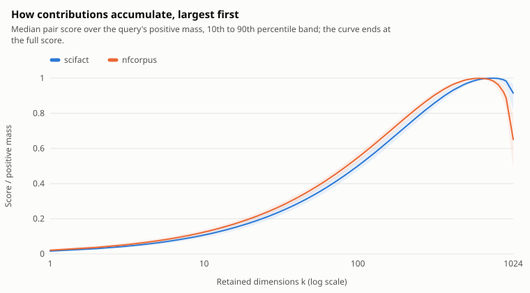
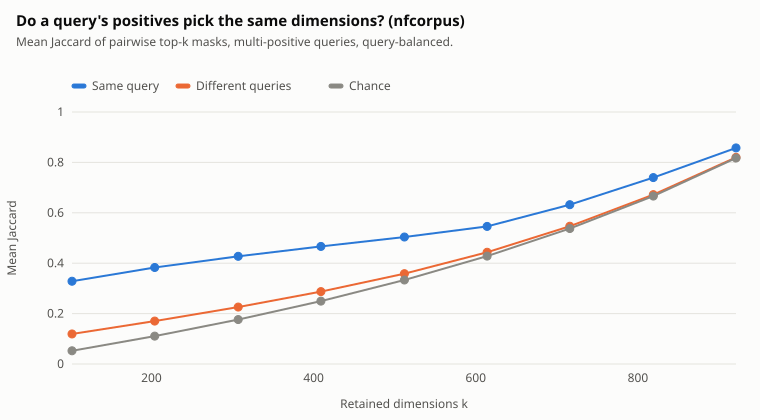
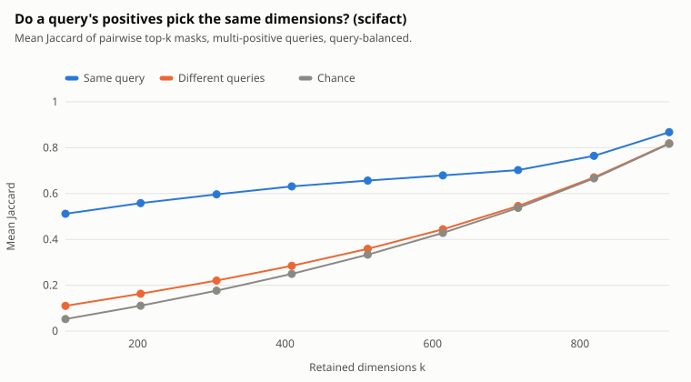
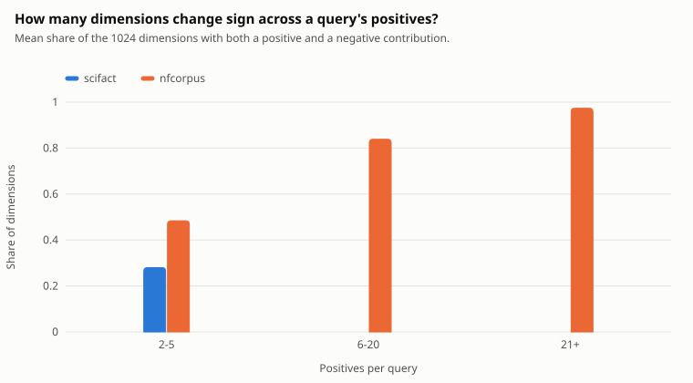
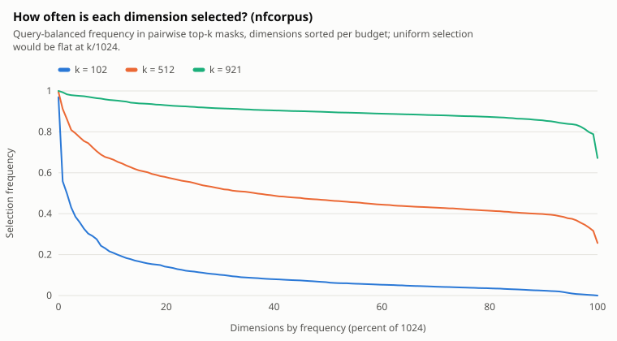
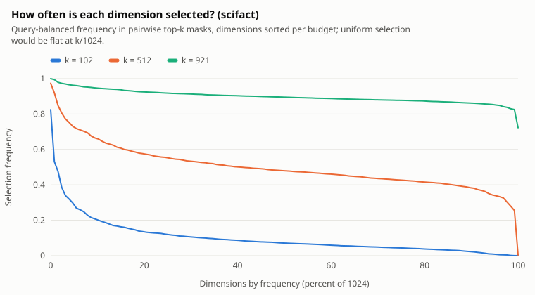
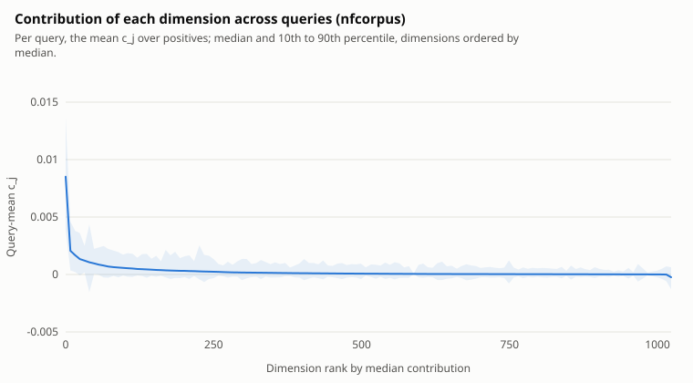
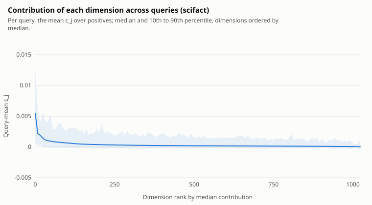
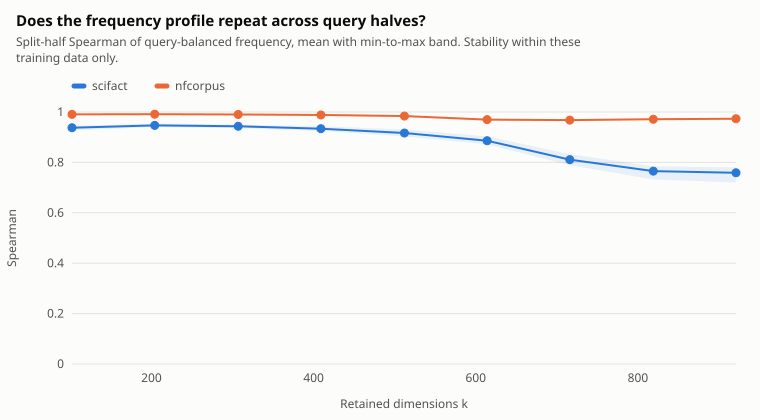
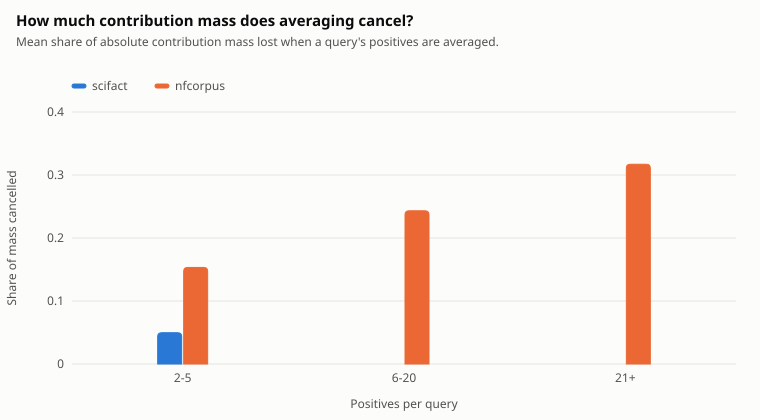

# P3: what dimension-level contributions reveal about known relevant pairs

Exploratory and descriptive. Protocol: in-domain, training queries and training judgments
only. This is not a benchmark: no selector, retrieval method, or ranking is evaluated,
and no document without a judgment is scored. Findings describe these training pairs and
do not claim to hold for unseen queries.

- analyze-representations `20261105T222415Z-de526aa7` (commit `2b7d031e09f2`, dirty working tree)
- Settings: all training queries per environment, budgets [102, 204, 307, 409, 512, 614, 716, 819, 921], 20 split-half draws, 2000 across-query pairs, seed 0.
- **Provisional inputs (scifact, nfcorpus):** not the published F2 artifacts. Rerun on those before citing a number.
- **Not analyzed yet:** msmarco.

## What is measured, and what is not

For a query `q` and a relevant document `d`, `c_j = q_j * d_j` and `Σ c_j = dot(q, d)`.
Keeping the `k` largest `c_j` gives the largest unnormalized inner product any mask of
exactly `k` dimensions can give that pair. Three things are different:

1. **Maximizing similarity to one known relevant document**: measured.
2. **Preserving the original similarity**: measured.
3. **Improving a ranking**: not measured, and not implied by 1 or 2. A mask that raises one pair's score may raise competing documents' scores more.

## Representations available

The stored vectors are the only representation here: the L2-normalized last-token pooled
output of frozen Qwen3-Embedding-0.6B, 1024 wide, with the instruction prefix on queries
and none on documents, and stored as float16. Token embeddings and intermediate encoder
states are not persisted by the embedding pipeline, so they are out of scope, and nothing
here assumes their coordinates correspond to these. Measured norms are in the
decomposition table below. Embeddings are opened read-only; masks are never applied
to a stored matrix, and masked queries are not re-normalized.

| environment | inputs | dataset run | dataset fingerprint | train judgments sha256 | embeddings run | documents sha256 | queries sha256 | split seed | validation fraction | model revision | stored dtype | pooling |
|---|---|---|---|---|---|---|---|---|---|---|---|---|
| scifact | converted from the F0 spike caches by scripts/checks/p3_spike_inputs.py (pilot) | 20261105T221651Z-387f9345 | ca52c14d6f18 | ac709ec68585 | 20261105T221651Z-072c2218 | 9043cc845645 | ad7c14aa295d | 0 | 0.1 | 97b0c614be4d | float16 | last_token |
| nfcorpus | converted from the F0 spike caches by scripts/checks/p3_spike_inputs.py (pilot) | 20261105T221651Z-7b153cb0 | 1af5f1c2e9d9 | 1a66c1391eca | 20261105T221653Z-7cf57b55 | 51378a9788e6 | 7d0bba947ea5 | 0 | 0.1 | 97b0c614be4d | float16 | last_token |

## Judgment coverage

| environment | training queries | analyzed | relevant pairs | mean positives | max positives | single-positive queries | multi-positive queries | judged nonrelevant pairs | mean unjudged documents per query | grades |
|---|---|---|---|---|---|---|---|---|---|---|
| scifact | 728 | 728 | 822 | 1.13 | 5 | 659 | 69 | 0 | 5181.9 | 1: 822 |
| nfcorpus | 2331 | 2331 | 100833 | 43.26 | 1363 | 169 | 2162 | 0 | 3589.7 | 1: 100833 |

| environment | positives per query | queries | pairs |
|---|---|---|---|
| scifact | 1 | 659 | 659 |
| scifact | 2-5 | 69 | 163 |
| scifact | 6-20 | 0 | 0 |
| scifact | 21+ | 0 | 0 |
| nfcorpus | 1 | 169 | 169 |
| nfcorpus | 2-5 | 399 | 1296 |
| nfcorpus | 6-20 | 688 | 8275 |
| nfcorpus | 21+ | 1075 | 91093 |

Judged nonrelevant (grade 0) and unjudged documents are different things: only the former
could be analyzed as a reference, and unjudged documents are never treated as negatives.

## 1. What was directly observed

Summaries are query-balanced (mean within a query, then across queries) unless a column
says pair-weighted; ranges are the 10th to 90th percentiles of query values.

- **scifact, contributions.** Coordinates agree in sign on 0.729 of dimensions (independent, symmetric signs would give 0.5); negative mass is 0.086 of absolute mass. Positive mass spreads over about 259 effective dimensions, and 90% of it takes 365.
- **scifact, the pair-optimal mask.** The curve first reaches the full score after 393 dimensions on average, peaks at the positive mass, and falls back to the full score as negative contributions enter. At k = 307 a pair's maximum is 0.613 against a full score of 0.656; the difference is negative mass removed less positive mass removed.
- **scifact, magnitude source.** `log|c| = log|q| + log|d|` splits its variance into 0.405 query, 0.405 document, and 0.190 covariance. The top 50 contributions sit at the 0.949 percentile of |q| and 0.949 of |d| (0.5 would be a typical coordinate).
- **scifact, agreement at k = 307.** Over 69 multi-positive queries, masks of the same query have Jaccard 0.596, masks of different queries 0.220, chance 0.176. 0.280 of dimensions change sign across a query's positives, and c orderings correlate 0.673 (Spearman).
- **scifact, recurrence at k = 307.** Query-balanced selection frequency reaches 0.940 against 0.300 by chance, and 3 dimensions are never selected. Its rank correlation with `mean|q| x mean|d|` is 0.976: the closer to 1, the more of the recurrence marginal magnitudes alone account for, and marginal magnitudes do not involve relevance.
- **nfcorpus, contributions.** Coordinates agree in sign on 0.614 of dimensions (independent, symmetric signs would give 0.5); negative mass is 0.251 of absolute mass. Positive mass spreads over about 218 effective dimensions, and 90% of it takes 314.
- **nfcorpus, the pair-optimal mask.** The curve first reaches the full score after 161 dimensions on average, peaks at the positive mass, and falls back to the full score as negative contributions enter. At k = 307 a pair's maximum is 0.460 against a full score of 0.347; the difference is negative mass removed less positive mass removed.
- **nfcorpus, magnitude source.** `log|c| = log|q| + log|d|` splits its variance into 0.462 query, 0.465 document, and 0.073 covariance. The top 50 contributions sit at the 0.914 percentile of |q| and 0.914 of |d| (0.5 would be a typical coordinate).
- **nfcorpus, agreement at k = 307.** Over 2162 multi-positive queries, masks of the same query have Jaccard 0.427, masks of different queries 0.226, chance 0.176. 0.840 of dimensions change sign across a query's positives, and c orderings correlate 0.394 (Spearman).
- **nfcorpus, recurrence at k = 307.** Query-balanced selection frequency reaches 0.993 against 0.300 by chance, and 2 dimensions are never selected. Its rank correlation with `mean|q| x mean|d|` is 0.928: the closer to 1, the more of the recurrence marginal magnitudes alone account for, and marginal magnitudes do not involve relevance.

Identities, checked on every pair:

- scifact: largest `|Σ c_j - dot(q, d)|` 0.00e+00 over 822 pairs; largest `|weighted_mean(q * d) - q * weighted_mean(d)|` 1.73e-18.
- nfcorpus: largest `|Σ c_j - dot(q, d)|` 0.00e+00 over 100833 pairs; largest `|weighted_mean(q * d) - q * weighted_mean(d)|` 1.21e-17.



| statistic | environment | all queries, mean (p10 to p90) | single positive, mean (p10 to p90) | multiple positives, mean (p10 to p90) | pair-weighted mean |
|---|---|---|---|---|---|
| full-vector score | scifact | 0.656 (0.497 to 0.801) | 0.655 (0.486 to 0.804) | 0.663 (0.572 to 0.779) | 0.658 |
| full-vector score | nfcorpus | 0.347 (0.219 to 0.477) | 0.409 (0.201 to 0.665) | 0.343 (0.220 to 0.464) | 0.319 |
| query norm | scifact | 1.000 (1.000 to 1.000) | 1.000 (1.000 to 1.000) | 1.000 (1.000 to 1.000) | 1.000 |
| query norm | nfcorpus | 1.000 (1.000 to 1.000) | 1.000 (1.000 to 1.000) | 1.000 (1.000 to 1.000) | 1.000 |
| document norm | scifact | 1.000 (1.000 to 1.000) | 1.000 (1.000 to 1.000) | 1.000 (1.000 to 1.000) | 1.000 |
| document norm | nfcorpus | 1.000 (1.000 to 1.000) | 1.000 (1.000 to 1.000) | 1.000 (1.000 to 1.000) | 1.000 |
| positive mass P | scifact | 0.721 (0.608 to 0.827) | 0.720 (0.604 to 0.831) | 0.725 (0.661 to 0.808) | 0.722 |
| positive mass P | nfcorpus | 0.516 (0.438 to 0.597) | 0.556 (0.422 to 0.723) | 0.513 (0.439 to 0.589) | 0.498 |
| negative mass N | scifact | 0.065 (0.028 to 0.111) | 0.066 (0.027 to 0.115) | 0.062 (0.032 to 0.090) | 0.065 |
| negative mass N | nfcorpus | 0.169 (0.119 to 0.219) | 0.147 (0.059 to 0.222) | 0.171 (0.125 to 0.218) | 0.179 |
| N / (P + N) | scifact | 0.086 (0.033 to 0.155) | 0.087 (0.031 to 0.160) | 0.081 (0.037 to 0.121) | 0.085 |
| N / (P + N) | nfcorpus | 0.251 (0.170 to 0.334) | 0.216 (0.077 to 0.344) | 0.254 (0.178 to 0.334) | 0.268 |
| dimensions with c > 0 | scifact | 745.035 (672.000 to 811.000) | 744.853 (671.000 to 812.200) | 746.776 (706.000 to 793.100) | 745.809 |
| dimensions with c > 0 | nfcorpus | 627.034 (583.500 to 674.000) | 650.716 (571.800 to 746.200) | 625.183 (583.771 to 669.656) | 616.450 |
| dimensions with c < 0 | scifact | 277.092 (211.000 to 349.300) | 277.278 (210.000 to 351.000) | 275.321 (229.800 to 316.700) | 276.308 |
| dimensions with c < 0 | nfcorpus | 394.691 (347.800 to 437.833) | 370.864 (275.600 to 449.200) | 396.554 (352.025 to 437.500) | 405.381 |
| dimensions with c = 0 | scifact | 1.873 (0.000 to 4.000) | 1.869 (0.000 to 4.000) | 1.902 (0.500 to 3.500) | 1.883 |
| dimensions with c = 0 | nfcorpus | 2.275 (0.952 to 4.000) | 2.420 (1.000 to 4.200) | 2.264 (0.951 to 3.900) | 2.169 |
| sign agreement, by count | scifact | 0.729 (0.658 to 0.794) | 0.729 (0.657 to 0.795) | 0.731 (0.690 to 0.775) | 0.730 |
| sign agreement, by count | nfcorpus | 0.614 (0.571 to 0.660) | 0.637 (0.560 to 0.730) | 0.612 (0.572 to 0.656) | 0.603 |
| effective positive dimensions | scifact | 258.906 (226.510 to 292.159) | 258.865 (224.529 to 292.555) | 259.296 (233.908 to 285.732) | 258.957 |
| effective positive dimensions | nfcorpus | 217.657 (193.783 to 240.200) | 226.249 (190.259 to 264.516) | 216.985 (194.260 to 238.735) | 213.685 |
| effective negative dimensions | scifact | 111.094 (84.042 to 140.060) | 111.182 (82.940 to 140.418) | 110.251 (88.413 to 130.523) | 110.701 |
| effective negative dimensions | nfcorpus | 152.900 (135.139 to 170.263) | 144.616 (107.341 to 177.594) | 153.547 (136.468 to 169.733) | 157.024 |
| share of P in the largest c | scifact | 0.018 (0.012 to 0.024) | 0.018 (0.012 to 0.025) | 0.017 (0.013 to 0.022) | 0.018 |
| share of P in the largest c | nfcorpus | 0.022 (0.017 to 0.029) | 0.021 (0.014 to 0.030) | 0.022 (0.017 to 0.029) | 0.023 |
| share of P in the top 10 | scifact | 0.108 (0.093 to 0.125) | 0.108 (0.093 to 0.125) | 0.108 (0.094 to 0.120) | 0.108 |
| share of P in the top 10 | nfcorpus | 0.124 (0.112 to 0.138) | 0.121 (0.103 to 0.139) | 0.125 (0.112 to 0.138) | 0.126 |
| share of P in the top 100 | scifact | 0.502 (0.474 to 0.532) | 0.502 (0.473 to 0.532) | 0.503 (0.481 to 0.528) | 0.502 |
| share of P in the top 100 | nfcorpus | 0.547 (0.524 to 0.570) | 0.537 (0.499 to 0.577) | 0.548 (0.526 to 0.570) | 0.551 |
| dimensions for 50% of P | scifact | 100.094 (90.000 to 110.000) | 100.159 (90.000 to 110.000) | 99.474 (91.267 to 107.100) | 99.990 |
| dimensions for 50% of P | nfcorpus | 85.814 (79.118 to 92.750) | 88.988 (77.800 to 101.000) | 85.566 (79.254 to 92.178) | 84.716 |
| dimensions for 80% of P | scifact | 259.403 (237.000 to 282.000) | 259.381 (235.000 to 283.000) | 259.615 (246.400 to 274.000) | 259.442 |
| dimensions for 80% of P | nfcorpus | 223.142 (207.971 to 239.700) | 230.716 (204.000 to 259.000) | 222.550 (208.000 to 238.250) | 220.201 |
| dimensions for 90% of P | scifact | 365.336 (334.700 to 395.300) | 365.255 (333.000 to 397.000) | 366.109 (348.400 to 384.067) | 365.516 |
| dimensions for 90% of P | nfcorpus | 313.579 (293.000 to 336.893) | 324.355 (289.000 to 368.000) | 312.736 (293.007 to 334.414) | 309.204 |
| dimensions for 95% of P | scifact | 453.216 (414.000 to 489.000) | 453.080 (411.800 to 490.000) | 454.509 (433.500 to 476.200) | 453.529 |
| dimensions for 95% of P | nfcorpus | 387.822 (362.420 to 416.000) | 401.538 (358.800 to 455.200) | 386.750 (362.650 to 413.136) | 382.146 |
| dimensions for 99% of P | scifact | 593.381 (542.000 to 641.000) | 593.187 (539.600 to 642.000) | 595.236 (564.700 to 631.400) | 593.942 |
| dimensions for 99% of P | nfcorpus | 504.943 (471.630 to 541.000) | 523.254 (465.600 to 594.200) | 503.512 (471.947 to 538.124) | 497.065 |
| smallest k whose maximum reaches the full score | scifact | 393.453 (252.700 to 533.000) | 392.967 (246.800 to 536.400) | 398.096 (312.950 to 499.800) | 395.080 |
| smallest k whose maximum reaches the full score | nfcorpus | 161.343 (83.286 to 245.778) | 206.515 (73.800 to 400.000) | 157.812 (84.325 to 237.455) | 142.277 |
| var log|c|: query share | scifact | 0.405 (0.357 to 0.453) | 0.405 (0.355 to 0.455) | 0.408 (0.375 to 0.442) | 0.405 |
| var log|c|: query share | nfcorpus | 0.462 (0.433 to 0.489) | 0.451 (0.393 to 0.500) | 0.463 (0.436 to 0.488) | 0.466 |
| var log|c|: document share | scifact | 0.405 (0.358 to 0.453) | 0.406 (0.358 to 0.454) | 0.399 (0.364 to 0.438) | 0.404 |
| var log|c|: document share | nfcorpus | 0.465 (0.435 to 0.494) | 0.455 (0.405 to 0.500) | 0.465 (0.437 to 0.493) | 0.470 |
| var log|c|: covariance share | scifact | 0.190 (0.111 to 0.272) | 0.189 (0.107 to 0.274) | 0.193 (0.145 to 0.251) | 0.191 |
| var log|c|: covariance share | nfcorpus | 0.073 (0.038 to 0.113) | 0.094 (0.022 to 0.199) | 0.072 (0.039 to 0.108) | 0.064 |
| |q| percentile of the top 50 c | scifact | 0.949 (0.932 to 0.963) | 0.949 (0.931 to 0.963) | 0.951 (0.937 to 0.961) | 0.949 |
| |q| percentile of the top 50 c | nfcorpus | 0.914 (0.895 to 0.932) | 0.921 (0.889 to 0.952) | 0.914 (0.895 to 0.931) | 0.911 |
| |d| percentile of the top 50 c | scifact | 0.949 (0.933 to 0.963) | 0.949 (0.932 to 0.964) | 0.951 (0.939 to 0.961) | 0.949 |
| |d| percentile of the top 50 c | nfcorpus | 0.914 (0.896 to 0.932) | 0.921 (0.890 to 0.951) | 0.914 (0.896 to 0.930) | 0.911 |

### Masks by budget

Removing a dimension removes its contribution: the top-k ordering drops negative
contributions first and positive mass last, so `max - full` is negative mass removed
less positive mass removed.

| environment | k | max pair score | gain over full / (P + N) | |max - full| / (P + N) | positive mass removed | negative mass removed |
|---|---|---|---|---|---|---|
| scifact | 102 | 0.364 (0.321 to 0.407) | -0.365 (-0.466 to -0.242) | 0.365 (0.242 to 0.466) | 0.356 (0.285 to 0.426) | 0.065 (0.028 to 0.111) |
| scifact | 204 | 0.520 (0.456 to 0.584) | -0.167 (-0.259 to -0.056) | 0.170 (0.059 to 0.259) | 0.200 (0.153 to 0.250) | 0.065 (0.028 to 0.111) |
| scifact | 307 | 0.613 (0.531 to 0.690) | -0.050 (-0.132 to 0.049) | 0.075 (0.016 to 0.134) | 0.108 (0.076 to 0.141) | 0.065 (0.028 to 0.111) |
| scifact | 409 | 0.668 (0.575 to 0.755) | 0.019 (-0.053 to 0.110) | 0.051 (0.010 to 0.110) | 0.053 (0.032 to 0.074) | 0.065 (0.028 to 0.111) |
| scifact | 512 | 0.699 (0.599 to 0.794) | 0.059 (-0.006 to 0.144) | 0.063 (0.008 to 0.144) | 0.021 (0.010 to 0.034) | 0.065 (0.028 to 0.111) |
| scifact | 614 | 0.715 (0.607 to 0.815) | 0.079 (0.019 to 0.154) | 0.079 (0.019 to 0.154) | 0.006 (0.001 to 0.012) | 0.065 (0.028 to 0.111) |
| scifact | 716 | 0.720 (0.608 to 0.824) | 0.085 (0.031 to 0.154) | 0.085 (0.031 to 0.154) | 0.001 (0.000 to 0.002) | 0.065 (0.028 to 0.111) |
| scifact | 819 | 0.718 (0.601 to 0.827) | 0.082 (0.033 to 0.144) | 0.082 (0.033 to 0.144) | 0.000 (0.000 to 0.000) | 0.063 (0.028 to 0.104) |
| scifact | 921 | 0.706 (0.579 to 0.824) | 0.066 (0.029 to 0.111) | 0.066 (0.029 to 0.111) | 0.000 (0.000 to 0.000) | 0.050 (0.025 to 0.081) |
| nfcorpus | 102 | 0.284 (0.248 to 0.319) | -0.085 (-0.216 to 0.048) | 0.128 (0.057 to 0.221) | 0.233 (0.188 to 0.280) | 0.169 (0.119 to 0.219) |
| nfcorpus | 204 | 0.397 (0.346 to 0.448) | 0.079 (-0.037 to 0.195) | 0.126 (0.067 to 0.201) | 0.119 (0.091 to 0.150) | 0.169 (0.119 to 0.219) |
| nfcorpus | 307 | 0.460 (0.399 to 0.522) | 0.171 (0.067 to 0.275) | 0.179 (0.089 to 0.275) | 0.056 (0.039 to 0.075) | 0.169 (0.119 to 0.219) |
| nfcorpus | 409 | 0.495 (0.425 to 0.565) | 0.220 (0.126 to 0.315) | 0.221 (0.129 to 0.315) | 0.022 (0.013 to 0.033) | 0.169 (0.119 to 0.219) |
| nfcorpus | 512 | 0.511 (0.436 to 0.586) | 0.243 (0.157 to 0.332) | 0.243 (0.158 to 0.332) | 0.006 (0.002 to 0.010) | 0.169 (0.119 to 0.219) |
| nfcorpus | 614 | 0.516 (0.438 to 0.595) | 0.250 (0.168 to 0.334) | 0.250 (0.168 to 0.334) | 0.001 (0.000 to 0.002) | 0.169 (0.119 to 0.218) |
| nfcorpus | 716 | 0.513 (0.431 to 0.595) | 0.245 (0.169 to 0.323) | 0.245 (0.169 to 0.323) | 0.000 (0.000 to 0.000) | 0.165 (0.118 to 0.212) |
| nfcorpus | 819 | 0.498 (0.411 to 0.587) | 0.224 (0.157 to 0.290) | 0.224 (0.157 to 0.290) | 0.000 (0.000 to 0.000) | 0.151 (0.110 to 0.190) |
| nfcorpus | 921 | 0.461 (0.362 to 0.561) | 0.169 (0.121 to 0.217) | 0.169 (0.121 to 0.217) | 0.000 (0.000 to 0.000) | 0.114 (0.085 to 0.142) |

### Agreement among a query's relevant documents (multi-positive queries only)




| environment | k | within-query Jaccard | worst pair in the query | across-query Jaccard | chance | dims in all positives | dims in a majority | dims in at most half | dims in any |
|---|---|---|---|---|---|---|---|---|---|
| scifact | 102 | 0.512 (0.384 to 0.618) | 0.499 (0.369 to 0.596) | 0.110 (0.074 to 0.153) | 0.052 | 65.0 (52.6 to 76.2) | 8.2 (0.0 to 33.2) | 68.3 (46.8 to 94.0) | 141.5 (127.8 to 155.0) |
| scifact | 204 | 0.558 (0.458 to 0.645) | 0.547 (0.442 to 0.645) | 0.163 (0.130 to 0.200) | 0.111 | 137.3 (114.8 to 158.0) | 19.4 (0.0 to 77.0) | 114.9 (84.0 to 156.4) | 271.6 (250.0 to 296.2) |
| scifact | 307 | 0.596 (0.508 to 0.672) | 0.588 (0.489 to 0.661) | 0.220 (0.192 to 0.251) | 0.176 | 217.6 (189.0 to 242.2) | 26.1 (0.0 to 106.6) | 153.9 (104.0 to 202.8) | 397.6 (371.8 to 426.2) |
| scifact | 409 | 0.631 (0.542 to 0.713) | 0.623 (0.530 to 0.708) | 0.285 (0.258 to 0.311) | 0.250 | 301.6 (266.8 to 338.2) | 33.0 (0.0 to 133.0) | 181.9 (120.0 to 246.4) | 516.5 (479.8 to 552.0) |
| scifact | 512 | 0.657 (0.573 to 0.728) | 0.649 (0.545 to 0.724) | 0.359 (0.337 to 0.382) | 0.333 | 387.9 (348.0 to 429.2) | 40.4 (0.0 to 163.2) | 205.9 (140.0 to 280.8) | 634.2 (594.8 to 676.0) |
| scifact | 614 | 0.679 (0.605 to 0.740) | 0.672 (0.570 to 0.738) | 0.444 (0.426 to 0.464) | 0.428 | 475.8 (428.2 to 521.0) | 47.4 (0.0 to 184.0) | 225.1 (152.0 to 304.8) | 748.3 (707.0 to 793.6) |
| scifact | 716 | 0.702 (0.631 to 0.758) | 0.696 (0.606 to 0.757) | 0.546 (0.530 to 0.560) | 0.538 | 566.9 (509.0 to 617.0) | 54.8 (0.0 to 202.4) | 235.6 (146.6 to 316.8) | 857.3 (815.0 to 902.4) |
| scifact | 819 | 0.764 (0.718 to 0.816) | 0.760 (0.708 to 0.816) | 0.670 (0.660 to 0.682) | 0.666 | 685.8 (625.6 to 736.0) | 56.5 (0.0 to 213.2) | 197.5 (110.8 to 263.2) | 939.8 (902.0 to 974.4) |
| scifact | 921 | 0.868 (0.841 to 0.897) | 0.865 (0.838 to 0.894) | 0.819 (0.811 to 0.826) | 0.817 | 839.9 (803.8 to 869.4) | 37.9 (0.0 to 143.6) | 113.8 (54.8 to 158.8) | 991.6 (972.6 to 1008.2) |
| nfcorpus | 102 | 0.328 (0.277 to 0.395) | 0.212 (0.140 to 0.308) | 0.119 (0.085 to 0.159) | 0.052 | 10.8 (0.0 to 34.0) | 57.5 (40.0 to 72.0) | 270.0 (114.0 to 406.9) | 338.3 (188.0 to 466.0) |
| nfcorpus | 204 | 0.383 (0.334 to 0.446) | 0.277 (0.211 to 0.369) | 0.170 (0.140 to 0.204) | 0.111 | 25.5 (1.0 to 79.0) | 133.1 (83.0 to 163.0) | 381.4 (187.1 to 534.9) | 540.0 (347.1 to 686.0) |
| nfcorpus | 307 | 0.427 (0.381 to 0.490) | 0.328 (0.266 to 0.415) | 0.226 (0.199 to 0.256) | 0.176 | 43.7 (2.0 to 131.9) | 219.1 (129.0 to 269.9) | 431.0 (237.1 to 570.9) | 693.7 (499.1 to 828.0) |
| nfcorpus | 409 | 0.467 (0.423 to 0.526) | 0.372 (0.315 to 0.458) | 0.287 (0.264 to 0.311) | 0.250 | 64.4 (3.0 to 191.9) | 311.5 (169.1 to 389.0) | 439.1 (278.0 to 546.0) | 815.0 (631.1 to 928.0) |
| nfcorpus | 512 | 0.504 (0.463 to 0.561) | 0.414 (0.360 to 0.493) | 0.358 (0.339 to 0.380) | 0.333 | 88.3 (5.0 to 259.7) | 410.6 (211.0 to 522.0) | 416.1 (302.0 to 484.0) | 915.1 (758.0 to 1000.0) |
| nfcorpus | 614 | 0.546 (0.511 to 0.597) | 0.461 (0.411 to 0.537) | 0.443 (0.426 to 0.462) | 0.428 | 116.7 (8.0 to 334.9) | 516.4 (250.0 to 674.0) | 346.7 (296.1 to 390.0) | 979.7 (868.0 to 1024.0) |
| nfcorpus | 716 | 0.632 (0.603 to 0.674) | 0.560 (0.512 to 0.625) | 0.547 (0.532 to 0.562) | 0.538 | 180.3 (21.0 to 458.9) | 593.3 (256.0 to 815.0) | 226.1 (180.0 to 282.0) | 999.8 (939.0 to 1024.0) |
| nfcorpus | 819 | 0.740 (0.718 to 0.770) | 0.688 (0.655 to 0.733) | 0.672 (0.661 to 0.683) | 0.666 | 314.7 (108.1 to 612.0) | 572.4 (219.1 to 835.0) | 124.5 (80.0 to 182.0) | 1011.6 (981.0 to 1024.0) |
| nfcorpus | 921 | 0.857 (0.845 to 0.875) | 0.829 (0.811 to 0.853) | 0.820 (0.813 to 0.827) | 0.817 | 527.2 (300.1 to 796.9) | 445.4 (145.1 to 703.0) | 47.0 (19.0 to 86.0) | 1019.6 (1008.0 to 1024.0) |



| environment | queries | n | share of dims with a sign conflict | dims always helpful | dims always harmful | mean Spearman of c orderings | worst Spearman pair | mass cancelled by averaging | variance between positives / second moment | dims whose mean opposes a positive |
|---|---|---|---|---|---|---|---|---|---|---|
| scifact | multi | 69 | 0.280 (0.194 to 0.371) | 598.1 (525.8 to 664.4) | 136.7 (80.8 to 195.6) | 0.673 (0.530 to 0.797) | 0.661 (0.452 to 0.796) | 0.050 (0.025 to 0.085) | 0.081 (0.040 to 0.147) | 286.4 (198.8 to 379.8) |
| scifact | positives 2-5 | 69 | 0.280 (0.194 to 0.371) | 598.1 (525.8 to 664.4) | 136.7 (80.8 to 195.6) | 0.673 (0.530 to 0.797) | 0.661 (0.452 to 0.796) | 0.050 (0.025 to 0.085) | 0.081 (0.040 to 0.147) | 286.4 (198.8 to 379.8) |
| scifact | positives 21+ | 0 | n/a | n/a | n/a | n/a | n/a | n/a | n/a | n/a |
| scifact | positives 6-20 | 0 | n/a | n/a | n/a | n/a | n/a | n/a | n/a | n/a |
| nfcorpus | multi | 2162 | 0.840 (0.522 to 0.989) | 122.2 (9.0 to 352.9) | 39.5 (0.0 to 136.0) | 0.394 (0.305 to 0.518) | 0.184 (0.055 to 0.384) | 0.263 (0.146 to 0.359) | 0.391 (0.235 to 0.520) | 860.3 (534.1 to 1013.0) |
| nfcorpus | positives 2-5 | 399 | 0.484 (0.279 to 0.676) | 371.3 (234.8 to 511.0) | 154.0 (70.6 to 260.2) | 0.469 (0.320 to 0.638) | 0.390 (0.212 to 0.601) | 0.153 (0.073 to 0.233) | 0.243 (0.112 to 0.370) | 495.4 (285.8 to 692.2) |
| nfcorpus | positives 21+ | 1075 | 0.974 (0.948 to 0.994) | 24.0 (5.0 to 48.0) | 1.7 (0.0 to 5.0) | 0.347 (0.297 to 0.405) | 0.093 (0.032 to 0.150) | 0.317 (0.258 to 0.374) | 0.461 (0.375 to 0.547) | 996.9 (971.0 to 1018.0) |
| nfcorpus | positives 6-20 | 688 | 0.838 (0.729 to 0.927) | 131.1 (62.7 to 217.0) | 32.0 (6.0 to 72.0) | 0.424 (0.339 to 0.521) | 0.206 (0.119 to 0.312) | 0.243 (0.177 to 0.303) | 0.368 (0.272 to 0.457) | 858.6 (746.0 to 949.0) |

### Relevance grades

Only one relevance grade among the analyzed judgments of scifact, nfcorpus, so
variability associated with grades cannot be assessed there.

| environment | grade | queries | pairs | score | positive mass | N / (P + N) | effective positive dims | dims for 90% of P |
|---|---|---|---|---|---|---|---|---|
| scifact | 1 | 728 | 822 | 0.656 (0.497 to 0.801) | 0.721 (0.608 to 0.827) | 0.086 (0.033 to 0.155) | 258.9 (226.5 to 292.2) | 365.3 (334.7 to 395.3) |
| nfcorpus | 1 | 2331 | 100833 | 0.347 (0.219 to 0.477) | 0.516 (0.438 to 0.597) | 0.251 (0.170 to 0.334) | 217.7 (193.8 to 240.2) | 313.6 (293.0 to 336.9) |

### Recurrence across the training queries







| environment | k | chance frequency | max frequency | effective dims | dims never selected | mask inside the k most frequent dims | Spearman with pair-weighted frequency (pair-weighted) | Spearman with mean|q| x mean|d| |
|---|---|---|---|---|---|---|---|---|
| scifact | 102 | 0.100 | 0.825 | 712.3 | 8 | 0.335 (0.265 to 0.407) | 0.997 | 0.978 |
| scifact | 204 | 0.199 | 0.915 | 858.6 | 3 | 0.398 (0.343 to 0.451) | 0.997 | 0.983 |
| scifact | 307 | 0.300 | 0.940 | 930.4 | 3 | 0.460 (0.417 to 0.498) | 0.997 | 0.976 |
| scifact | 409 | 0.399 | 0.958 | 971.1 | 2 | 0.521 (0.487 to 0.553) | 0.996 | 0.959 |
| scifact | 512 | 0.500 | 0.974 | 995.6 | 0 | 0.586 (0.559 to 0.611) | 0.996 | 0.937 |
| scifact | 614 | 0.600 | 0.988 | 1010.9 | 0 | 0.654 (0.634 to 0.674) | 0.994 | 0.892 |
| scifact | 716 | 0.699 | 0.993 | 1018.7 | 0 | 0.728 (0.714 to 0.742) | 0.990 | 0.766 |
| scifact | 819 | 0.800 | 1.000 | 1022.0 | 0 | 0.814 (0.805 to 0.823) | 0.989 | 0.438 |
| scifact | 921 | 0.899 | 1.000 | 1023.3 | 0 | 0.905 (0.900 to 0.910) | 0.990 | 0.103 |
| nfcorpus | 102 | 0.100 | 0.970 | 684.1 | 3 | 0.359 (0.311 to 0.408) | 0.986 | 0.977 |
| nfcorpus | 204 | 0.199 | 0.988 | 844.5 | 3 | 0.418 (0.378 to 0.460) | 0.985 | 0.958 |
| nfcorpus | 307 | 0.300 | 0.993 | 925.4 | 2 | 0.473 (0.438 to 0.507) | 0.983 | 0.928 |
| nfcorpus | 409 | 0.399 | 0.994 | 970.7 | 0 | 0.525 (0.498 to 0.552) | 0.981 | 0.888 |
| nfcorpus | 512 | 0.500 | 0.995 | 998.6 | 0 | 0.583 (0.562 to 0.604) | 0.977 | 0.821 |
| nfcorpus | 614 | 0.600 | 0.998 | 1012.4 | 0 | 0.648 (0.634 to 0.662) | 0.966 | 0.661 |
| nfcorpus | 716 | 0.699 | 0.999 | 1018.7 | 0 | 0.727 (0.718 to 0.735) | 0.958 | 0.338 |
| nfcorpus | 819 | 0.800 | 1.000 | 1021.4 | 0 | 0.816 (0.810 to 0.822) | 0.960 | 0.056 |
| nfcorpus | 921 | 0.899 | 1.000 | 1023.0 | 0 | 0.908 (0.904 to 0.911) | 0.967 | -0.177 |

Groups: queries are stratified by number of positives only; no clustering was run. The
first components of the query-by-dimension selection matrix explain, cumulatively:

- scifact (k = 307, first and tenth): 0.022 and 0.118
- nfcorpus (k = 307, first and tenth): 0.019 and 0.123

| environment | k | positives per query | queries | Spearman of the stratum's frequency with the corpus's |
|---|---|---|---|---|
| scifact | 307 | 1 | 659 | 0.998 |
| scifact | 307 | 2-5 | 69 | 0.856 |
| scifact | 307 | 6-20 | 0 | n/a |
| scifact | 307 | 21+ | 0 | n/a |
| nfcorpus | 307 | 1 | 169 | 0.899 |
| nfcorpus | 307 | 2-5 | 399 | 0.973 |
| nfcorpus | 307 | 6-20 | 688 | 0.991 |
| nfcorpus | 307 | 21+ | 1075 | 0.992 |

Dimension identities are not interpreted here: nothing in these data gives a coordinate a
meaning.

### A limited reference: judged nonrelevant documents

No judged nonrelevant training document in scifact, nfcorpus: every judgment analyzed
there is positive, so that reference is unavailable and positive-only patterns stay
unconfirmed as relevance-specific.

| environment | queries with a judged nonrelevant document | coverage | pairs | statistic | mean (p10 to p90), per pair |
|---|---|---|---|---|---|
| scifact | 0 | 0.000 | 0 | none available | n/a |
| nfcorpus | 0 | 0.000 | 0 | none available | n/a |

## 2. What is stable within the analyzed training data

Stable means stable across disjoint halves of these training queries, a query always
keeping all of its positives. It says nothing about unseen queries.

- **scifact.** At k = 307 the frequency profile is stable by this report's rule (lowest of 20 split-half Spearmans at least 0.8): 0.943 (0.935 to 0.950); it is -0.059 once dimension identity is shuffled per query. Mean contribution per dimension: 0.955 (0.947 to 0.962).
- **nfcorpus.** At k = 307 the frequency profile is stable by this report's rule (lowest of 20 split-half Spearmans at least 0.8): 0.990 (0.989 to 0.991); it is -0.061 once dimension identity is shuffled per query. Mean contribution per dimension: 0.986 (0.983 to 0.988).



| environment | k | draws | split-half Spearman, mean (min to max) | top-k overlap of the two halves, mean (min to max) | same, dimension identity shuffled per query | stable (min >= 0.8) |
|---|---|---|---|---|---|---|
| scifact | 102 | 20 | 0.938 (0.927 to 0.945) | 0.890 (0.873 to 0.912) | 0.036 | yes |
| scifact | 204 | 20 | 0.947 (0.940 to 0.955) | 0.889 (0.868 to 0.912) | 0.014 | yes |
| scifact | 307 | 20 | 0.943 (0.935 to 0.950) | 0.895 (0.876 to 0.919) | -0.059 | yes |
| scifact | 409 | 20 | 0.934 (0.925 to 0.943) | 0.878 (0.866 to 0.895) | -0.061 | yes |
| scifact | 512 | 20 | 0.917 (0.903 to 0.931) | 0.859 (0.832 to 0.879) | 0.032 | yes |
| scifact | 614 | 20 | 0.886 (0.872 to 0.903) | 0.870 (0.857 to 0.886) | 0.013 | yes |
| scifact | 716 | 20 | 0.811 (0.789 to 0.833) | 0.844 (0.830 to 0.852) | -0.012 | no |
| scifact | 819 | 20 | 0.765 (0.732 to 0.784) | 0.874 (0.862 to 0.883) | -0.051 | no |
| scifact | 921 | 20 | 0.759 (0.720 to 0.780) | 0.938 (0.932 to 0.946) | -0.035 | no |
| nfcorpus | 102 | 20 | 0.991 (0.990 to 0.991) | 0.959 (0.951 to 0.971) | 0.018 | yes |
| nfcorpus | 204 | 20 | 0.991 (0.990 to 0.992) | 0.961 (0.951 to 0.975) | -0.004 | yes |
| nfcorpus | 307 | 20 | 0.990 (0.989 to 0.991) | 0.964 (0.954 to 0.974) | -0.061 | yes |
| nfcorpus | 409 | 20 | 0.988 (0.986 to 0.989) | 0.962 (0.956 to 0.971) | -0.005 | yes |
| nfcorpus | 512 | 20 | 0.984 (0.982 to 0.985) | 0.950 (0.941 to 0.957) | 0.025 | yes |
| nfcorpus | 614 | 20 | 0.970 (0.965 to 0.972) | 0.944 (0.936 to 0.951) | 0.001 | yes |
| nfcorpus | 716 | 20 | 0.968 (0.965 to 0.972) | 0.929 (0.923 to 0.937) | -0.034 | yes |
| nfcorpus | 819 | 20 | 0.971 (0.970 to 0.975) | 0.954 (0.946 to 0.960) | 0.034 | yes |
| nfcorpus | 921 | 20 | 0.973 (0.971 to 0.975) | 0.986 (0.984 to 0.989) | 0.091 | yes |

| finding | environment | query-balanced value | difference between query halves, mean (min to max) |
|---|---|---|---|
| N / (P + N) | scifact | 0.086 | 0.003 (0.000 to 0.007) |
| N / (P + N) | nfcorpus | 0.251 | 0.002 (0.000 to 0.008) |
| sign agreement | scifact | 0.729 | 0.003 (0.001 to 0.007) |
| sign agreement | nfcorpus | 0.614 | 0.001 (0.000 to 0.005) |
| effective positive dimensions | scifact | 258.906 | 1.856 (0.123 to 4.563) |
| effective positive dimensions | nfcorpus | 217.657 | 0.501 (0.016 to 1.639) |
| dimensions for 90% of P | scifact | 365.336 | 1.492 (0.028 to 3.710) |
| dimensions for 90% of P | nfcorpus | 313.579 | 0.558 (0.007 to 2.049) |
| smallest k reaching the full score | scifact | 393.453 | 7.404 (2.039 to 16.291) |
| smallest k reaching the full score | nfcorpus | 161.343 | 2.497 (0.055 to 8.902) |
| within-query Jaccard, headline k | scifact | 0.596 | 0.011 (0.000 to 0.029) |
| within-query Jaccard, headline k | nfcorpus | 0.427 | 0.001 (0.000 to 0.004) |
| share of dims with a sign conflict | scifact | 0.280 | 0.014 (0.001 to 0.043) |
| share of dims with a sign conflict | nfcorpus | 0.840 | 0.006 (0.001 to 0.013) |
| mass cancelled by averaging | scifact | 0.050 | 0.004 (0.001 to 0.010) |
| mass cancelled by averaging | nfcorpus | 0.263 | 0.002 (0.000 to 0.007) |

## 3. What aggregation conceals

`weighted_mean(q * d) = q * weighted_mean(d)` holds exactly, with the repository's oracle
weights `2**grade - 1`, so averaging contributions and averaging documents are the same
operation. This compares masks and pair scores; it does not benchmark Learning-to-Select.

- **scifact.** Averaging cancels 0.050 of the absolute contribution mass and removes the variance between positives, which is 0.081 of the second moment. The mean opposes at least one positive on 286 dimensions. At k = 307 its mask holds 0.866 of a positive's own mask, 0.855 for the least-served positive, and drops 0.581 of the dimensions that only a minority of positives select.
- **nfcorpus.** Averaging cancels 0.263 of the absolute contribution mass and removes the variance between positives, which is 0.391 of the second moment. The mean opposes at least one positive on 860 dimensions. At k = 307 its mask holds 0.714 of a positive's own mask, 0.635 for the least-served positive, and drops 0.863 of the dimensions that only a minority of positives select.



| environment | k | positive's mask inside the mean's mask | least-served positive | lost pair score / (P + N) | worst lost pair score | minority dims the mean's mask drops | conflicted dims in the mean's mask |
|---|---|---|---|---|---|---|---|
| scifact | 102 | 0.826 (0.765 to 0.870) | 0.805 (0.745 to 0.857) | 0.019 (0.009 to 0.030) | 0.022 (0.010 to 0.036) | 0.579 (0.500 to 0.786) | 0.005 (0.000 to 0.020) |
| scifact | 204 | 0.850 (0.806 to 0.887) | 0.835 (0.787 to 0.877) | 0.026 (0.013 to 0.043) | 0.030 (0.015 to 0.048) | 0.583 (0.500 to 0.826) | 0.017 (0.000 to 0.049) |
| scifact | 307 | 0.866 (0.826 to 0.897) | 0.855 (0.807 to 0.889) | 0.028 (0.014 to 0.046) | 0.032 (0.016 to 0.053) | 0.581 (0.500 to 0.830) | 0.032 (0.003 to 0.086) |
| scifact | 409 | 0.880 (0.837 to 0.913) | 0.870 (0.828 to 0.906) | 0.029 (0.014 to 0.050) | 0.032 (0.016 to 0.056) | 0.581 (0.500 to 0.832) | 0.055 (0.014 to 0.119) |
| scifact | 512 | 0.890 (0.850 to 0.919) | 0.883 (0.847 to 0.913) | 0.028 (0.015 to 0.049) | 0.032 (0.016 to 0.053) | 0.581 (0.495 to 0.842) | 0.090 (0.033 to 0.172) |
| scifact | 614 | 0.899 (0.859 to 0.924) | 0.891 (0.850 to 0.921) | 0.027 (0.014 to 0.047) | 0.031 (0.015 to 0.056) | 0.584 (0.492 to 0.846) | 0.133 (0.063 to 0.222) |
| scifact | 716 | 0.906 (0.870 to 0.931) | 0.899 (0.859 to 0.928) | 0.025 (0.013 to 0.043) | 0.029 (0.015 to 0.052) | 0.576 (0.480 to 0.831) | 0.188 (0.110 to 0.277) |
| scifact | 819 | 0.925 (0.905 to 0.947) | 0.920 (0.896 to 0.944) | 0.023 (0.012 to 0.039) | 0.027 (0.014 to 0.046) | 0.558 (0.453 to 0.838) | 0.249 (0.176 to 0.329) |
| scifact | 921 | 0.960 (0.949 to 0.971) | 0.956 (0.945 to 0.970) | 0.018 (0.009 to 0.030) | 0.020 (0.011 to 0.034) | 0.560 (0.440 to 0.867) | 0.279 (0.202 to 0.361) |
| nfcorpus | 102 | 0.636 (0.569 to 0.722) | 0.528 (0.431 to 0.667) | 0.082 (0.046 to 0.110) | 0.133 (0.062 to 0.186) | 0.845 (0.740 to 0.911) | 0.588 (0.078 to 0.951) |
| nfcorpus | 204 | 0.681 (0.623 to 0.757) | 0.592 (0.505 to 0.716) | 0.114 (0.065 to 0.153) | 0.181 (0.085 to 0.250) | 0.852 (0.749 to 0.916) | 0.667 (0.157 to 0.971) |
| nfcorpus | 307 | 0.714 (0.662 to 0.783) | 0.635 (0.560 to 0.746) | 0.129 (0.073 to 0.174) | 0.205 (0.097 to 0.282) | 0.863 (0.757 to 0.932) | 0.717 (0.232 to 0.980) |
| nfcorpus | 409 | 0.741 (0.694 to 0.804) | 0.668 (0.599 to 0.770) | 0.135 (0.077 to 0.182) | 0.214 (0.101 to 0.295) | 0.879 (0.763 to 0.956) | 0.754 (0.301 to 0.983) |
| nfcorpus | 512 | 0.764 (0.721 to 0.821) | 0.696 (0.631 to 0.791) | 0.136 (0.077 to 0.183) | 0.216 (0.100 to 0.297) | 0.894 (0.764 to 0.976) | 0.781 (0.371 to 0.984) |
| nfcorpus | 614 | 0.784 (0.743 to 0.839) | 0.722 (0.663 to 0.811) | 0.133 (0.075 to 0.180) | 0.213 (0.099 to 0.293) | 0.895 (0.763 to 0.982) | 0.804 (0.436 to 0.985) |
| nfcorpus | 716 | 0.827 (0.791 to 0.874) | 0.784 (0.737 to 0.852) | 0.128 (0.072 to 0.173) | 0.204 (0.096 to 0.282) | 0.899 (0.754 to 0.990) | 0.823 (0.492 to 0.986) |
| nfcorpus | 819 | 0.884 (0.861 to 0.914) | 0.857 (0.827 to 0.901) | 0.114 (0.064 to 0.154) | 0.182 (0.087 to 0.251) | 0.913 (0.766 to 1.000) | 0.836 (0.528 to 0.987) |
| nfcorpus | 921 | 0.940 (0.927 to 0.955) | 0.925 (0.911 to 0.948) | 0.084 (0.047 to 0.113) | 0.135 (0.064 to 0.186) | 0.924 (0.777 to 1.000) | 0.842 (0.536 to 0.988) |

## 4. Questions that remain unanswered

- Whether any of this is specific to relevance. Unjudged documents were not analyzed, and
  judged nonrelevant documents exist only where the table above says so.
- Whether a higher pair score under a mask changes any ranking. Nothing here scores a
  competing document.
- Whether a pattern is predictable from a query embedding for unseen queries. All of it
  is computed with the labels of the queries it describes.
- How much within-query agreement comes from the documents at all. `c = q * d` shares `q`
  across a query's positives, so some overlap is structural, and same-query Jaccard above
  different-query Jaccard does not by itself show that the documents agree.
- How much of the agreement between positives reflects a query's relevance structure, and
  how much the documents' similarity to one another. Document-document similarity was
  not separated out.
- What the token-level and intermediate representations would show. They are not stored.

## 5. Follow-up hypotheses these observations motivate

Hypotheses to test, not recommendations. No method follows from a descriptive pattern.

- *Marginals versus relevance.* If recurrence mostly reflects marginal magnitudes, then
  the same frequency profile should appear for query-document pairs that are not
  relevant.
  Testing it needs judged nonrelevant documents or a design that does not call unjudged
  documents negative.
- *Conflict and ranking.* If sign conflicts mark documents reached through different
  coordinates, then masks that serve one positive may hurt another. Testing it needs a
  ranking measurement, which this experiment excludes.
- *Query specificity.* If within-query agreement reflects more than the shared `q`, then
  it should exceed what the same `q` gives with documents unrelated to the query, and
  should vary with the similarity among a query's positives.

## Offline cost

All of it is offline; this analysis has no online path. Costs are one CPU run's and vary
by machine.

| environment | pairs | seconds (total, CPU, offline) | pair analysis | corpus summaries | pairs per second | peak RSS (MiB) | artifact MiB | bytes per pair (arrays) |
|---|---|---|---|---|---|---|---|---|
| scifact | 822 | 2.3 | 1.6 | 0.6 | 502 | 444 | 9.4 | 6144 |
| nfcorpus | 100833 | 86.9 | 82.9 | 2.2 | 1216 | 1327 | 705.8 | 6144 |

## Limitations

- Training data only, so every statement is in-sample by design.
- Stored vectors are float16, and the decomposition uses them as stored.
- Percentile ranges describe query values, not uncertainty of the means.
- `Spearman` between profiles over 1024 dimensions counts dimensions as observations; they are not independent, so no p-value is given.
- Sign conflicts and cancellation can only grow as positives are added, so compare them
  within a stratum of positive counts, not across environments with different counts.
- `chance` assumes independent uniform subsets. Coordinate magnitudes are not uniform, so
  it is a reference point and not a null model of these data.

## Reproduce

```bash
python scripts/checks/p3_spike_inputs.py artifacts/spike artifacts/p3-spike
hyperdime analyze-representations --output artifacts/p3-spike --envs scifact nfcorpus
hyperdime report P3 --artifacts artifacts/p3-spike
```
