# P3: what dimension-level contributions reveal about known relevant pairs

Exploratory and descriptive. Protocol: in-domain, training queries and training judgments
only. This is not a benchmark: no selector, retrieval method, or ranking is evaluated.
Unjudged documents appear only as a labeled reference, never as negatives, and the corpus
is never ranked. Findings describe these training pairs and do not claim to hold for
unseen queries.

- analyze-representations `20261106T231934Z-efae7f88` (commit `cb9d23b6e48f`)
- Settings: all training queries per environment, every k from 1 to 1024, summary checkpoints [102, 204, 307, 409, 512, 614, 716, 819, 921], 5 reference samples per query, at most 2000 document pairs per query, 20 split-half draws, 2000 across-query pairs, seed 0.

## What is measured, and what is not

For a query `q` and a relevant document `d`, `c_j = q_j * d_j` and `Σ c_j = dot(q, d)`.
Keeping the `k` largest `c_j` gives the largest unnormalized inner product any mask of
exactly `k` dimensions can give that pair. Three things are different:

1. **Maximizing similarity to one known relevant document**: measured.
2. **Preserving the original similarity**: measured.
3. **Improving a ranking**: not measured, and not implied by 1 or 2. A mask that raises one pair's score may raise competing documents' scores more.

## Representations available

The stored vectors are the only representation here: the L2-normalized last-token pooled
output of frozen Qwen3-Embedding-0.6B, 1024 wide, with the instruction prefix on queries
and none on documents, and stored as float16. Token embeddings and intermediate encoder
states are not persisted by the embedding pipeline, so they are out of scope, and nothing
here assumes their coordinates correspond to these. Measured norms are in the
decomposition table below. Embeddings are opened read-only; masks are never applied
to a stored matrix, and masked queries are not re-normalized.

| environment | inputs | dataset run | dataset fingerprint | train judgments sha256 | embeddings run | documents sha256 | queries sha256 | split seed | validation fraction | model revision | stored dtype | pooling |
|---|---|---|---|---|---|---|---|---|---|---|---|---|
| scifact | published F2 artifacts | 20261012T034117Z-05f1e2b6 | 59eac26c95e2 | ac709ec68585 | 20261012T034158Z-c104845c | f5a5f1cf6a92 | 24683eb63bbf | 0 | 0.1 | 97b0c614be4d | float16 | last_token |
| nfcorpus | published F2 artifacts | 20261012T034240Z-f6be20fc | 713bf04e7e7d | 1a66c1391eca | 20261012T034249Z-757da0cd | fb122f1fe564 | a52cfea38cbc | 0 | 0.1 | 97b0c614be4d | float16 | last_token |
| msmarco | published F2 artifacts | 20261012T034348Z-0403ce06 | b1ba471f97a4 | 28e7e64c0c69 | 20261012T034554Z-a504c38d | d76394a3adc6 | 6709aaa7f223 | 0 | 0.1 | 97b0c614be4d | float16 | last_token |

### Input verification

Checked before analysis, and a failure stops the run: payload hashes, D = 1024,
embeddings made from this dataset, split counts against the dataset manifest, disjoint
splits, and unit norms within 0.01 on every training query and a seeded document sample.

| environment | inputs | payload hashes | D | documents | train queries | F2 cap on train and validation queries | document norms (sampled) | train query norms | documents sampled for norms | embeddings commit | instruction | encoding settings |
|---|---|---|---|---|---|---|---|---|---|---|---|---|
| scifact | published F2 artifacts | match | 1024 | 5183 | 728 | none | 0.9998 to 1.0002 | 0.9998 to 1.0002 | 5183 | 0f047eeb08ac | Given a scientific claim, retrieve documents that support or refute the claim | {"dtype": "bfloat16", "embedding_dim": 1024, "frozen": true, "max_length": 512, "name": "Qwen/Qwen3-Embedding-0.6B", "normalize": true, "revision": "97b0c614be4d77ee51c0cef4e5f07c00f9eb65b3"} |
| nfcorpus | published F2 artifacts | match | 1024 | 3633 | 2331 | none | 0.9998 to 1.0002 | 0.9998 to 1.0002 | 3633 | 0f047eeb08ac | Given a question, retrieve relevant documents that best answer the question | {"dtype": "bfloat16", "embedding_dim": 1024, "frozen": true, "max_length": 512, "name": "Qwen/Qwen3-Embedding-0.6B", "normalize": true, "revision": "97b0c614be4d77ee51c0cef4e5f07c00f9eb65b3"} |
| msmarco | published F2 artifacts | match | 1024 | 8841823 | 45000 | 50000 | 0.9998 to 1.0002 | 0.9998 to 1.0002 | 10000 | 0f047eeb08ac | Given a web search query, retrieve relevant passages that answer the query | {"dtype": "bfloat16", "embedding_dim": 1024, "frozen": true, "max_length": 512, "name": "Qwen/Qwen3-Embedding-0.6B", "normalize": true, "revision": "97b0c614be4d77ee51c0cef4e5f07c00f9eb65b3"} |

### Differences from the earlier spike-derived inputs

| environment | spike inputs | identical | differ | train queries shared | only F2 | only spike | train judgments shared | documents shared | lowest document cosine | lowest query cosine |
|---|---|---|---|---|---|---|---|---|---|---|
| msmarco | none | n/a | n/a | n/a | n/a | n/a | n/a | n/a | n/a | n/a |
| nfcorpus | present | instruction, model_revision, split_seed, train_judgments_file, validation_fraction | dataset_fingerprint, documents_payload, queries_payload | 2331 | 0 | 0 | 100833 | 3633 | 0.999752 | 0.999165 |
| scifact | present | instruction, model_revision, split_seed, train_judgments_file, validation_fraction | dataset_fingerprint, documents_payload, queries_payload | 728 | 0 | 0 | 822 | 5183 | 0.999720 | 0.999673 |

## Judgment coverage

| environment | training queries | analyzed | relevant pairs | mean positives | max positives | single-positive queries | multi-positive queries | judged nonrelevant pairs | mean unjudged documents per query | grades |
|---|---|---|---|---|---|---|---|---|---|---|
| scifact | 728 | 728 | 822 | 1.13 | 5 | 659 | 69 | 0 | 5181.9 | 1: 822 |
| nfcorpus | 2331 | 2331 | 100833 | 43.26 | 1363 | 169 | 2162 | 0 | 3589.7 | 1: 100833 |
| msmarco | 45000 | 45000 | 47733 | 1.06 | 7 | 42679 | 2321 | 0 | 8841821.9 | 1: 47733 |

| environment | positives per query | queries | pairs |
|---|---|---|---|
| scifact | 1 | 659 | 659 |
| scifact | 2-5 | 69 | 163 |
| scifact | 6-20 | 0 | 0 |
| scifact | 21+ | 0 | 0 |
| nfcorpus | 1 | 169 | 169 |
| nfcorpus | 2-5 | 399 | 1296 |
| nfcorpus | 6-20 | 688 | 8275 |
| nfcorpus | 21+ | 1075 | 91093 |
| msmarco | 1 | 42679 | 42679 |
| msmarco | 2-5 | 2317 | 5029 |
| msmarco | 6-20 | 4 | 25 |
| msmarco | 21+ | 0 | 0 |

Judged nonrelevant (grade 0) and unjudged documents are different things. Reference
documents below are unjudged for their query, not confirmed negatives; some may be
relevant, which would pull a difference from relevant documents toward zero.

## 1. What was directly observed

Summaries are query-balanced (mean within a query, then across queries) unless a column
says pair-weighted; ranges are the 10th to 90th percentiles of query values.

- **scifact, contributions.** Coordinates agree in sign on 0.729 of dimensions (independent, symmetric signs would give 0.5); negative mass is 0.086 of absolute mass. Positive mass spreads over about 259 effective dimensions, and 90% of it takes 365.
- **scifact, magnitude source.** `log|c| = log|q| + log|d|` splits its variance into 0.404 query, 0.406 document, and 0.189 covariance. The top 50 contributions sit at the 0.949 percentile of |q| and 0.949 of |d| (0.5 would be a typical coordinate).
- **nfcorpus, contributions.** Coordinates agree in sign on 0.614 of dimensions (independent, symmetric signs would give 0.5); negative mass is 0.251 of absolute mass. Positive mass spreads over about 218 effective dimensions, and 90% of it takes 314.
- **nfcorpus, magnitude source.** `log|c| = log|q| + log|d|` splits its variance into 0.462 query, 0.465 document, and 0.073 covariance. The top 50 contributions sit at the 0.914 percentile of |q| and 0.914 of |d| (0.5 would be a typical coordinate).
- **msmarco, contributions.** Coordinates agree in sign on 0.746 of dimensions (independent, symmetric signs would give 0.5); negative mass is 0.069 of absolute mass. Positive mass spreads over about 268 effective dimensions, and 90% of it takes 374.
- **msmarco, magnitude source.** `log|c| = log|q| + log|d|` splits its variance into 0.395 query, 0.394 document, and 0.210 covariance. The top 50 contributions sit at the 0.953 percentile of |q| and 0.953 of |d| (0.5 would be a typical coordinate).

Identities, checked on every pair:

- scifact: largest `|Σ c_j - dot(q, d)|` 0.00e+00 over 822 pairs; largest `|weighted_mean(q * d) - q * weighted_mean(d)|` 3.47e-18.
- nfcorpus: largest `|Σ c_j - dot(q, d)|` 0.00e+00 over 100833 pairs; largest `|weighted_mean(q * d) - q * weighted_mean(d)|` 1.56e-17.
- msmarco: largest `|Σ c_j - dot(q, d)|` 0.00e+00 over 47733 pairs; largest `|weighted_mean(q * d) - q * weighted_mean(d)|` 3.47e-18.

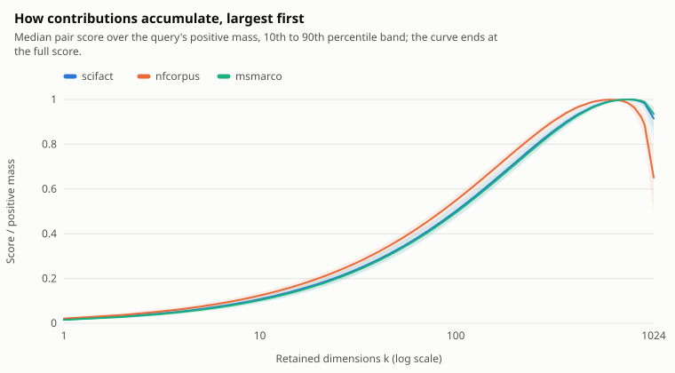

| statistic | environment | all queries, mean (p10 to p90) | single positive, mean (p10 to p90) | multiple positives, mean (p10 to p90) | pair-weighted mean |
|---|---|---|---|---|---|
| full-vector score | scifact | 0.656 (0.498 to 0.800) | 0.655 (0.487 to 0.804) | 0.663 (0.574 to 0.778) | 0.658 |
| full-vector score | nfcorpus | 0.347 (0.218 to 0.477) | 0.409 (0.201 to 0.663) | 0.342 (0.220 to 0.463) | 0.319 |
| full-vector score | msmarco | 0.695 (0.568 to 0.808) | 0.696 (0.569 to 0.810) | 0.668 (0.556 to 0.773) | 0.693 |
| query norm | scifact | 1.000 (1.000 to 1.000) | 1.000 (1.000 to 1.000) | 1.000 (1.000 to 1.000) | 1.000 |
| query norm | nfcorpus | 1.000 (1.000 to 1.000) | 1.000 (1.000 to 1.000) | 1.000 (1.000 to 1.000) | 1.000 |
| query norm | msmarco | 1.000 (1.000 to 1.000) | 1.000 (1.000 to 1.000) | 1.000 (1.000 to 1.000) | 1.000 |
| document norm | scifact | 1.000 (1.000 to 1.000) | 1.000 (1.000 to 1.000) | 1.000 (1.000 to 1.000) | 1.000 |
| document norm | nfcorpus | 1.000 (1.000 to 1.000) | 1.000 (1.000 to 1.000) | 1.000 (1.000 to 1.000) | 1.000 |
| document norm | msmarco | 1.000 (1.000 to 1.000) | 1.000 (1.000 to 1.000) | 1.000 (1.000 to 1.000) | 1.000 |
| positive mass P | scifact | 0.721 (0.609 to 0.826) | 0.720 (0.603 to 0.831) | 0.725 (0.664 to 0.808) | 0.722 |
| positive mass P | nfcorpus | 0.516 (0.438 to 0.596) | 0.556 (0.423 to 0.724) | 0.513 (0.439 to 0.589) | 0.498 |
| positive mass P | msmarco | 0.748 (0.655 to 0.834) | 0.749 (0.656 to 0.835) | 0.729 (0.649 to 0.807) | 0.747 |
| negative mass N | scifact | 0.065 (0.028 to 0.111) | 0.066 (0.027 to 0.115) | 0.062 (0.032 to 0.090) | 0.065 |
| negative mass N | nfcorpus | 0.169 (0.119 to 0.219) | 0.147 (0.059 to 0.222) | 0.171 (0.125 to 0.218) | 0.179 |
| negative mass N | msmarco | 0.054 (0.025 to 0.088) | 0.053 (0.025 to 0.088) | 0.061 (0.033 to 0.093) | 0.054 |
| N / (P + N) | scifact | 0.086 (0.033 to 0.155) | 0.087 (0.031 to 0.159) | 0.081 (0.037 to 0.122) | 0.085 |
| N / (P + N) | nfcorpus | 0.251 (0.170 to 0.335) | 0.216 (0.077 to 0.344) | 0.254 (0.178 to 0.333) | 0.268 |
| N / (P + N) | msmarco | 0.069 (0.029 to 0.118) | 0.068 (0.029 to 0.118) | 0.079 (0.039 to 0.126) | 0.069 |
| dimensions with c > 0 | scifact | 745.095 (674.000 to 810.000) | 744.895 (671.000 to 811.200) | 747.007 (709.000 to 792.917) | 745.900 |
| dimensions with c > 0 | nfcorpus | 626.982 (583.727 to 674.000) | 650.822 (574.000 to 747.000) | 625.118 (584.000 to 669.466) | 616.405 |
| dimensions with c > 0 | msmarco | 762.483 (704.000 to 819.000) | 763.130 (704.000 to 819.000) | 750.581 (700.500 to 799.500) | 761.708 |
| dimensions with c < 0 | scifact | 276.893 (212.000 to 349.000) | 277.103 (211.000 to 350.000) | 274.891 (229.050 to 313.600) | 276.084 |
| dimensions with c < 0 | nfcorpus | 394.804 (348.600 to 438.500) | 371.071 (275.000 to 446.200) | 396.659 (352.813 to 438.000) | 405.283 |
| dimensions with c < 0 | msmarco | 259.144 (203.000 to 318.000) | 258.496 (202.000 to 317.000) | 271.051 (222.333 to 321.000) | 259.919 |
| dimensions with c = 0 | scifact | 2.011 (0.000 to 4.000) | 2.002 (0.000 to 4.000) | 2.102 (0.633 to 3.600) | 2.016 |
| dimensions with c = 0 | nfcorpus | 2.214 (0.909 to 3.917) | 2.107 (1.000 to 4.000) | 2.223 (0.905 to 3.896) | 2.312 |
| dimensions with c = 0 | msmarco | 2.374 (1.000 to 4.000) | 2.374 (1.000 to 4.000) | 2.368 (0.667 to 4.000) | 2.373 |
| sign agreement, by count | scifact | 0.729 (0.659 to 0.792) | 0.729 (0.658 to 0.793) | 0.731 (0.693 to 0.776) | 0.730 |
| sign agreement, by count | nfcorpus | 0.614 (0.571 to 0.659) | 0.637 (0.563 to 0.731) | 0.612 (0.571 to 0.655) | 0.603 |
| sign agreement, by count | msmarco | 0.746 (0.689 to 0.801) | 0.747 (0.689 to 0.802) | 0.735 (0.686 to 0.783) | 0.746 |
| effective positive dimensions | scifact | 258.935 (225.762 to 291.956) | 258.899 (224.376 to 292.286) | 259.277 (234.002 to 285.521) | 258.981 |
| effective positive dimensions | nfcorpus | 217.649 (193.716 to 240.309) | 226.119 (190.272 to 263.678) | 216.987 (194.305 to 238.720) | 213.704 |
| effective positive dimensions | msmarco | 268.449 (238.074 to 298.181) | 268.713 (238.243 to 298.520) | 263.598 (235.854 to 290.449) | 268.124 |
| effective negative dimensions | scifact | 111.096 (84.164 to 140.041) | 111.184 (82.909 to 140.659) | 110.259 (88.631 to 130.115) | 110.705 |
| effective negative dimensions | nfcorpus | 152.928 (135.117 to 170.313) | 144.659 (106.754 to 178.006) | 153.575 (136.586 to 169.830) | 157.088 |
| effective negative dimensions | msmarco | 103.638 (79.163 to 128.974) | 103.404 (78.835 to 128.976) | 107.945 (86.498 to 128.827) | 103.921 |
| share of P in the largest c | scifact | 0.018 (0.012 to 0.024) | 0.018 (0.012 to 0.025) | 0.017 (0.013 to 0.022) | 0.018 |
| share of P in the largest c | nfcorpus | 0.022 (0.016 to 0.029) | 0.021 (0.014 to 0.030) | 0.022 (0.017 to 0.029) | 0.023 |
| share of P in the largest c | msmarco | 0.016 (0.012 to 0.022) | 0.016 (0.012 to 0.022) | 0.017 (0.012 to 0.021) | 0.016 |
| share of P in the top 10 | scifact | 0.108 (0.093 to 0.125) | 0.108 (0.093 to 0.125) | 0.108 (0.094 to 0.120) | 0.108 |
| share of P in the top 10 | nfcorpus | 0.124 (0.112 to 0.138) | 0.121 (0.103 to 0.139) | 0.125 (0.112 to 0.138) | 0.126 |
| share of P in the top 10 | msmarco | 0.104 (0.090 to 0.119) | 0.104 (0.090 to 0.119) | 0.106 (0.093 to 0.120) | 0.104 |
| share of P in the top 100 | scifact | 0.502 (0.474 to 0.532) | 0.502 (0.473 to 0.533) | 0.503 (0.481 to 0.527) | 0.502 |
| share of P in the top 100 | nfcorpus | 0.547 (0.524 to 0.570) | 0.537 (0.499 to 0.577) | 0.548 (0.526 to 0.570) | 0.551 |
| share of P in the top 100 | msmarco | 0.495 (0.468 to 0.523) | 0.495 (0.468 to 0.523) | 0.499 (0.476 to 0.525) | 0.495 |
| dimensions for 50% of P | scifact | 100.122 (90.000 to 110.000) | 100.187 (90.000 to 110.000) | 99.509 (91.200 to 107.500) | 100.019 |
| dimensions for 50% of P | nfcorpus | 85.804 (79.141 to 92.810) | 88.947 (77.000 to 101.000) | 85.558 (79.277 to 92.122) | 84.719 |
| dimensions for 50% of P | msmarco | 102.534 (93.000 to 112.000) | 102.621 (93.000 to 112.000) | 100.941 (92.000 to 109.500) | 102.430 |
| dimensions for 80% of P | scifact | 259.425 (237.000 to 282.000) | 259.401 (235.800 to 283.000) | 259.654 (246.800 to 273.667) | 259.465 |
| dimensions for 80% of P | nfcorpus | 223.127 (207.889 to 239.875) | 230.675 (204.000 to 259.000) | 222.538 (208.000 to 238.206) | 220.210 |
| dimensions for 80% of P | msmarco | 265.455 (245.000 to 286.000) | 265.654 (245.000 to 286.000) | 261.789 (243.500 to 279.333) | 265.215 |
| dimensions for 90% of P | scifact | 365.330 (334.000 to 395.000) | 365.252 (333.000 to 397.000) | 366.079 (348.800 to 383.867) | 365.509 |
| dimensions for 90% of P | nfcorpus | 313.563 (292.917 to 336.842) | 324.343 (288.800 to 367.200) | 312.720 (293.000 to 334.498) | 309.218 |
| dimensions for 90% of P | msmarco | 373.704 (346.000 to 400.000) | 373.987 (346.000 to 401.000) | 368.508 (344.000 to 392.000) | 373.365 |
| dimensions for 95% of P | scifact | 453.213 (414.000 to 489.000) | 453.080 (411.800 to 490.000) | 454.481 (433.800 to 477.200) | 453.526 |
| dimensions for 95% of P | nfcorpus | 387.803 (362.406 to 415.972) | 401.456 (359.800 to 455.000) | 386.736 (362.654 to 413.078) | 382.163 |
| dimensions for 95% of P | msmarco | 463.255 (429.000 to 496.000) | 463.611 (430.000 to 496.000) | 456.713 (426.500 to 485.000) | 462.828 |
| dimensions for 99% of P | scifact | 593.370 (541.700 to 640.000) | 593.168 (539.000 to 641.000) | 595.293 (565.700 to 630.733) | 593.938 |
| dimensions for 99% of P | nfcorpus | 504.900 (471.612 to 541.333) | 523.207 (465.800 to 595.000) | 503.469 (471.945 to 537.973) | 497.075 |
| dimensions for 99% of P | msmarco | 606.192 (562.000 to 649.000) | 606.672 (562.000 to 649.000) | 597.375 (559.000 to 634.000) | 605.616 |
| smallest k whose maximum reaches the full score | scifact | 393.412 (254.100 to 532.300) | 392.914 (246.800 to 537.000) | 398.175 (312.250 to 499.700) | 395.055 |
| smallest k whose maximum reaches the full score | nfcorpus | 161.251 (83.194 to 245.750) | 206.343 (73.800 to 398.800) | 157.727 (84.003 to 237.226) | 142.195 |
| smallest k whose maximum reaches the full score | msmarco | 431.028 (309.000 to 550.000) | 432.436 (309.000 to 552.000) | 405.130 (301.500 to 508.500) | 429.360 |
| var log|c|: query share | scifact | 0.404 (0.356 to 0.452) | 0.404 (0.355 to 0.454) | 0.405 (0.370 to 0.436) | 0.404 |
| var log|c|: query share | nfcorpus | 0.462 (0.433 to 0.490) | 0.449 (0.393 to 0.495) | 0.463 (0.435 to 0.490) | 0.466 |
| var log|c|: query share | msmarco | 0.395 (0.354 to 0.438) | 0.395 (0.354 to 0.438) | 0.402 (0.367 to 0.440) | 0.396 |
| var log|c|: document share | scifact | 0.406 (0.361 to 0.454) | 0.407 (0.361 to 0.455) | 0.403 (0.367 to 0.432) | 0.406 |
| var log|c|: document share | nfcorpus | 0.465 (0.435 to 0.494) | 0.457 (0.409 to 0.504) | 0.465 (0.438 to 0.493) | 0.470 |
| var log|c|: document share | msmarco | 0.394 (0.353 to 0.437) | 0.394 (0.353 to 0.437) | 0.401 (0.366 to 0.438) | 0.395 |
| var log|c|: covariance share | scifact | 0.189 (0.111 to 0.270) | 0.189 (0.106 to 0.273) | 0.192 (0.140 to 0.251) | 0.190 |
| var log|c|: covariance share | nfcorpus | 0.073 (0.038 to 0.112) | 0.093 (0.019 to 0.196) | 0.072 (0.038 to 0.109) | 0.064 |
| var log|c|: covariance share | msmarco | 0.210 (0.140 to 0.278) | 0.211 (0.140 to 0.279) | 0.196 (0.138 to 0.255) | 0.209 |
| |q| percentile of the top 50 c | scifact | 0.949 (0.933 to 0.963) | 0.949 (0.932 to 0.963) | 0.951 (0.937 to 0.961) | 0.949 |
| |q| percentile of the top 50 c | nfcorpus | 0.914 (0.895 to 0.932) | 0.920 (0.888 to 0.950) | 0.914 (0.896 to 0.931) | 0.911 |
| |q| percentile of the top 50 c | msmarco | 0.953 (0.939 to 0.964) | 0.953 (0.939 to 0.964) | 0.950 (0.938 to 0.961) | 0.952 |
| |d| percentile of the top 50 c | scifact | 0.949 (0.933 to 0.963) | 0.949 (0.933 to 0.964) | 0.951 (0.940 to 0.961) | 0.949 |
| |d| percentile of the top 50 c | nfcorpus | 0.914 (0.896 to 0.931) | 0.921 (0.891 to 0.951) | 0.914 (0.896 to 0.930) | 0.911 |
| |d| percentile of the top 50 c | msmarco | 0.953 (0.939 to 0.964) | 0.953 (0.939 to 0.964) | 0.950 (0.939 to 0.961) | 0.953 |

### Every cardinality

Each pair has one descending contribution ordering, computed once and reused for every k
from 1 to 1024. Three different quantities come from it: **raw similarity** (the
unnormalized score of the top k), **positive mass retained**, and **negative mass
removed**. `k = 0`, the empty mask, scores 0 by definition and appears only as a labeled
reference row. Every value, with its standard error and eligible query count, is in
`tables/curves-<environment>.csv` (positive-count strata in
`tables/strata-curves-<environment>.csv`); checkpoint rows here are samples of those.

- **scifact, raw similarity.** Relevant pairs peak at 0.720 with k = 740 and end at 0.656; matched reference pairs peak at 0.463 with k = 597 and end at 0.262. Both are the largest inner product any mask of that size can give the pair.
- **nfcorpus, raw similarity.** Relevant pairs peak at 0.516 with k = 628 and end at 0.347; matched reference pairs peak at 0.451 with k = 591 and end at 0.242. Both are the largest inner product any mask of that size can give the pair.
- **msmarco, raw similarity.** Relevant pairs peak at 0.748 with k = 758 and end at 0.695; matched reference pairs peak at 0.378 with k = 551 and end at 0.114. Both are the largest inner product any mask of that size can give the pair.

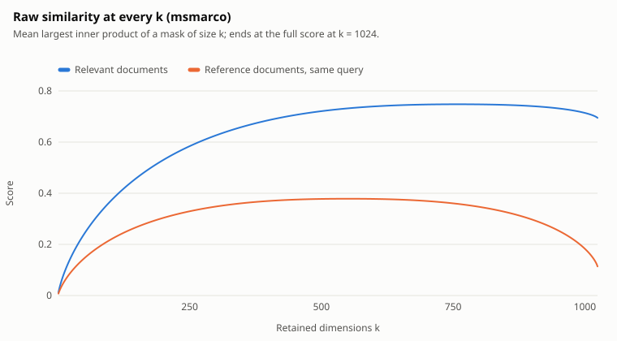
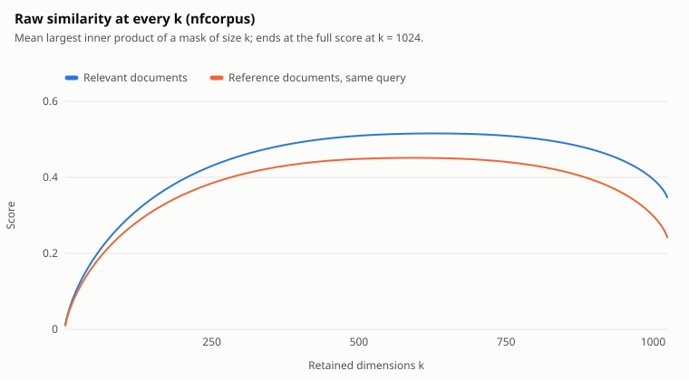
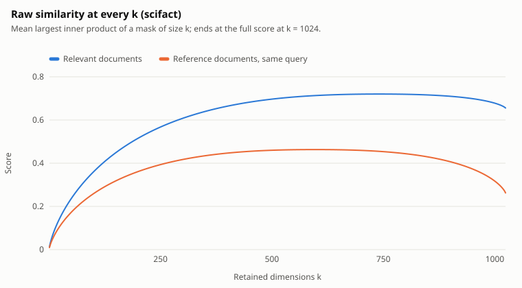

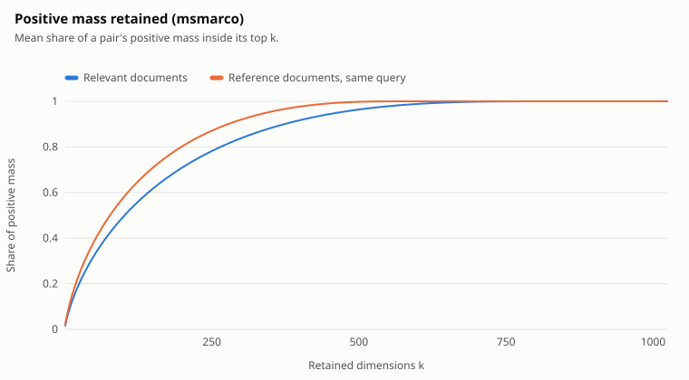
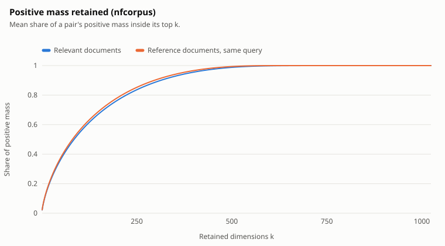
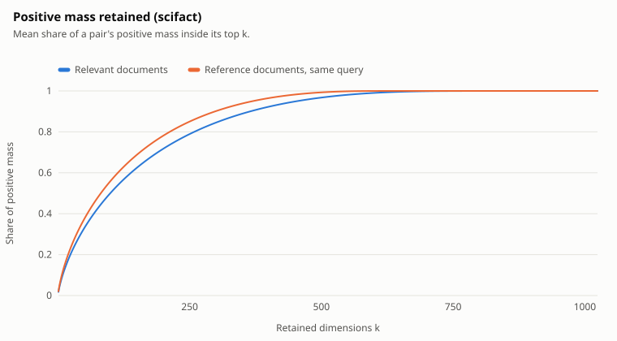

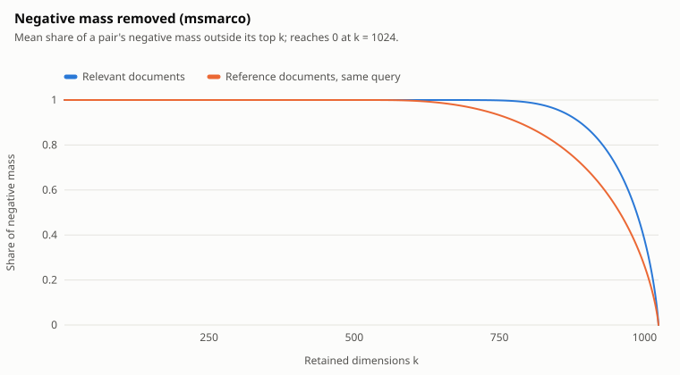
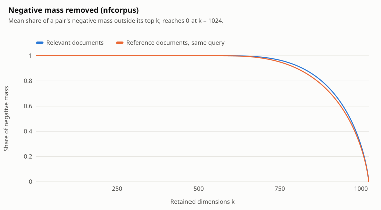
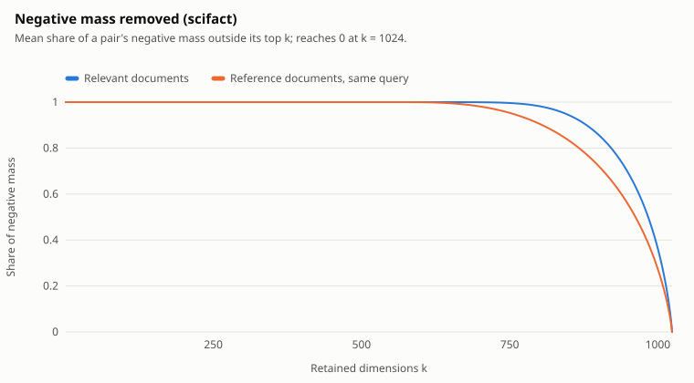

| environment | k | raw similarity, relevant | raw similarity, reference | positive mass retained, relevant | positive mass retained, reference | negative mass removed, relevant | negative mass removed, reference |
|---|---|---|---|---|---|---|---|
| scifact | 102 | 0.364 (0.321 to 0.406) | 0.262 (0.245 to 0.281) | 0.508 (0.480 to 0.538) | 0.566 (0.551 to 0.582) | 1.000 (1.000 to 1.000) | 1.000 (1.000 to 1.000) |
| scifact | 204 | 0.520 (0.456 to 0.583) | 0.364 (0.339 to 0.389) | 0.724 (0.695 to 0.754) | 0.788 (0.774 to 0.802) | 1.000 (1.000 to 1.000) | 1.000 (1.000 to 1.000) |
| scifact | 307 | 0.613 (0.532 to 0.691) | 0.420 (0.390 to 0.449) | 0.852 (0.827 to 0.877) | 0.907 (0.897 to 0.918) | 1.000 (1.000 to 1.000) | 1.000 (1.000 to 1.000) |
| scifact | 409 | 0.668 (0.575 to 0.755) | 0.448 (0.416 to 0.482) | 0.928 (0.909 to 0.948) | 0.969 (0.963 to 0.975) | 1.000 (1.000 to 1.000) | 1.000 (1.000 to 1.000) |
| scifact | 512 | 0.699 (0.598 to 0.793) | 0.461 (0.426 to 0.496) | 0.971 (0.959 to 0.984) | 0.995 (0.992 to 0.997) | 1.000 (1.000 to 1.000) | 1.000 (1.000 to 1.000) |
| scifact | 614 | 0.715 (0.608 to 0.815) | 0.463 (0.427 to 0.499) | 0.992 (0.986 to 0.998) | 1.000 (1.000 to 1.000) | 1.000 (1.000 to 1.000) | 0.999 (0.998 to 1.000) |
| scifact | 716 | 0.720 (0.609 to 0.824) | 0.458 (0.420 to 0.496) | 0.999 (0.998 to 1.000) | 1.000 (1.000 to 1.000) | 0.999 (0.996 to 1.000) | 0.974 (0.967 to 0.982) |
| scifact | 819 | 0.718 (0.602 to 0.826) | 0.439 (0.397 to 0.481) | 1.000 (1.000 to 1.000) | 1.000 (1.000 to 1.000) | 0.972 (0.933 to 1.000) | 0.882 (0.867 to 0.898) |
| scifact | 921 | 0.706 (0.578 to 0.823) | 0.394 (0.347 to 0.441) | 1.000 (1.000 to 1.000) | 1.000 (1.000 to 1.000) | 0.801 (0.720 to 0.884) | 0.660 (0.640 to 0.681) |
| nfcorpus | 102 | 0.284 (0.248 to 0.319) | 0.256 (0.237 to 0.275) | 0.553 (0.530 to 0.576) | 0.569 (0.555 to 0.583) | 1.000 (1.000 to 1.000) | 1.000 (1.000 to 1.000) |
| nfcorpus | 204 | 0.397 (0.346 to 0.447) | 0.356 (0.329 to 0.382) | 0.773 (0.749 to 0.795) | 0.790 (0.778 to 0.803) | 1.000 (1.000 to 1.000) | 1.000 (1.000 to 1.000) |
| nfcorpus | 307 | 0.460 (0.399 to 0.522) | 0.410 (0.378 to 0.441) | 0.895 (0.875 to 0.912) | 0.909 (0.900 to 0.919) | 1.000 (1.000 to 1.000) | 1.000 (1.000 to 1.000) |
| nfcorpus | 409 | 0.494 (0.425 to 0.565) | 0.438 (0.402 to 0.472) | 0.960 (0.947 to 0.972) | 0.970 (0.964 to 0.976) | 1.000 (1.000 to 1.000) | 1.000 (1.000 to 1.000) |
| nfcorpus | 512 | 0.511 (0.436 to 0.586) | 0.449 (0.412 to 0.486) | 0.990 (0.983 to 0.996) | 0.995 (0.993 to 0.997) | 1.000 (1.000 to 1.000) | 1.000 (1.000 to 1.000) |
| nfcorpus | 614 | 0.515 (0.438 to 0.595) | 0.451 (0.412 to 0.490) | 0.999 (0.998 to 1.000) | 1.000 (1.000 to 1.000) | 0.999 (0.998 to 1.000) | 0.999 (0.997 to 1.000) |
| nfcorpus | 716 | 0.513 (0.431 to 0.595) | 0.445 (0.404 to 0.486) | 1.000 (1.000 to 1.000) | 1.000 (1.000 to 1.000) | 0.982 (0.969 to 0.994) | 0.972 (0.964 to 0.980) |
| nfcorpus | 819 | 0.498 (0.410 to 0.587) | 0.425 (0.380 to 0.469) | 1.000 (1.000 to 1.000) | 1.000 (1.000 to 1.000) | 0.902 (0.873 to 0.933) | 0.878 (0.863 to 0.893) |
| nfcorpus | 921 | 0.461 (0.361 to 0.561) | 0.379 (0.327 to 0.429) | 1.000 (1.000 to 1.000) | 1.000 (1.000 to 1.000) | 0.687 (0.650 to 0.728) | 0.657 (0.639 to 0.675) |
| msmarco | 102 | 0.374 (0.337 to 0.408) | 0.221 (0.209 to 0.234) | 0.501 (0.474 to 0.529) | 0.585 (0.570 to 0.599) | 1.000 (1.000 to 1.000) | 1.000 (1.000 to 1.000) |
| msmarco | 204 | 0.535 (0.481 to 0.584) | 0.306 (0.289 to 0.323) | 0.716 (0.691 to 0.743) | 0.809 (0.797 to 0.821) | 1.000 (1.000 to 1.000) | 1.000 (1.000 to 1.000) |
| msmarco | 307 | 0.632 (0.566 to 0.691) | 0.350 (0.330 to 0.371) | 0.845 (0.823 to 0.868) | 0.926 (0.917 to 0.934) | 1.000 (1.000 to 1.000) | 1.000 (1.000 to 1.000) |
| msmarco | 409 | 0.690 (0.614 to 0.758) | 0.371 (0.349 to 0.394) | 0.923 (0.906 to 0.940) | 0.980 (0.976 to 0.984) | 1.000 (1.000 to 1.000) | 1.000 (1.000 to 1.000) |
| msmarco | 512 | 0.724 (0.641 to 0.799) | 0.378 (0.355 to 0.402) | 0.968 (0.956 to 0.980) | 0.999 (0.998 to 0.999) | 1.000 (1.000 to 1.000) | 1.000 (1.000 to 1.000) |
| msmarco | 614 | 0.741 (0.653 to 0.821) | 0.377 (0.353 to 0.402) | 0.991 (0.984 to 0.997) | 1.000 (1.000 to 1.000) | 1.000 (1.000 to 1.000) | 0.995 (0.993 to 0.997) |
| msmarco | 716 | 0.747 (0.655 to 0.831) | 0.367 (0.341 to 0.394) | 0.999 (0.997 to 1.000) | 1.000 (1.000 to 1.000) | 1.000 (1.000 to 1.000) | 0.957 (0.950 to 0.964) |
| msmarco | 819 | 0.747 (0.651 to 0.834) | 0.340 (0.311 to 0.369) | 1.000 (1.000 to 1.000) | 1.000 (1.000 to 1.000) | 0.981 (0.952 to 1.000) | 0.855 (0.842 to 0.867) |
| msmarco | 921 | 0.738 (0.634 to 0.831) | 0.281 (0.248 to 0.314) | 1.000 (1.000 to 1.000) | 1.000 (1.000 to 1.000) | 0.822 (0.750 to 0.894) | 0.633 (0.616 to 0.649) |

At `k = 1024` the curves must return to the unmasked pair, which checks the arithmetic:

| environment | |similarity(1024) - dot(q, d)| | |retained P(1024) - 1| | |removed N(1024)| | |Jaccard(1024) - 1| |
|---|---|---|---|---|
| scifact | 0.00e+00 | 0.00e+00 | 0.00e+00 | 0.00e+00 |
| nfcorpus | 0.00e+00 | 0.00e+00 | 0.00e+00 | 0.00e+00 |
| msmarco | 0.00e+00 | 0.00e+00 | 0.00e+00 | 0.00e+00 |

### What cardinality forces

At `k = 1024` every mask is the same set, so Jaccard 1 and a zero gap there are not
evidence of shared relevance structure. The same effect acts earlier: above `k = 512` two
masks must share at least `2k - 1024` dimensions (the floor), chance rises with k, and
any gap is squeezed toward zero by construction. Selection frequency saturates the same
way, and at `k = 1024` its rank correlations are undefined because every dimension is
always selected, so a fall in correlation near the top of the range is not by itself a
loss of structure. There, what a mask leaves out is the most negative contributions,
which can be large in magnitude, so correlation with magnitude can change sign.
Chance-corrected curves are in the run's `curves.json`.

### Control 1: sharing the same query vector

For each query, the masks of its relevant documents are compared with masks of
corpus-reference documents paired with that same query: the same number of documents,
drawn uniformly without looking at content, excluding the query's judged documents, in
repeated seeded samples. Reference documents are unjudged, not negatives. Reading up the
ladder: chance has no structure; different queries share only coordinates; the same query
adds `q`; relevant documents add whatever else relevant documents have in common.

- **scifact, uncertainty.** Over 69 multi-positive queries, the 95% interval of the mean within-query difference leaves zero at 1019 of 1024 k, first 1, last 1019. It reflects query sampling only, as a normal approximation, and says nothing about queries outside these training sets. These intervals are pointwise and exploratory: neighboring k are strongly dependent, so the count is not that many independent confirmations, and a difference from zero is not evidence of relevance structure by itself.
- **scifact, sharing q.** Over 69 multi-positive queries, the gap between relevant and reference masks is largest at k = 1: relevant 0.542, reference with the same query 0.196 (repeats 0.139 to 0.246), reference across queries 0.109, chance 0.000. Query halves put the gap between 0.208 and 0.473. Agreement among reference documents is what sharing q gives without any judged relationship.
- **scifact, what else differs.** The two groups are not alike apart from their judgment: full score 0.663 against 0.266, and cosine between a group's documents 0.717 against 0.275. The gap above may reflect either, not relevance itself.
- **nfcorpus, uncertainty.** Over 2162 multi-positive queries, the 95% interval of the mean within-query difference leaves zero at 1023 of 1024 k, first 1, last 1023. It reflects query sampling only, as a normal approximation, and says nothing about queries outside these training sets. These intervals are pointwise and exploratory: neighboring k are strongly dependent, so the count is not that many independent confirmations, and a difference from zero is not evidence of relevance structure by itself.
- **nfcorpus, sharing q.** Over 2162 multi-positive queries, the gap between relevant and reference masks is largest at k = 90: relevant 0.321, reference with the same query 0.253 (repeats 0.252 to 0.254), reference across queries 0.118, chance 0.046. Query halves put the gap between 0.066 and 0.070. Agreement among reference documents is what sharing q gives without any judged relationship.
- **nfcorpus, what else differs.** The two groups are not alike apart from their judgment: full score 0.342 against 0.243, and cosine between a group's documents 0.439 against 0.308. The gap above may reflect either, not relevance itself.
- **msmarco, uncertainty.** Over 2321 multi-positive queries, the 95% interval of the mean within-query difference leaves zero at 1022 of 1024 k, first 1, last 1022. It reflects query sampling only, as a normal approximation, and says nothing about queries outside these training sets. These intervals are pointwise and exploratory: neighboring k are strongly dependent, so the count is not that many independent confirmations, and a difference from zero is not evidence of relevance structure by itself.
- **msmarco, sharing q.** Over 2321 multi-positive queries, the gap between relevant and reference masks is largest at k = 1: relevant 0.461, reference with the same query 0.093 (repeats 0.089 to 0.099), reference across queries 0.012, chance 0.000. Query halves put the gap between 0.339 and 0.395. Agreement among reference documents is what sharing q gives without any judged relationship.
- **msmarco, what else differs.** The two groups are not alike apart from their judgment: full score 0.668 against 0.115, and cosine between a group's documents 0.664 against 0.164. The gap above may reflect either, not relevance itself.

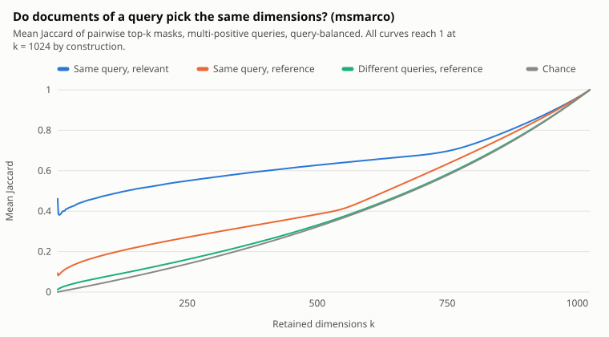
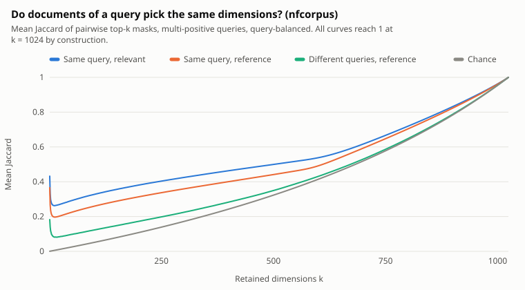
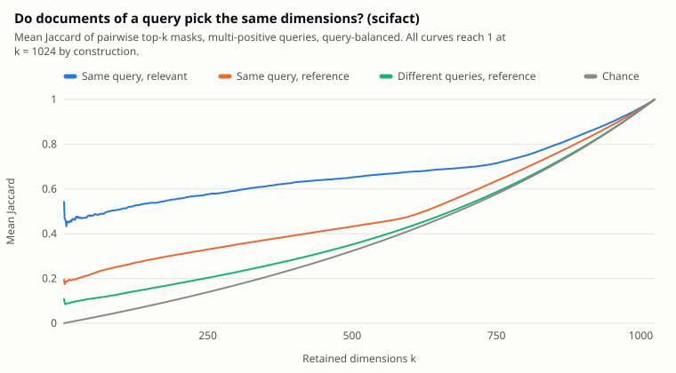

| environment | k | chance | floor | different queries, reference documents | same query, reference documents | same query, relevant documents | relevant minus reference (query p10 to p90) | reference repeats (min to max) | difference over query halves (min to max) |
|---|---|---|---|---|---|---|---|---|---|
| scifact | 102 | 0.052 | 0.000 | 0.133 (0.097 to 0.172) | 0.257 (0.238 to 0.283) | 0.512 (0.393 to 0.618) | 0.255 (0.131 to 0.356) | 0.249 to 0.263 | 0.238 to 0.288 |
| scifact | 204 | 0.111 | 0.000 | 0.181 (0.146 to 0.218) | 0.309 (0.289 to 0.330) | 0.558 (0.457 to 0.645) | 0.249 (0.149 to 0.340) | 0.306 to 0.315 | 0.230 to 0.268 |
| scifact | 307 | 0.176 | 0.000 | 0.233 (0.202 to 0.266) | 0.355 (0.339 to 0.372) | 0.597 (0.507 to 0.676) | 0.242 (0.157 to 0.322) | 0.352 to 0.357 | 0.232 to 0.261 |
| scifact | 409 | 0.250 | 0.000 | 0.291 (0.266 to 0.317) | 0.396 (0.384 to 0.414) | 0.632 (0.544 to 0.714) | 0.236 (0.146 to 0.321) | 0.390 to 0.400 | 0.227 to 0.253 |
| scifact | 512 | 0.333 | 0.000 | 0.361 (0.339 to 0.382) | 0.437 (0.422 to 0.454) | 0.655 (0.573 to 0.727) | 0.218 (0.137 to 0.291) | 0.429 to 0.442 | 0.208 to 0.235 |
| scifact | 614 | 0.428 | 0.199 | 0.445 (0.426 to 0.464) | 0.490 (0.475 to 0.505) | 0.679 (0.606 to 0.742) | 0.189 (0.110 to 0.267) | 0.485 to 0.495 | 0.177 to 0.203 |
| scifact | 716 | 0.538 | 0.398 | 0.548 (0.533 to 0.563) | 0.597 (0.583 to 0.607) | 0.701 (0.629 to 0.757) | 0.104 (0.031 to 0.168) | 0.594 to 0.601 | 0.092 to 0.120 |
| scifact | 819 | 0.666 | 0.600 | 0.673 (0.661 to 0.685) | 0.717 (0.707 to 0.726) | 0.765 (0.720 to 0.816) | 0.048 (-0.001 to 0.100) | 0.714 to 0.719 | 0.042 to 0.056 |
| scifact | 921 | 0.817 | 0.799 | 0.820 (0.813 to 0.827) | 0.846 (0.839 to 0.852) | 0.868 (0.840 to 0.897) | 0.022 (-0.004 to 0.050) | 0.845 to 0.847 | 0.018 to 0.026 |
| nfcorpus | 102 | 0.052 | 0.000 | 0.124 (0.085 to 0.166) | 0.261 (0.244 to 0.277) | 0.328 (0.277 to 0.394) | 0.068 (0.019 to 0.134) | 0.260 to 0.261 | 0.065 to 0.070 |
| nfcorpus | 204 | 0.111 | 0.000 | 0.175 (0.146 to 0.207) | 0.316 (0.302 to 0.329) | 0.383 (0.333 to 0.446) | 0.067 (0.020 to 0.131) | 0.315 to 0.316 | 0.065 to 0.070 |
| nfcorpus | 307 | 0.176 | 0.000 | 0.228 (0.199 to 0.256) | 0.362 (0.350 to 0.373) | 0.427 (0.381 to 0.490) | 0.065 (0.020 to 0.127) | 0.362 to 0.362 | 0.064 to 0.067 |
| nfcorpus | 409 | 0.250 | 0.000 | 0.288 (0.264 to 0.313) | 0.404 (0.394 to 0.414) | 0.467 (0.423 to 0.526) | 0.062 (0.019 to 0.122) | 0.404 to 0.404 | 0.061 to 0.064 |
| nfcorpus | 512 | 0.333 | 0.000 | 0.358 (0.337 to 0.378) | 0.446 (0.438 to 0.454) | 0.504 (0.463 to 0.560) | 0.058 (0.017 to 0.113) | 0.446 to 0.446 | 0.056 to 0.059 |
| nfcorpus | 614 | 0.428 | 0.199 | 0.444 (0.426 to 0.462) | 0.504 (0.497 to 0.512) | 0.546 (0.510 to 0.597) | 0.042 (0.007 to 0.093) | 0.504 to 0.504 | 0.041 to 0.044 |
| nfcorpus | 716 | 0.538 | 0.398 | 0.547 (0.533 to 0.563) | 0.610 (0.600 to 0.620) | 0.632 (0.602 to 0.674) | 0.022 (-0.005 to 0.061) | 0.610 to 0.610 | 0.021 to 0.023 |
| nfcorpus | 819 | 0.666 | 0.600 | 0.673 (0.661 to 0.685) | 0.726 (0.717 to 0.734) | 0.740 (0.717 to 0.770) | 0.014 (-0.005 to 0.041) | 0.726 to 0.726 | 0.013 to 0.015 |
| nfcorpus | 921 | 0.817 | 0.799 | 0.821 (0.813 to 0.828) | 0.850 (0.845 to 0.856) | 0.857 (0.845 to 0.875) | 0.007 (-0.003 to 0.022) | 0.850 to 0.851 | 0.006 to 0.007 |
| msmarco | 102 | 0.052 | 0.000 | 0.081 (0.057 to 0.109) | 0.191 (0.170 to 0.213) | 0.482 (0.368 to 0.606) | 0.291 (0.172 to 0.418) | 0.191 to 0.192 | 0.287 to 0.295 |
| msmarco | 204 | 0.111 | 0.000 | 0.135 (0.112 to 0.159) | 0.248 (0.230 to 0.267) | 0.532 (0.427 to 0.639) | 0.284 (0.174 to 0.393) | 0.248 to 0.249 | 0.280 to 0.288 |
| msmarco | 307 | 0.176 | 0.000 | 0.195 (0.174 to 0.216) | 0.297 (0.281 to 0.314) | 0.570 (0.472 to 0.673) | 0.272 (0.172 to 0.376) | 0.297 to 0.298 | 0.268 to 0.277 |
| msmarco | 409 | 0.250 | 0.000 | 0.262 (0.243 to 0.282) | 0.343 (0.329 to 0.358) | 0.602 (0.509 to 0.701) | 0.259 (0.164 to 0.357) | 0.343 to 0.344 | 0.254 to 0.263 |
| msmarco | 512 | 0.333 | 0.000 | 0.341 (0.323 to 0.358) | 0.390 (0.377 to 0.404) | 0.631 (0.542 to 0.721) | 0.240 (0.149 to 0.333) | 0.390 to 0.391 | 0.236 to 0.244 |
| msmarco | 614 | 0.428 | 0.199 | 0.434 (0.418 to 0.450) | 0.479 (0.467 to 0.491) | 0.656 (0.572 to 0.742) | 0.178 (0.093 to 0.264) | 0.479 to 0.479 | 0.174 to 0.182 |
| msmarco | 716 | 0.538 | 0.398 | 0.542 (0.528 to 0.557) | 0.594 (0.583 to 0.605) | 0.683 (0.607 to 0.764) | 0.089 (0.012 to 0.168) | 0.594 to 0.594 | 0.085 to 0.092 |
| msmarco | 819 | 0.666 | 0.600 | 0.671 (0.660 to 0.682) | 0.716 (0.707 to 0.724) | 0.750 (0.703 to 0.802) | 0.034 (-0.014 to 0.087) | 0.715 to 0.716 | 0.032 to 0.036 |
| msmarco | 921 | 0.817 | 0.799 | 0.820 (0.813 to 0.827) | 0.846 (0.841 to 0.851) | 0.858 (0.833 to 0.885) | 0.012 (-0.013 to 0.041) | 0.846 to 0.846 | 0.011 to 0.013 |

| environment | queries | multi-positive | reference samples per query | reference documents drawn | groups short of documents | queries using sampled pairs | pairs per query at most | corpus documents behind the scale |
|---|---|---|---|---|---|---|---|---|
| scifact | 728 | 69 | 5 | 4110 | 0 | 0 | 2000 | 5183 |
| nfcorpus | 2331 | 2162 | 5 | 504165 | 0 | 310 | 2000 | 3633 |
| msmarco | 45000 | 2321 | 5 | 238665 | 0 | 0 | 2000 | 200000 |

### Control 2: coordinate magnitude

Two views. First, whether relevant and reference documents select the same dimensions at
all, with `selection placed differently` the share of selection the two profiles place
differently. Second, the same analysis after dividing each contribution by
`mean|q_j| * mean|d_j|`, estimated from unlabeled vectors. Scaling removes that one
per-dimension size, not sign structure or within-query structure.

- **scifact, coordinate magnitude.** Selection frequency against `mean|q| x mean|d|` for relevant / reference documents, and relevant against reference: k = 102: 0.971 / 0.972 / 0.953; k = 512: 0.928 / 0.801 / 0.875; k = 921: 0.103 / -0.203 / 0.719; After scaling each contribution by that size, relevant / reference against it, and split-half Spearman of the excess over reference: k = 102: 0.296 / 0.601 / 0.673; k = 512: 0.672 / 0.634 / 0.728; k = 921: 0.714 / 0.633 / 0.449; The full curves are in `tables/frequency-curves-scifact.csv`.
- **nfcorpus, coordinate magnitude.** Selection frequency against `mean|q| x mean|d|` for relevant / reference documents, and relevant against reference: k = 102: 0.975 / 0.968 / 0.995; k = 512: 0.817 / 0.755 / 0.979; k = 921: -0.180 / -0.225 / 0.982; After scaling each contribution by that size, relevant / reference against it, and split-half Spearman of the excess over reference: k = 102: 0.573 / 0.564 / 0.727; k = 512: 0.617 / 0.583 / 0.756; k = 921: 0.622 / 0.572 / 0.580; The full curves are in `tables/frequency-curves-nfcorpus.csv`.
- **msmarco, coordinate magnitude.** Selection frequency against `mean|q| x mean|d|` for relevant / reference documents, and relevant against reference: k = 102: 0.991 / 0.962 / 0.960; k = 512: 0.968 / 0.634 / 0.724; k = 921: -0.397 / -0.635 / 0.803; After scaling each contribution by that size, relevant / reference against it, and split-half Spearman of the excess over reference: k = 102: 0.310 / 0.368 / 0.967; k = 512: 0.563 / 0.372 / 0.969; k = 921: 0.608 / 0.349 / 0.961; The full curves are in `tables/frequency-curves-msmarco.csv`.

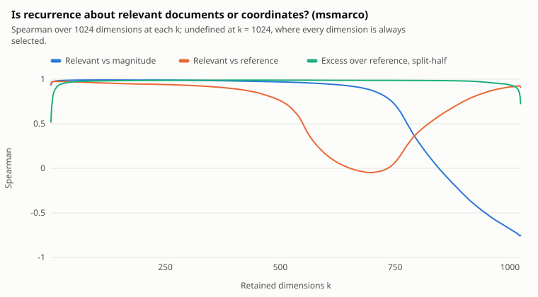
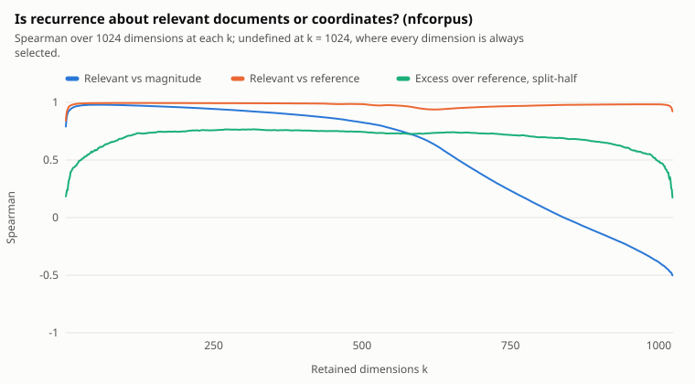
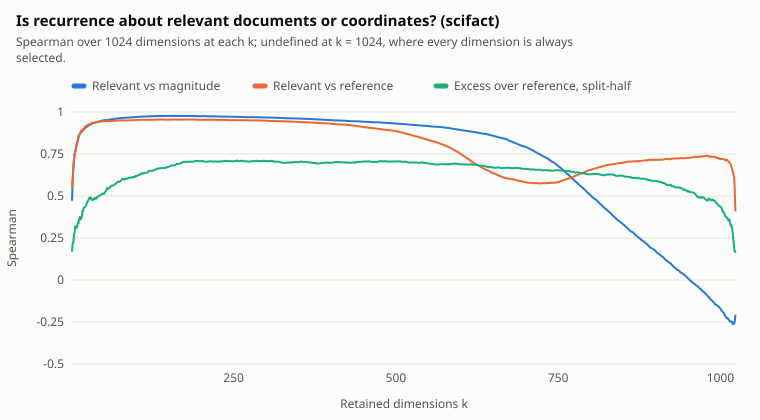

| environment | coordinates | k | relevant vs magnitude | reference vs magnitude | relevant vs reference | selection placed differently | excess vs magnitude | split-half relevant, mean (min) | split-half reference, mean (min) | split-half excess, mean (min) |
|---|---|---|---|---|---|---|---|---|---|---|
| scifact | raw | 102 | 0.971 | 0.972 | 0.953 | 0.089 | -0.166 | 0.938 (0.931) | 0.977 (0.976) | 0.623 (0.602) |
| scifact | raw | 204 | 0.975 | 0.950 | 0.954 | 0.065 | -0.177 | 0.947 (0.943) | 0.980 (0.979) | 0.706 (0.688) |
| scifact | raw | 307 | 0.967 | 0.921 | 0.947 | 0.050 | -0.098 | 0.944 (0.938) | 0.977 (0.976) | 0.709 (0.689) |
| scifact | raw | 409 | 0.950 | 0.882 | 0.927 | 0.041 | 0.036 | 0.935 (0.927) | 0.971 (0.970) | 0.702 (0.677) |
| scifact | raw | 512 | 0.928 | 0.801 | 0.875 | 0.036 | 0.213 | 0.918 (0.912) | 0.960 (0.958) | 0.703 (0.691) |
| scifact | raw | 614 | 0.885 | 0.569 | 0.713 | 0.032 | 0.411 | 0.886 (0.877) | 0.934 (0.932) | 0.687 (0.672) |
| scifact | raw | 716 | 0.759 | 0.267 | 0.577 | 0.026 | 0.506 | 0.805 (0.782) | 0.937 (0.934) | 0.656 (0.633) |
| scifact | raw | 819 | 0.437 | 0.019 | 0.678 | 0.018 | 0.515 | 0.763 (0.738) | 0.936 (0.930) | 0.626 (0.612) |
| scifact | raw | 921 | 0.103 | -0.203 | 0.719 | 0.011 | 0.477 | 0.759 (0.737) | 0.934 (0.929) | 0.564 (0.552) |
| scifact | scaled | 102 | 0.296 | 0.601 | 0.323 | 0.096 | -0.394 | 0.372 (0.326) | 0.845 (0.829) | 0.673 (0.653) |
| scifact | scaled | 204 | 0.590 | 0.631 | 0.624 | 0.081 | -0.407 | 0.519 (0.484) | 0.899 (0.896) | 0.725 (0.708) |
| scifact | scaled | 307 | 0.674 | 0.631 | 0.775 | 0.066 | -0.416 | 0.653 (0.628) | 0.913 (0.907) | 0.733 (0.718) |
| scifact | scaled | 409 | 0.668 | 0.633 | 0.789 | 0.052 | -0.417 | 0.706 (0.685) | 0.922 (0.920) | 0.743 (0.725) |
| scifact | scaled | 512 | 0.672 | 0.634 | 0.792 | 0.039 | -0.414 | 0.729 (0.714) | 0.932 (0.929) | 0.728 (0.721) |
| scifact | scaled | 614 | 0.681 | 0.630 | 0.787 | 0.028 | -0.366 | 0.753 (0.738) | 0.936 (0.934) | 0.649 (0.627) |
| scifact | scaled | 716 | 0.680 | 0.628 | 0.791 | 0.021 | -0.297 | 0.769 (0.751) | 0.930 (0.926) | 0.558 (0.535) |
| scifact | scaled | 819 | 0.696 | 0.630 | 0.815 | 0.014 | -0.153 | 0.811 (0.789) | 0.925 (0.922) | 0.497 (0.474) |
| scifact | scaled | 921 | 0.714 | 0.633 | 0.822 | 0.009 | 0.050 | 0.837 (0.814) | 0.920 (0.914) | 0.449 (0.415) |
| nfcorpus | raw | 102 | 0.975 | 0.968 | 0.995 | 0.028 | -0.098 | 0.991 (0.990) | 0.996 (0.995) | 0.700 (0.682) |
| nfcorpus | raw | 204 | 0.955 | 0.939 | 0.994 | 0.021 | -0.115 | 0.991 (0.990) | 0.996 (0.995) | 0.750 (0.728) |
| nfcorpus | raw | 307 | 0.925 | 0.901 | 0.993 | 0.016 | -0.060 | 0.990 (0.989) | 0.995 (0.994) | 0.766 (0.753) |
| nfcorpus | raw | 409 | 0.884 | 0.850 | 0.991 | 0.013 | 0.082 | 0.988 (0.986) | 0.994 (0.994) | 0.755 (0.739) |
| nfcorpus | raw | 512 | 0.817 | 0.755 | 0.979 | 0.011 | 0.253 | 0.983 (0.982) | 0.992 (0.991) | 0.739 (0.723) |
| nfcorpus | raw | 614 | 0.656 | 0.497 | 0.940 | 0.010 | 0.445 | 0.969 (0.966) | 0.989 (0.987) | 0.732 (0.713) |
| nfcorpus | raw | 716 | 0.332 | 0.207 | 0.963 | 0.007 | 0.468 | 0.967 (0.966) | 0.988 (0.987) | 0.729 (0.719) |
| nfcorpus | raw | 819 | 0.052 | -0.029 | 0.976 | 0.005 | 0.417 | 0.971 (0.970) | 0.988 (0.987) | 0.694 (0.683) |
| nfcorpus | raw | 921 | -0.180 | -0.225 | 0.982 | 0.003 | 0.341 | 0.972 (0.970) | 0.987 (0.986) | 0.639 (0.628) |
| nfcorpus | scaled | 102 | 0.573 | 0.564 | 0.947 | 0.032 | -0.276 | 0.915 (0.911) | 0.964 (0.961) | 0.727 (0.717) |
| nfcorpus | scaled | 204 | 0.618 | 0.584 | 0.969 | 0.025 | -0.329 | 0.946 (0.942) | 0.974 (0.972) | 0.762 (0.748) |
| nfcorpus | scaled | 307 | 0.617 | 0.587 | 0.973 | 0.020 | -0.345 | 0.953 (0.950) | 0.978 (0.977) | 0.785 (0.772) |
| nfcorpus | scaled | 409 | 0.619 | 0.587 | 0.975 | 0.015 | -0.339 | 0.958 (0.955) | 0.981 (0.980) | 0.782 (0.777) |
| nfcorpus | scaled | 512 | 0.617 | 0.583 | 0.973 | 0.011 | -0.320 | 0.962 (0.960) | 0.985 (0.984) | 0.756 (0.745) |
| nfcorpus | scaled | 614 | 0.618 | 0.576 | 0.970 | 0.008 | -0.247 | 0.966 (0.963) | 0.989 (0.987) | 0.692 (0.672) |
| nfcorpus | scaled | 716 | 0.618 | 0.569 | 0.969 | 0.006 | -0.164 | 0.966 (0.964) | 0.983 (0.982) | 0.663 (0.653) |
| nfcorpus | scaled | 819 | 0.617 | 0.569 | 0.970 | 0.005 | -0.064 | 0.967 (0.965) | 0.979 (0.978) | 0.634 (0.623) |
| nfcorpus | scaled | 921 | 0.622 | 0.572 | 0.970 | 0.003 | 0.068 | 0.966 (0.964) | 0.976 (0.974) | 0.580 (0.556) |
| msmarco | raw | 102 | 0.991 | 0.962 | 0.960 | 0.074 | 0.112 | 0.997 (0.997) | 0.999 (0.999) | 0.980 (0.980) |
| msmarco | raw | 204 | 0.991 | 0.933 | 0.945 | 0.055 | 0.215 | 0.997 (0.997) | 0.999 (0.999) | 0.986 (0.984) |
| msmarco | raw | 307 | 0.987 | 0.897 | 0.929 | 0.045 | 0.331 | 0.997 (0.997) | 0.999 (0.999) | 0.989 (0.988) |
| msmarco | raw | 409 | 0.979 | 0.834 | 0.887 | 0.039 | 0.452 | 0.996 (0.996) | 0.998 (0.998) | 0.989 (0.988) |
| msmarco | raw | 512 | 0.968 | 0.634 | 0.724 | 0.037 | 0.571 | 0.995 (0.994) | 0.995 (0.994) | 0.989 (0.988) |
| msmarco | raw | 614 | 0.942 | -0.074 | 0.099 | 0.035 | 0.671 | 0.992 (0.991) | 0.996 (0.995) | 0.987 (0.986) |
| msmarco | raw | 716 | 0.840 | -0.359 | -0.034 | 0.027 | 0.719 | 0.982 (0.981) | 0.997 (0.997) | 0.987 (0.986) |
| msmarco | raw | 819 | 0.167 | -0.514 | 0.486 | 0.018 | 0.723 | 0.968 (0.967) | 0.998 (0.998) | 0.985 (0.984) |
| msmarco | raw | 921 | -0.397 | -0.635 | 0.803 | 0.010 | 0.664 | 0.976 (0.974) | 0.998 (0.998) | 0.976 (0.973) |
| msmarco | scaled | 102 | 0.310 | 0.368 | 0.278 | 0.074 | -0.213 | 0.866 (0.861) | 0.983 (0.982) | 0.967 (0.966) |
| msmarco | scaled | 204 | 0.473 | 0.378 | 0.510 | 0.060 | -0.197 | 0.902 (0.899) | 0.985 (0.984) | 0.971 (0.969) |
| msmarco | scaled | 307 | 0.530 | 0.381 | 0.623 | 0.048 | -0.184 | 0.918 (0.914) | 0.986 (0.984) | 0.973 (0.972) |
| msmarco | scaled | 409 | 0.545 | 0.378 | 0.654 | 0.037 | -0.165 | 0.926 (0.923) | 0.987 (0.984) | 0.972 (0.970) |
| msmarco | scaled | 512 | 0.563 | 0.372 | 0.671 | 0.028 | -0.141 | 0.934 (0.931) | 0.988 (0.986) | 0.969 (0.967) |
| msmarco | scaled | 614 | 0.577 | 0.359 | 0.687 | 0.021 | -0.114 | 0.946 (0.944) | 0.987 (0.987) | 0.962 (0.958) |
| msmarco | scaled | 716 | 0.596 | 0.350 | 0.688 | 0.015 | -0.071 | 0.961 (0.960) | 0.986 (0.985) | 0.964 (0.963) |
| msmarco | scaled | 819 | 0.607 | 0.345 | 0.689 | 0.010 | 0.003 | 0.974 (0.973) | 0.985 (0.985) | 0.965 (0.964) |
| msmarco | scaled | 921 | 0.608 | 0.349 | 0.697 | 0.006 | 0.099 | 0.981 (0.980) | 0.984 (0.982) | 0.961 (0.959) |

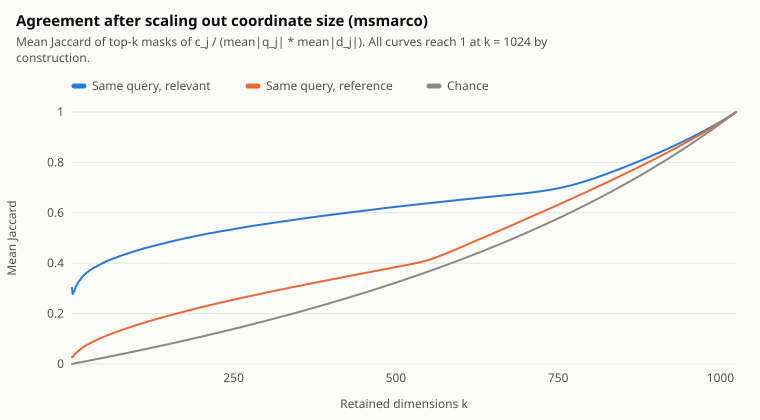
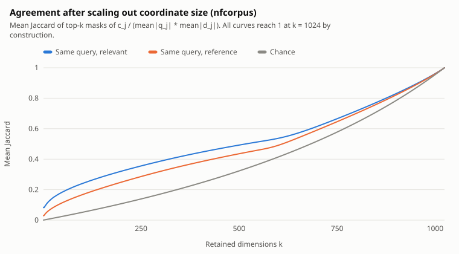
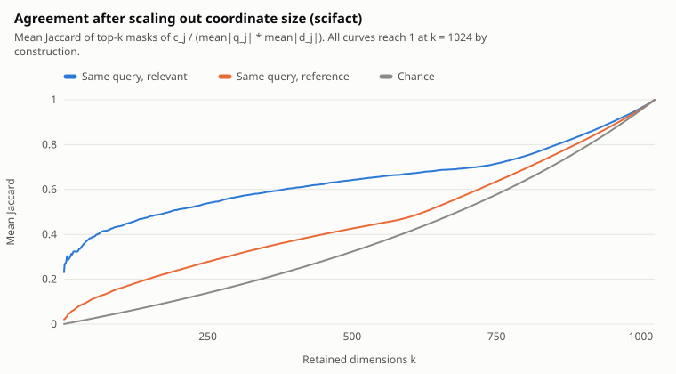

| environment | k | different queries, reference | same query, reference | same query, relevant | relevant minus reference |
|---|---|---|---|---|---|
| scifact | 102 | 0.056 (0.030 to 0.079) | 0.163 (0.148 to 0.180) | 0.439 (0.333 to 0.545) | 0.276 (0.157 to 0.384) |
| scifact | 204 | 0.120 (0.094 to 0.149) | 0.244 (0.229 to 0.264) | 0.513 (0.413 to 0.607) | 0.268 (0.167 to 0.370) |
| scifact | 307 | 0.195 (0.170 to 0.223) | 0.316 (0.301 to 0.331) | 0.570 (0.471 to 0.659) | 0.253 (0.151 to 0.341) |
| scifact | 409 | 0.272 (0.247 to 0.296) | 0.378 (0.366 to 0.393) | 0.610 (0.517 to 0.694) | 0.232 (0.138 to 0.314) |
| scifact | 512 | 0.355 (0.333 to 0.376) | 0.432 (0.417 to 0.448) | 0.646 (0.559 to 0.718) | 0.214 (0.130 to 0.290) |
| scifact | 614 | 0.446 (0.428 to 0.464) | 0.490 (0.475 to 0.505) | 0.675 (0.600 to 0.743) | 0.185 (0.106 to 0.259) |
| scifact | 716 | 0.550 (0.536 to 0.565) | 0.597 (0.585 to 0.607) | 0.700 (0.628 to 0.759) | 0.103 (0.030 to 0.166) |
| scifact | 819 | 0.674 (0.663 to 0.685) | 0.716 (0.708 to 0.725) | 0.766 (0.719 to 0.814) | 0.050 (0.003 to 0.099) |
| scifact | 921 | 0.821 (0.813 to 0.827) | 0.845 (0.839 to 0.850) | 0.866 (0.840 to 0.895) | 0.022 (-0.005 to 0.050) |
| nfcorpus | 102 | 0.056 (0.036 to 0.079) | 0.169 (0.161 to 0.177) | 0.242 (0.189 to 0.316) | 0.073 (0.022 to 0.146) |
| nfcorpus | 204 | 0.120 (0.094 to 0.146) | 0.252 (0.244 to 0.261) | 0.324 (0.273 to 0.392) | 0.072 (0.022 to 0.142) |
| nfcorpus | 307 | 0.194 (0.170 to 0.221) | 0.325 (0.317 to 0.333) | 0.392 (0.345 to 0.456) | 0.066 (0.020 to 0.130) |
| nfcorpus | 409 | 0.272 (0.249 to 0.296) | 0.387 (0.379 to 0.394) | 0.449 (0.405 to 0.509) | 0.062 (0.018 to 0.122) |
| nfcorpus | 512 | 0.354 (0.333 to 0.374) | 0.442 (0.435 to 0.448) | 0.498 (0.458 to 0.553) | 0.056 (0.016 to 0.112) |
| nfcorpus | 614 | 0.445 (0.426 to 0.462) | 0.504 (0.496 to 0.512) | 0.545 (0.510 to 0.597) | 0.042 (0.006 to 0.093) |
| nfcorpus | 716 | 0.550 (0.535 to 0.565) | 0.609 (0.600 to 0.618) | 0.631 (0.602 to 0.672) | 0.022 (-0.004 to 0.061) |
| nfcorpus | 819 | 0.674 (0.663 to 0.687) | 0.723 (0.717 to 0.730) | 0.738 (0.717 to 0.767) | 0.015 (-0.004 to 0.042) |
| nfcorpus | 921 | 0.821 (0.813 to 0.827) | 0.848 (0.844 to 0.851) | 0.855 (0.844 to 0.871) | 0.007 (-0.003 to 0.023) |
| msmarco | 102 | 0.055 (0.036 to 0.079) | 0.156 (0.138 to 0.174) | 0.451 (0.333 to 0.581) | 0.295 (0.174 to 0.423) |
| msmarco | 204 | 0.116 (0.094 to 0.136) | 0.228 (0.211 to 0.245) | 0.514 (0.404 to 0.632) | 0.286 (0.172 to 0.401) |
| msmarco | 307 | 0.183 (0.163 to 0.204) | 0.287 (0.271 to 0.303) | 0.559 (0.458 to 0.664) | 0.272 (0.169 to 0.375) |
| msmarco | 409 | 0.257 (0.238 to 0.276) | 0.340 (0.325 to 0.355) | 0.595 (0.501 to 0.692) | 0.255 (0.159 to 0.353) |
| msmarco | 512 | 0.340 (0.321 to 0.358) | 0.390 (0.377 to 0.404) | 0.627 (0.538 to 0.721) | 0.237 (0.147 to 0.331) |
| msmarco | 614 | 0.434 (0.418 to 0.450) | 0.479 (0.466 to 0.491) | 0.655 (0.571 to 0.744) | 0.177 (0.092 to 0.264) |
| msmarco | 716 | 0.542 (0.527 to 0.557) | 0.593 (0.583 to 0.603) | 0.683 (0.607 to 0.761) | 0.090 (0.014 to 0.170) |
| msmarco | 819 | 0.669 (0.658 to 0.680) | 0.713 (0.705 to 0.721) | 0.749 (0.703 to 0.802) | 0.036 (-0.011 to 0.090) |
| msmarco | 921 | 0.818 (0.811 to 0.826) | 0.843 (0.838 to 0.848) | 0.857 (0.832 to 0.885) | 0.014 (-0.012 to 0.042) |

### Control 3: the number of relevant documents

Mean pairwise Jaccard has no built-in dependence on group size, so it is compared within
strata. Sign-conflict coverage can only grow as documents join a group; the cancelled
share need not, and can fall. Both depend on group size, so they are compared at a fixed
group size, on relevant and matched reference documents. Only
queries with at least that many positives enter a row, and that selection remains.

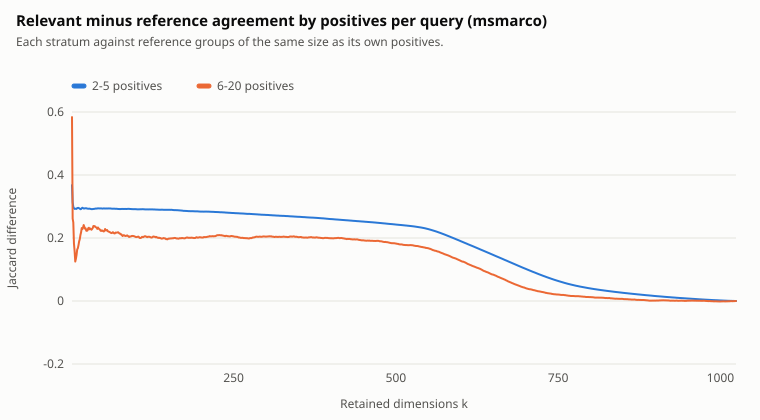
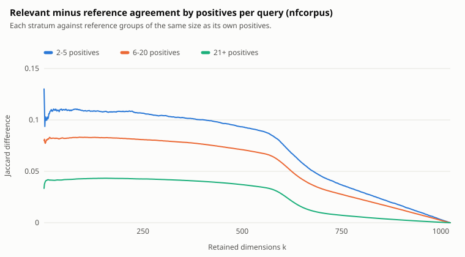
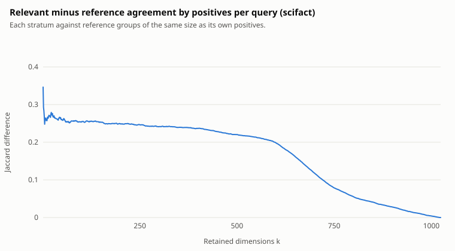

| environment | positives per query | k | queries | same query, relevant | same query, matched reference | relevant minus reference | mean difference, 95% interval over queries |
|---|---|---|---|---|---|---|---|
| scifact | 2-5 | 102 | 69 | 0.512 (0.393 to 0.618) | 0.257 (0.238 to 0.283) | 0.255 (0.131 to 0.356) | 0.255 (0.234 to 0.276) |
| scifact | 2-5 | 204 | 69 | 0.558 (0.457 to 0.645) | 0.309 (0.289 to 0.330) | 0.249 (0.149 to 0.340) | 0.249 (0.231 to 0.268) |
| scifact | 2-5 | 307 | 69 | 0.597 (0.507 to 0.676) | 0.355 (0.339 to 0.372) | 0.242 (0.157 to 0.322) | 0.242 (0.225 to 0.260) |
| scifact | 2-5 | 409 | 69 | 0.632 (0.544 to 0.714) | 0.396 (0.384 to 0.414) | 0.236 (0.146 to 0.321) | 0.236 (0.219 to 0.253) |
| scifact | 2-5 | 512 | 69 | 0.655 (0.573 to 0.727) | 0.437 (0.422 to 0.454) | 0.218 (0.137 to 0.291) | 0.218 (0.203 to 0.234) |
| scifact | 2-5 | 614 | 69 | 0.679 (0.606 to 0.742) | 0.490 (0.475 to 0.505) | 0.189 (0.110 to 0.267) | 0.189 (0.174 to 0.203) |
| scifact | 2-5 | 716 | 69 | 0.701 (0.629 to 0.757) | 0.597 (0.583 to 0.607) | 0.104 (0.031 to 0.168) | 0.104 (0.090 to 0.117) |
| scifact | 2-5 | 819 | 69 | 0.765 (0.720 to 0.816) | 0.717 (0.707 to 0.726) | 0.048 (-0.001 to 0.100) | 0.048 (0.039 to 0.057) |
| scifact | 2-5 | 921 | 69 | 0.868 (0.840 to 0.897) | 0.846 (0.839 to 0.852) | 0.022 (-0.004 to 0.050) | 0.022 (0.017 to 0.027) |
| scifact | 6-20 | 102 | 0 | n/a | n/a | n/a |  |
| scifact | 6-20 | 204 | 0 | n/a | n/a | n/a |  |
| scifact | 6-20 | 307 | 0 | n/a | n/a | n/a |  |
| scifact | 6-20 | 409 | 0 | n/a | n/a | n/a |  |
| scifact | 6-20 | 512 | 0 | n/a | n/a | n/a |  |
| scifact | 6-20 | 614 | 0 | n/a | n/a | n/a |  |
| scifact | 6-20 | 716 | 0 | n/a | n/a | n/a |  |
| scifact | 6-20 | 819 | 0 | n/a | n/a | n/a |  |
| scifact | 6-20 | 921 | 0 | n/a | n/a | n/a |  |
| scifact | 21+ | 102 | 0 | n/a | n/a | n/a |  |
| scifact | 21+ | 204 | 0 | n/a | n/a | n/a |  |
| scifact | 21+ | 307 | 0 | n/a | n/a | n/a |  |
| scifact | 21+ | 409 | 0 | n/a | n/a | n/a |  |
| scifact | 21+ | 512 | 0 | n/a | n/a | n/a |  |
| scifact | 21+ | 614 | 0 | n/a | n/a | n/a |  |
| scifact | 21+ | 716 | 0 | n/a | n/a | n/a |  |
| scifact | 21+ | 819 | 0 | n/a | n/a | n/a |  |
| scifact | 21+ | 921 | 0 | n/a | n/a | n/a |  |
| nfcorpus | 2-5 | 102 | 399 | 0.367 (0.277 to 0.479) | 0.258 (0.234 to 0.282) | 0.109 (0.018 to 0.214) | 0.109 (0.101 to 0.117) |
| nfcorpus | 2-5 | 204 | 399 | 0.422 (0.339 to 0.517) | 0.313 (0.294 to 0.334) | 0.108 (0.024 to 0.203) | 0.108 (0.101 to 0.115) |
| nfcorpus | 2-5 | 307 | 399 | 0.465 (0.389 to 0.554) | 0.360 (0.345 to 0.379) | 0.104 (0.026 to 0.195) | 0.104 (0.097 to 0.111) |
| nfcorpus | 2-5 | 409 | 399 | 0.502 (0.429 to 0.585) | 0.402 (0.388 to 0.419) | 0.100 (0.025 to 0.183) | 0.100 (0.093 to 0.106) |
| nfcorpus | 2-5 | 512 | 399 | 0.537 (0.468 to 0.622) | 0.445 (0.432 to 0.458) | 0.092 (0.020 to 0.175) | 0.092 (0.086 to 0.098) |
| nfcorpus | 2-5 | 614 | 399 | 0.577 (0.514 to 0.653) | 0.506 (0.491 to 0.519) | 0.072 (0.005 to 0.147) | 0.072 (0.066 to 0.077) |
| nfcorpus | 2-5 | 716 | 399 | 0.655 (0.601 to 0.713) | 0.613 (0.598 to 0.626) | 0.042 (-0.011 to 0.099) | 0.042 (0.038 to 0.047) |
| nfcorpus | 2-5 | 819 | 399 | 0.755 (0.717 to 0.799) | 0.728 (0.717 to 0.738) | 0.027 (-0.010 to 0.070) | 0.027 (0.024 to 0.031) |
| nfcorpus | 2-5 | 921 | 399 | 0.866 (0.845 to 0.889) | 0.852 (0.845 to 0.858) | 0.014 (-0.006 to 0.038) | 0.014 (0.012 to 0.016) |
| nfcorpus | 6-20 | 102 | 688 | 0.343 (0.295 to 0.400) | 0.260 (0.244 to 0.275) | 0.083 (0.037 to 0.137) | 0.083 (0.080 to 0.086) |
| nfcorpus | 6-20 | 204 | 688 | 0.397 (0.350 to 0.450) | 0.315 (0.301 to 0.329) | 0.082 (0.037 to 0.134) | 0.082 (0.079 to 0.085) |
| nfcorpus | 6-20 | 307 | 688 | 0.441 (0.399 to 0.493) | 0.361 (0.350 to 0.372) | 0.080 (0.036 to 0.131) | 0.080 (0.077 to 0.082) |
| nfcorpus | 6-20 | 409 | 688 | 0.480 (0.441 to 0.526) | 0.404 (0.394 to 0.413) | 0.076 (0.036 to 0.123) | 0.076 (0.073 to 0.079) |
| nfcorpus | 6-20 | 512 | 688 | 0.516 (0.479 to 0.562) | 0.446 (0.438 to 0.454) | 0.070 (0.033 to 0.115) | 0.070 (0.068 to 0.073) |
| nfcorpus | 6-20 | 614 | 688 | 0.558 (0.522 to 0.600) | 0.504 (0.497 to 0.512) | 0.054 (0.019 to 0.096) | 0.054 (0.051 to 0.056) |
| nfcorpus | 6-20 | 716 | 688 | 0.642 (0.610 to 0.679) | 0.611 (0.602 to 0.620) | 0.031 (0.003 to 0.066) | 0.031 (0.029 to 0.033) |
| nfcorpus | 6-20 | 819 | 688 | 0.747 (0.722 to 0.775) | 0.726 (0.718 to 0.734) | 0.021 (-0.001 to 0.047) | 0.021 (0.019 to 0.022) |
| nfcorpus | 6-20 | 921 | 688 | 0.861 (0.847 to 0.877) | 0.851 (0.846 to 0.856) | 0.011 (-0.001 to 0.026) | 0.011 (0.010 to 0.011) |
| nfcorpus | 21+ | 102 | 1075 | 0.305 (0.272 to 0.342) | 0.262 (0.247 to 0.277) | 0.043 (0.015 to 0.075) | 0.043 (0.041 to 0.044) |
| nfcorpus | 21+ | 204 | 1075 | 0.360 (0.329 to 0.396) | 0.317 (0.305 to 0.329) | 0.043 (0.016 to 0.075) | 0.043 (0.042 to 0.044) |
| nfcorpus | 21+ | 307 | 1075 | 0.405 (0.376 to 0.438) | 0.363 (0.353 to 0.372) | 0.042 (0.016 to 0.071) | 0.042 (0.041 to 0.043) |
| nfcorpus | 21+ | 409 | 1075 | 0.445 (0.418 to 0.475) | 0.405 (0.397 to 0.413) | 0.040 (0.016 to 0.069) | 0.040 (0.039 to 0.041) |
| nfcorpus | 21+ | 512 | 1075 | 0.483 (0.459 to 0.513) | 0.447 (0.441 to 0.453) | 0.036 (0.014 to 0.063) | 0.036 (0.035 to 0.038) |
| nfcorpus | 21+ | 614 | 1075 | 0.527 (0.508 to 0.550) | 0.503 (0.497 to 0.510) | 0.024 (0.005 to 0.048) | 0.024 (0.023 to 0.025) |
| nfcorpus | 21+ | 716 | 1075 | 0.617 (0.601 to 0.636) | 0.609 (0.600 to 0.618) | 0.009 (-0.005 to 0.026) | 0.009 (0.008 to 0.009) |
| nfcorpus | 21+ | 819 | 1075 | 0.729 (0.716 to 0.744) | 0.725 (0.717 to 0.732) | 0.005 (-0.005 to 0.017) | 0.005 (0.004 to 0.005) |
| nfcorpus | 21+ | 921 | 1075 | 0.852 (0.844 to 0.860) | 0.850 (0.845 to 0.855) | 0.002 (-0.003 to 0.009) | 0.002 (0.002 to 0.002) |
| msmarco | 2-5 | 102 | 2317 | 0.482 (0.369 to 0.606) | 0.191 (0.170 to 0.213) | 0.291 (0.172 to 0.418) | 0.291 (0.287 to 0.295) |
| msmarco | 2-5 | 204 | 2317 | 0.532 (0.427 to 0.639) | 0.248 (0.230 to 0.267) | 0.284 (0.174 to 0.393) | 0.284 (0.280 to 0.287) |
| msmarco | 2-5 | 307 | 2317 | 0.570 (0.472 to 0.673) | 0.297 (0.281 to 0.314) | 0.272 (0.172 to 0.376) | 0.272 (0.269 to 0.276) |
| msmarco | 2-5 | 409 | 2317 | 0.602 (0.509 to 0.701) | 0.343 (0.329 to 0.358) | 0.259 (0.164 to 0.357) | 0.259 (0.255 to 0.262) |
| msmarco | 2-5 | 512 | 2317 | 0.631 (0.542 to 0.721) | 0.390 (0.377 to 0.404) | 0.240 (0.149 to 0.333) | 0.240 (0.237 to 0.243) |
| msmarco | 2-5 | 614 | 2317 | 0.657 (0.572 to 0.742) | 0.479 (0.467 to 0.491) | 0.178 (0.093 to 0.264) | 0.178 (0.175 to 0.181) |
| msmarco | 2-5 | 716 | 2317 | 0.683 (0.607 to 0.764) | 0.594 (0.583 to 0.605) | 0.089 (0.012 to 0.168) | 0.089 (0.086 to 0.091) |
| msmarco | 2-5 | 819 | 2317 | 0.750 (0.703 to 0.802) | 0.716 (0.707 to 0.724) | 0.034 (-0.014 to 0.088) | 0.034 (0.032 to 0.036) |
| msmarco | 2-5 | 921 | 2317 | 0.858 (0.833 to 0.885) | 0.846 (0.841 to 0.851) | 0.012 (-0.013 to 0.041) | 0.012 (0.011 to 0.013) |
| msmarco | 6-20 | 102 | 4 | 0.401 (0.378 to 0.418) | 0.197 (0.192 to 0.203) | 0.204 (0.184 to 0.218) | 0.204 (0.185 to 0.223) |
| msmarco | 6-20 | 204 | 4 | 0.456 (0.426 to 0.487) | 0.253 (0.250 to 0.257) | 0.203 (0.175 to 0.233) | 0.203 (0.171 to 0.235) |
| msmarco | 6-20 | 307 | 4 | 0.504 (0.479 to 0.534) | 0.299 (0.297 to 0.302) | 0.205 (0.181 to 0.235) | 0.205 (0.174 to 0.237) |
| msmarco | 6-20 | 409 | 4 | 0.542 (0.528 to 0.564) | 0.342 (0.340 to 0.343) | 0.200 (0.186 to 0.221) | 0.200 (0.178 to 0.222) |
| msmarco | 6-20 | 512 | 4 | 0.566 (0.554 to 0.585) | 0.388 (0.385 to 0.391) | 0.178 (0.165 to 0.199) | 0.178 (0.157 to 0.200) |
| msmarco | 6-20 | 614 | 4 | 0.591 (0.577 to 0.611) | 0.476 (0.473 to 0.480) | 0.115 (0.103 to 0.134) | 0.115 (0.094 to 0.136) |
| msmarco | 6-20 | 716 | 4 | 0.626 (0.616 to 0.636) | 0.593 (0.590 to 0.596) | 0.033 (0.021 to 0.045) | 0.033 (0.020 to 0.045) |
| msmarco | 6-20 | 819 | 4 | 0.726 (0.717 to 0.735) | 0.715 (0.713 to 0.717) | 0.010 (0.001 to 0.022) | 0.010 (-0.002 to 0.022) |
| msmarco | 6-20 | 921 | 4 | 0.847 (0.844 to 0.850) | 0.846 (0.844 to 0.848) | 0.001 (-0.004 to 0.005) | 0.001 (-0.004 to 0.007) |
| msmarco | 21+ | 102 | 0 | n/a | n/a | n/a |  |
| msmarco | 21+ | 204 | 0 | n/a | n/a | n/a |  |
| msmarco | 21+ | 307 | 0 | n/a | n/a | n/a |  |
| msmarco | 21+ | 409 | 0 | n/a | n/a | n/a |  |
| msmarco | 21+ | 512 | 0 | n/a | n/a | n/a |  |
| msmarco | 21+ | 614 | 0 | n/a | n/a | n/a |  |
| msmarco | 21+ | 716 | 0 | n/a | n/a | n/a |  |
| msmarco | 21+ | 819 | 0 | n/a | n/a | n/a |  |
| msmarco | 21+ | 921 | 0 | n/a | n/a | n/a |  |

| environment | positives per query | queries | k | stratum vs corpus | stratum vs its own matched reference |
|---|---|---|---|---|---|
| scifact | 1 | 659 | 102 | 0.998 | 0.950 |
| scifact | 1 | 659 | 204 | 0.998 | 0.950 |
| scifact | 1 | 659 | 307 | 0.998 | 0.944 |
| scifact | 1 | 659 | 409 | 0.997 | 0.923 |
| scifact | 1 | 659 | 512 | 0.997 | 0.870 |
| scifact | 1 | 659 | 614 | 0.996 | 0.705 |
| scifact | 1 | 659 | 716 | 0.993 | 0.573 |
| scifact | 1 | 659 | 819 | 0.992 | 0.673 |
| scifact | 1 | 659 | 921 | 0.992 | 0.715 |
| scifact | 2-5 | 69 | 102 | 0.857 | 0.888 |
| scifact | 2-5 | 69 | 204 | 0.865 | 0.900 |
| scifact | 2-5 | 69 | 307 | 0.856 | 0.884 |
| scifact | 2-5 | 69 | 409 | 0.842 | 0.857 |
| scifact | 2-5 | 69 | 512 | 0.817 | 0.801 |
| scifact | 2-5 | 69 | 614 | 0.778 | 0.629 |
| scifact | 2-5 | 69 | 716 | 0.707 | 0.460 |
| scifact | 2-5 | 69 | 819 | 0.668 | 0.493 |
| scifact | 2-5 | 69 | 921 | 0.660 | 0.500 |
| nfcorpus | 1 | 169 | 102 | 0.913 | 0.913 |
| nfcorpus | 1 | 169 | 204 | 0.910 | 0.912 |
| nfcorpus | 1 | 169 | 307 | 0.898 | 0.902 |
| nfcorpus | 1 | 169 | 409 | 0.892 | 0.892 |
| nfcorpus | 1 | 169 | 512 | 0.876 | 0.843 |
| nfcorpus | 1 | 169 | 614 | 0.827 | 0.737 |
| nfcorpus | 1 | 169 | 716 | 0.786 | 0.717 |
| nfcorpus | 1 | 169 | 819 | 0.795 | 0.752 |
| nfcorpus | 1 | 169 | 921 | 0.801 | 0.764 |
| nfcorpus | 2-5 | 399 | 102 | 0.975 | 0.975 |
| nfcorpus | 2-5 | 399 | 204 | 0.978 | 0.976 |
| nfcorpus | 2-5 | 399 | 307 | 0.973 | 0.970 |
| nfcorpus | 2-5 | 399 | 409 | 0.968 | 0.962 |
| nfcorpus | 2-5 | 399 | 512 | 0.959 | 0.939 |
| nfcorpus | 2-5 | 399 | 614 | 0.935 | 0.877 |
| nfcorpus | 2-5 | 399 | 716 | 0.925 | 0.895 |
| nfcorpus | 2-5 | 399 | 819 | 0.936 | 0.921 |
| nfcorpus | 2-5 | 399 | 921 | 0.939 | 0.929 |
| nfcorpus | 6-20 | 688 | 102 | 0.993 | 0.992 |
| nfcorpus | 6-20 | 688 | 204 | 0.993 | 0.992 |
| nfcorpus | 6-20 | 688 | 307 | 0.991 | 0.990 |
| nfcorpus | 6-20 | 688 | 409 | 0.990 | 0.987 |
| nfcorpus | 6-20 | 688 | 512 | 0.987 | 0.973 |
| nfcorpus | 6-20 | 688 | 614 | 0.977 | 0.930 |
| nfcorpus | 6-20 | 688 | 716 | 0.976 | 0.956 |
| nfcorpus | 6-20 | 688 | 819 | 0.977 | 0.969 |
| nfcorpus | 6-20 | 688 | 921 | 0.978 | 0.975 |
| nfcorpus | 21+ | 1075 | 102 | 0.993 | 0.994 |
| nfcorpus | 21+ | 1075 | 204 | 0.993 | 0.994 |
| nfcorpus | 21+ | 1075 | 307 | 0.992 | 0.992 |
| nfcorpus | 21+ | 1075 | 409 | 0.991 | 0.990 |
| nfcorpus | 21+ | 1075 | 512 | 0.988 | 0.983 |
| nfcorpus | 21+ | 1075 | 614 | 0.981 | 0.950 |
| nfcorpus | 21+ | 1075 | 716 | 0.977 | 0.968 |
| nfcorpus | 21+ | 1075 | 819 | 0.980 | 0.975 |
| nfcorpus | 21+ | 1075 | 921 | 0.984 | 0.982 |
| msmarco | 1 | 42679 | 102 | 1.000 | 0.960 |
| msmarco | 1 | 42679 | 204 | 1.000 | 0.944 |
| msmarco | 1 | 42679 | 307 | 1.000 | 0.928 |
| msmarco | 1 | 42679 | 409 | 1.000 | 0.886 |
| msmarco | 1 | 42679 | 512 | 1.000 | 0.723 |
| msmarco | 1 | 42679 | 614 | 1.000 | 0.098 |
| msmarco | 1 | 42679 | 716 | 1.000 | -0.037 |
| msmarco | 1 | 42679 | 819 | 1.000 | 0.483 |
| msmarco | 1 | 42679 | 921 | 1.000 | 0.802 |
| msmarco | 2-5 | 2317 | 102 | 0.977 | 0.957 |
| msmarco | 2-5 | 2317 | 204 | 0.975 | 0.947 |
| msmarco | 2-5 | 2317 | 307 | 0.973 | 0.928 |
| msmarco | 2-5 | 2317 | 409 | 0.969 | 0.887 |
| msmarco | 2-5 | 2317 | 512 | 0.964 | 0.726 |
| msmarco | 2-5 | 2317 | 614 | 0.950 | 0.130 |
| msmarco | 2-5 | 2317 | 716 | 0.905 | 0.033 |
| msmarco | 2-5 | 2317 | 819 | 0.886 | 0.504 |
| msmarco | 2-5 | 2317 | 921 | 0.924 | 0.770 |
| msmarco | 6-20 | 4 | 102 | 0.437 | 0.761 |
| msmarco | 6-20 | 4 | 204 | 0.443 | 0.756 |
| msmarco | 6-20 | 4 | 307 | 0.406 | 0.723 |
| msmarco | 6-20 | 4 | 409 | 0.349 | 0.669 |
| msmarco | 6-20 | 4 | 512 | 0.302 | 0.494 |
| msmarco | 6-20 | 4 | 614 | 0.251 | 0.026 |
| msmarco | 6-20 | 4 | 716 | 0.168 | 0.034 |
| msmarco | 6-20 | 4 | 819 | 0.223 | 0.212 |
| msmarco | 6-20 | 4 | 921 | 0.287 | 0.320 |


### Relevant-document masks at checkpoints

Removing a dimension removes its contribution: the top-k ordering drops negative
contributions first and positive mass last, so `max - full` is negative mass removed
less positive mass removed. These rows are samples of the curves above, not substitutes.

| environment | k | max pair score | gain over full / (P + N) | |max - full| / (P + N) | positive mass removed | negative mass removed |
|---|---|---|---|---|---|---|
| scifact | 102 | 0.364 (0.321 to 0.406) | -0.365 (-0.465 to -0.243) | 0.365 (0.243 to 0.465) | 0.356 (0.285 to 0.427) | 0.065 (0.028 to 0.111) |
| scifact | 204 | 0.520 (0.456 to 0.583) | -0.167 (-0.259 to -0.058) | 0.170 (0.060 to 0.259) | 0.200 (0.153 to 0.251) | 0.065 (0.028 to 0.111) |
| scifact | 307 | 0.613 (0.532 to 0.691) | -0.050 (-0.132 to 0.047) | 0.075 (0.017 to 0.134) | 0.108 (0.076 to 0.141) | 0.065 (0.028 to 0.111) |
| scifact | 409 | 0.668 (0.575 to 0.755) | 0.019 (-0.053 to 0.110) | 0.051 (0.010 to 0.110) | 0.053 (0.032 to 0.073) | 0.065 (0.028 to 0.111) |
| scifact | 512 | 0.699 (0.598 to 0.793) | 0.059 (-0.007 to 0.142) | 0.063 (0.008 to 0.142) | 0.021 (0.010 to 0.033) | 0.065 (0.028 to 0.111) |
| scifact | 614 | 0.715 (0.608 to 0.815) | 0.079 (0.019 to 0.153) | 0.079 (0.019 to 0.153) | 0.006 (0.001 to 0.012) | 0.065 (0.028 to 0.111) |
| scifact | 716 | 0.720 (0.609 to 0.824) | 0.085 (0.031 to 0.155) | 0.085 (0.031 to 0.155) | 0.001 (0.000 to 0.002) | 0.065 (0.028 to 0.110) |
| scifact | 819 | 0.718 (0.602 to 0.826) | 0.082 (0.033 to 0.144) | 0.082 (0.033 to 0.144) | 0.000 (0.000 to 0.000) | 0.063 (0.028 to 0.103) |
| scifact | 921 | 0.706 (0.578 to 0.823) | 0.066 (0.029 to 0.112) | 0.066 (0.029 to 0.112) | 0.000 (0.000 to 0.000) | 0.050 (0.025 to 0.080) |
| nfcorpus | 102 | 0.284 (0.248 to 0.319) | -0.085 (-0.217 to 0.048) | 0.128 (0.058 to 0.221) | 0.232 (0.188 to 0.280) | 0.169 (0.119 to 0.219) |
| nfcorpus | 204 | 0.397 (0.346 to 0.447) | 0.079 (-0.037 to 0.195) | 0.126 (0.067 to 0.201) | 0.119 (0.091 to 0.150) | 0.169 (0.119 to 0.219) |
| nfcorpus | 307 | 0.460 (0.399 to 0.522) | 0.171 (0.067 to 0.275) | 0.179 (0.089 to 0.275) | 0.056 (0.039 to 0.075) | 0.169 (0.119 to 0.219) |
| nfcorpus | 409 | 0.494 (0.425 to 0.565) | 0.220 (0.126 to 0.315) | 0.221 (0.129 to 0.315) | 0.022 (0.013 to 0.033) | 0.169 (0.119 to 0.219) |
| nfcorpus | 512 | 0.511 (0.436 to 0.586) | 0.243 (0.157 to 0.332) | 0.243 (0.157 to 0.332) | 0.006 (0.002 to 0.010) | 0.169 (0.119 to 0.219) |
| nfcorpus | 614 | 0.515 (0.438 to 0.595) | 0.250 (0.168 to 0.334) | 0.250 (0.168 to 0.334) | 0.001 (0.000 to 0.002) | 0.169 (0.119 to 0.218) |
| nfcorpus | 716 | 0.513 (0.431 to 0.595) | 0.245 (0.169 to 0.323) | 0.245 (0.169 to 0.323) | 0.000 (0.000 to 0.000) | 0.165 (0.118 to 0.212) |
| nfcorpus | 819 | 0.498 (0.410 to 0.587) | 0.224 (0.157 to 0.291) | 0.224 (0.157 to 0.291) | 0.000 (0.000 to 0.000) | 0.151 (0.110 to 0.190) |
| nfcorpus | 921 | 0.461 (0.361 to 0.561) | 0.169 (0.121 to 0.217) | 0.169 (0.121 to 0.217) | 0.000 (0.000 to 0.000) | 0.114 (0.085 to 0.142) |
| msmarco | 102 | 0.374 (0.337 to 0.408) | -0.397 (-0.475 to -0.304) | 0.397 (0.304 to 0.475) | 0.375 (0.314 to 0.433) | 0.054 (0.025 to 0.088) |
| msmarco | 204 | 0.535 (0.481 to 0.584) | -0.196 (-0.267 to -0.112) | 0.197 (0.113 to 0.267) | 0.213 (0.171 to 0.255) | 0.054 (0.025 to 0.088) |
| msmarco | 307 | 0.632 (0.566 to 0.691) | -0.076 (-0.139 to -0.001) | 0.085 (0.024 to 0.140) | 0.117 (0.088 to 0.145) | 0.054 (0.025 to 0.088) |
| msmarco | 409 | 0.690 (0.614 to 0.758) | -0.004 (-0.060 to 0.064) | 0.040 (0.007 to 0.078) | 0.059 (0.040 to 0.078) | 0.054 (0.025 to 0.088) |
| msmarco | 512 | 0.724 (0.641 to 0.799) | 0.039 (-0.012 to 0.100) | 0.044 (0.006 to 0.100) | 0.025 (0.014 to 0.036) | 0.054 (0.025 to 0.088) |
| msmarco | 614 | 0.741 (0.653 to 0.821) | 0.060 (0.015 to 0.115) | 0.060 (0.015 to 0.115) | 0.007 (0.002 to 0.013) | 0.054 (0.025 to 0.088) |
| msmarco | 716 | 0.747 (0.655 to 0.831) | 0.068 (0.027 to 0.118) | 0.068 (0.027 to 0.118) | 0.001 (0.000 to 0.002) | 0.054 (0.025 to 0.088) |
| msmarco | 819 | 0.747 (0.651 to 0.834) | 0.067 (0.029 to 0.113) | 0.067 (0.029 to 0.113) | 0.000 (0.000 to 0.000) | 0.052 (0.025 to 0.084) |
| msmarco | 921 | 0.738 (0.634 to 0.831) | 0.055 (0.026 to 0.089) | 0.055 (0.026 to 0.089) | 0.000 (0.000 to 0.000) | 0.043 (0.022 to 0.066) |

| environment | k | within-query Jaccard | worst pair in the query | across-query Jaccard | chance | dims in all positives | dims in a majority | dims in at most half | dims in any |
|---|---|---|---|---|---|---|---|---|---|
| scifact | 102 | 0.512 (0.393 to 0.618) | 0.499 (0.377 to 0.606) | 0.110 (0.074 to 0.153) | 0.052 | 65.0 (52.6 to 76.2) | 8.2 (0.0 to 32.6) | 68.2 (48.0 to 94.4) | 141.4 (127.8 to 153.2) |
| scifact | 204 | 0.558 (0.457 to 0.645) | 0.547 (0.441 to 0.635) | 0.163 (0.130 to 0.196) | 0.111 | 137.4 (115.6 to 157.2) | 19.3 (0.0 to 78.6) | 114.9 (81.2 to 158.0) | 271.6 (250.8 to 297.0) |
| scifact | 307 | 0.597 (0.507 to 0.676) | 0.588 (0.498 to 0.665) | 0.220 (0.192 to 0.251) | 0.176 | 217.7 (188.8 to 244.2) | 26.1 (0.0 to 107.0) | 153.6 (104.8 to 200.8) | 397.4 (369.8 to 426.0) |
| scifact | 409 | 0.632 (0.544 to 0.714) | 0.623 (0.532 to 0.704) | 0.285 (0.258 to 0.311) | 0.250 | 301.9 (266.8 to 336.2) | 33.0 (0.0 to 129.6) | 181.3 (117.8 to 244.8) | 516.2 (481.8 to 552.2) |
| scifact | 512 | 0.655 (0.573 to 0.727) | 0.648 (0.544 to 0.719) | 0.359 (0.337 to 0.382) | 0.333 | 387.4 (348.8 to 428.0) | 40.4 (0.0 to 164.2) | 206.8 (142.4 to 281.2) | 634.6 (596.0 to 675.2) |
| scifact | 614 | 0.679 (0.606 to 0.742) | 0.672 (0.572 to 0.742) | 0.445 (0.426 to 0.462) | 0.428 | 475.6 (427.0 to 522.2) | 47.5 (0.0 to 183.6) | 225.4 (150.0 to 303.6) | 748.5 (705.8 to 797.0) |
| scifact | 716 | 0.701 (0.629 to 0.757) | 0.695 (0.605 to 0.757) | 0.546 (0.530 to 0.562) | 0.538 | 566.2 (509.4 to 616.2) | 55.1 (0.0 to 202.8) | 236.8 (148.4 to 318.8) | 858.0 (815.8 to 901.4) |
| scifact | 819 | 0.765 (0.720 to 0.816) | 0.760 (0.710 to 0.816) | 0.671 (0.660 to 0.682) | 0.666 | 686.1 (626.6 to 736.2) | 56.3 (0.0 to 213.6) | 197.3 (109.6 to 264.4) | 939.7 (901.8 to 975.2) |
| scifact | 921 | 0.868 (0.840 to 0.897) | 0.865 (0.837 to 0.896) | 0.819 (0.813 to 0.826) | 0.817 | 839.8 (802.2 to 870.4) | 37.7 (0.0 to 141.2) | 114.2 (55.0 to 160.0) | 991.8 (971.6 to 1007.2) |
| nfcorpus | 102 | 0.328 (0.277 to 0.394) | 0.212 (0.140 to 0.308) | 0.119 (0.085 to 0.159) | 0.052 | 10.8 (0.0 to 34.0) | 57.6 (39.1 to 72.0) | 270.0 (114.0 to 406.0) | 338.3 (188.0 to 467.9) |
| nfcorpus | 204 | 0.383 (0.334 to 0.446) | 0.277 (0.211 to 0.369) | 0.171 (0.143 to 0.204) | 0.111 | 25.5 (1.0 to 79.0) | 133.1 (84.0 to 163.0) | 381.4 (187.0 to 535.0) | 540.1 (347.1 to 686.9) |
| nfcorpus | 307 | 0.427 (0.381 to 0.490) | 0.328 (0.266 to 0.415) | 0.226 (0.199 to 0.256) | 0.176 | 43.7 (2.0 to 131.0) | 219.0 (128.1 to 269.0) | 431.0 (238.0 to 570.0) | 693.7 (498.1 to 828.0) |
| nfcorpus | 409 | 0.467 (0.423 to 0.526) | 0.372 (0.315 to 0.458) | 0.287 (0.262 to 0.313) | 0.250 | 64.5 (3.0 to 193.0) | 311.4 (169.0 to 389.0) | 439.1 (277.3 to 546.0) | 815.0 (633.0 to 929.0) |
| nfcorpus | 512 | 0.504 (0.463 to 0.560) | 0.414 (0.360 to 0.495) | 0.358 (0.339 to 0.378) | 0.333 | 88.3 (5.0 to 257.9) | 410.6 (209.0 to 522.0) | 416.2 (301.1 to 484.0) | 915.0 (758.1 to 1000.0) |
| nfcorpus | 614 | 0.546 (0.511 to 0.597) | 0.461 (0.411 to 0.535) | 0.443 (0.426 to 0.462) | 0.428 | 116.6 (8.0 to 335.0) | 516.5 (250.0 to 673.9) | 346.7 (296.0 to 390.0) | 979.7 (868.2 to 1024.0) |
| nfcorpus | 716 | 0.632 (0.602 to 0.674) | 0.560 (0.514 to 0.625) | 0.547 (0.532 to 0.562) | 0.538 | 180.3 (20.0 to 457.9) | 593.3 (256.0 to 816.0) | 226.2 (180.0 to 282.9) | 999.8 (938.0 to 1024.0) |
| nfcorpus | 819 | 0.740 (0.717 to 0.770) | 0.688 (0.655 to 0.733) | 0.672 (0.660 to 0.685) | 0.666 | 314.7 (108.0 to 611.9) | 572.4 (220.1 to 834.0) | 124.5 (80.0 to 181.9) | 1011.6 (980.1 to 1024.0) |
| nfcorpus | 921 | 0.857 (0.845 to 0.875) | 0.829 (0.811 to 0.853) | 0.820 (0.813 to 0.827) | 0.817 | 527.3 (300.0 to 796.0) | 445.3 (145.0 to 703.9) | 47.0 (19.0 to 86.0) | 1019.6 (1008.0 to 1024.0) |
| msmarco | 102 | 0.482 (0.368 to 0.606) | 0.475 (0.351 to 0.606) | 0.076 (0.052 to 0.103) | 0.052 | 63.4 (48.0 to 77.0) | 5.8 (0.0 to 38.0) | 72.8 (50.0 to 98.0) | 142.0 (127.0 to 159.0) |
| msmarco | 204 | 0.532 (0.427 to 0.639) | 0.526 (0.412 to 0.639) | 0.132 (0.109 to 0.156) | 0.111 | 136.1 (110.0 to 159.0) | 11.2 (0.0 to 72.0) | 125.9 (87.0 to 168.0) | 273.3 (249.0 to 301.0) |
| msmarco | 307 | 0.570 (0.472 to 0.673) | 0.564 (0.462 to 0.668) | 0.194 (0.174 to 0.216) | 0.176 | 215.1 (179.0 to 246.0) | 16.4 (0.0 to 107.0) | 168.5 (114.0 to 222.0) | 399.9 (368.0 to 437.0) |
| msmarco | 409 | 0.602 (0.509 to 0.701) | 0.596 (0.498 to 0.697) | 0.264 (0.243 to 0.284) | 0.250 | 297.4 (254.0 to 336.0) | 21.3 (0.0 to 138.0) | 201.8 (138.0 to 266.0) | 520.5 (482.0 to 564.0) |
| msmarco | 512 | 0.631 (0.542 to 0.721) | 0.626 (0.533 to 0.721) | 0.343 (0.325 to 0.362) | 0.333 | 384.2 (333.0 to 429.0) | 25.8 (0.0 to 166.0) | 228.6 (156.0 to 304.0) | 638.6 (595.0 to 688.0) |
| msmarco | 614 | 0.656 (0.572 to 0.742) | 0.652 (0.564 to 0.739) | 0.434 (0.418 to 0.452) | 0.428 | 473.1 (413.0 to 522.0) | 30.1 (0.0 to 192.0) | 248.9 (164.0 to 332.0) | 752.1 (706.0 to 806.0) |
| msmarco | 716 | 0.683 (0.607 to 0.764) | 0.678 (0.598 to 0.759) | 0.540 (0.525 to 0.555) | 0.538 | 565.7 (507.0 to 618.0) | 34.4 (0.0 to 215.0) | 260.9 (168.0 to 346.0) | 861.0 (814.0 to 914.0) |
| msmarco | 819 | 0.750 (0.703 to 0.802) | 0.746 (0.699 to 0.800) | 0.668 (0.656 to 0.678) | 0.666 | 687.6 (627.0 to 728.0) | 33.7 (0.0 to 223.0) | 221.4 (123.0 to 284.0) | 942.7 (910.0 to 978.0) |
| msmarco | 921 | 0.858 (0.833 to 0.885) | 0.856 (0.831 to 0.885) | 0.818 (0.811 to 0.826) | 0.817 | 841.1 (799.0 to 865.0) | 23.0 (0.0 to 150.0) | 130.0 (59.0 to 166.0) | 994.2 (977.0 to 1011.0) |

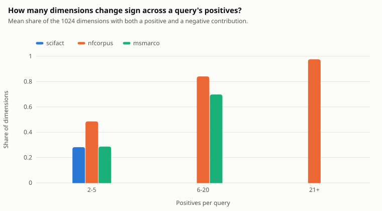

| environment | queries | n | share of dims with a sign conflict | dims always helpful | dims always harmful | mean Spearman of c orderings | worst Spearman pair | mass cancelled by averaging | variance between positives / second moment | dims whose mean opposes a positive |
|---|---|---|---|---|---|---|---|---|---|---|
| scifact | multi | 69 | 0.280 (0.195 to 0.370) | 598.1 (525.8 to 667.0) | 136.1 (82.0 to 195.4) | 0.673 (0.530 to 0.797) | 0.660 (0.451 to 0.797) | 0.050 (0.026 to 0.085) | 0.081 (0.041 to 0.147) | 286.7 (200.0 to 379.0) |
| scifact | positives 2-5 | 69 | 0.280 (0.195 to 0.370) | 598.1 (525.8 to 667.0) | 136.1 (82.0 to 195.4) | 0.673 (0.530 to 0.797) | 0.660 (0.451 to 0.797) | 0.050 (0.026 to 0.085) | 0.081 (0.041 to 0.147) | 286.7 (200.0 to 379.0) |
| scifact | positives 21+ | 0 | n/a | n/a | n/a | n/a | n/a | n/a | n/a | n/a |
| scifact | positives 6-20 | 0 | n/a | n/a | n/a | n/a | n/a | n/a | n/a | n/a |
| nfcorpus | multi | 2162 | 0.840 (0.521 to 0.990) | 122.1 (9.0 to 353.7) | 39.5 (0.0 to 135.9) | 0.394 (0.305 to 0.517) | 0.184 (0.055 to 0.383) | 0.263 (0.147 to 0.359) | 0.391 (0.235 to 0.521) | 860.4 (533.1 to 1013.9) |
| nfcorpus | positives 2-5 | 399 | 0.484 (0.278 to 0.675) | 371.5 (233.0 to 510.0) | 154.3 (68.0 to 262.0) | 0.468 (0.319 to 0.639) | 0.390 (0.212 to 0.601) | 0.153 (0.073 to 0.233) | 0.243 (0.111 to 0.370) | 495.2 (285.0 to 691.0) |
| nfcorpus | positives 21+ | 1075 | 0.974 (0.948 to 0.994) | 23.8 (5.0 to 47.0) | 1.7 (0.0 to 5.0) | 0.347 (0.297 to 0.405) | 0.092 (0.033 to 0.149) | 0.317 (0.258 to 0.375) | 0.461 (0.376 to 0.548) | 997.0 (971.0 to 1018.0) |
| nfcorpus | positives 6-20 | 688 | 0.839 (0.729 to 0.929) | 131.0 (62.0 to 216.0) | 32.1 (5.0 to 72.3) | 0.423 (0.339 to 0.521) | 0.206 (0.119 to 0.313) | 0.243 (0.177 to 0.304) | 0.368 (0.273 to 0.457) | 858.7 (746.4 to 951.0) |
| msmarco | multi | 2321 | 0.286 (0.191 to 0.396) | 600.7 (501.0 to 695.0) | 127.5 (81.0 to 175.0) | 0.623 (0.457 to 0.786) | 0.613 (0.435 to 0.782) | 0.057 (0.022 to 0.100) | 0.096 (0.040 to 0.163) | 292.3 (196.0 to 405.0) |
| msmarco | positives 2-5 | 2317 | 0.285 (0.191 to 0.395) | 601.2 (501.6 to 695.0) | 127.7 (81.0 to 175.0) | 0.623 (0.457 to 0.786) | 0.614 (0.436 to 0.783) | 0.057 (0.022 to 0.100) | 0.096 (0.040 to 0.163) | 291.6 (195.6 to 404.0) |
| msmarco | positives 21+ | 0 | n/a | n/a | n/a | n/a | n/a | n/a | n/a | n/a |
| msmarco | positives 6-20 | 4 | 0.696 (0.661 to 0.726) | 283.8 (256.4 to 319.3) | 25.2 (21.5 to 28.4) | 0.502 (0.477 to 0.545) | 0.380 (0.315 to 0.452) | 0.138 (0.119 to 0.152) | 0.204 (0.165 to 0.233) | 712.8 (676.6 to 743.9) |

### Relevance grades

Only one relevance grade among the analyzed judgments of scifact, nfcorpus, msmarco, so
variability associated with grades cannot be assessed there.

| environment | grade | queries | pairs | score | positive mass | N / (P + N) | effective positive dims | dims for 90% of P |
|---|---|---|---|---|---|---|---|---|
| scifact | 1 | 728 | 822 | 0.656 (0.498 to 0.800) | 0.721 (0.609 to 0.826) | 0.086 (0.033 to 0.155) | 258.9 (225.8 to 292.0) | 365.3 (334.0 to 395.0) |
| nfcorpus | 1 | 2331 | 100833 | 0.347 (0.218 to 0.477) | 0.516 (0.438 to 0.596) | 0.251 (0.170 to 0.335) | 217.6 (193.7 to 240.3) | 313.6 (292.9 to 336.8) |
| msmarco | 1 | 45000 | 47733 | 0.695 (0.568 to 0.808) | 0.748 (0.655 to 0.834) | 0.069 (0.029 to 0.118) | 268.4 (238.1 to 298.2) | 373.7 (346.0 to 400.0) |

### Recurrence across the training queries


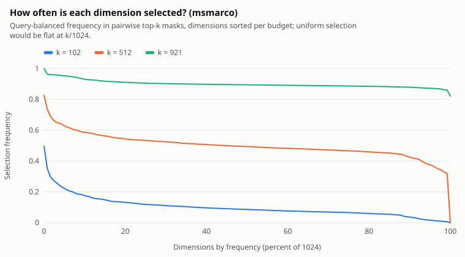
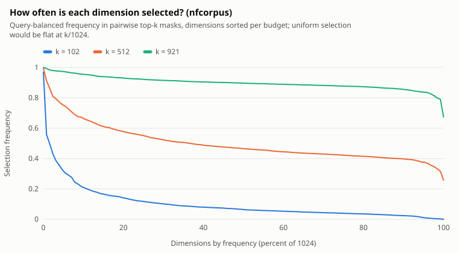
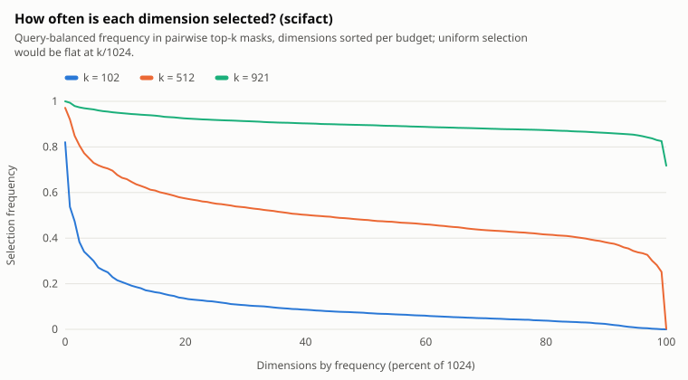

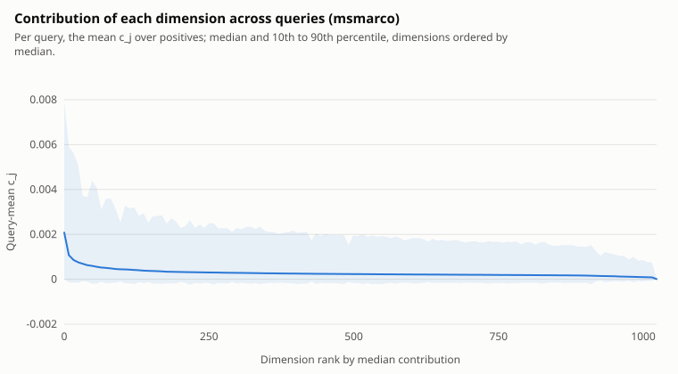
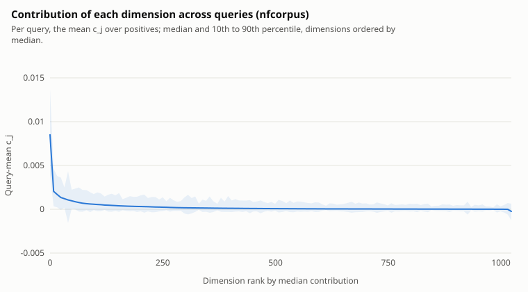
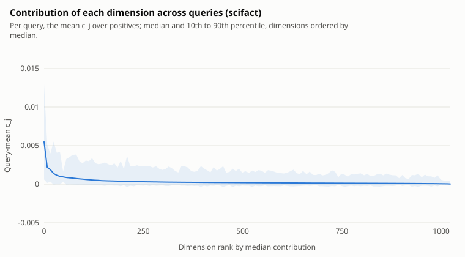

| environment | k | chance frequency | max frequency | effective dims | dims never selected | mask inside the k most frequent dims | Spearman with pair-weighted frequency (pair-weighted) | Spearman with mean|q| x mean|d| |
|---|---|---|---|---|---|---|---|---|
| scifact | 102 | 0.100 | 0.821 | 712.0 | 8 | 0.335 (0.265 to 0.412) | 0.997 | 0.977 |
| scifact | 204 | 0.199 | 0.914 | 858.7 | 3 | 0.398 (0.343 to 0.451) | 0.997 | 0.984 |
| scifact | 307 | 0.300 | 0.940 | 930.5 | 3 | 0.460 (0.414 to 0.498) | 0.997 | 0.976 |
| scifact | 409 | 0.399 | 0.958 | 971.0 | 2 | 0.521 (0.487 to 0.553) | 0.996 | 0.959 |
| scifact | 512 | 0.500 | 0.971 | 995.5 | 0 | 0.586 (0.561 to 0.611) | 0.996 | 0.937 |
| scifact | 614 | 0.600 | 0.987 | 1010.9 | 0 | 0.654 (0.635 to 0.673) | 0.994 | 0.893 |
| scifact | 716 | 0.699 | 0.993 | 1018.7 | 0 | 0.728 (0.714 to 0.742) | 0.990 | 0.766 |
| scifact | 819 | 0.800 | 1.000 | 1022.0 | 0 | 0.814 (0.806 to 0.823) | 0.989 | 0.438 |
| scifact | 921 | 0.899 | 1.000 | 1023.3 | 0 | 0.905 (0.900 to 0.911) | 0.989 | 0.101 |
| nfcorpus | 102 | 0.100 | 0.969 | 684.4 | 3 | 0.359 (0.311 to 0.408) | 0.986 | 0.977 |
| nfcorpus | 204 | 0.199 | 0.988 | 844.6 | 3 | 0.418 (0.377 to 0.459) | 0.985 | 0.958 |
| nfcorpus | 307 | 0.300 | 0.993 | 925.5 | 2 | 0.473 (0.438 to 0.507) | 0.983 | 0.928 |
| nfcorpus | 409 | 0.399 | 0.994 | 970.8 | 0 | 0.525 (0.498 to 0.552) | 0.981 | 0.888 |
| nfcorpus | 512 | 0.500 | 0.996 | 998.6 | 0 | 0.583 (0.562 to 0.604) | 0.977 | 0.821 |
| nfcorpus | 614 | 0.600 | 0.998 | 1012.4 | 0 | 0.648 (0.634 to 0.662) | 0.967 | 0.660 |
| nfcorpus | 716 | 0.699 | 0.999 | 1018.7 | 0 | 0.727 (0.718 to 0.735) | 0.958 | 0.336 |
| nfcorpus | 819 | 0.800 | 1.000 | 1021.4 | 0 | 0.816 (0.810 to 0.822) | 0.960 | 0.056 |
| nfcorpus | 921 | 0.899 | 1.000 | 1023.0 | 0 | 0.907 (0.904 to 0.911) | 0.967 | -0.177 |
| msmarco | 102 | 0.100 | 0.497 | 858.4 | 3 | 0.243 (0.196 to 0.294) | 1.000 | 0.996 |
| msmarco | 204 | 0.199 | 0.621 | 942.7 | 3 | 0.322 (0.279 to 0.363) | 1.000 | 0.994 |
| msmarco | 307 | 0.300 | 0.702 | 980.2 | 3 | 0.398 (0.365 to 0.430) | 1.000 | 0.989 |
| msmarco | 409 | 0.399 | 0.768 | 999.8 | 2 | 0.473 (0.446 to 0.501) | 1.000 | 0.980 |
| msmarco | 512 | 0.500 | 0.825 | 1011.1 | 0 | 0.551 (0.529 to 0.572) | 1.000 | 0.969 |
| msmarco | 614 | 0.600 | 0.868 | 1018.0 | 0 | 0.631 (0.614 to 0.648) | 1.000 | 0.943 |
| msmarco | 716 | 0.699 | 0.916 | 1022.5 | 0 | 0.713 (0.700 to 0.726) | 1.000 | 0.840 |
| msmarco | 819 | 0.800 | 0.984 | 1023.5 | 0 | 0.806 (0.797 to 0.814) | 0.999 | 0.168 |
| msmarco | 921 | 0.899 | 1.000 | 1023.7 | 0 | 0.903 (0.898 to 0.908) | 1.000 | -0.398 |

Groups: queries are stratified by number of positives only; no clustering was run. Each
row below describes the query-by-dimension selection matrix at one checkpoint.

| environment | k | explained by the first component | explained by the first ten |
|---|---|---|---|
| scifact | 102 | 0.030 | 0.137 |
| scifact | 204 | 0.026 | 0.129 |
| scifact | 307 | 0.022 | 0.118 |
| scifact | 409 | 0.019 | 0.106 |
| scifact | 512 | 0.015 | 0.092 |
| scifact | 614 | 0.012 | 0.080 |
| scifact | 716 | 0.009 | 0.070 |
| scifact | 819 | 0.008 | 0.064 |
| scifact | 921 | 0.007 | 0.062 |
| nfcorpus | 102 | 0.025 | 0.158 |
| nfcorpus | 204 | 0.022 | 0.139 |
| nfcorpus | 307 | 0.019 | 0.123 |
| nfcorpus | 409 | 0.017 | 0.107 |
| nfcorpus | 512 | 0.015 | 0.093 |
| nfcorpus | 614 | 0.013 | 0.079 |
| nfcorpus | 716 | 0.010 | 0.061 |
| nfcorpus | 819 | 0.009 | 0.053 |
| nfcorpus | 921 | 0.010 | 0.055 |
| msmarco | 102 | 0.007 | 0.049 |
| msmarco | 204 | 0.006 | 0.041 |
| msmarco | 307 | 0.005 | 0.035 |
| msmarco | 409 | 0.004 | 0.030 |
| msmarco | 512 | 0.004 | 0.026 |
| msmarco | 614 | 0.003 | 0.022 |
| msmarco | 716 | 0.003 | 0.019 |
| msmarco | 819 | 0.002 | 0.016 |
| msmarco | 921 | 0.002 | 0.016 |

| environment | k | positives per query | queries | Spearman of the stratum's frequency with the corpus's |
|---|---|---|---|---|
| scifact | 102 | 1 | 659 | 0.998 |
| scifact | 102 | 2-5 | 69 | 0.857 |
| scifact | 102 | 6-20 | 0 | n/a |
| scifact | 102 | 21+ | 0 | n/a |
| scifact | 204 | 1 | 659 | 0.998 |
| scifact | 204 | 2-5 | 69 | 0.865 |
| scifact | 204 | 6-20 | 0 | n/a |
| scifact | 204 | 21+ | 0 | n/a |
| scifact | 307 | 1 | 659 | 0.998 |
| scifact | 307 | 2-5 | 69 | 0.856 |
| scifact | 307 | 6-20 | 0 | n/a |
| scifact | 307 | 21+ | 0 | n/a |
| scifact | 409 | 1 | 659 | 0.997 |
| scifact | 409 | 2-5 | 69 | 0.842 |
| scifact | 409 | 6-20 | 0 | n/a |
| scifact | 409 | 21+ | 0 | n/a |
| scifact | 512 | 1 | 659 | 0.997 |
| scifact | 512 | 2-5 | 69 | 0.817 |
| scifact | 512 | 6-20 | 0 | n/a |
| scifact | 512 | 21+ | 0 | n/a |
| scifact | 614 | 1 | 659 | 0.996 |
| scifact | 614 | 2-5 | 69 | 0.778 |
| scifact | 614 | 6-20 | 0 | n/a |
| scifact | 614 | 21+ | 0 | n/a |
| scifact | 716 | 1 | 659 | 0.993 |
| scifact | 716 | 2-5 | 69 | 0.707 |
| scifact | 716 | 6-20 | 0 | n/a |
| scifact | 716 | 21+ | 0 | n/a |
| scifact | 819 | 1 | 659 | 0.992 |
| scifact | 819 | 2-5 | 69 | 0.668 |
| scifact | 819 | 6-20 | 0 | n/a |
| scifact | 819 | 21+ | 0 | n/a |
| scifact | 921 | 1 | 659 | 0.992 |
| scifact | 921 | 2-5 | 69 | 0.660 |
| scifact | 921 | 6-20 | 0 | n/a |
| scifact | 921 | 21+ | 0 | n/a |
| nfcorpus | 102 | 1 | 169 | 0.913 |
| nfcorpus | 102 | 2-5 | 399 | 0.975 |
| nfcorpus | 102 | 6-20 | 688 | 0.993 |
| nfcorpus | 102 | 21+ | 1075 | 0.993 |
| nfcorpus | 204 | 1 | 169 | 0.910 |
| nfcorpus | 204 | 2-5 | 399 | 0.978 |
| nfcorpus | 204 | 6-20 | 688 | 0.993 |
| nfcorpus | 204 | 21+ | 1075 | 0.993 |
| nfcorpus | 307 | 1 | 169 | 0.898 |
| nfcorpus | 307 | 2-5 | 399 | 0.973 |
| nfcorpus | 307 | 6-20 | 688 | 0.991 |
| nfcorpus | 307 | 21+ | 1075 | 0.992 |
| nfcorpus | 409 | 1 | 169 | 0.892 |
| nfcorpus | 409 | 2-5 | 399 | 0.968 |
| nfcorpus | 409 | 6-20 | 688 | 0.990 |
| nfcorpus | 409 | 21+ | 1075 | 0.991 |
| nfcorpus | 512 | 1 | 169 | 0.876 |
| nfcorpus | 512 | 2-5 | 399 | 0.959 |
| nfcorpus | 512 | 6-20 | 688 | 0.987 |
| nfcorpus | 512 | 21+ | 1075 | 0.988 |
| nfcorpus | 614 | 1 | 169 | 0.827 |
| nfcorpus | 614 | 2-5 | 399 | 0.935 |
| nfcorpus | 614 | 6-20 | 688 | 0.977 |
| nfcorpus | 614 | 21+ | 1075 | 0.981 |
| nfcorpus | 716 | 1 | 169 | 0.786 |
| nfcorpus | 716 | 2-5 | 399 | 0.925 |
| nfcorpus | 716 | 6-20 | 688 | 0.976 |
| nfcorpus | 716 | 21+ | 1075 | 0.977 |
| nfcorpus | 819 | 1 | 169 | 0.795 |
| nfcorpus | 819 | 2-5 | 399 | 0.936 |
| nfcorpus | 819 | 6-20 | 688 | 0.977 |
| nfcorpus | 819 | 21+ | 1075 | 0.980 |
| nfcorpus | 921 | 1 | 169 | 0.801 |
| nfcorpus | 921 | 2-5 | 399 | 0.939 |
| nfcorpus | 921 | 6-20 | 688 | 0.978 |
| nfcorpus | 921 | 21+ | 1075 | 0.984 |
| msmarco | 102 | 1 | 42679 | 1.000 |
| msmarco | 102 | 2-5 | 2317 | 0.977 |
| msmarco | 102 | 6-20 | 4 | 0.437 |
| msmarco | 102 | 21+ | 0 | n/a |
| msmarco | 204 | 1 | 42679 | 1.000 |
| msmarco | 204 | 2-5 | 2317 | 0.975 |
| msmarco | 204 | 6-20 | 4 | 0.443 |
| msmarco | 204 | 21+ | 0 | n/a |
| msmarco | 307 | 1 | 42679 | 1.000 |
| msmarco | 307 | 2-5 | 2317 | 0.973 |
| msmarco | 307 | 6-20 | 4 | 0.407 |
| msmarco | 307 | 21+ | 0 | n/a |
| msmarco | 409 | 1 | 42679 | 1.000 |
| msmarco | 409 | 2-5 | 2317 | 0.969 |
| msmarco | 409 | 6-20 | 4 | 0.349 |
| msmarco | 409 | 21+ | 0 | n/a |
| msmarco | 512 | 1 | 42679 | 1.000 |
| msmarco | 512 | 2-5 | 2317 | 0.964 |
| msmarco | 512 | 6-20 | 4 | 0.301 |
| msmarco | 512 | 21+ | 0 | n/a |
| msmarco | 614 | 1 | 42679 | 1.000 |
| msmarco | 614 | 2-5 | 2317 | 0.950 |
| msmarco | 614 | 6-20 | 4 | 0.251 |
| msmarco | 614 | 21+ | 0 | n/a |
| msmarco | 716 | 1 | 42679 | 1.000 |
| msmarco | 716 | 2-5 | 2317 | 0.905 |
| msmarco | 716 | 6-20 | 4 | 0.169 |
| msmarco | 716 | 21+ | 0 | n/a |
| msmarco | 819 | 1 | 42679 | 1.000 |
| msmarco | 819 | 2-5 | 2317 | 0.886 |
| msmarco | 819 | 6-20 | 4 | 0.223 |
| msmarco | 819 | 21+ | 0 | n/a |
| msmarco | 921 | 1 | 42679 | 1.000 |
| msmarco | 921 | 2-5 | 2317 | 0.924 |
| msmarco | 921 | 6-20 | 4 | 0.287 |
| msmarco | 921 | 21+ | 0 | n/a |

Dimension identities are not interpreted here: nothing in these data gives a coordinate a
meaning.

### A limited reference: judged nonrelevant documents

No judged nonrelevant training document in scifact, nfcorpus, msmarco: every judgment analyzed
there is positive, so that reference is unavailable and positive-only patterns stay
unconfirmed as relevance-specific.

| environment | queries with a judged nonrelevant document | coverage | pairs | statistic | mean (p10 to p90), per pair |
|---|---|---|---|---|---|
| scifact | 0 | 0.000 | 0 | none available | n/a |
| nfcorpus | 0 | 0.000 | 0 | none available | n/a |
| msmarco | 0 | 0.000 | 0 | none available | n/a |

## 2. What is stable within the analyzed training data

Stable means stable across disjoint halves of these training queries, a query always
keeping all of its positives. It says nothing about unseen queries.

- **scifact.** Among the checkpoints, the relevant-document frequency profile falls below this report's rule (lowest of 20 split-half Spearmans at least 0.8) at k = 716, 819, 921. Mean contribution per dimension: 0.955 (0.947 to 0.962). High stability here does not separate relevant documents from coordinates; the excess profile below does.
- **nfcorpus.** Among the checkpoints, the relevant-document frequency profile falls below this report's rule (lowest of 20 split-half Spearmans at least 0.8) at none of them. Mean contribution per dimension: 0.986 (0.983 to 0.988). High stability here does not separate relevant documents from coordinates; the excess profile below does.
- **msmarco.** Among the checkpoints, the relevant-document frequency profile falls below this report's rule (lowest of 20 split-half Spearmans at least 0.8) at none of them. Mean contribution per dimension: 0.998 (0.998 to 0.998). High stability here does not separate relevant documents from coordinates; the excess profile below does.
- **scifact, every k.** The lowest split-half Spearman reaches 0.8 for the relevant-document frequency profile at 683 of the 1023 defined k (first 17, last 699), and for its excess over reference documents at none of the 1023 defined k. A frequency profile can repeat because coordinates repeat; the excess is what is left after the profile of reference documents is subtracted.
- **nfcorpus, every k.** The lowest split-half Spearman reaches 0.8 for the relevant-document frequency profile at 1022 of the 1023 defined k (first 2, last 1023), and for its excess over reference documents at none of the 1023 defined k. A frequency profile can repeat because coordinates repeat; the excess is what is left after the profile of reference documents is subtracted.
- **msmarco, every k.** The lowest split-half Spearman reaches 0.8 for the relevant-document frequency profile at 1023 of the 1023 defined k (first 1, last 1023), and for its excess over reference documents at 1016 of the 1023 defined k (first 6, last 1021). A frequency profile can repeat because coordinates repeat; the excess is what is left after the profile of reference documents is subtracted.

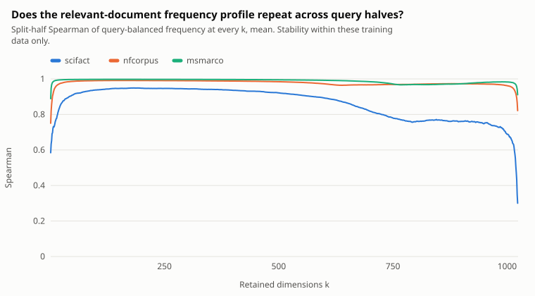

| environment | k | draws | split-half Spearman, mean (min to max) | top-k overlap of the two halves, mean (min to max) | same, dimension identity shuffled per query | stable (min >= 0.8) |
|---|---|---|---|---|---|---|
| scifact | 102 | 20 | 0.937 (0.929 to 0.945) | 0.884 (0.853 to 0.912) | 0.031 | yes |
| scifact | 204 | 20 | 0.947 (0.940 to 0.955) | 0.893 (0.868 to 0.917) | 0.013 | yes |
| scifact | 307 | 20 | 0.943 (0.934 to 0.949) | 0.891 (0.873 to 0.922) | -0.056 | yes |
| scifact | 409 | 20 | 0.934 (0.924 to 0.944) | 0.874 (0.858 to 0.890) | -0.069 | yes |
| scifact | 512 | 20 | 0.917 (0.904 to 0.930) | 0.865 (0.848 to 0.885) | 0.030 | yes |
| scifact | 614 | 20 | 0.886 (0.873 to 0.901) | 0.867 (0.853 to 0.879) | 0.006 | yes |
| scifact | 716 | 20 | 0.811 (0.782 to 0.835) | 0.848 (0.835 to 0.858) | -0.008 | no |
| scifact | 819 | 20 | 0.766 (0.738 to 0.784) | 0.876 (0.866 to 0.888) | -0.039 | no |
| scifact | 921 | 20 | 0.759 (0.722 to 0.785) | 0.938 (0.933 to 0.944) | -0.041 | no |
| nfcorpus | 102 | 20 | 0.991 (0.990 to 0.991) | 0.961 (0.951 to 0.971) | 0.020 | yes |
| nfcorpus | 204 | 20 | 0.991 (0.990 to 0.992) | 0.962 (0.951 to 0.975) | -0.005 | yes |
| nfcorpus | 307 | 20 | 0.990 (0.989 to 0.991) | 0.964 (0.954 to 0.971) | -0.056 | yes |
| nfcorpus | 409 | 20 | 0.988 (0.986 to 0.989) | 0.961 (0.956 to 0.971) | 0.003 | yes |
| nfcorpus | 512 | 20 | 0.984 (0.982 to 0.985) | 0.951 (0.939 to 0.961) | 0.027 | yes |
| nfcorpus | 614 | 20 | 0.970 (0.966 to 0.972) | 0.942 (0.933 to 0.948) | -0.001 | yes |
| nfcorpus | 716 | 20 | 0.968 (0.966 to 0.972) | 0.930 (0.920 to 0.939) | -0.027 | yes |
| nfcorpus | 819 | 20 | 0.971 (0.969 to 0.975) | 0.952 (0.947 to 0.960) | 0.034 | yes |
| nfcorpus | 921 | 20 | 0.973 (0.970 to 0.975) | 0.986 (0.984 to 0.989) | 0.091 | yes |
| msmarco | 102 | 20 | 0.997 (0.997 to 0.998) | 0.980 (0.971 to 0.990) | 0.015 | yes |
| msmarco | 204 | 20 | 0.997 (0.997 to 0.998) | 0.970 (0.961 to 0.985) | 0.049 | yes |
| msmarco | 307 | 20 | 0.997 (0.997 to 0.997) | 0.976 (0.967 to 0.980) | -0.011 | yes |
| msmarco | 409 | 20 | 0.996 (0.996 to 0.997) | 0.972 (0.966 to 0.983) | -0.002 | yes |
| msmarco | 512 | 20 | 0.995 (0.994 to 0.995) | 0.967 (0.961 to 0.973) | 0.050 | yes |
| msmarco | 614 | 20 | 0.992 (0.991 to 0.993) | 0.963 (0.956 to 0.971) | -0.002 | yes |
| msmarco | 716 | 20 | 0.982 (0.979 to 0.983) | 0.954 (0.947 to 0.959) | 0.053 | yes |
| msmarco | 819 | 20 | 0.967 (0.964 to 0.970) | 0.951 (0.944 to 0.960) | -0.027 | yes |
| msmarco | 921 | 20 | 0.976 (0.974 to 0.978) | 0.988 (0.984 to 0.990) | -0.004 | yes |

| finding | environment | query-balanced value | difference between query halves, mean (min to max) |
|---|---|---|---|
| N / (P + N) | scifact | 0.086 | 0.003 (0.000 to 0.007) |
| N / (P + N) | nfcorpus | 0.251 | 0.002 (0.000 to 0.008) |
| N / (P + N) | msmarco | 0.069 | 0.000 (0.000 to 0.001) |
| sign agreement | scifact | 0.729 | 0.003 (0.001 to 0.007) |
| sign agreement | nfcorpus | 0.614 | 0.001 (0.000 to 0.005) |
| sign agreement | msmarco | 0.746 | 0.000 (0.000 to 0.001) |
| effective positive dimensions | scifact | 258.935 | 1.855 (0.127 to 4.547) |
| effective positive dimensions | nfcorpus | 217.649 | 0.497 (0.012 to 1.663) |
| effective positive dimensions | msmarco | 268.449 | 0.260 (0.022 to 0.700) |
| dimensions for 90% of P | scifact | 365.330 | 1.485 (0.001 to 3.646) |
| dimensions for 90% of P | nfcorpus | 313.563 | 0.559 (0.000 to 2.059) |
| dimensions for 90% of P | msmarco | 373.704 | 0.196 (0.028 to 0.439) |
| smallest k reaching the full score | scifact | 393.412 | 7.381 (1.754 to 16.266) |
| smallest k reaching the full score | nfcorpus | 161.251 | 2.497 (0.053 to 8.934) |
| smallest k reaching the full score | msmarco | 431.028 | 0.795 (0.086 to 2.159) |
| share of dims with a sign conflict | scifact | 0.280 | 0.014 (0.001 to 0.043) |
| share of dims with a sign conflict | nfcorpus | 0.840 | 0.006 (0.001 to 0.013) |
| share of dims with a sign conflict | msmarco | 0.286 | 0.003 (0.000 to 0.007) |
| mass cancelled by averaging | scifact | 0.050 | 0.004 (0.000 to 0.010) |
| mass cancelled by averaging | nfcorpus | 0.263 | 0.002 (0.000 to 0.007) |
| mass cancelled by averaging | msmarco | 0.057 | 0.001 (0.000 to 0.003) |
| within-query Jaccard, k = 102 | scifact | 0.512 | 0.013 (0.002 to 0.047) |
| within-query Jaccard, k = 204 | scifact | 0.558 | 0.013 (0.003 to 0.031) |
| within-query Jaccard, k = 307 | scifact | 0.597 | 0.011 (0.002 to 0.026) |
| within-query Jaccard, k = 409 | scifact | 0.632 | 0.010 (0.000 to 0.026) |
| within-query Jaccard, k = 512 | scifact | 0.655 | 0.010 (0.001 to 0.026) |
| within-query Jaccard, k = 614 | scifact | 0.679 | 0.010 (0.000 to 0.025) |
| within-query Jaccard, k = 716 | scifact | 0.701 | 0.010 (0.001 to 0.028) |
| within-query Jaccard, k = 819 | scifact | 0.765 | 0.006 (0.001 to 0.016) |
| within-query Jaccard, k = 921 | scifact | 0.868 | 0.004 (0.001 to 0.008) |
| within-query Jaccard, k = 102 | nfcorpus | 0.328 | 0.002 (0.000 to 0.005) |
| within-query Jaccard, k = 204 | nfcorpus | 0.383 | 0.002 (0.000 to 0.005) |
| within-query Jaccard, k = 307 | nfcorpus | 0.427 | 0.001 (0.000 to 0.004) |
| within-query Jaccard, k = 409 | nfcorpus | 0.467 | 0.001 (0.000 to 0.004) |
| within-query Jaccard, k = 512 | nfcorpus | 0.504 | 0.001 (0.000 to 0.003) |
| within-query Jaccard, k = 614 | nfcorpus | 0.546 | 0.001 (0.000 to 0.003) |
| within-query Jaccard, k = 716 | nfcorpus | 0.632 | 0.001 (0.000 to 0.003) |
| within-query Jaccard, k = 819 | nfcorpus | 0.740 | 0.001 (0.000 to 0.002) |
| within-query Jaccard, k = 921 | nfcorpus | 0.857 | 0.000 (0.000 to 0.001) |
| within-query Jaccard, k = 102 | msmarco | 0.482 | 0.003 (0.000 to 0.008) |
| within-query Jaccard, k = 204 | msmarco | 0.532 | 0.004 (0.001 to 0.008) |
| within-query Jaccard, k = 307 | msmarco | 0.570 | 0.003 (0.000 to 0.009) |
| within-query Jaccard, k = 409 | msmarco | 0.602 | 0.003 (0.000 to 0.008) |
| within-query Jaccard, k = 512 | msmarco | 0.631 | 0.003 (0.000 to 0.008) |
| within-query Jaccard, k = 614 | msmarco | 0.656 | 0.003 (0.000 to 0.007) |
| within-query Jaccard, k = 716 | msmarco | 0.683 | 0.002 (0.000 to 0.007) |
| within-query Jaccard, k = 819 | msmarco | 0.750 | 0.001 (0.000 to 0.004) |
| within-query Jaccard, k = 921 | msmarco | 0.858 | 0.001 (0.000 to 0.002) |

## 3. What aggregation conceals

`weighted_mean(q * d) = q * weighted_mean(d)` holds exactly, with the repository's oracle
weights `2**grade - 1`, so averaging contributions and averaging documents are the same
operation. This compares masks and pair scores; it does not benchmark Learning-to-Select.

- **scifact.** Averaging cancels 0.050 of the absolute contribution mass and removes the variance between positives, which is 0.081 of the second moment. The mean opposes at least one positive on 287 dimensions. From k = 102 to k = 921 its mask holds 0.826 to 0.960 of a positive's own mask, and 0.804 to 0.956 for the least-served positive. Those overlaps rise with k partly by construction.
- **nfcorpus.** Averaging cancels 0.263 of the absolute contribution mass and removes the variance between positives, which is 0.391 of the second moment. The mean opposes at least one positive on 860 dimensions. From k = 102 to k = 921 its mask holds 0.636 to 0.940 of a positive's own mask, and 0.528 to 0.925 for the least-served positive. Those overlaps rise with k partly by construction.
- **msmarco.** Averaging cancels 0.057 of the absolute contribution mass and removes the variance between positives, which is 0.096 of the second moment. The mean opposes at least one positive on 292 dimensions. From k = 102 to k = 921 its mask holds 0.815 to 0.956 of a positive's own mask, and 0.794 to 0.953 for the least-served positive. Those overlaps rise with k partly by construction.

### Cancellation and conflict with the document count held fixed

A sign conflict needs `d_j` to change sign wherever `q_j` is nonzero, so it comes from
the documents. Cancellation is then weighted by `|q_j|`. Means here are unweighted,
because a reference document has no grade.

- **scifact, groups of 2** (69 queries). Sign conflict 0.242 relevant, 0.411 reference. Cancelled mass 0.046 relevant, 0.185 reference.
- **scifact, groups of 5** (1 queries). Sign conflict 0.545 relevant, 0.784 reference. Cancelled mass 0.081 relevant, 0.302 reference.
- **nfcorpus, groups of 2** (2162 queries). Sign conflict 0.353 relevant, 0.400 reference. Cancelled mass 0.136 relevant, 0.178 reference.
- **nfcorpus, groups of 5** (1833 queries). Sign conflict 0.713 relevant, 0.786 reference. Cancelled mass 0.234 relevant, 0.307 reference.
- **nfcorpus, groups of 20** (1105 queries). Sign conflict 0.947 relevant, 0.971 reference. Cancelled mass 0.305 relevant, 0.380 reference.
- **msmarco, groups of 2** (2321 queries). Sign conflict 0.264 relevant, 0.445 reference. Cancelled mass 0.054 relevant, 0.235 reference.
- **msmarco, groups of 5** (18 queries). Sign conflict 0.582 relevant, 0.859 reference. Cancelled mass 0.109 relevant, 0.421 reference.


| environment | documents in the group | queries with that many positives | measure | relevant | matched reference | relevant minus reference |
|---|---|---|---|---|---|---|
| scifact | 2 | 69 | sign conflict | 0.242 (0.192 to 0.295) | 0.411 (0.394 to 0.427) | -0.169 (-0.233 to -0.110) |
| scifact | 2 | 69 | cancelled mass | 0.046 (0.023 to 0.078) | 0.185 (0.169 to 0.200) | -0.140 (-0.169 to -0.101) |
| scifact | 5 | 1 | sign conflict | 0.545 (0.545 to 0.545) | 0.784 (0.784 to 0.784) | -0.239 (-0.239 to -0.239) |
| scifact | 5 | 1 | cancelled mass | 0.081 (0.081 to 0.081) | 0.302 (0.302 to 0.302) | -0.220 (-0.220 to -0.220) |
| scifact | 20 | 0 | sign conflict | n/a | n/a | n/a |
| scifact | 20 | 0 | cancelled mass | n/a | n/a | n/a |
| nfcorpus | 2 | 2162 | sign conflict | 0.353 (0.300 to 0.397) | 0.400 (0.382 to 0.418) | -0.047 (-0.102 to 0.001) |
| nfcorpus | 2 | 2162 | cancelled mass | 0.136 (0.094 to 0.171) | 0.178 (0.161 to 0.194) | -0.043 (-0.085 to -0.004) |
| nfcorpus | 5 | 1833 | sign conflict | 0.713 (0.637 to 0.767) | 0.786 (0.773 to 0.800) | -0.074 (-0.148 to -0.018) |
| nfcorpus | 5 | 1833 | cancelled mass | 0.234 (0.175 to 0.285) | 0.307 (0.289 to 0.325) | -0.073 (-0.134 to -0.024) |
| nfcorpus | 20 | 1105 | sign conflict | 0.947 (0.925 to 0.964) | 0.971 (0.968 to 0.974) | -0.024 (-0.046 to -0.006) |
| nfcorpus | 20 | 1105 | cancelled mass | 0.305 (0.250 to 0.358) | 0.380 (0.361 to 0.399) | -0.075 (-0.127 to -0.030) |
| msmarco | 2 | 2321 | sign conflict | 0.264 (0.188 to 0.337) | 0.445 (0.431 to 0.459) | -0.182 (-0.257 to -0.107) |
| msmarco | 2 | 2321 | cancelled mass | 0.054 (0.022 to 0.093) | 0.235 (0.220 to 0.249) | -0.181 (-0.217 to -0.140) |
| msmarco | 5 | 18 | sign conflict | 0.582 (0.502 to 0.651) | 0.859 (0.845 to 0.871) | -0.277 (-0.352 to -0.214) |
| msmarco | 5 | 18 | cancelled mass | 0.109 (0.070 to 0.142) | 0.421 (0.407 to 0.434) | -0.312 (-0.342 to -0.274) |
| msmarco | 20 | 0 | sign conflict | n/a | n/a | n/a |
| msmarco | 20 | 0 | cancelled mass | n/a | n/a | n/a |

| statistic | environment | queries | n | relevant | matched reference | relevant minus reference |
|---|---|---|---|---|---|---|
| full score | scifact | all | 728 | 0.656 (0.498 to 0.800) | 0.262 (0.202 to 0.323) | 0.393 (0.220 to 0.541) |
| full score | scifact | multi | 69 | 0.663 (0.574 to 0.778) | 0.266 (0.221 to 0.321) | 0.398 (0.302 to 0.519) |
| full score | scifact | positives 2-5 | 69 | 0.663 (0.574 to 0.778) | 0.266 (0.221 to 0.321) | 0.398 (0.302 to 0.519) |
| full score | scifact | positives 21+ | 0 | n/a | n/a | n/a |
| full score | scifact | positives 6-20 | 0 | n/a | n/a | n/a |
| full score | scifact | single | 659 | 0.655 (0.487 to 0.804) | 0.262 (0.199 to 0.323) | 0.393 (0.217 to 0.546) |
| full score | nfcorpus | all | 2331 | 0.347 (0.218 to 0.477) | 0.242 (0.175 to 0.307) | 0.105 (0.017 to 0.217) |
| full score | nfcorpus | multi | 2162 | 0.342 (0.220 to 0.463) | 0.243 (0.177 to 0.307) | 0.099 (0.018 to 0.199) |
| full score | nfcorpus | positives 2-5 | 399 | 0.362 (0.210 to 0.547) | 0.226 (0.157 to 0.293) | 0.136 (0.009 to 0.296) |
| full score | nfcorpus | positives 21+ | 1075 | 0.337 (0.232 to 0.440) | 0.253 (0.188 to 0.313) | 0.084 (0.024 to 0.156) |
| full score | nfcorpus | positives 6-20 | 688 | 0.340 (0.213 to 0.467) | 0.238 (0.176 to 0.304) | 0.102 (0.010 to 0.206) |
| full score | nfcorpus | single | 169 | 0.409 (0.201 to 0.663) | 0.226 (0.151 to 0.308) | 0.183 (-0.007 to 0.409) |
| full score | msmarco | all | 45000 | 0.695 (0.568 to 0.808) | 0.114 (0.071 to 0.157) | 0.581 (0.444 to 0.706) |
| full score | msmarco | multi | 2321 | 0.668 (0.556 to 0.773) | 0.115 (0.080 to 0.152) | 0.553 (0.430 to 0.665) |
| full score | msmarco | positives 2-5 | 2317 | 0.668 (0.556 to 0.773) | 0.115 (0.080 to 0.152) | 0.553 (0.431 to 0.665) |
| full score | msmarco | positives 21+ | 0 | n/a | n/a | n/a |
| full score | msmarco | positives 6-20 | 4 | 0.588 (0.555 to 0.625) | 0.118 (0.105 to 0.130) | 0.470 (0.433 to 0.503) |
| full score | msmarco | single | 42679 | 0.696 (0.569 to 0.810) | 0.114 (0.070 to 0.158) | 0.583 (0.445 to 0.708) |
| cosine between documents | scifact | all | 69 | 0.717 (0.575 to 0.832) | 0.275 (0.237 to 0.321) | 0.442 (0.287 to 0.578) |
| cosine between documents | scifact | multi | 69 | 0.717 (0.575 to 0.832) | 0.275 (0.237 to 0.321) | 0.442 (0.287 to 0.578) |
| cosine between documents | scifact | positives 2-5 | 69 | 0.717 (0.575 to 0.832) | 0.275 (0.237 to 0.321) | 0.442 (0.287 to 0.578) |
| cosine between documents | scifact | positives 21+ | 0 | n/a | n/a | n/a |
| cosine between documents | scifact | positives 6-20 | 0 | n/a | n/a | n/a |
| cosine between documents | scifact | single | 0 | n/a | n/a | n/a |
| cosine between documents | nfcorpus | all | 2162 | 0.439 (0.345 to 0.570) | 0.308 (0.297 to 0.319) | 0.131 (0.036 to 0.266) |
| cosine between documents | nfcorpus | multi | 2162 | 0.439 (0.345 to 0.570) | 0.308 (0.297 to 0.319) | 0.131 (0.036 to 0.266) |
| cosine between documents | nfcorpus | positives 2-5 | 399 | 0.520 (0.365 to 0.701) | 0.309 (0.277 to 0.343) | 0.211 (0.051 to 0.380) |
| cosine between documents | nfcorpus | positives 21+ | 1075 | 0.388 (0.335 to 0.452) | 0.308 (0.302 to 0.314) | 0.081 (0.028 to 0.144) |
| cosine between documents | nfcorpus | positives 6-20 | 688 | 0.471 (0.381 to 0.574) | 0.308 (0.295 to 0.320) | 0.163 (0.077 to 0.266) |
| cosine between documents | nfcorpus | single | 0 | n/a | n/a | n/a |
| cosine between documents | msmarco | all | 2321 | 0.664 (0.498 to 0.824) | 0.164 (0.127 to 0.201) | 0.500 (0.328 to 0.662) |
| cosine between documents | msmarco | multi | 2321 | 0.664 (0.498 to 0.824) | 0.164 (0.127 to 0.201) | 0.500 (0.328 to 0.662) |
| cosine between documents | msmarco | positives 2-5 | 2317 | 0.664 (0.498 to 0.824) | 0.164 (0.127 to 0.201) | 0.500 (0.328 to 0.662) |
| cosine between documents | msmarco | positives 21+ | 0 | n/a | n/a | n/a |
| cosine between documents | msmarco | positives 6-20 | 4 | 0.542 (0.520 to 0.580) | 0.158 (0.148 to 0.171) | 0.384 (0.348 to 0.432) |
| cosine between documents | msmarco | single | 0 | n/a | n/a | n/a |
| share of dims with a sign conflict | scifact | all | 69 | 0.280 (0.195 to 0.370) | 0.477 (0.399 to 0.629) | -0.197 (-0.320 to -0.112) |
| share of dims with a sign conflict | scifact | multi | 69 | 0.280 (0.195 to 0.370) | 0.477 (0.399 to 0.629) | -0.197 (-0.320 to -0.112) |
| share of dims with a sign conflict | scifact | positives 2-5 | 69 | 0.280 (0.195 to 0.370) | 0.477 (0.399 to 0.629) | -0.197 (-0.320 to -0.112) |
| share of dims with a sign conflict | scifact | positives 21+ | 0 | n/a | n/a | n/a |
| share of dims with a sign conflict | scifact | positives 6-20 | 0 | n/a | n/a | n/a |
| share of dims with a sign conflict | scifact | single | 0 | n/a | n/a | n/a |
| share of dims with a sign conflict | nfcorpus | all | 2162 | 0.840 (0.521 to 0.990) | 0.894 (0.610 to 0.992) | -0.054 (-0.147 to -0.002) |
| share of dims with a sign conflict | nfcorpus | multi | 2162 | 0.840 (0.521 to 0.990) | 0.894 (0.610 to 0.992) | -0.054 (-0.147 to -0.002) |
| share of dims with a sign conflict | nfcorpus | positives 2-5 | 399 | 0.484 (0.278 to 0.675) | 0.593 (0.393 to 0.784) | -0.110 (-0.205 to -0.022) |
| share of dims with a sign conflict | nfcorpus | positives 21+ | 1075 | 0.974 (0.948 to 0.994) | 0.987 (0.977 to 0.994) | -0.013 (-0.030 to -0.000) |
| share of dims with a sign conflict | nfcorpus | positives 6-20 | 688 | 0.839 (0.729 to 0.929) | 0.923 (0.854 to 0.967) | -0.085 (-0.160 to -0.030) |
| share of dims with a sign conflict | nfcorpus | single | 0 | n/a | n/a | n/a |
| share of dims with a sign conflict | msmarco | all | 2321 | 0.286 (0.191 to 0.396) | 0.479 (0.432 to 0.664) | -0.194 (-0.285 to -0.112) |
| share of dims with a sign conflict | msmarco | multi | 2321 | 0.286 (0.191 to 0.396) | 0.479 (0.432 to 0.664) | -0.194 (-0.285 to -0.112) |
| share of dims with a sign conflict | msmarco | positives 2-5 | 2317 | 0.285 (0.191 to 0.395) | 0.479 (0.432 to 0.663) | -0.194 (-0.285 to -0.112) |
| share of dims with a sign conflict | msmarco | positives 21+ | 0 | n/a | n/a | n/a |
| share of dims with a sign conflict | msmarco | positives 6-20 | 4 | 0.696 (0.661 to 0.726) | 0.911 (0.896 to 0.925) | -0.215 (-0.247 to -0.194) |
| share of dims with a sign conflict | msmarco | single | 0 | n/a | n/a | n/a |
| mass cancelled by an unweighted mean | scifact | all | 69 | 0.050 (0.026 to 0.085) | 0.208 (0.173 to 0.272) | -0.159 (-0.228 to -0.105) |
| mass cancelled by an unweighted mean | scifact | multi | 69 | 0.050 (0.026 to 0.085) | 0.208 (0.173 to 0.272) | -0.159 (-0.228 to -0.105) |
| mass cancelled by an unweighted mean | scifact | positives 2-5 | 69 | 0.050 (0.026 to 0.085) | 0.208 (0.173 to 0.272) | -0.159 (-0.228 to -0.105) |
| mass cancelled by an unweighted mean | scifact | positives 21+ | 0 | n/a | n/a | n/a |
| mass cancelled by an unweighted mean | scifact | positives 6-20 | 0 | n/a | n/a | n/a |
| mass cancelled by an unweighted mean | scifact | single | 0 | n/a | n/a | n/a |
| mass cancelled by an unweighted mean | nfcorpus | all | 2162 | 0.263 (0.147 to 0.359) | 0.356 (0.258 to 0.410) | -0.093 (-0.158 to -0.035) |
| mass cancelled by an unweighted mean | nfcorpus | multi | 2162 | 0.263 (0.147 to 0.359) | 0.356 (0.258 to 0.410) | -0.093 (-0.158 to -0.035) |
| mass cancelled by an unweighted mean | nfcorpus | positives 2-5 | 399 | 0.153 (0.073 to 0.233) | 0.246 (0.176 to 0.308) | -0.092 (-0.158 to -0.025) |
| mass cancelled by an unweighted mean | nfcorpus | positives 21+ | 1075 | 0.317 (0.258 to 0.375) | 0.395 (0.373 to 0.417) | -0.078 (-0.130 to -0.032) |
| mass cancelled by an unweighted mean | nfcorpus | positives 6-20 | 688 | 0.243 (0.177 to 0.304) | 0.360 (0.329 to 0.388) | -0.117 (-0.179 to -0.061) |
| mass cancelled by an unweighted mean | nfcorpus | single | 0 | n/a | n/a | n/a |
| mass cancelled by an unweighted mean | msmarco | all | 2321 | 0.057 (0.022 to 0.100) | 0.250 (0.222 to 0.328) | -0.193 (-0.243 to -0.143) |
| mass cancelled by an unweighted mean | msmarco | multi | 2321 | 0.057 (0.022 to 0.100) | 0.250 (0.222 to 0.328) | -0.193 (-0.243 to -0.143) |
| mass cancelled by an unweighted mean | msmarco | positives 2-5 | 2317 | 0.057 (0.022 to 0.100) | 0.250 (0.222 to 0.328) | -0.193 (-0.242 to -0.143) |
| mass cancelled by an unweighted mean | msmarco | positives 21+ | 0 | n/a | n/a | n/a |
| mass cancelled by an unweighted mean | msmarco | positives 6-20 | 4 | 0.138 (0.119 to 0.152) | 0.452 (0.441 to 0.463) | -0.313 (-0.333 to -0.295) |
| mass cancelled by an unweighted mean | msmarco | single | 0 | n/a | n/a | n/a |

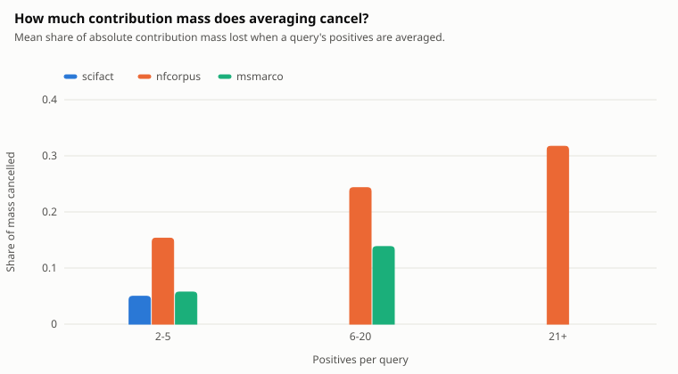

| environment | k | positive's mask inside the mean's mask | least-served positive | lost pair score / (P + N) | worst lost pair score | minority dims the mean's mask drops | conflicted dims in the mean's mask |
|---|---|---|---|---|---|---|---|
| scifact | 102 | 0.826 (0.769 to 0.870) | 0.804 (0.745 to 0.863) | 0.019 (0.010 to 0.030) | 0.022 (0.010 to 0.036) | 0.580 (0.500 to 0.806) | 0.006 (0.000 to 0.022) |
| scifact | 204 | 0.850 (0.806 to 0.885) | 0.835 (0.782 to 0.877) | 0.026 (0.014 to 0.042) | 0.030 (0.015 to 0.048) | 0.584 (0.500 to 0.840) | 0.017 (0.000 to 0.051) |
| scifact | 307 | 0.866 (0.828 to 0.899) | 0.855 (0.807 to 0.893) | 0.028 (0.014 to 0.046) | 0.031 (0.016 to 0.052) | 0.580 (0.500 to 0.826) | 0.032 (0.003 to 0.087) |
| scifact | 409 | 0.881 (0.838 to 0.911) | 0.870 (0.826 to 0.905) | 0.029 (0.014 to 0.050) | 0.032 (0.016 to 0.055) | 0.581 (0.500 to 0.839) | 0.055 (0.014 to 0.124) |
| scifact | 512 | 0.890 (0.850 to 0.918) | 0.883 (0.843 to 0.916) | 0.028 (0.015 to 0.049) | 0.032 (0.015 to 0.054) | 0.582 (0.495 to 0.844) | 0.090 (0.031 to 0.174) |
| scifact | 614 | 0.899 (0.860 to 0.925) | 0.890 (0.850 to 0.923) | 0.027 (0.014 to 0.047) | 0.031 (0.015 to 0.055) | 0.584 (0.494 to 0.854) | 0.133 (0.066 to 0.224) |
| scifact | 716 | 0.905 (0.871 to 0.931) | 0.898 (0.859 to 0.926) | 0.025 (0.013 to 0.043) | 0.029 (0.014 to 0.052) | 0.577 (0.476 to 0.839) | 0.188 (0.109 to 0.277) |
| scifact | 819 | 0.925 (0.906 to 0.947) | 0.920 (0.896 to 0.944) | 0.023 (0.012 to 0.039) | 0.027 (0.014 to 0.045) | 0.556 (0.453 to 0.831) | 0.249 (0.175 to 0.329) |
| scifact | 921 | 0.960 (0.949 to 0.971) | 0.956 (0.945 to 0.970) | 0.018 (0.009 to 0.030) | 0.020 (0.011 to 0.033) | 0.561 (0.444 to 0.862) | 0.280 (0.203 to 0.363) |
| nfcorpus | 102 | 0.636 (0.569 to 0.722) | 0.528 (0.431 to 0.676) | 0.082 (0.046 to 0.110) | 0.133 (0.061 to 0.186) | 0.845 (0.738 to 0.910) | 0.589 (0.079 to 0.951) |
| nfcorpus | 204 | 0.681 (0.622 to 0.757) | 0.592 (0.505 to 0.716) | 0.114 (0.065 to 0.153) | 0.181 (0.086 to 0.250) | 0.852 (0.751 to 0.916) | 0.668 (0.162 to 0.971) |
| nfcorpus | 307 | 0.714 (0.661 to 0.784) | 0.635 (0.560 to 0.749) | 0.129 (0.074 to 0.174) | 0.205 (0.097 to 0.282) | 0.863 (0.756 to 0.932) | 0.718 (0.225 to 0.980) |
| nfcorpus | 409 | 0.741 (0.694 to 0.805) | 0.668 (0.599 to 0.770) | 0.135 (0.077 to 0.182) | 0.214 (0.101 to 0.296) | 0.879 (0.758 to 0.955) | 0.754 (0.299 to 0.983) |
| nfcorpus | 512 | 0.764 (0.721 to 0.822) | 0.696 (0.631 to 0.789) | 0.136 (0.077 to 0.183) | 0.216 (0.101 to 0.297) | 0.894 (0.764 to 0.977) | 0.782 (0.369 to 0.984) |
| nfcorpus | 614 | 0.784 (0.743 to 0.839) | 0.722 (0.663 to 0.813) | 0.133 (0.075 to 0.180) | 0.213 (0.099 to 0.292) | 0.895 (0.762 to 0.982) | 0.804 (0.437 to 0.985) |
| nfcorpus | 716 | 0.827 (0.791 to 0.874) | 0.784 (0.737 to 0.852) | 0.128 (0.072 to 0.173) | 0.204 (0.096 to 0.282) | 0.899 (0.750 to 0.990) | 0.823 (0.492 to 0.986) |
| nfcorpus | 819 | 0.884 (0.861 to 0.915) | 0.857 (0.827 to 0.901) | 0.114 (0.064 to 0.154) | 0.182 (0.087 to 0.250) | 0.913 (0.765 to 1.000) | 0.836 (0.527 to 0.988) |
| nfcorpus | 921 | 0.940 (0.927 to 0.955) | 0.925 (0.911 to 0.948) | 0.084 (0.047 to 0.113) | 0.135 (0.064 to 0.186) | 0.924 (0.776 to 1.000) | 0.842 (0.534 to 0.989) |
| msmarco | 102 | 0.815 (0.752 to 0.877) | 0.794 (0.725 to 0.863) | 0.022 (0.009 to 0.036) | 0.025 (0.011 to 0.043) | 0.544 (0.500 to 0.758) | 0.008 (0.000 to 0.029) |
| msmarco | 204 | 0.840 (0.787 to 0.890) | 0.826 (0.765 to 0.882) | 0.030 (0.013 to 0.049) | 0.034 (0.014 to 0.057) | 0.542 (0.500 to 0.772) | 0.022 (0.000 to 0.054) |
| msmarco | 307 | 0.857 (0.811 to 0.901) | 0.846 (0.795 to 0.896) | 0.033 (0.014 to 0.055) | 0.037 (0.016 to 0.063) | 0.542 (0.500 to 0.793) | 0.041 (0.003 to 0.094) |
| msmarco | 409 | 0.871 (0.829 to 0.911) | 0.861 (0.814 to 0.905) | 0.034 (0.015 to 0.056) | 0.038 (0.016 to 0.065) | 0.542 (0.500 to 0.792) | 0.066 (0.010 to 0.137) |
| msmarco | 512 | 0.882 (0.843 to 0.918) | 0.874 (0.830 to 0.914) | 0.033 (0.014 to 0.055) | 0.037 (0.016 to 0.063) | 0.542 (0.495 to 0.803) | 0.100 (0.027 to 0.186) |
| msmarco | 614 | 0.891 (0.856 to 0.925) | 0.884 (0.844 to 0.920) | 0.031 (0.013 to 0.053) | 0.036 (0.015 to 0.062) | 0.540 (0.490 to 0.804) | 0.140 (0.050 to 0.243) |
| msmarco | 716 | 0.900 (0.866 to 0.931) | 0.892 (0.853 to 0.927) | 0.029 (0.012 to 0.051) | 0.034 (0.013 to 0.060) | 0.532 (0.474 to 0.782) | 0.191 (0.092 to 0.306) |
| msmarco | 819 | 0.920 (0.899 to 0.943) | 0.915 (0.890 to 0.939) | 0.027 (0.011 to 0.046) | 0.031 (0.012 to 0.054) | 0.509 (0.439 to 0.769) | 0.250 (0.147 to 0.359) |
| msmarco | 921 | 0.956 (0.945 to 0.967) | 0.953 (0.940 to 0.965) | 0.021 (0.009 to 0.035) | 0.024 (0.009 to 0.041) | 0.495 (0.414 to 0.759) | 0.283 (0.189 to 0.391) |

## 4. Questions that remain unanswered

- How much of a difference from reference documents comes from relevance, and how much
  from relevant documents simply lying closer to the query and to one another. The score
  and document-cosine rows above show those gaps; this design does not remove them.
- Whether the same differences appear against documents as close to the query as the
  positives are. Matching on score within a bounded sample needs no ranking of the
  corpus; that control has not been run here.
- Whether a higher pair score under a mask changes any ranking. Nothing here compares a
  document's score with a competitor's.
- Whether a pattern is predictable from a query embedding for unseen queries. All of it
  is computed with the labels of the queries it describes.
- What judged nonrelevant documents would show, where none exists in these judgments.
- What the token-level and intermediate representations would show. They are not stored.

## 5. Follow-up hypotheses these observations motivate

Hypotheses to test, not recommendations. No method follows from a descriptive pattern.

- *Closeness versus relevance.* If the difference from reference documents mostly
  reflects closeness to the query, it should shrink against reference documents matched
  on score.
  Testing it needs a design for choosing them that does not call them negatives.
- *Excess profile.* If the excess of relevant over reference selection frequency is
  query-independent structure, it should repeat across disjoint queries of one corpus.
  The split-half curves bound this in-sample only.
- *Conflict and ranking.* If sign conflicts mark documents reached through different
  coordinates, then masks that serve one positive may hurt another. Testing it needs a
  ranking measurement, which this experiment excludes.

## Offline cost

All of it is offline; this analysis has no online path. Each row is one run on the device
it names, and costs vary by machine and load.

| environment | device | batch pairs | pairs | seconds (total, offline) | pair analysis | corpus summaries | pairs per second | peak RSS (MiB) | artifact MiB | bytes per pair (arrays) |
|---|---|---|---|---|---|---|---|---|---|---|
| scifact | NVIDIA GeForce RTX 4090 | 8192 | 822 | 4.8 | 0.7 | 0.3 | 1207 | 1943 | 56.5 | 6144 |
| nfcorpus | NVIDIA GeForce RTX 4090 | 8192 | 100833 | 41.5 | 21.6 | 0.9 | 4671 | 2509 | 837.1 | 6144 |
| msmarco | NVIDIA GeForce RTX 4090 | 8192 | 47733 | 126.5 | 39.3 | 4.9 | 1213 | 21216 | 1685.7 | 6144 |

Wall time by stage. `read`, `transfer`, `synchronized compute`, `write`, and `plan` are
only the batched kernels, on the pair orderings and the control pass. The total also
holds loading and hashing, the CPU per-pair statistics and corpus summaries, the all-k
summaries, and writing the JSON, so those columns do not add up to it.

| environment | total, seconds | load and verify inputs | orderings and per-pair statistics | corpus summaries | control pass | all-k summaries | other (JSON, sizes) | of those, profiled kernels | unprofiled |
|---|---|---|---|---|---|---|---|---|---|
| scifact | 4.8 | 0.1 | 0.7 | 0.3 | 0.3 | 3.0 | 0.3 | 0.4 | 4.5 |
| nfcorpus | 41.5 | 0.5 | 21.6 | 0.9 | 13.1 | 4.8 | 0.7 | 13.6 | 27.9 |
| msmarco | 126.5 | 28.6 | 39.3 | 4.9 | 14.1 | 37.7 | 1.9 | 14.0 | 112.5 |

| environment | curves and controls, seconds | their summaries, seconds | read | transfer | synchronized compute | write | peak device memory, MiB | of which all-k and reference arrays, MiB |
|---|---|---|---|---|---|---|---|---|
| scifact | 0.3 | 3.0 | 0.0 | 0.0 | 0.2 | 0.1 | 1114 | 34.2 |
| nfcorpus | 13.1 | 4.8 | 1.0 | 0.6 | 11.1 | 0.4 | 1985 | 116.0 |
| msmarco | 14.1 | 37.7 | 2.3 | 0.5 | 3.4 | 4.4 | 1556 | 1112.4 |

Peak RSS is the process peak so far, so later environments include earlier ones, and it
counts pages of memory-mapped files: the read-only embeddings and the staged arrays. The
system can drop those pages, so RSS is not all allocation. Hashing streams a file and
adds no RSS. Device memory holds batches only, never the corpus.

## Limitations

- Training data only, so every statement is in-sample by design.
- Stored vectors are float16, and the decomposition uses them as stored.
- Percentile ranges describe query values, not uncertainty of the means.
- `Spearman` between profiles over 1024 dimensions counts dimensions as observations; they are not independent, so no p-value is given.
- Sign-conflict coverage can only grow as positives are added; the cancelled share need
  not, and can fall. Both depend on the count, so compare them within a stratum of
  positive counts, not across environments with different counts.
- `chance` assumes independent uniform subsets. Coordinate magnitudes are not uniform, so
  it is a reference point and not a null model of these data.
- Scaling by `mean|q_j| * mean|d_j|` removes one per-dimension size and nothing else: it
  keeps within-query and sign structure, and is not a model of the coordinates.
- Reference documents are a uniform corpus sample excluding the query's judged documents.
  Only training judgments are read, so a reference document's status is otherwise open.

## Reproduce

```bash
python scripts/checks/p3_input_differences.py artifacts artifacts/p3-spike
hyperdime analyze-representations --envs scifact nfcorpus msmarco
hyperdime report P3
```
